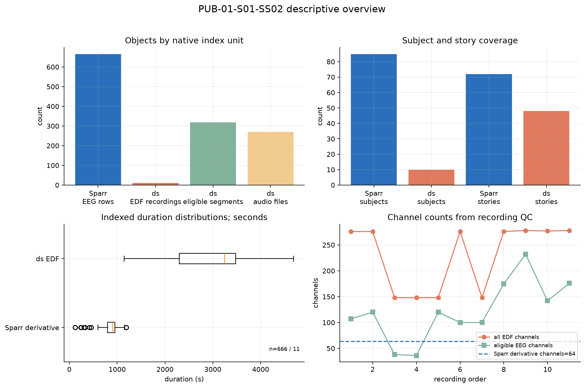
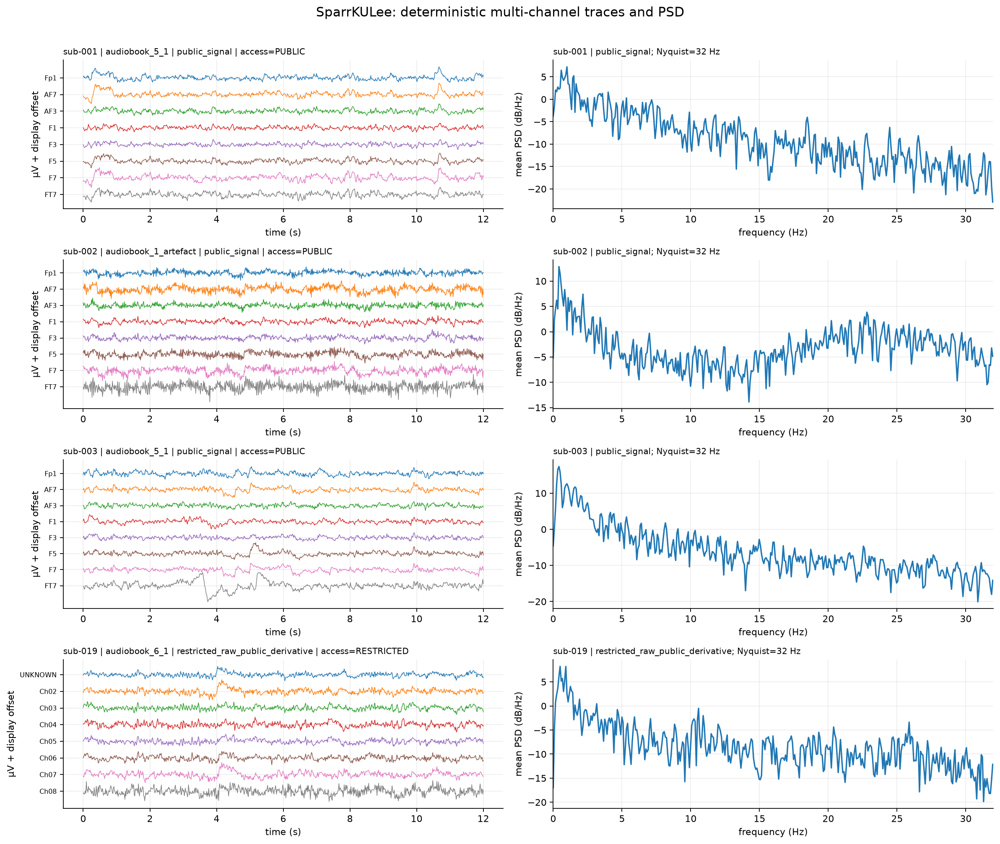
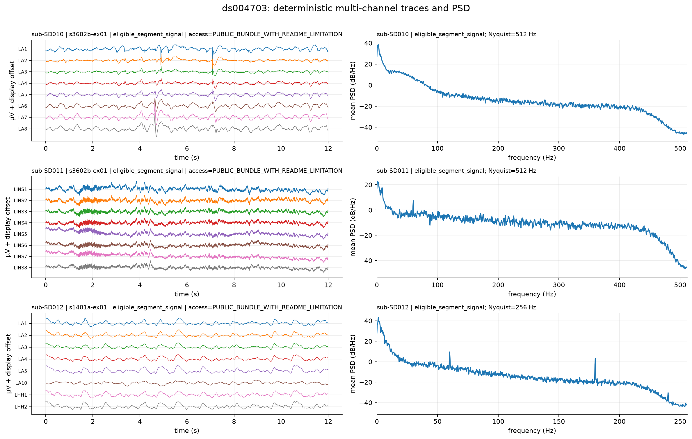
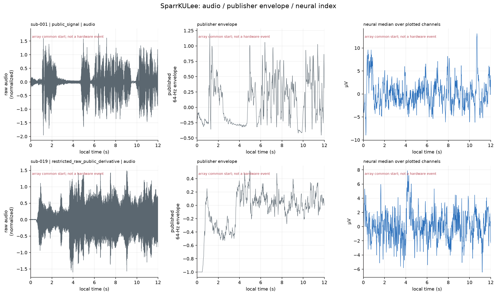
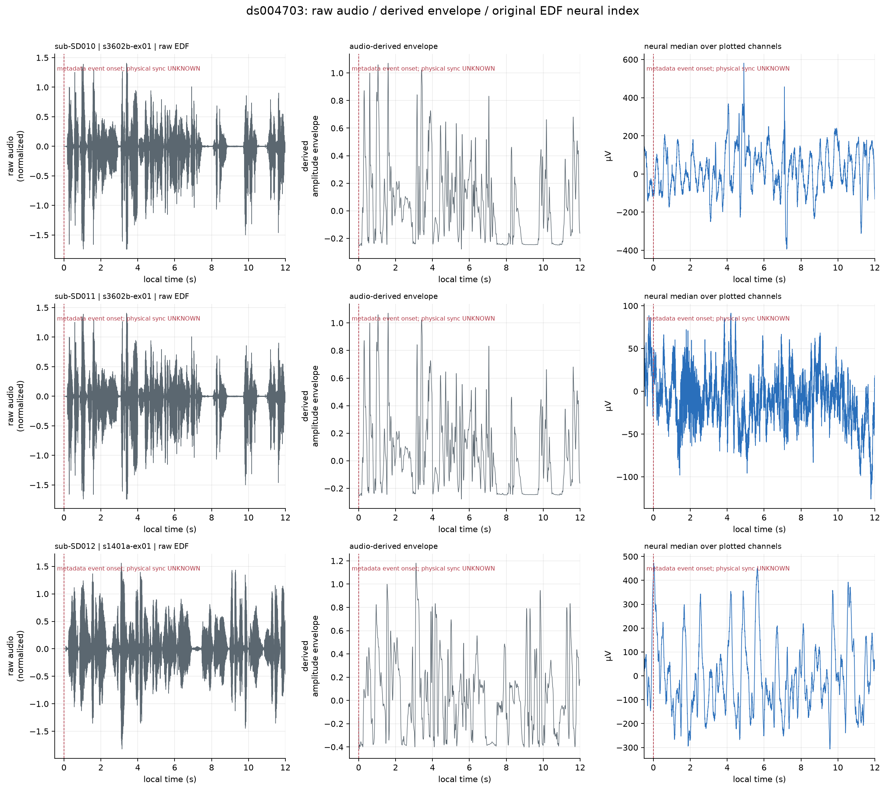
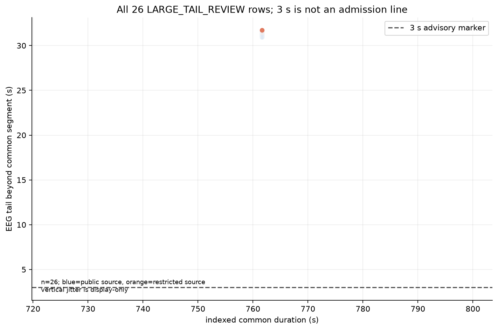
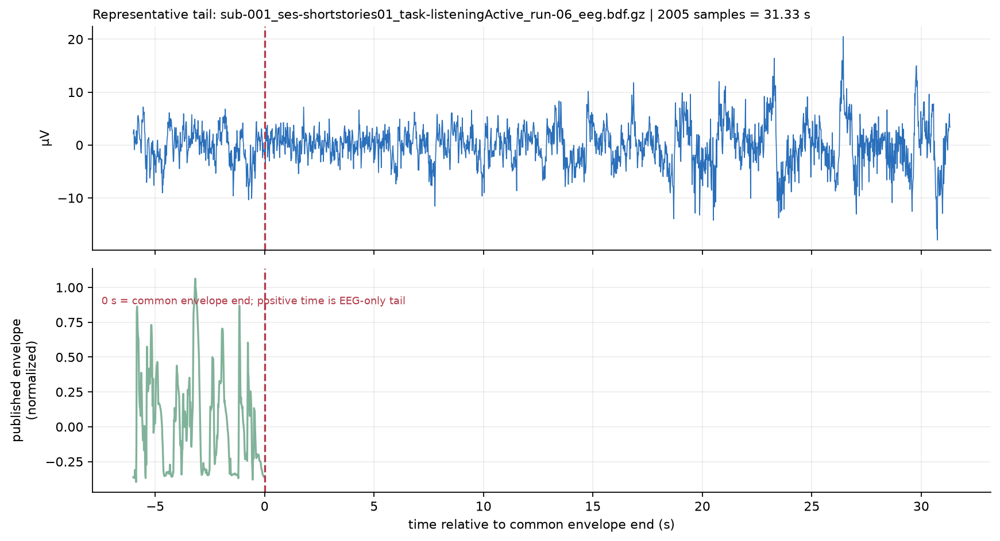

# PUB-01-S01-SS02：先探索数据的描述性报告

## 结论先行

本批已在 server2203 对既有索引和确定性小样本完成实际读取、时域图、PSD、音频/包络/事件时间轴和尾差图。图形足以开始描述性分析；正式 benchmark 的 split、物理同步、版本身份和因果/生物解释仍保留为后续 QC/实验设计问题。

- SparrKULee：666 条发布方预处理 EEG derivative 行，85 个被试、85 个 session、72 个 story 标签；索引时长总和 158.46 h，单行 119.41–1191.42 s，发布方采样率 64 Hz、PSD Nyquist 32 Hz。样本被试：sub-001, sub-002, sub-003, sub-019；本批 raw access 计数 {'PUBLIC': 3, 'RESTRICTED': 1}。
- ds004703：11 条原 EDF recording、319 个 eligible segment、270 个索引 WAV，10 个被试、48 个 eligible story 标签；EDF 时长总和 8.83 h，单 recording 1146.50–4687.50 s，原生采样率为 512 Hz, 1024 Hz。样本被试：sub-SD010, sub-SD011, sub-SD012。
- Sparr 尾差：全部 26 条 LARGE_TAIL_REVIEW 均绘制；尾差 31.33–31.33 s，中位数 31.33 s。图中 3 s 只是旧提示的可视化参照，不是本轮描述性分析的准入线。

## 1. 规模、时长、通道和 story 覆盖

实际内容：柱状图区分 Sparr derivative 行、ds EDF recording、ds eligible segment 和 WAV 文件；时长直方图以秒为单位；通道图使用 recording_qc 的原索引字段，并把 Sparr 64 个发布方 derivative 通道单独标出。

观察：两个数据集的对象数不是同一计数单位，不能直接当作一个样本量比较。Sparr 的 64 Hz derivative 行适合短窗表征；ds 的原 EDF recording、segment 和音频分别对应不同层级。

可开展的分析：先按 recording、subject、story 做描述性时频和事件窗口汇总，再根据目标定义 segment-level 或 subject-level 汇总。不要把 666 行 derivative、11 条 EDF 和 319 个 segment 混成一个 n。

后续 QC：故事版本、物理同步、通道选择/参考和 split 需在正式 benchmark 前冻结。

## 2. SparrKULee 多通道时域和 PSD

实际内容：发布方 64 Hz 预处理 EEG，每行最多 8 个通道；PSD 显示到 32 Hz，未超过 Nyquist；含 normal public pair 和 raw restricted、public derivative 示例。

观察：可看到 derivative 通道振幅和低采样率可解析的频谱；受限 raw 示例仍可读公开 derivative，但不能由图推断受限 raw 的物理单位、同步或刺激波形。

可开展的分析：可继续做公开 derivative 的时域统计、低频 PSD 和包络相关描述；正式模型训练仍需冻结 subject/story 分组。

后续 QC：发布方 NPY 单位依据既有 provenance 合同标为 µV；正式分析保留 derivative 版本、通道映射和 physical sync UNKNOWN。

## 3. ds004703 原 EDF 多通道时域和 PSD

实际内容：原 EDF 事件附近小窗和 eligible 通道。只有在 EDF original unit 为 µV 且 MNE 返回 SI V 时才转换成 µV；PSD 每个 panel 的横轴上限是该样本 fs/2。

观察：native rate 差异直接影响 Nyquist；event/segment 是 metadata 时间参考，尚未证明与音频物理同步。

可开展的分析：可开展 recording-level、segment-level 的功率、通道稳定性和故事覆盖描述。

后续 QC：正式跨 recording 频带比较前冻结滤波、参考、通道排除、单位和采样率处理。

## 4. 音频、包络、神经索引和事件时间轴

Sparr 图使用公开 raw stimulus audio（story 可索引时）、公开 publisher envelope 和公开 EEG derivative。时间零点是 array common start，不是 hardware event。受限示例不请求 restricted raw。

ds 图使用公开 WAV，并在服务器即时计算 Hilbert + 20 Hz low-pass amplitude envelope；虚线 0 s 是 clean segment 的 metadata event onset，physical_sync=UNKNOWN。

观察：两数据集都能形成可读的音频、包络、神经时间轴，但参考时间 provenance 不同。图形相关性只能作为描述性线索，不能升级为硬件同步或生物机制证明。

可开展的分析：可先计算局部包络-神经相关、事件前后功率变化和故事/被试描述性差异，并分数据集报告。

后续 QC：核实音频/包络版本关系、事件定义、offset 残差和物理 loopback；这些问题影响正式解释，但不阻挡本轮探索。

## 5. 26 条尾差的总体关系和代表尾端

第一张图包含全部 26 条 LARGE_TAIL_REVIEW；横轴为索引 common duration，纵轴为 EEG-only tail duration。第二张取 source_recording 字典序第一行，显示 common envelope end 后的 EEG-only tail。3 s 虚线只是 advisory 参照。

观察：尾差是连续的长度关系，不应压缩成“超过 3 s 就坏、未超过就好”的二元标签。

可开展的分析：可把 tail duration 作为 alignment diagnostic、敏感性分层或后续裁剪策略的候选变量。

后续 QC：正式任务需明确 common overlap、tail 保留/裁剪及其与事件定义、split 的关系。

## 本轮范围和限制

- 只读取既有 full index 加确定性小样本；不重读全库，不下载，不请求受限载荷，不训练。
- 本批没有小样本读取失败。
- 旧四个准入产物保留为历史 formal-admission 记录；本报告不把它们改写成探索阻碍。
- 本轮 acceptance 依据是真实图形、单位/Nyquist 检查和逐图解释；未知项标注为未知。

## 运行材料

- [sample_manifest.csv](sample_manifest.csv)
- [SAMPLE_PARAMETERS_COMMANDS.md](SAMPLE_PARAMETERS_COMMANDS.md)
- [plot_exploration.py](plot_exploration.py)
