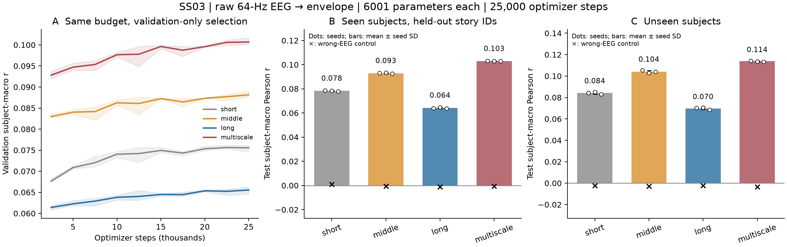
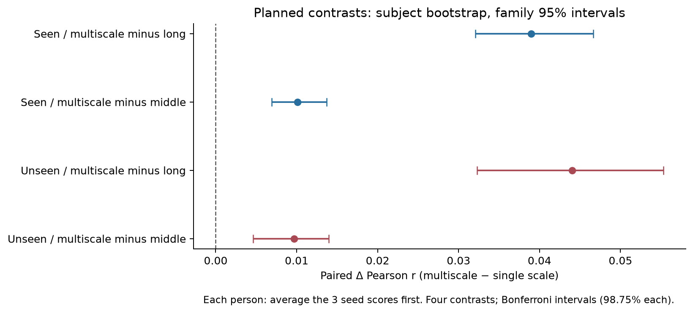

# SS03：多时间尺度EEG直接包络解码的真实比较

2026-10-19，`PUB-01-S03_SS03`。**预设多尺度假设在本次小型原型、公开可用fold4及固定预算内得到支持；没有达到强基线/SOTA结论，也没有证明神经生理时标机制。** 四组×三seed实际训练、验证选择和一次测试已完成；Technical PASS / Acceptance PASS_WITH_LIMITATION / Parent consistency PASS。

## 实际结果

下表是各seed先得到subject-macro60s Pearson r，再取三seed均值±seed SD；不是把三seed当成更多被试。seen为69名训练中见过的人在指定留出story ID上的结果；heldout为13名未见人，但其全部音频故事不一定未见。两组独立报告。

| 结构 | Seen r，三seed均值±SD | Heldout r，三seed均值±SD | 2:1加权r |
|---|---:|---:|---:|
| short：1/1/1 dilation | 0.07840 ± 0.00037 | 0.08416 ± 0.00116 | 0.08032 |
| middle：4/4/4 | 0.09297 ± 0.00042 | 0.10413 ± 0.00120 | 0.09669 |
| long：16/16/16 | 0.06411 ± 0.00048 | 0.06979 ± 0.00108 | 0.06600 |
| **multiscale：1/4/16** | **0.10305 ± 0.00025** | **0.11380 ± 0.00051** | **0.10663** |

四组均6001参数、每3s窗1124352 nominal conv MACC；只改时间卷积dilation，全部直接从原始64Hz EEG训练，**没有插入SS02 Transformer EEG encoder**。数据、窗口、train-only normalization、batch顺序、初始权重抽样和预算按同seed配对；每次25000优化步、每2500步用完整49人validation选checkpoint，无early-stop。全部12训练结束后才开放test，每个selected checkpoint仅测试一次。详见[输入契约](DATA_CONTRACT.md)、[冻结矩阵](EXPERIMENT_MATRIX.md)和[运行命令](COMMANDS.md)。

## 图1：预算、选择与两组重建

**A，验证曲线。** 曲线为三seed均值，阴影为seed最小至最大，并非置信区间。multiscale在固定验证检查点中保持最高，middle其次，short再次，long最低。各组都有学习而非随机未训练输出；部分曲线在预算末端仍小幅上升，因此只说明共同25000步预算下的效果，不能称全部最优收敛。检查点均由validation单独选择，没有用test选轮数。

**B，seen。** 多尺度r=.1031，高于middle .0930及long .0641；三seed差异小，排序稳定。错误EEG在同record内循环错配后均接近0（多尺度−.00056），说明当前读出依赖局部EEG—目标对齐，而非只输出录音的粗略均值。低层声音包络的有限相关不能等同完整语音重建。

**C，heldout。** 多尺度r=.1138，middle .1041，long .0698；wrong EEG多尺度为−.00331。三seedSD小于对应多尺度与middle差值。heldout绝对r略高于seen不能解释为“新被试更好泛化”：两组故事与支持区间不同，heldout也不保证同时是新故事。柱误差条仅seed SD，点为三个实际seed；被试不确定性由下面配对区间单独表达。

CPU/GPU实际batch64 smoke推理约：CPU short/middle/long/multiscale为1.83/2.98/2.78/2.46ms（精确值以smoke.json为准）；GPU约.276/.269/.270/.269ms。这是单次固定环境warmup后20次平均的工程测量，不是完整应用延迟。CUDA记录的约18.3MB是smoke进程累计峰值，非隔离的各模型峰值；正式训练每GPU约14.1GB主要来自预加载公共输入。参数/名义算量匹配不保证任意硬件耗时相同。

## 图2：关键配对检验

对每人先平均三个seed，再计算同一人的多尺度−对照差值。按person bootstrap10000次，图示四个预定contrast的Bonferroni family95%区间（单个98.75%）。没有将seed×person当作独立样本，也未根据test临时选择比较。

| 预定比较 | 平均Δr | family95%区间 | Δr>0的人数 |
|---|---:|---:|---:|
| Seen：multiscale−long | +0.03894 | +0.03207 至 +0.04663 | 69/69 |
| Seen：multiscale−middle | +0.01009 | +0.00692 至 +0.01368 | 58/69 |
| Heldout：multiscale−long | +0.04401 | +0.03226 至 +0.05531 | 13/13 |
| Heldout：multiscale−middle | +0.00966 | +0.00463 至 +0.01395 | 12/13 |

四个区间均在0以上，满足事先固定的两组支持规则。相对最大感受野相同的long仍有优势，因此结果不能仅归因于“multiscale看到了更长时间”。但更有信息的幅度是对**最佳匹配单尺度middle约+.01r**的增益；对long约+.04r的差值部分来自long本身表现较差，不能用这个更大数字夸大方法价值。

## 可以支持什么，不能支持什么

事实是：在同一小型网络、同数据/参数/名义计算/优化步数下，同时保留近、中、远计算支持的结构，优于只用一个dilation。long的9tap跨129个sample、采样较稀疏；相比之下middle保留较密集的局部点，多尺度还混合不同密度。这提示局部与较远信息的互补可能有用，但**采样密度/频率响应、稀疏栅格效应和优化偏置**也可能解释效果。没有额外消融将这些机制分离，不能从这次比较证明生理层级、神经潜伏期或一般性的“多尺度最优”。

原型加权r=.1066，在数值上仍低于SS02 contrastive Transformer encoder+Conv32参考r=.1593（seen .1688/heldout .1403）。虽然沿用同fold与目标区间，训练目标、参数规模、预训练和预算不同；这只是绝对水平的上下文，**不是公平的算力匹配胜负，也不是已经改进强基线**。旧10人TRF r≈.1819更不是同cohort对照，不能直接排名。没有运行可选同fold线性参考、jitter/调制诊断或任何retrieval/GPT/新架构。

常数/训练均值control在test前拟合；恒定预测的Pearson因零方差未定义，报告null而非伪造0。错误EEG不是“audio-only”模型，不能覆盖全部先验捷径。网络推理signature仅EEG；相同EEG重复输出相同、EEG时间扰动改变输出、无pretrained encoder，12个canary均通过。

## 复核、限制与停止

独立post-execution pass核对12次相同步数/验证间隔/检查点、冻结source/config身份、一次test、完整人群和segment→person→group/weighted汇总，最大汇总误差近0。另从原始EEG重新读取并CPU重建每run两个组各首个60s段，共24段，最大r差7.41e-6；不是仅重读同一个缓存分数。全部测试完整段无效排除0。5项结构测试与四组真实CPU/GPU反向传播也通过。详见[审阅](REVIEW.md)及[机器证据](review.json)。

本轮没有工程失败重启、没有选择性保留seed；正负结果均完整保留。主要限制：一个可用公开fold、13名heldout人、共享故事导致的非独立性、三seed不足以覆盖全部训练随机性、固定有限预算、低容量单层时间原型、未知物理同步。source-family隔离、原论文完整cohort或生理时间精度均未新增证明。

SS03 **COMPLETED / PASS_WITH_LIMITATION**，S03/PUB-01仍ACTIVE。代码/轻量结果在PR#3分支，SS02保持冻结；所有raw/cache/包络数组/权重留2203。当前到此停止，不自动启动SS04/S04或生成ART-AUDREP-v1。PR保持Draft，不自行合并main。
