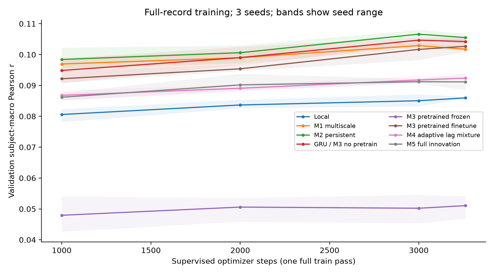
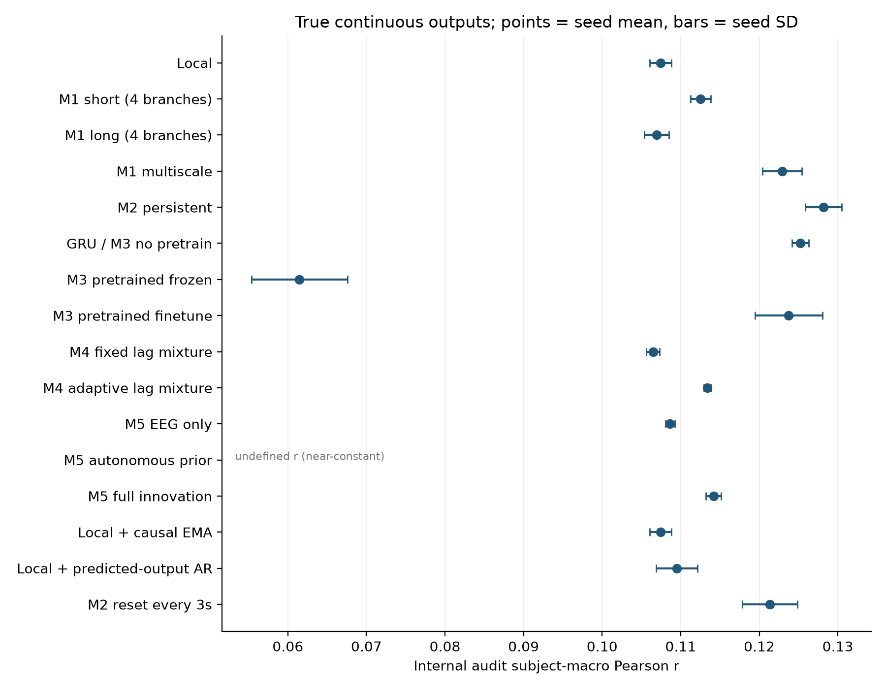
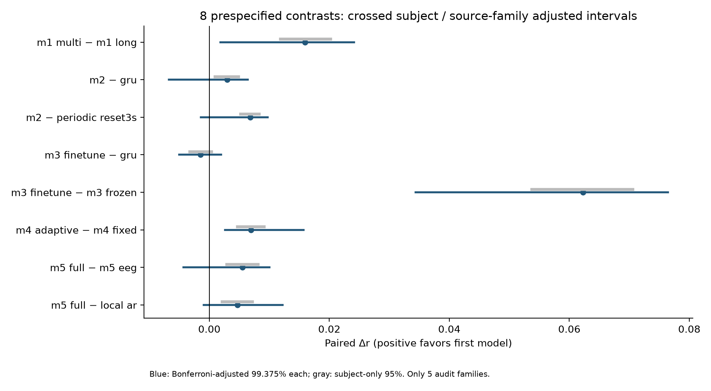
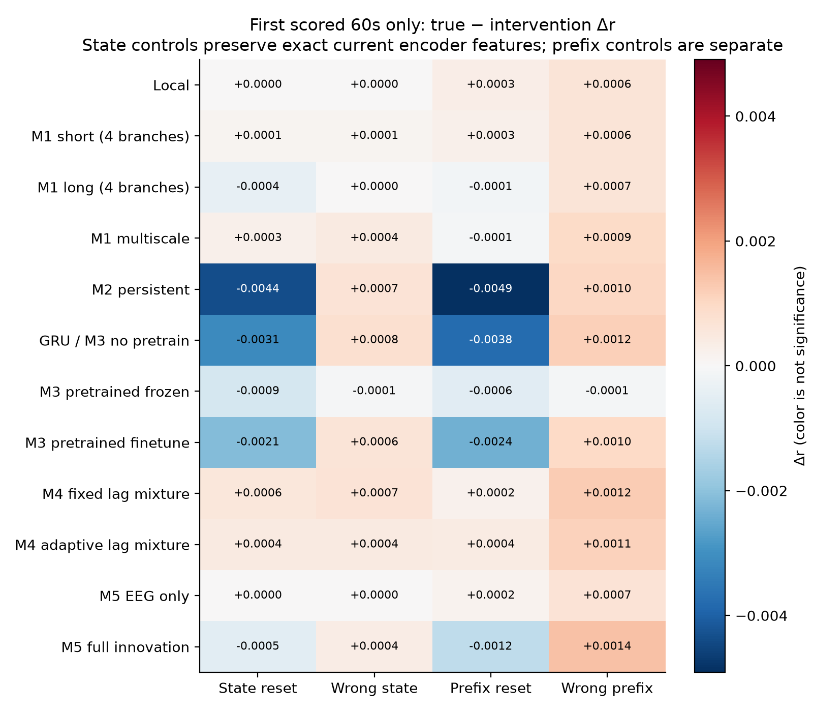

# SS06：五种连续信息框架的真实 EEG 比较

2026-10-23，`PUB-01-S03_SS06 / eeg_run01`。**39次监督训练、3次自监督预训练及一次冻结内部审计已实际完成。M2的r点估计最高，但未稳健超过普通GRU；M1多尺度优于容量/最长span匹配的长尺度控制，M4自适应优于均匀固定lag混合。M3预训练相对从头GRU的额外收益、M5额外收益及内容特异历史收益均未建立。** M3微调明显优于仅冻结预训练表示，但这不能替代“预训练比从头更好”的证据。

Technical PASS / Acceptance PASS_WITH_LIMITATION / Parent consistency PASS。八项预设比较中三项分组校正区间为正；这不是五种机制均被证明，也不是SOTA或生物学机制结论。

## 范围、数据与实际预算

只用既有合法公开SparrKULee的64Hz EEG/包络输入资产。SS05旧train353条/23个source families经固定seed20261023按元数据一次分为train249条/13family/70人、validation63条/5family/45人、audit41条/5family/36人。所有来源曾用于SS03/SS05训练及项目开发，因此严格标为 **prospective INTERNAL / EXPLORATORY audit**，不能称从未接触的外部独立确认。人与训练可重叠；family/story/record及信号路径跨phase不交叉。旧已看validation/test不参与本轮调参。

EEG64channel与scalar目标的mean/std在新249train、14,064,857共同时间sample上重拟合，旧统计不改。固定lag8sample，`EEG[s+8]→envelope[s]`，表示EEG相对目标晚125ms；不是按audit寻峰或生理潜伏期证明。每record首60s热身，之后完整60s块评分，统一排除不完整尾段；train/val/audit分别3262/980/538块。详细来源、坐标和边界见[SPLIT_PROVENANCE.md](SPLIT_PROVENANCE.md)。

13候选分别训练，不把五框架叠加。所有监督run共用完整record/block顺序、batch1、一轮3262步、每步完整60s一次`1−r+.1MSE`，跨块detach保留状态，换record清状态。每seed监督目标12,526,080sample；seed1024/2026/31415，不挑seed。每1000步及最终3262步完整validation，仅val选最高r的最早点；全39run都跑满，无early stop。自主prior以MSE选择且单列。

M3各seed另预训练3511个完整60s段、13,482,240 EEG sample，覆盖全部新train完整时间段；future latent只作训练目标，teacher EMA在更新之后进行。辅助目标目前逐段fresh-state，不宣称跨段流式teacher学习。frozen/finetune使用同seed同正式预训练checkpoint，GRU等同M3 no_pretrain。额外预训练量不伪装成同算力。

## 图1：完整记录的一轮学习轨迹

曲线为完整validation的三seed均值，阴影是seed最小至最大，**不是分组置信区间**。图只显示冻结的1000/2000/3000/3262四个验证点。M2、GRU、M1multi和M3finetune在此预算中形成较高的validation重建水平；M3frozen明显较低，说明当前自监督表示加线性head不足以替代有监督适配。多数曲线仍有上升或小幅波动，单pass结果不能证明已达每种架构的最佳能力，也不授权按audit追加训练。

全训练完成、来源/预算/最优val/完整同序覆盖及正式预训练身份核验通过后，才选择输出平滑/AR系数并原子开放audit。每selected模型的一次审计包含全部预定条件；后置CPU重建是技术复核，没有重新选择模型或修改协议。

## 图2：真实连续输出的实际指标

主指标是全部538个60s块的Pearson→record等权→person等权；下表为三seed均值±seed SD。MSE用新train标准化单位，不等同R²或解释方差。图上的seed SD也不能代替subject/family不确定性。

| 候选 | r：均值±seed SD | 标准化MSE |
|---|---:|---:|
| local | .107432 ± .001360 | .826737 |
| M1 short，4活跃分支 | .112541 ± .001308 | .823128 |
| M1 long，4活跃分支 | .106941 ± .001580 | .823177 |
| M1 multi | .122913 ± .002530 | .819946 |
| M2 persistent | .128164 ± .002330 | .815732 |
| GRU / M3 no_pretrain | .125221 ± .001073 | .817900 |
| M3 pretrained frozen | .061478 ± .006119 | .845885 |
| M3 pretrained finetune | .123747 ± .004304 | .820571 |
| M4 fixed uniform | .106476 ± .000843 | .823820 |
| M4 adaptive | .113400 ± .000481 | .823192 |
| M5 EEG-only | .108641 ± .000600 | .823816 |
| M5 autonomous prior | 未定义：主输出近常数 | .836447 |
| M5 full | .114178 ± .000962 | .824122 |

同协议控制：local+EMA为.107432±.001360，三seed验证均选择alpha=0，即保留local；local+预测输出AR为.109510±.002654，gain依seed为.2/.05/.5。AR仅在新train真过去目标上拟合，然后测试时用过去**预测输出**递推，绝不输入真实历史声音。该控制拟合14,054,897个train配对样本，另计其目标访问/成本；不能称排除了所有声音先验。M2同权重每3s清后encoder状态为.121350±.003504，是推理干预，不是另训的reset架构。

M2最高点估计不构成稳健排名。也不能拿本表与SS02/SS03/SS05的不同split、目标函数、lookahead、归一化和预算直接排名；更不能把包络r写成语音内容识别、可听语音恢复或患者泛化。

## 图3：八项预设配对比较

每record先平均三seed，再按person汇总。蓝线是subject/source-family交叉重采样、Bonferroni校正的99.375%单项区间（八项名义family95%），灰线仅subject95%；各10000次。只有5个audit families，尾部区间是有限样本近似，不能夸大覆盖保证。

| 预设Δr | 点估计 | 校正后交叉分组区间 | 本轮判定 |
|---|---:|---:|---|
| M1multi−long | +.015972 | [.001820, .024137] | 支持当前匹配控制下的多尺度收益 |
| M2−GRU | +.002944 | [−.006744, .006380] | 未建立稳健优势 |
| M2−每3s reset | +.006815 | [−.001412, .009753] | 校正后仍不确定 |
| M3finetune−GRU | −.001474 | [−.005002, .001951] | 未建立额外预训练收益 |
| M3finetune−frozen | +.062269 | [.034388, .076437] | 支持当前表示仍需有监督适配 |
| M4adaptive−uniform fixed | +.006925 | [.002608, .015733] | 支持相对均匀固定混合的收益 |
| M5full−EEG-only | +.005537 | [−.004320, .010025] | 额外校正结构收益未建立 |
| M5full−local AR | +.004668 | [−.000939, .012189] | 未稳健超过该输出历史控制 |

M1三组各有4个活跃独立分支、相同参数量/名义MACC；long与multi最长span均约16.27s。该比较支持当前混合尺度设计相对稀疏长尺度控制，不识别脑生理时间层级。M2与GRU的subject-only区间虽为正，加入family和多重性后跨0，不能挑较窄区间称显著。

M3微调明显超过冻结，但相对从头GRU点估计略低且区间跨0，因此没有证据把这轮额外SSL包装为收益。M4**没有优化最优静态非均匀lag权重/逐lag控制**，其结果不能证明真实时延在变化或动态门控不可替代。M5与EEG-only的活动容量不同，且相对AR也不稳健，不能确认innovation/潜状态预测的独立必要贡献。

## 图4：固定当前EEG的历史干预

这里只评分每record第一个60s块，共41段；真实/错配前缀均60s。前两列保留真实local encoder缓存，当前局部特征逐点相同；后两列替换整个前缀，含最初16sample局部边界影响。颜色是Δr，**不是显著性**，该端点不能与全538块主结果混合。

| 框架 | 真实−错配state Δr | 交叉分组95%（探索性、未校正） |
|---|---:|---:|
| M1multi | +.000440 | [−.000750, .001777] |
| M2 | +.000664 | [−.000985, .002430] |
| M3finetune | +.000614 | [−.000929, .002284] |
| M4adaptive | +.000433 | [−.000185, .001055] |
| M5full | +.000381 | [−.000671, .000921] |

五主框架的内容匹配优势均未建立。改变state能影响输出不等于正确历史有预测价值，更不是语义相关事件的检索证据。local和M5 EEG-only的state-only差值精确为0，是局部缓存隔离canary；全前缀差异说明短暂边界也会影响分数。

单次首块state reset与全记录每3s reset有不同频率和端点：M2首块真实−单次reset为−.004356，而全记录真实−周期reset为+.006815。二者分别解释，不能合成单一“reset有益/有害”的机制结论。M4真实−单次reset的未校正95%略高于0，M5相应差值略为负；这些是多项次要探索，不能替代预设主要比较或证明内容特异性。自主prior重置后的短暂非恒定输出可产生负r，主持续输出近常数r仍未定义，未伪填0。

## 实际成本与限制

逐run活动参数、非零梯度、样本和时间见training_summary；完整网络审计见[CODE_AUDIT.md](CODE_AUDIT.md)。M1三组实际图参与参数均40481；M2为29345；GRU/M3finetune为25153；M3frozen只训练33个head参数。M4fixed/adaptive为18817/18950；M5EEG/prior/full为18817/1089/23009。不是跨框架等容量。

训练及验证循环wall：local12.7–13.0s，M1multi18.2–19.3s，M2 33.4–33.6s，GRU24.3–24.5s，M3finetune24.3–24.8s并额外SSL25.7–26.1s；M4adaptive27.6–29.2s，M5full1798–1827s。M5使用CPU，其余主模型用L40；时间不含独立解释器启动和数据准备，不能混设备排名。额外同设备实测：60s目标段推理M5full约90.6ms CPU/296.9ms GPU，GRU约65.7ms CPU/.94ms GPU，说明当前细粒度递推实现有明显开销，不能宣称效率优势。CPU峰值RSS只作中途观测，未完整测所有模型峰值。

本轮限一个监督pass、三seed、5families、与训练人重叠、既往开发暴露、已有发布方预处理、固定lag和低层包络；physical_sync仍UNKNOWN。M3预测最大horizon为1s且SSL段间fresh-state，M2未做fast-only/slow-only，M4缺最优静态非均匀控制，M5 latent未校准/不可识别。未显著不等于严格等价或所有连续记忆/自监督无用；也不能据此确认SS05阴性由某个单独设计缺陷造成。

## 复核、交付与停止

后置逐段→record→person重算误差0；从原始输入资产的64Hz EEG/包络数组重新归一化，用原型CPU路径核验222个有效相关（max差1.55e−7）、234个MSE（max差6.52e−8）及12个未定义相关。这里“原始输入”指已有64Hz资产，**不是从BDF重做滤波/物理同步**。同一agent另作post-execution pass；协调会话实际独立读source/split/cache/runtime证据，不称第三方科学签署。详情[REVIEW.md](REVIEW.md)、review.json及package_review.json。

协调会话还在2203独立从逐record、逐seed证据重聚合全部SUMMARY，最大差5.55e−17，并核对8个预设比较、历史差值及开封门；这补充了结果一致性证据，不替代执行者原始输入CPU复算或外部科学确认。

回传时E盘实际满导致部分轻量副本写入失败，科学结果和服务器证据未损。仅把本轮未提交partial evidence移至C盘备份，未永久删除资料。Git保留全部CSV/四图及精简逐run JSON；只省去重复访问序列，记录完整文件路径/身份和覆盖核验。完整轻量包在2203本轮delivery01及本地`C:/Users/fanyu/.codex/backups/Auditory_Simulation_ss06_20261023/delivery01`，不含信号/权重。数据、cache、统计npz、checkpoint始终仅在2203。

执行/冻结源码提交ea5a1b5，最终报告提交见PR#6。SS06 **COMPLETED / PASS_WITH_LIMITATION**；S03/PUB仍ACTIVE，PR#6保持Draft、不自行合并，SS04/S04/父S05/GPT/artifact不启动。旧SS02/SS03/SS05和主目录CNN/TRF/stash保持原状。当前到此停止。
