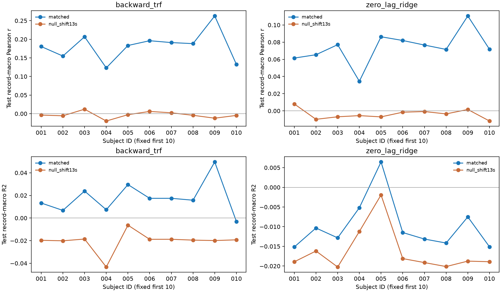
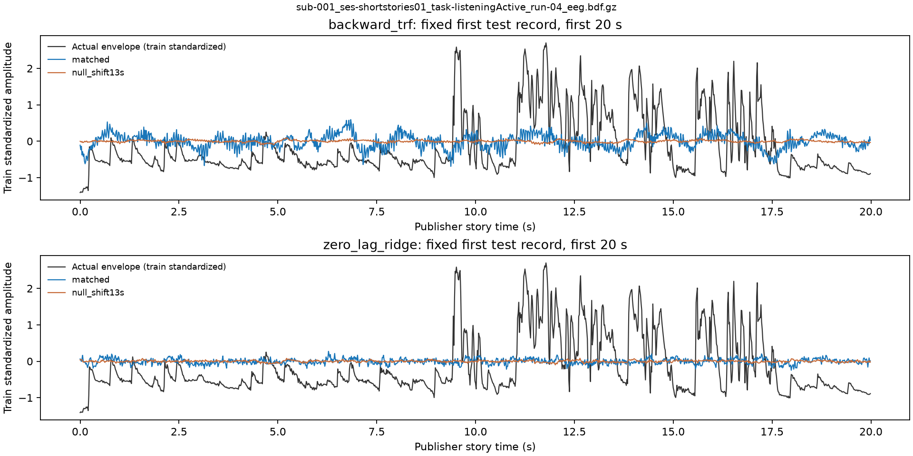

# PUB-01-S03_SS01 初步 EEG→声音包络解码结果

本轮于北京时间 **2026-10-11** 在 server2203 完成。冻结前10名被试（sub-001–010）、93条记录全部可读并参与；每个模型/条件测试27条记录、1,448,987个64Hz时间点。本轮验收 **PASS_WITH_LIMITATION**；完整 S03 和 PUB-01 保持 ACTIVE。

**实际可运行的解码基线已建立：backward ridge/TRF。** 在被试内跨声音来源 family 的 test 上，逐记录宏平均后再被试宏平均 r=0.18191、R²=0.01781；非循环13秒错配 r=−0.00329。可以报告弱但高于本轮错配对照的包络预测关系，尚不能写成可靠声音或语义重建。零时滞 ridge 可运行，但宏平均 R² 为负。

## 1. 本轮 test 与 null

主指标先对每个被试的 test record 求 r/R²，再对其 record 等权平均，最后对10名被试等权平均。没有把约145万个自相关时间点当成独立样本做显著性检验。

| 模型 | 条件 | 被试 | test r（record macro） | test R²（record macro） | test r（subject pooled） | test R²（subject pooled） |
|---|---|---:|---:|---:|---:|---:|
| backward ridge/TRF | matched | 10 | 0.18191 | 0.01781 | 0.18288 | 0.02225 |
| backward ridge/TRF | +13 s null | 10 | −0.00329 | −0.02043 | −0.00293 | −0.01619 |
| zero-lag ridge | matched | 10 | 0.07368 | −0.00985 | 0.07400 | −0.00571 |
| zero-lag ridge | +13 s null | 10 | −0.00373 | −0.01635 | −0.00380 | −0.01220 |

TRF 的 matched−null 平均 Δr=0.18520；zero-lag 为0.07741。10/10被试的TRF r高于其null；9/10的TRF record-macro R²>0，sub-010为−0.00307。zero-lag只有1/10被试的R²>0（sub-005）。R²的分母为各test record自身目标均值下的SST；训练均值预测器另行记录在CSV，不把负R²隐藏。TRF相对zero-lag的相关提升为本轮同目标、同范围的描述性比较，未作统计推断。

图中保留所有预定被试。TRF的r约0.12–0.26，null接近0；R²明显较小，相关性没有转化成高精度幅度重建。zero-lag的多数负R²提示仅有弱相关不足以支持可靠预测。

## 2. 一个预先固定的实际例子

例子为首被试首条test记录（按source_recording排序）：`sub-001_ses-shortstories01_task-listeningActive_run-04_eeg.bdf.gz`，`audiobook_1`，共同区间59,958 samples。显示最初20秒有效支持区间；没有按test性能选择例子。横轴是发布方story-origin时间，纵轴为train-only均值/标准差下的包络幅度。

黑线是真实包络，蓝线为matched预测，橙线为错配预测。TRF输出有变化，但真实包络尖峰的幅度与细节大量丢失；zero-lag更接近均值预测。图支持“初步包络追踪基线”，不支持可听语音恢复或理解语义。静态图是本轮获准回传的示例汇总；未回传原始数组或交互载荷。

## 3. 模型、输入输出和冻结参数

输入为SparrKULee RDR V3.1发布方preprocessed EEG，64通道×64Hz；输出为发布方envelope在feature轴的均值，一维64Hz。使用已有cleaning index和S02 common-overlap，未增加滤波、ICA、重参考或PCA。EEG/包络物理单位及历史生成revision未在本轮重新确定，计算在train标准化坐标下执行。

TRF设计明确定义为：`envelope[t] <- EEG[t + lag]`。lag samples为`[0,4,8,12,16,20,24,28,32]`，即0–500ms、步长62.5ms，共576设计列；zero-lag只有64列。因为使用当前声音之后最多500ms的EEG，它是**离线backward decoder**。这是自写NumPy/SciPy线性实现，没有声称调用MNE运行。脑信号→刺激的时滞回归属于stimulus reconstruction/decoding，方向定义可参照[MNE官方示例](https://mne.tools/stable/auto_examples/decoding/receptive_field_mtrf.html)。

训练目标为`mean((y_z-X_z w)^2) + alpha*||w||²`，训练均值处理截距。每个设计列和目标的mean/std只由train计算。alpha候选固定为`[0.0001,0.001,0.01,0.1,1,10]`；每个被试/模型/条件只按validation逐record平均r选择，平局取最小alpha。不在train+val上重拟合，不用test选lag、模型或alpha。TRF matched所选alpha：0.01（3名）、0.1（4名）、1（3名）；逐项见[alpha_selection.csv](alpha_selection.csv)。

原始方法来源为[Crosse等（2016）mTRF论文](https://www.frontiersin.org/journals/human-neuroscience/articles/10.3389/fnhum.2016.00604/full)：backward model把多通道神经响应映射回刺激特征。其decoder权重不能直接当作神经生理机制或脑区贡献解释。[作者stimulus_reconstruction示例](https://github.com/mickcrosse/mTRF-Toolbox/blob/master/examples/stimulus_reconstruction.m)实际设置`Dir=-1`，先在训练数据交叉验证正则化，再对保留test评估。这里仅引用方法方向，不声称逐参数复现该示例：本轮自写Python实现、独立train/val/test、不同lag网格及正则化尺度均以冻结配置为准，未引入MATLAB依赖。

null独立训练、独立validation选alpha：`envelope[t] <- EEG[t+832+lag]`。832 samples=13s，不循环、不跨record补数据。为了可比，四种条件均用`t∈[0,n−864)`，并共用target以及全部matched/null TRF输入的有限掩码；因此各record、各被试的train/val/test计数相同。不是将matched模型输出挪动后打分，也不是多次置换检验。

## 4. 范围与划分

按S02 READY被试ID字典序冻结sub-001–010，使用其93条全部READY记录，失败不替换。S02上游共有83名/659条；本轮未扩大到全83名。精确复制既有被试内canonical source-family train/val/test，来源family不跨split；不重新分配split，不跨record造lag。train/val/test记录数和实际支持计数可查[split_manifest.csv](split_manifest.csv)、[sample_manifest.csv](sample_manifest.csv)。

每个被试独立拟合，因此结果是**被试内跨source-family评估**。同一故事可能被多名被试听过，10名不是独立的故事总体抽样；不能宣称新被试泛化、全库效果或held-out-content统计显著性。来源别名规则和发布方坐标的限制沿用S02；相关峰不证明硬件同步。

## 5. 已验证与待比较模型

| 模型/组件 | 实际角色、输入→输出 | 本轮状态 | 可以怎样使用/解释 |
|---|---|---|---|
| backward ridge/TRF | 64通道滞后EEG→一维声音包络 | **已验证可运行**：10名test/null，r=0.1819、R²=0.0178 | 公开EEG离线包络解码基线；初步预测关系，幅度保真度有限 |
| zero-lag ridge | 同时刻64通道EEG→包络 | **已验证可运行**：r=0.0737、R²=−0.0098 | 低复杂度方向明确的解码对照；不能称可靠重建 |
| facebook/wav2vec2-base（冻结） | 声音→audio feature；旧S02为feature→EEG encoding | **9月已运行的声音编码器；本轮未用作EEG decoder** | 可作声音表示/目标候选；本轮没有EEG→wav2vec2 embedding结果 |
| HuBERT | 声音→audio feature候选 | **HOLD**：既有identity/cache未核定 | 未下载、未训练；不能登记为已验证decoder |
| 轻量temporal CNN EEG decoder | 预定形式可为EEG时序→包络 | **待比较；未训练** | 需冻结容量、时域支持及训练验证配置后与TRF公平比较；当前无性能结论 |

本轮不为增加模型数量自动训练深度模型。新被试泛化、neural encoder/retrieval和颅内迁移均未完成；不进入S04。

## 6. 验证、失败与许可

合成验证通过lag方向、非循环边界、共享有限掩码、streaming ridge对独立解析solve、streaming指标对直接公式、已知延迟响应的重建检查。首被试另存完整rerun，指标最大差为0。另一个脚本直接读取首条test记录和仅留在2203的参数，以独立np.corrcoef/SSE公式复核四条件r/R²，最大误差2.22×10⁻¹⁶。表格算术、精确S02 split、alpha validation-only选择和同时间支持均复核通过，详见[REVIEW.md](REVIEW.md)、[technical_review.json](technical_review.json)。独立review pass由同一agent另行进行；不是外部人工批准。

本轮93/93可读、0条读取跳过、0个被试失败、0条r未定义。S02历史中不满足split的被试不属于预定前10名范围，并非本轮悄悄排除。预定四条件及阴性结果全部保留。

仅使用已经获准的SparrKULee公共数据进行非商业内部研究；历史许可门及来源见[上游来源说明](SOURCES.md)。载荷、参数NPZ、EEG/envelope、缓存全部留2203。本地只回传CSV/JSON、静态图和报告。未下载新数据/模型，未读取患者/STN資料，未提交/推送或覆盖旧产物。

## 7. 复现和产物

运行代码：[pub_01_s03_envelope_decode.py](../../../../scripts/pub_01_s03_envelope_decode.py)；复核代码：[pub_01_s03_review_decode.py](../../../../scripts/pub_01_s03_review_decode.py)。[config_snapshot.json](config_snapshot.json)是拟合前配置副本，详细命令见[COMMANDS.md](COMMANDS.md)。主运行58.11s，Python 3.11.15 / NumPy 2.4.6 / SciPy 1.17.0 / Matplotlib 3.11.1，BLAS/OMP线程各8，无GPU训练。

- [逐被试指标](metrics_per_subject.csv)、[逐记录指标](metrics_per_record.csv)、[配对差值](paired_deltas.csv)
- [冻结范围](scope_frozen.json)、[运行汇总](run_summary.json)、[合成技术检查](technical_self_test.json)
- [首被试独立重跑指标](reproduce_sub001/metrics_per_subject.csv)、[周报段落](WEEKLY_REPORT.md)

SS01完成不等于S03完成，也没有生成ART-AUDREP-v1。完成本轮交付后停止，下一轮应由既有S03职责和用户安排决定。
