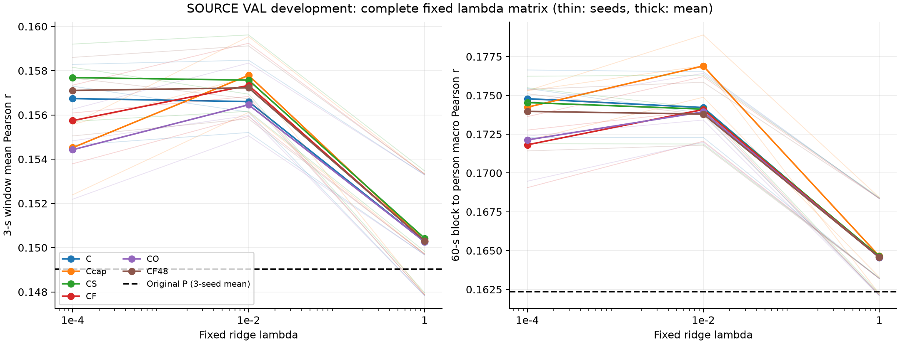
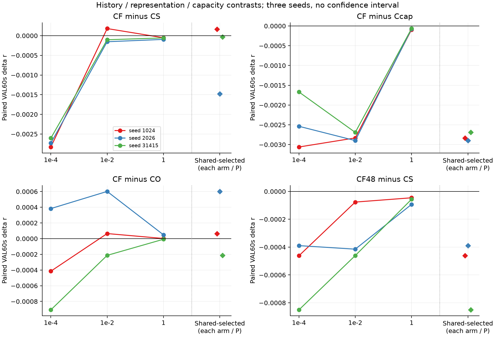
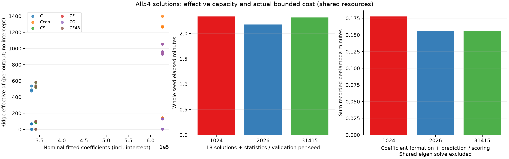

# D4：当前表征条件下，完整历史是否优于六段摘要？

**54/54个预定岭解完成，没有获得稳定的历史额外收益。** 按预设三seed共享λ，完整近历史CF的VAL60秒/person平均r=.174090，低于六段摘要CS的.174538，也低于同维当前输入对照Ccap的.176897。CF对Ccap三个seed均负；同维PCA48历史相对六段摘要在全部三个固定λ、三个seed上均负。本轮不支持凭D2的低能量保留率直接扩容历史模块。

有价值的正向结果来自**当前窗口读出**：当前C为.174789，增加固定平方特征的Ccap为.176897，均在三个seed高于原P的.162362。这是反复使用的source VAL上的开发结果；读出容量、MSE目标、正则与拟合方式均改变，不是独立泛化、新方法或连续历史机制证据。SS07及持续goal保持ACTIVE。

执行范围：原SparrKULee fold TRAIN426record/252454窗、VAL49record/30500窗；seed1024/2026/31415。全部数据、原P head前向、统计/PCA/回归/评分在server2203完成；无encoder forward、NN反向传播、新下载、旧test或DTU推理。正式PID521141正常完成；源码/协议与启动见[PLAN](PLAN.md)、[PROTOCOL](PROTOCOL.json)、[LAUNCH](LAUNCH.json)、[COMPLETED](COMPLETED.json)。

## 1. 检验的具体含义

保留原完整两阶段P各seed的encoder缓存与训练完成head，当前输入为8×192 latent和P当前192点输出。近历史CF对应当前起点之前3–0秒的独立3秒窗口，远历史CO对应之前6–3秒；二者都不与当前原始输入重叠。所有lookup严格留在同record/phase，不输入真实历史声音或包络。当前仍保留原P完整3秒离线权限，不能称实时因果模型。

所有臂共同只在局部i≥4拟合：每seed250750训练窗，VAL30304窗可加残差。首4窗一律返回共同P，保持原30500窗和原49人/752有效60秒块评分。首4窗与后续窗在Hann融合中有重叠，不能把它们简化成“前6秒完全独立的一段评分”；没有移动评分坐标或删掉不利块。全record Hann重建→固定60秒块→person宏均值，3秒窗平均Pearson另报。

每seed先在TRAIN每个Hann覆盖物理点上拟合一个全局正仿射P*=aP+b，只为MSE残差的输出单位：三个a=.0020456085/.0019605449/.0020852796，b=.3141162448/.3188783574/.3044801009；每seed24275628个物理点。正仿射与归一化Hann融合可交换，原P与P*逐块Pearson最大差≤2.78e−16；原P VAL60秒均值与warm incumbent逐seed差均0。**校准本身没有Pearson增益**，也没有逐窗、逐record或VAL校准。

各块仅以共同TRAIN拟合窗中心化/标准化，再除以sqrt(块维度)。固定λ={1e−4,.01,1}；float64求最小化均方残差+λ系数平方和的192输出联合岭解，截距不惩罚。CF48的PCA和白化仅拟合TRAIN、固定48维。六臂×三seed×三λ共54解，不选seed、不延长预算、不追加λ。

| 条件 | 当前C之外的输入 | 输入维度 | 拟合系数含截距 | 共享选择λ |
|---|---|---:|---:|---:|
| P | 无残差拟合 | — | 0 | — |
| C | C含current latent1536及P*192 | 1728 | 331968 | .0001 |
| Ccap | current标准化latent逐坐标平方 | 3264 | 626880 | .01 |
| CS | 近历史8×6段均值 | 1776 | 341184 | .0001 |
| CF | 近历史完整8×192 | 3264 | 626880 | .01 |
| CO | 远历史完整8×192 | 3264 | 626880 | .01 |
| CF48 | 近历史TRAIN PCA48 | 1776 | 341184 | .0001 |

每臂一个λ，由三seed VAL60秒均值共同选定，包含零残差原P候选；严格高于P才选择拟合。本轮六臂均选择拟合而非回退P。P*与current latent相关，输入维度/参数数不是独立信息维数。C也不是原257参数Conv32 head：它添加位置不共享的dense residual和192维截距；不能把C−P单独解释为目标函数改善。

## 2. 图一：完整固定λ矩阵与绝对分数

左为3秒窗平均r，右为60秒→person宏平均r；彩色粗线为三seed均值，细线为各seed，黑虚线为原P均值。六臂、三个固定λ全部呈现；线段仅连接离散网格，不是连续寻优结果。没有CI或显著性检验。

| 条件 | 选定3秒r均值 | 选定60秒r均值 | 相对P的三个seed差值（1024/2026/31415） |
|---|---:|---:|---|
| P | .149022 | .162362 | 0 / 0 / 0 |
| C | .156741 | .174789 | +.011132 / +.015860 / +.010288 |
| Ccap | .157791 | .176897 | +.013732 / +.017327 / +.012546 |
| CS | .157688 | .174538 | +.010734 / +.015907 / +.009885 |
| CF | .157337 | .174090 | +.010900 / +.014428 / +.009855 |
| CO | .156461 | .173939 | +.010836 / +.013827 / +.010068 |
| CF48 | .157108 | .173970 | +.010272 / +.015517 / +.009034 |

全部臂相对原P提高，不能因此声称历史有用：不含历史的C/Ccap已达到或超过历史臂。按各自共享λ，CF−C三个seed均负，均值−.000699；CS−C只有1/3为正，均值−.000251；Ccap−C三seed均正，均值+.002108，但此比较也含两个臂的λ选择差异。

λ=1时六臂接近原P，是强收缩下的表现，不是各方法等价。3秒与60秒也有不同排名：例如选定CS的3秒均值高于C，60秒却低于C。因此没有用较好看的3秒指标替代预定60秒endpoint。

## 3. 图二：历史表征、容量和时间距离的配对比较

四面板依次CF−CS、CF−Ccap、CF−CO、CF48−CS；横轴前三点是两个臂使用相同固定λ的比较，最右菱形是各臂使用自身跨seed共享λ后的比较，虚竖线区分两者。三色分别为seed1024/2026/31415，横线0为无差异，无区间。相同λ也不保证有效自由度相同，但避免只比较各臂最优λ而隐藏正则敏感性。

| 预设比较 | 各臂共享选择后的均差 | 三seed差值 | 正值seed |
|---|---:|---|---:|
| CF−CS | −.000447 | +.000166 / −.001478 / −.000030 | 1/3 |
| CF−Ccap | −.002807 | −.002831 / −.002898 / −.002691 | 0/3 |
| CF−CO | +.000151 | +.000065 / +.000601 / −.000213 | 2/3 |
| CF48−CS | −.000567 | −.000462 / −.000389 / −.000851 | 0/3 |

CF−CS在相同λ=.0001/.01/1的均差分别−.002721/−.000026/−.000068，对应0/1/0个正seed，未出现稳定full优势。CF−Ccap在全部三λ×三seed均负，且两者同3264维、626880系数。CF48−CS也在全部三λ×三seed均负，两者同1776维、341184系数。这些事实不支持“换更密历史即可解锁额外收益”。

CF−CO的差很小、依赖λ及seed：同λ=.0001均差−.000313，.01为+.000151，1为+.000014。CO不是预定零信息负对照；近远历史都可能携带持久被试/record状态，近优于远才另涉及时间局部性。本轮两者选定结果均低于C，不能据CF−CO的2/3正值声称历史存在，亦不能将3–6秒对照称为长程记忆证据。

PCA48按无监督方差选择，不是监督最优压缩；CF48的阴性不排除其他48维表征。full与summary不仅容量不同，表征/归一化/有效自由度也不同，本轮没有证明六bin保留了全部有用信息。D2的窗内去DC能量与本轮跨窗口TRAIN标准化/PCA属于不同量，不能直接相互替代。

## 4. 图三：实际有效容量与完整成本

左图每点对应一个臂/seed/λ的名义系数数与有效自由度；纵轴为每输出tr[G(G+λI)−1]，不含共同截距，不是192输出总参数数。C内P与latent相关，正则改变实际容量：例如选定C的有效df约476–537，Ccap约143–146，CF约129–133，CS约519–581，CF48约524–585。不能用横轴同参数数声称模型函数类或有效容量完全相等。

中图为各seed包含原head前向、TRAIN统计/PCA/Gram、18个解及全部VAL评分的总elapsed：140.046/130.530/138.861秒。右图只为原每λ字段记录的系数形成+预测/评分合计：10.657/9.363/9.328秒，**不包含共享特征分解**，不能把右图当整轮成本或纯求解速度。独立CPU子阶段未分别计时，明确缺失，不重跑补造。

整轮54解wall410.303秒（约6.84分钟）；实际进程peakRSS6775738368B（约6.31GiB），torch allocator peak840704B，执行中driver采样GPU500MiB；两者口径不同。运行后加入的53次sidecar观测末次CPU2634.42秒，是最后采样下界、非完整精确总CPU。BLAS/OMP/MKL环境为8，OS总25线程含GPU/helper/空闲线程池，不当成25个同时活跃BLAS线程。主运行派生输出1882540241B（约1.75GiB），另有轻量图表/观测结果；原缓存/预训练成本沿用历史而非记成零。

由冻结源码可确定：每seed原head前向TRAIN252454窗+VAL30500窗，TRAIN统计/Gram三个共同250750窗遍历；校准24275628物理点；VAL特征30304窗；原P/P*各一次加18解，共20次完整VAL评分，每次30500窗/752块/49人。三seed合计54解、60次完整VAL评分（1830000窗次/45120块次），不是60份独立验证集。3次TRAIN PCA及3次全局仿射拟合另列；没有NN优化更新。统计/输出表生成约数秒，不混入主run410秒或宣称隔离效率优势。

## 5. 可信度、来源与限制

增广最小二乘对照的岭系数最大差2.22e−15；record内近/远索引与PCA矩变换检查通过。实际54解normal equation最大绝对残差≤1.12e−16；全部原P核对通过、无常量输入坐标，三个PCA均48个正分量。独立代码审阅实际核对17来源，原样见[COORDINATOR_CODE_REVIEW](COORDINATOR_CODE_REVIEW.json)；最终实际结果审阅见本目录REVIEW入口。

原正式source SHA=0182fb055b7d684026ad3a21d13d715e70e7cd952831b42c436bcd6a4f54a410；protocol SHA=22bdfb1c0ed22f40930d906c0748a07b016fb956068a40c4a75bc6f1077b7a8b。数据target载荷shape/dtype/size/mtime/record长度的补充指纹在运行中加入，不冒充run前冻结。补充文件最初timing文本误写首seed Gram，已保留并在[时点与成本澄清](SUPPLEMENT_TIMING_AND_COST_CLARIFICATION.json)明确：首个观察实际是seed2026统计阶段、18个解已完成。补充后目标文件size/mtime未变化；不宣称覆盖之前全程的独立payload完整性证明。

结论限于原encoder、当前3秒表征、近3秒/远3–6秒历史、这六类加性线性残差和固定正则网格。它不覆盖历史×当前的非线性状态交互，不证明所有历史无用、等价、非劣或信息论独立性。Ccap的逐坐标平方也没有控制所有当前非线性。共享刺激、被试内重复与反复开发VAL限制独立性；三seed配对点差不是统计显著性或新数据泛化证明。

## 6. 下一步研究含义与产物

当前更有依据的方向是先把当前表征读出增益解释清楚，再决定是否需要历史×当前交互；本轮不自动追加任何拟合、距离、λ、seed或NN预算。当前读出增益仍需与适当强控制、独立确认和方法新意区分。D4完成不等于达到研究goal或完成S03/PUB，旧round01/warm/历史阴性不改写。

结构化结果：[全54格](RESULTS.csv)、[共享选择逐seed](report01/SELECTED.csv)、[预设比较全λ](report01/CONTRASTS.csv)、[全部逐人](report01/ALL_PERSON.csv)、[全部逐块](report01/ALL_BLOCK.csv)、[全部逐record的3秒均值](report01/ALL_RECORD_3S.csv)、[数值汇总](report01/NUMERICAL_SUMMARY.json)、[支持性比较/有效df](report01/REPORT_DETAILS.json)。这些是轻量统计；原预测、latent、PCA载荷、Gram和系数继续仅在2203。PR#6保持Draft，不合并，不启动其他节点或患者支线。
