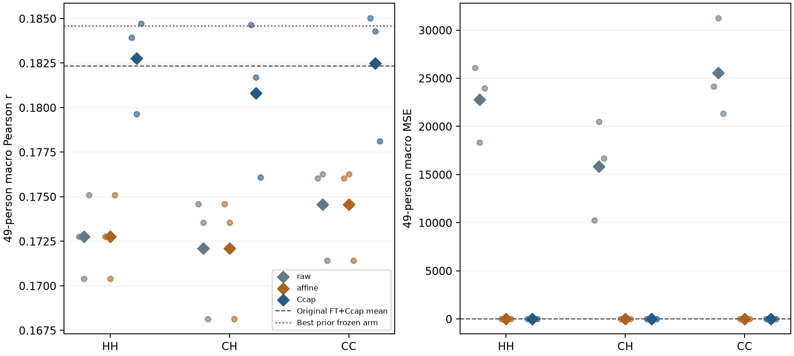
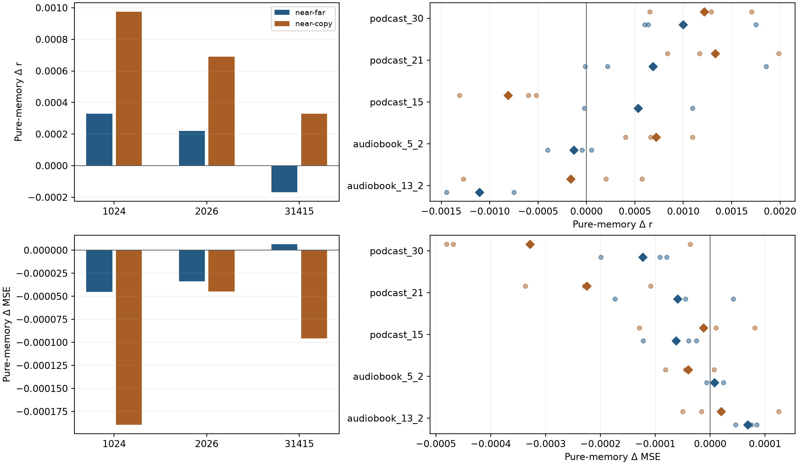
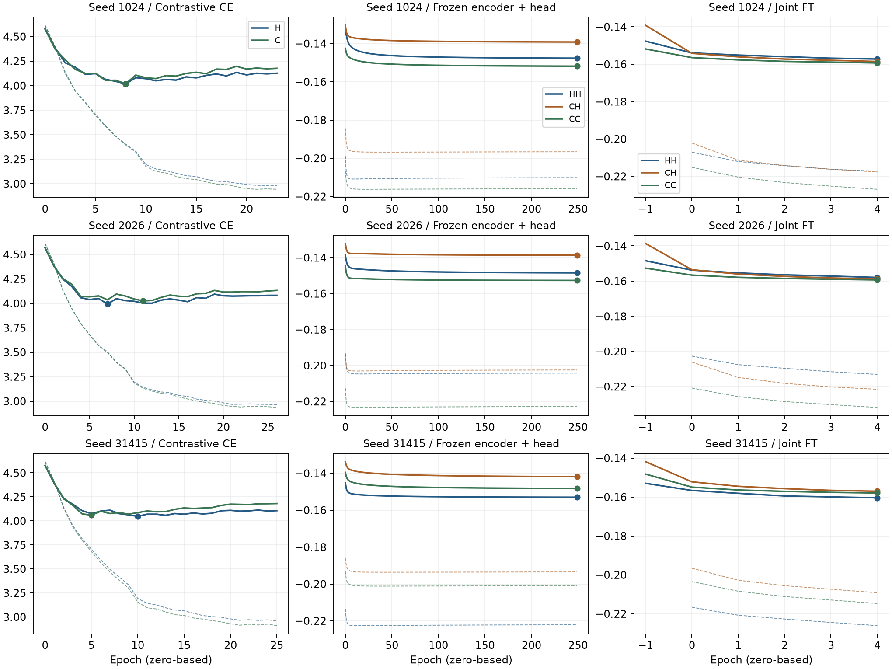

# D26 强对比预训练中的历史联合学习

三种子完整结果中，HH 在 D26 三臂的固定 epoch 4、Ccap 开发评分上最高，49 人等权 Pearson r 为 **0.182768**。它比原 FT+Ccap 锚点高 **0.000428**，三个种子中两个提高，全支持 MSE 平均增加 **0.000197**。HH 仍比既有 D22 B 的 **0.184581** 低 **0.001813**。现有证据支持保留 HH 为一条开发候选，历史预训练收益与 SOTA 尚未确立。[正式终态](FORMAL_COMPLETED.json) · [三种子汇总](report01/RESULT_SUMMARY.json) · [同任务参照范围](SOTA_COMPARISON_SCOPE.md)

## 同一支持上的正式性能

HH 在对比与监督阶段都使用近历史。CH 在对比阶段使用当前副本，监督阶段使用近历史。CC 两阶段都使用当前副本。每个种子只训练一套 H 和一套 C 对比模型，CH 和 CC 从同一选中 C 检查点分叉。三臂沿用同一个结构和原 426 条 TRAIN、49 条 VAL。固定比较使用五轮联合微调后的 epoch 4，以及各臂在 TRAIN 单独拟合的 λ=.01 Ccap。VAL 按原 Hann 正支持在 752 块上评分，先在人内均值再对 49 人等权。完整支持为 2,887,631 个点。[冻结决定](COORDINATOR_DECISION.md) · [逐块得分](report01/BLOCKS.csv) · [逐人得分](report01/PEOPLE.csv)

| 方法 | r · 1024 | r · 2026 | r · 31415 | 三种子平均 r | 全支持 MSE | 对同种子锚点平均 Δr |
| --- | ---: | ---: | ---: | ---: | ---: | ---: |
| 原 FT+Ccap | 0.181889 | 0.181756 | 0.183375 | 0.182340 | 0.242379 | — |
| HH | 0.183921 | 0.179655 | 0.184728 | 0.182768 | 0.242575 | +0.000428 |
| CH | 0.184647 | 0.181708 | 0.176081 | 0.180812 | 0.242893 | −0.001528 |
| CC | 0.185024 | 0.184291 | 0.178115 | 0.182477 | 0.242718 | +0.000137 |

HH 对 CH 的平均 Δr 为 +0.001956，对 CC 为 +0.000291。两种比较都只在 31415 种子为正。CC 对 CH 三个种子均为正，平均 +0.001665。HH 对锚点的逐人正向人数按种子为 31、18、25。HH 的平均领先依赖种子，无法据此把收益归给对比阶段引入历史。[完整配对差](report01/PAIRED.csv) · [1,176 条逐人配对差](report01/PAIRED_PEOPLE.csv)

图 1 左侧展示三臂、三种读出的 r，圆点是各个种子，菱形是三种子均值。正仿射校准保留相关系数，Ccap 提高了三臂的 r。HH 的均值略高于原锚点虚线，低于 D22 B 点线。右侧的原始输出 MSE 远高于校准输出，线性纵轴使约 0.24 的校准值贴近零线，细小差异以表格为准。训练使用逐窗去均值余弦目标，原输出幅度缺少直接约束。原始 MSE 的量级不宜用来比较已校准预测的幅值误差。[三种读出逐种子值](report01/PRIMARY.csv)

| 臂 | raw r | 正仿射 r | Ccap r | raw MSE | 正仿射 MSE | Ccap MSE |
| --- | ---: | ---: | ---: | ---: | ---: | ---: |
| HH | 0.172757 | 0.172757 | 0.182768 | 22,783.76 | 0.245325 | 0.242575 |
| CH | 0.172099 | 0.172099 | 0.180812 | 15,821.01 | 0.244532 | 0.242893 |
| CC | 0.174576 | 0.174576 | 0.182477 | 25,573.68 | 0.244280 | 0.242718 |

## 故事、来源族与历史替换

| 开发 VAL 分层 | 人数 | HH r | CH r | CC r |
| --- | ---: | ---: | ---: | ---: |
| audiobook_13_2 | 6 | 0.163797 | 0.159365 | 0.162791 |
| audiobook_5_2 | 23 | 0.226646 | 0.222614 | 0.225647 |
| podcast_15 | 4 | 0.136851 | 0.139894 | 0.140660 |
| podcast_21 | 7 | 0.114262 | 0.115935 | 0.113999 |
| podcast_30 | 9 | 0.156972 | 0.156928 | 0.157121 |
| TRAIN 已见来源族 | 29 | 0.213643 | 0.209528 | 0.212642 |
| TRAIN 未见来源族 | 20 | 0.137999 | 0.139173 | 0.138736 |

HH 的整体均值领先主要来自已见来源族。未见来源族的 r 排名不同，HH 在五个故事中只有两个领先。49 人均见于 TRAIN，且 VAL 仅有五个故事，来源族分层不能当作未见被试检验。故事、来源族和逐人结果共享记录，以上差异只作描述。各层 MSE 与细分来源族已单列。[分层表](report01/STRATA.csv) · [数据独立性核对](../../seawave_seen_reference/run01/COHORT_INTERPRETATION.md)

图 2 固定 HH 权重和当前输入，把 near 与 far 或当前副本比较，使用同一纯历史支持，共 752 块、2,840,640 点。左侧三种子 near−copy 的 r 均为正，均值 **+0.000665**，MSE 均为负，均值 **−0.000110**。near−far 的 r 有两正一负，均值 **+0.000127**，MSE 平均 **−0.000024**。右侧点是各故事中各个种子的差，菱形是三种子均值。near−copy 的 r 优势在 podcast_21 与 podcast_30 较明显，在 podcast_15 转负。替换使用同一位置编码但同时改变输入分布，观察到的差异只说明该 HH 模型对历史输入有反应。[共同支持及配对值](report01/PAIRED.csv) · [逐故事与逐来源得分](report01/STRATA.csv)

## 实际训练、停止和成本

图 3 按种子分行。实线为 VAL，虚线为 TRAIN，圆点是实际使用点。左列是对比交叉熵，三对 H/C 分别在 24、27、26 轮共同停止，实际使用检查点分别是 8/8、7/11、10/5。中列是冻结编码器后训练监督头的去均值负余弦目标，九个 HEAD 均跑满 250 轮，全部选 epoch 249，末轮 stale 均为 0。曲线视觉上接近平台，预算终点仍有小幅改善，现有轨迹不足以判定充分收敛。右列是从未联合训练的 epoch −1 到固定最终 epoch 4，目标下降不直接等于最终 Ccap 相关的增益。[实际训练轨迹](report01/TRAINING_EPOCH_LEDGER.json) · [阶段账本](report01/STAGE_COSTS.json)

| 阶段 | 完成数 | 实际优化更新 | 所用检查点前缀更新 | 主要计数 |
| --- | ---: | ---: | ---: | --- |
| EEG–XLSR 对比预训练 | 6 | 126,280 | 45,100 | TRAIN 当前 EEG 与音频目标各 16,163,840 窗，历史槽 31,781,084 次 |
| 冻结编码器训练监督头 | 9 | 8,876,250 | 8,876,250 | 缓存后 TRAIN 568,021,500 窗，VAL 68,625,000 窗 |
| 固定五轮联合微调 | 9 | 177,525 | 177,525 | TRAIN 11,360,430 窗、22,375,800 个历史槽 |
| TRAIN-only Ccap | 9 | 0 | 0 | 每次 250,750 个拟合窗，九次共 218,480,652 个拟合物理点 |

CL 的六份 TRAIN 当前窗在各 fit 内合计 756,936 个唯一窗，重复呈现 15,406,904 次，历史槽和按记录时间合并的唯一点另列。监督头阶段先缓存 2,546,586 个当前编码窗和 5,016,222 个历史槽，随后重复使用缓存。最终读出阶段含原 VAL 与 HH 干预，共 2,546,586 个当前窗和 5,376,930 个历史槽。跨拟合的唯一计数是各拟合内去重后相加。CH/CC 共用的预训练成本实际只计一次，逐臂摊销另列。[覆盖、前缀与分账](report01/STAGE_COSTS.json)

正式共 **9,180,055** 次优化更新。30 个 worker 的退出回执齐备，正式失败为零。自首个 worker 启动至最后退出约 12.49 小时，worker 墙钟累加约 22.50 小时，CPU 累加约 21.61 小时。每个 CL 模型有 3,817,609 个参数，监督头训练 257 个参数，联合模型有 3,389,513 个参数。训练以外的工程另计 14 次更新、一次 Ccap 工程求解。独立复算与 CPU 对照成本另列。[进程与成本](report01/STAGE_COSTS.json) · [工程记录](ENGINEERING_NOTES.md) · [独立验收](REVIEW.md)

## 证据边界与后续对照

HH 的小幅开发提升在种子和来源族间不稳定，幅度误差略高于锚点。D22 B、D18 P 与 D23 S 的完整开发均值分别为 0.184581、0.184379、0.183900，均高于 D26 最佳臂。它们的预算与选点规则不同。D28 的同支持共享与个人岭回归分别为 0.097929 与 0.158231，个人拟合与选择自由度单列。D27 Sea-Wave 已按原条件接续训练，正式性能待完整矩阵。当前结果限于反复开发的 49 人、五故事 VAL。独立泛化和同协议强方法对照仍待完成。[对照状态与来源](SOTA_COMPARISON_SCOPE.md) · [D27 准入回执](../../seawave_seen_reference/run01/D26_WAIT_ADMISSION.json)
