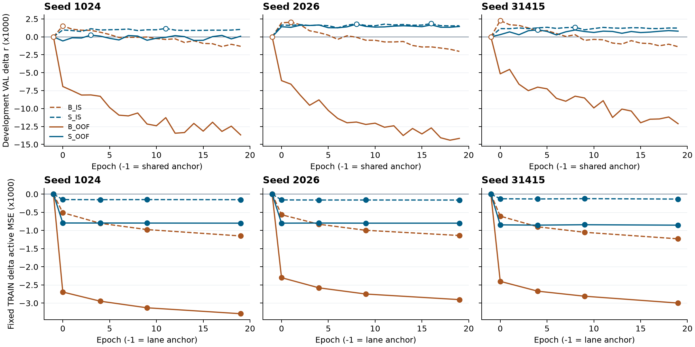
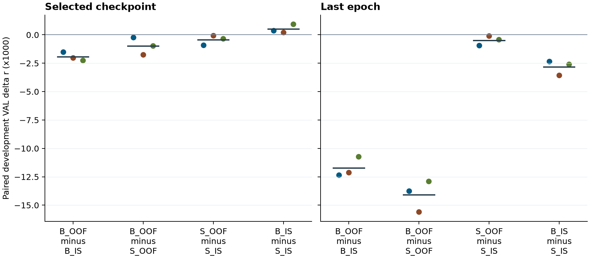

# D24 三折训练来源对照

**折外训练预测未改善历史后处理。** 采用折外输入的历史模型 B_OOF 三个 seed 均回退到共同锚点，60 个已训练轮次全部低于锚点。它在训练集降低了活动区 MSE，开发集相关却从第一轮起下降。无历史模型 S_OOF 的三个选中点和三个末轮均高于锚点，选中相关平均增加 0.000994，活动区 MSE 同时升高。这些结果来自原开发集的 49 条记录。

## 训练来源与对照

[D19/D20/D22/D23 的来源核查](../../stacking_input_audit/run01/REPORT.md)显示，原后处理训练集的 426 条预测都来自已经在这 426 条记录拟合过的上游。D24 按真实音频源族划分全部 426 条 TRAIN。三个整族折的记录数为 144、138、144，分别含 84,439、84,290、83,725 个原坐标窗。三个 seed 各训练三套上游。每套从头执行原 TransformerCLIP、native head、联合 FT、仿射校准与固定 `λ=0.01` 的 Ccap，重新拟合通道统计，排除自己所属折的全部记录和源族。上游预训练固定 9、12、11 轮，head 250 轮，FT 5 轮，采用末轮。原 VAL 不参与上游拟合或选点。

每条 TRAIN 记录在折外 lane 用排除该族的模型预测，在记录内 lane 用包含该记录的另一折模型预测。两种 lane 均覆盖全部 426 条记录，用同样的物理坐标和目标。B 用当前标量与前 96 个历史箱，S 两支都只输入当前标量。每种 lane 只用自己的 TRAIN 预测拟合标量统计，同 lane 的 B 与 S 共享统计。四臂在原 VAL49 上都用同一份全 TRAIN FT+Ccap 锚点和当前输入，按原 752 块、49 人等权 Pearson (r) 选点。协议、折表及真实运行链路可回查。[协调决定](COORDINATOR_DECISION.md) · [分折和预算](FOLD_AND_BUDGET_CANDIDATE_V2.json) · [上游总账](UPSTREAM_RECOVERY_TERMINAL.json) · [下游准入](DOWNSTREAM_FORMAL_GATE_V06.json)

## 四臂结果

均值在三个 seed 上等权。锚点相关为 **0.182339940**，活动区 MSE 为 **0.250262038**。轮次从 0 起算，−1 为共同锚点。

| 模型 | 选中轮次 1024 / 2026 / 31415 | 选中 r | 相对锚点 Δr | 末轮 r | 选中活动 MSE |
|---|---:|---:|---:|---:|---:|
| B_IS | 0 / 1 / 0 | 0.184280304 | +0.001940365 | 0.180762087 | 0.250876506 |
| S_IS | 11 / 16 / 8 | 0.183785103 | +0.001445163 | 0.183605130 | 0.250825657 |
| B_OOF | −1 / −1 / −1 | 0.182339940 | 0 | 0.169019619 | 0.250262038 |
| S_OOF | 3 / 8 / 4 | 0.183334318 | +0.000994379 | 0.183109722 | 0.251210271 |

B_OOF 最佳已训练轮次的三 seed 等权均值为 **0.176480208**，相对锚点低 **0.005859731**。B_OOF 与 S_OOF 的选中差以锚点作为 B_OOF 一端。S_OOF 在 49/60 个训练轮次高于锚点，S_IS 在 60/60 个轮次高于锚点，B_IS 在 22/60 个轮次高于锚点。

三列分别是三个 seed。上排为开发集 (r) 相对共同锚点的差，空心标记是选中轮次。下排为固定 TRAIN 活动区 MSE 相对各自 lane 锚点的差，只在 −1、0、4、9、19 轮计算。B_OOF 的 TRAIN 活动区 MSE 从 0.198091797 降到 0.195027308，开发集 (r) 在首轮平均已低 0.006065，末轮低 0.013320。B_IS 的开发峰值出现在最初两轮，三 seed 的末轮均低于锚点。两条 S 的固定 TRAIN MSE 首轮下降后接近平台，开发曲线也比 B 稳定。记录内和折外 TRAIN 锚点误差不同，图中的 TRAIN 差值各自以本 lane 的锚点为基准。

## 预设配对

| 比较 | 选中 Δr | 选中方向 | 末轮 Δr | 末轮方向 |
|---|---:|---|---:|---|
| B_OOF − B_IS | −0.001940365 | 3 负 | −0.011742468 | 3 负 |
| B_OOF − S_OOF | −0.000994379 | 3 负 | −0.014090103 | 3 负 |
| S_OOF − S_IS | −0.000450784 | 3 负 | −0.000495408 | 3 负 |
| B_IS − S_IS | +0.000495201 | 3 正 | −0.002843043 | 3 负 |

左右分别是各臂选中轮次和共同末轮。每列三个点为 seed 1024、2026、31415，按蓝、橙、绿顺序排列，短横线是三 seed 均值。相对记录内 B，折外 B 的选中差三个 seed 都为负，末轮负差更大。B_IS 相对 S_IS 的三个早期峰值优势到末轮全部反向。S_OOF 相对 S_IS 的差也均为负，绝对值较小。以每名被试的三 seed 平均选中差计，B_OOF−B_IS 有 17 人正、32 人负，B_OOF−S_OOF 有 22 人正、27 人负，S_OOF−S_IS 有 19 人正、30 人负，B_IS−S_IS 有 29 人正、20 人负。这些方向计数用于展示异质性。

在 B_IS 的固定选中模型上，将 lag1 历史改为 lag288 后，平均 (r) 下降 0.005490，三个 seed 同向。替换同时改变输入分布。B_OOF 的选中点全部回退锚点，选中结果中没有已训练的 B_OOF 历史响应可比。B 和 S 的参数数分别为 9,441 和 3,361，输入维数、函数类及初始化缩放也不同。记录内与折外 lane 的模型训练组成及预测分布仍有差别。结论限于这套端到端折外输入、固定物理目标和原开发评分。原 VAL 与 TRAIN 无记录重合，49 名 VAL 被试均在 TRAIN 出现，29 条 VAL 记录共享训练音频源族。D22/D23 作为历史参照，使用不同的训练预测来源。

## 执行与核验成本

| 阶段 | 实际完成 | 主要成本 |
|---|---|---|
| 九套上游 | 对比学习、head、FT 与各自校准/Ccap | 52,480 / 5,918,250 / 118,365 次更新。工作进程 wall 合计 19,780.4 秒，CPU 合计 21,372.8 秒 |
| 十二套下游 | 每臂三 seed，各 20 pass | 347,280 次更新，5,688,842,400 个物理反传点。工作进程 wall 合计 1,365.6 秒，CPU 合计 4,154.0 秒 |
| 独立上游 V03 | 三折全部通道统计、九套模型固定点重放 | 4,068 NN 窗、78 批、5,760 个物理点。最大差 2.22×10⁻¹⁶。0 拟合、0 标签 |
| 独立下游保存审核 | 完整三 seed 的训练统计、12 臂权重、优化器与评分汇总 | 0 新 NN、0 拟合、0 标签数组 |
| 独立下游功能重放 | 全部 12 臂，42 个 checkpoint 与历史条件组合 | 两种实现各 10,752 个物理点、各 3,756 个既有读出窗。预测最大差 9.69×10⁻⁸。0 新 raw EEG 编码或拟合 |

初版在 CPU 上重放，与正式 GPU 的 cuDNN TF32 数值路径不同。后续 GPU 的 TF32 开关对照确认了差异来源。失败与定位另计 1,076 个 NN 窗。改用正式设置后，V02 在前三组通过，计 1,377 窗、26 批、1,920 固定物理点。V02 的 CUDA 上下文触发原队列的 GPU 0 空卡检查。恢复进程只续行尚未启动的三项，已完成模型保持原样。最终 V03 在九组结束后单独重放，容差沿用原值。旧失败、停止与恢复终态均保留。训练和科研结果的汇总均使用最终通过的完整矩阵。下游共记录 7,540,443,831 个当前分支点、7,566,245,022 个上下文输出点、261 个 checkpoint 文件和 18 个训练统计 JSON。上游三个工程版本 `engineer`、`engineer_v02` 和 `engineer_v03` 各做 1 次 CL、1 次 head、1 次 FT 优化，合计 9 次工程更新。各版本墙钟为 3.134、5.299、8.871 秒。三份工程收据未记录总 CPU，V03 的 CL、head、FT 分项 CPU 为 1.161、0.232、0.101 秒。下游工程覆盖两个 B/S 张量及反传桥，0 更新，总 CPU 与墙钟缺记录。身份预检耗 CPU 0.024 秒、墙钟 0.050 秒。另一次独立下游统计预检耗 CPU 0.151 秒、0 NN、0 拟合。最终下游功能重放耗 CPU 3.628 秒、墙钟 2.144 秒。原 VAL 加载器打开了 6 条标签数组，重放阶段未据此生成新评分。

[上游工程 V01](UPSTREAM_ENGINEERING_V01.json) · [V02](UPSTREAM_ENGINEERING_V02.json) · [V03](UPSTREAM_ENGINEERING_V03.json) · [下游工程](DOWNSTREAM_ENGINEERING_V01.json) · [身份预检](DOWNSTREAM_INPUT_PREFLIGHT_V03.json)

[12 行逐 seed 结果](SEED_RESULTS.csv) · [252 行轨迹](EPOCH_METRICS.csv) · [588 行逐人结果](PEOPLE.csv) · [12 行配对](PAIRED_CONTRASTS.csv) · [结构化汇总与成本](SUMMARY.json) · [独立审核](REVIEW.md) · [独立科学复算](COORDINATOR_SCIENTIFIC_REVIEW.json)
