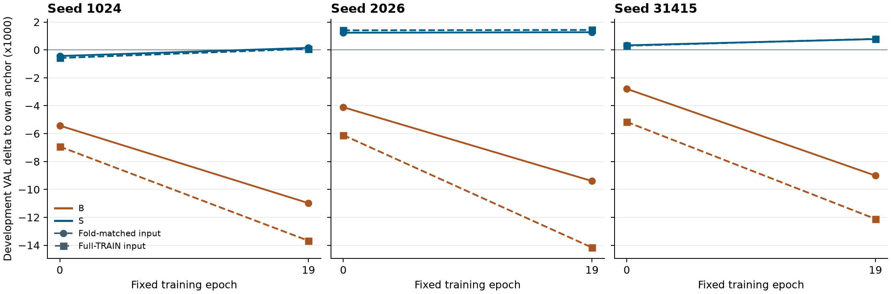

# D25 固定权重的预测来源诊断

**匹配预测来源减轻了历史模型 B 的相对退化，但六个固定对照仍全部低于折锚点、无历史模型 S 和原全 TRAIN 强锚点。** 三个 seed、两个固定轮次的 B 相对锚点的损失均缩小，平均缓解 0.002741。折锚点本身比全 TRAIN 锚点低 0.010093，因此 B 在折预测上的绝对相关也更低。

## 固定设计

复用 D24 的 B_OOF、S_OOF 各三个 seed 的实际 epoch 0 和 19 权重。每个折模型使用 D24 的冻结通道统计、FT、仿射校准、Ccap 和正 Hann 物理支持。B 和 S 复用原 OOF TRAIN 标量统计。B 的 96 个四点箱保持在当前预测索引之前，S 的两支都只使用当前标量，EEG 编码仍为原 3 秒离线输入权限。

原 VAL 有 49 条记录和 752 个评分块。两个共享源族的 29 条记录都用排除其音频源族的 fold 1。未见源族的 20 条记录分别在三折评分，再在同一记录的同一块上平均三份分数。每个记录和每名被试在最终汇总中只占原有权重。全 TRAIN 输入对照来自 D24 已保存的同 seed、同 epoch 结果。[冻结计划](PLAN.md) · [来源路由](ROUTING_AND_BUDGET_CANDIDATE.json) · [D24 汇总](../../crossfit_output/run01/SUMMARY.json)

## 固定轮次结果

三 seed 等权。折锚点 (r=0.172246557)，全 TRAIN 锚点 (r=0.182339940)。

| 模型与轮次 | 折预测绝对 r | 相对折锚点 Δr | 全 TRAIN 预测绝对 r | 相对全 TRAIN 锚点 Δr | 两个 Δr 的差 |
|---|---:|---:|---:|---:|---:|
| B · 0 | 0.168138904 | −0.004107654 | 0.176274821 | −0.006065119 | +0.001957465 |
| B · 19 | 0.162450143 | −0.009796415 | 0.169019619 | −0.013320321 | +0.003523906 |
| S · 0 | 0.172623670 | +0.000377113 | 0.182717795 | +0.000377855 | −0.000000743 |
| S · 19 | 0.172980295 | +0.000733738 | 0.183109722 | +0.000769783 | −0.000036045 |

每列是一个 seed，纵轴是相对各自来源锚点的开发集 (r) 差，放大 1,000 倍。圆点实线为折预测，方点虚线为全 TRAIN 预测，连线仅连接两个已测轮次。三个 seed 的 B 实线均高于对应虚线，但始终低于零。B 的折预测相对 S 平均差从 epoch 0 的 −0.004485 扩大到 epoch 19 的 −0.010530。S 的两种来源相对差大多接近，epoch 19 的三个折预测均略高于各自折锚点。

折预测上，B 相对锚点的活动区 MSE 分别增加 0.002114 和 0.001757，S 分别增加 0.000421 和 0.000352。B 的残差 RMS 从 0.04695 升至 0.05269，S 从 0.02895 降至 0.02739。epoch 0 折预测的标准化当前输入 RMS 为 0.99743，B 的历史上下文为 0.98946，S 上下文为 0.99743。这些数值描述折预测输入的整体尺度，缺少全 TRAIN 固定轮次同口径尺度，无法量化两来源的全部分布差异。

## 音频源族分层

| 组别 | 记录与被试数 | 折锚点 r | B Δr 0 / 19 | S Δr 0 / 19 |
|---|---:|---:|---:|---:|
| 与 TRAIN 共享音频源族 | 29 | 0.202217 | −0.002755 / −0.009132 | +0.001751 / +0.002051 |
| TRAIN 未见音频源族 | 20 | 0.128790 | −0.006070 / −0.010761 | −0.001615 / −0.001177 |

B 在两个分层的六个固定格都低于折锚点。S 对共享源族的六个差值均为正，对未见源族的六个差值均为负。两个分层的刺激构成、折模型路由和锚点水平同时不同。旧全 TRAIN 结果只保留同固定轮次的全体聚合，本轮的分层表使用折预测端。

六个 B 固定格均出现相对损失缓解，同时都未越过三个比较基准。这支持来源匹配对本次开发结果的部分缓解。折锚点能力、训练组成、B 与 S 的容量和输入维数同时影响比较，现有结果无法把退化单独归因给来源错配。原 VAL 已多次用于开发，支线在这两个固定轮次的结果上封存。

## 执行成本与核验

正式使用 9 条折上游路由，完成 170,634 个编码窗、2,673 个 B64 批和 36 条下游路由。生产路径实际计数为当前分支与上下文各 64,189,524 个活动点，锚点评分计 16,047,381 个折内物理点。正式墙钟 51.008 秒、CPU 126.251 秒，CUDA 峰值预留 249,561,088 字节。实际读取原 VAL 的 49 条标签记录，优化更新、统计拟合、旧测试及外部评估均为 0。

工程 V03 单独执行一条共享记录，605 窗、10 个编码批和 227,324 个下游活动点。耗墙钟 2.702 秒、CPU 5.017 秒，优化与统计拟合为 0。V01/V02 仅部署源码。独立审核使用保存的结构化评分，核对 20,970 个块、1,335 个记录与折结果，以及 36 个汇总。没有新增神经网络前向、信号数组或拟合。[独立审核](REVIEW.md)

[36 行汇总](RESULTS.csv) · [1,335 行逐折逐人](RECORD_SCORES.csv) · [20,970 行逐块](BLOCK_SCORES.csv) · [三 seed 汇总与输入尺度](SUMMARY.json) · [执行回执](COMPLETED.json)
