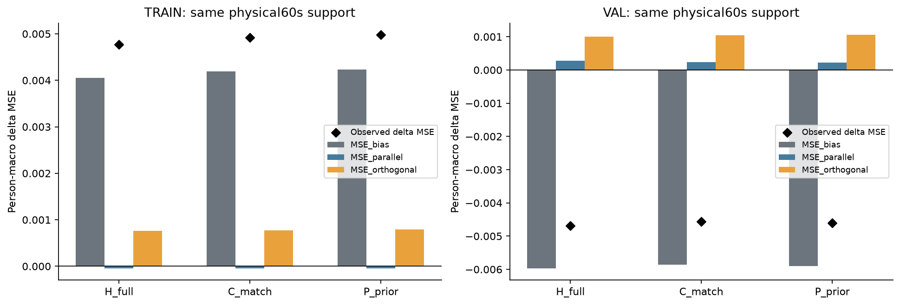
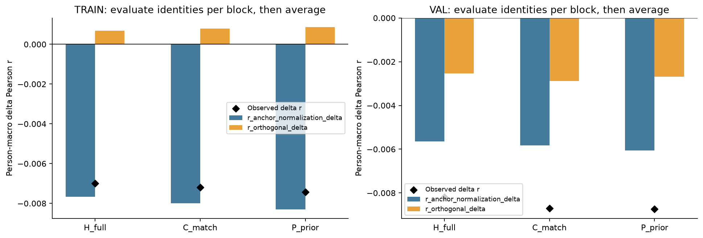
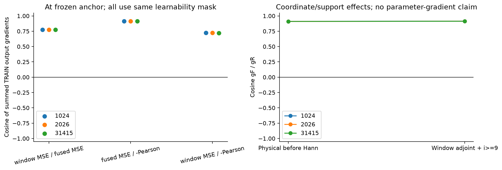
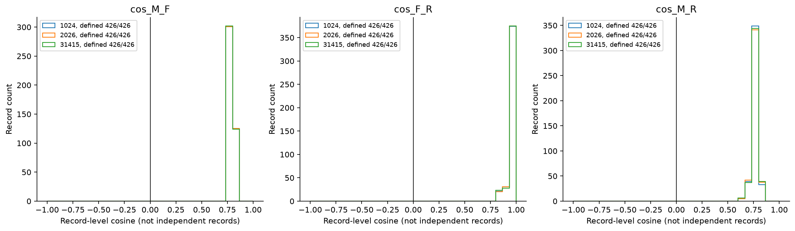

# D13：固定 last19 的误差分解与输出梯度诊断

2026-11-02；PUB-01-S03_SS07。**VAL 的 MSE 降低主要由偏置修正贡献；它同时伴随 Pearson 下降。固定最后轮模型在 TRAIN 上的物理 MSE、Pearson 也变差，因此不能简单归为“训练拟合更好、验证过拟合”。三种输出目标的梯度总体及每条记录余弦全部为正，本轮不支持目标方向相反的解释。**这些是内部开发诊断，不构成历史机制、参数优化因果或方法创新证据。整体科研目标尚未达到。

## 固定对象、支持与来源

沿用 [PLAN](PLAN.md) 与 [协调数学定义](COORDINATOR_MATH_AND_SCOPE.md)。锚点为冻结完整 FT encoder 的 Ccap 当前读出；H_full 为完整历史条件器，C_match 为匹配容量的当前条件对照，P_prior 为既定先验条件对照。固定 seed1024/2026/31415，九个模型统一使用 last epoch19，不按成绩选择。D12 的 selected−1 和阴性结论不改写。

服务器唯一新目录为 `/home/fanyu/auditory_simulation_m6a/pub_01/s03_full_ft_error_decomposition_20261102`。实际源冻结 commit `71ace166c2b42618dcc4bb143272e446b46f79a5`；[PROTOCOL](PROTOCOL.json) SHA256 `47404c336f76365c48fb847ac59007067420ea6701a82f806c82418c7b02221c`。协议记录实际源、既有缓存/目标与九个 last checkpoint 身份。未重新编码、下载、训练或改变 split。

| Phase | 记录 / 人 | 完整60s块 | 全部窗口 | 有效残差窗口 |
|---|---:|---:|---:|---:|
| TRAIN | 426 / 70 | 6104 | 252454 | 248620 |
| VAL | 49 / 49 | 752 | 30500 | 30059 |

窗口192点、hop96、64Hz。先固定原目标和 Hann covered mask，再按记录内完整3840点块评分。每块独立求统计量，再块→人→phase等权，最后三seed等权；不把平均 alpha 代回非线性公式。完整支持见 [SUPPORT_MASK](SUPPORT_MASK.json)。TRAIN 目标由原记录 cast float32 再转 float64，匹配继承的训练窗口目标；VAL 保留原连续 float64 目标。两者目标精度差明确保留，不解释成处理完全一致。

## 解析分解

同一物理块内，锚点 a、新预测 p=a+d、目标 y；令 u=a−mean(a)、v=d−mean(d)，alpha=(u·v)/(u·u)，e=v−alpha*u。方差/协方差使用 population ddof0。alpha 是新计算的描述性投影系数，不能作为可部署的校准参数或声称没有统计计算。

```
D = sqrt((1+alpha)^2 + var(e)/var(a))
r_new = ((1+alpha)*r_anchor + cov(e,y)/sqrt(var(a)*var(y))) / D
delta_r = ((1+alpha)/D - 1)*r_anchor
          + cov(e,y)/(sqrt(var(a)*var(y))*D)

delta_MSE = bias + parallel + orthogonal
bias = 2*mean(d)*(mean(a)-mean(y)) + mean(d)^2
parallel = (alpha^2+2*alpha)*var(a) - 2*alpha*cov(a,y)
orthogonal = var(e) - 2*cov(e,y)
```

Pearson 的中心化消除均值偏移；其中 anchor-normalization 项包含新增正交方差对归一化的影响，不能称为纯幅度缩放损失。主评分61,704块的投影/Pearson均已定义，低方差/非有限标记0；程序最大 MSE/r 闭合误差4.89×10⁻¹⁶/3.33×10⁻¹⁶。一般规则仍是零方差或非有限显式 undefined，任一块未定义则相应人/phase指标不跳过，低方差仅标记而不加epsilon。

## 固定参数离线结果

以下均为完整60s/person宏平均，再三seed平均；完整18行在 [PHASE_SUMMARY](results/report01/PHASE_SUMMARY.csv)，六组均值在 [MODEL_SUMMARY](results/report01/MODEL_SUMMARY.csv)。Δ均相对同seed锚点。

| Phase / 模型 | r | Δr | MSE | ΔMSE | bias | parallel | orthogonal |
|---|---:|---:|---:|---:|---:|---:|---:|
| TRAIN anchor | .246590 | 0 | .204885 | 0 | — | — | — |
| TRAIN H_full | .239596 | −.006993 | .209657 | +.004772 | +.004055 | −.000044 | +.000761 |
| TRAIN C_match | .239388 | −.007201 | .209805 | +.004920 | +.004196 | −.000044 | +.000769 |
| TRAIN P_prior | .239152 | −.007437 | .209866 | +.004981 | +.004233 | −.000042 | +.000790 |
| VAL anchor | .182340 | 0 | .242379 | 0 | — | — | — |
| VAL H_full | .174155 | −.008185 | .237691 | −.004688 | −.005970 | +.000275 | +.001006 |
| VAL C_match | .173643 | −.008697 | .237814 | −.004565 | −.005856 | +.000244 | +.001047 |
| VAL P_prior | .173608 | −.008732 | .237769 | −.004610 | −.005894 | +.000223 | +.001062 |



**图1。** 左TRAIN、右VAL，横轴三臂，纵轴相对锚点的物理60s/person ΔMSE；灰/蓝/黄分别为偏置/平行/正交项，黑菱形为实测总变化。TRAIN三臂的偏置项约+.0041–.0042，正交项也为正，微小负平行项不足抵消；因此固定最后参数的TRAIN物理MSE恶化。VAL偏置项约−.0059，大于正平行和正交代价，使总MSE降低。三臂共享这一模式，不能把它归为完整历史特有作用。这里没有置信区间或独立确认性检验；柱为固定三个seed的描述性均值。

TRAIN 的 mean(a)=.560830、mean(y)=.569736，新增 mean(d)=.071629/.072633/.073380；VAL 原 mean(a)=.563253、mean(y)=.645831，新增约.070–.072。均值方向帮助理解不同phase的偏置修正，但精确贡献来自逐块计算，不能用这些总体均值代替逐块偏置式。VAL每seed仅16–17/49人MSE降低，均值下降不等于多数人获益。TRAIN每seed每臂均25/70人MSE降低，其余人更差；每seed r改善的人数TRAIN4–15/70、VAL0–4/49。逐人异质性保留在 PERSON.csv，不以总体均值代替分布。

| Phase / 模型 | anchor-normalization 对Δr | orthogonal-covariance 对Δr | 合计 |
|---|---:|---:|---:|
| TRAIN H_full | −.007676 | +.000683 | −.006993 |
| TRAIN C_match | −.007995 | +.000794 | −.007201 |
| TRAIN P_prior | −.008303 | +.000866 | −.007437 |
| VAL H_full | −.005647 | −.002538 | −.008185 |
| VAL C_match | −.005820 | −.002877 | −.008697 |
| VAL P_prior | −.006052 | −.002680 | −.008732 |



**图2。** 两面板同为完整60s/person Δr，蓝柱是 anchor-normalization 项，黄柱是正交协方差项，黑菱形为实测和。TRAIN正交项略正，但不足抵消更大的归一化项损失；VAL两项都负。新增残差并非只作均值修正，它还引入改变中心化形状/方差的分量。故“偏置改善MSE”无法推出“相关结构改善”；TRAIN/VAL同样r下降也不支持简单的训练r先学好再泛化失败。未给出参数梯度或优化轨迹因果。

## 三输出梯度及坐标效应

每seed只在固定 TRAIN 锚点计算一次。gM 是全部252454窗×192点等权的静态数据项导数，分母含fallback，前九窗可学习导数置零；gF/gR分别为同完整物理块、同人/块权重的融合MSE与负Pearson导数。先累加整个record物理梯度，再用 Hann 转置映回窗口，包含跨块窗口贡献，最后统一i≥9 mask。gM还监督零Hann端点/非评分尾部，后两者在这些坐标为零。全局cos先加dot/norm²再计算，不能平均record cos。

| Seed | cos(gM,gF) | cos(gF,gR) | cos(gM,gR) | 物理空间 Hann前 cos(gF,gR) |
|---|---:|---:|---:|---:|
| 1024 | .773227 | .914660 | .723859 | .911148 |
| 2026 | .773292 | .913338 | .722177 | .909766 |
| 31415 | .773280 | .912594 | .721731 | .909120 |



**图3。** 左面板是三seed在统一可学习窗口坐标的三对余弦，均为正（数值描述，未作显著性检验）；右面板比较物理空间和Hann转置+mask后的gF/gR，约.909–.911变为.913–.915，变化很小。窗口MSE与物理MSE方向并不相同，但也没有反向；Pearson与物理MSE更接近。gM范数平方约4.38%位于主评分支持外，约1.07%在零Hann端点，两类有交集，不能相加。不能把本图当作更换loss会提升真实训练的证明。



**图4。** 三面板分别为M/F、F/R、M/R的record余弦直方图，三seed叠加，每seed426/426已定义。全部记录和全部70人聚合的三对余弦均为正；record M/F约.763–.815，F/R约.819–.997，M/R最低约.65。分布集中，不能说总体正值仅由少数反向记录抵消产生。记录共享人/声音，直方图不构成426个独立样本或因果检验。逐人/记录norm与dot保留，且本图分布均值不是图3全局cos。

单块物理空间存在精确关系 `P_perp gF=(2*||u||*||yc||/n)*gR`，系数为正。实际最大误差约1.59×10⁻²²。总体角度不同仍可由径向/校准分量、块幅度/权重及Hann转置/可学习mask产生。我们只诊断固定锚点的**输出空间**，没有经过模型Jacobian、Adam状态或20轮在线轨迹，因此无法排除参数空间差异，也没有证明优化已经正常。

## 辅助区域与未定义值

完整主评分不因区域成绩改变。另保留 whole_covered、prefix[0,864)、first_learning_overlap[864,960)、tail、last_single_window 的全部记录统计。[辅助汇总](results/report01/SUPPLEMENTARY_SUMMARY.json)按record→person→phase再seed平均，与完整60s块评分不同，不混用。

prefix 的d、ΔMSE、Δr逐记录均0，符合前九fallback窗冻结；首可学习重叠、末端单窗与尾部表现不同。以H为例，VAL首重叠Δr=+.030345而末单窗−.031517；whole-covered Δr仍−.009225、ΔMSE−.005029；TRAIN whole-covered Δr−.008460、ΔMSE+.004351。局部正值不能替代主评分或声称同步/历史机制成立。

TRAIN每seed每臂15条记录tail不足点、30条末single目标零方差，显式保留 `INSUFFICIENT_POINTS` / `LOW_VARIANCE_Y;UNDEFINED_PEARSON`。因此TRAIN tail汇总及末single的r保持null，不跳过这些记录；VAL全部区域可定义。它们不影响主评分全部定义的事实，也不以补epsilon人为得到相关值。

## 成本、验证和结论边界

队列真实PID1669043；三个worker退出码均0。每worker836037有效残差NN窗口，总计 **2,508,111**；新encoder/head前向0，学习模型fit0，optimizer更新0。主块投影统计61,704、辅助统计总行机会21,375，其中21,240行投影已定义、135行不足点未定义，不能称零计算。主队列wall90.269s、CPU worker和355.187s；worker峰RSS最大5,136,268KiB，GPU allocated21,325,824B。初始两盘各余量≥20GiB；图表生成后新root约62.8MB，低于128MiB，没有梯度/历史数组落盘或信号返回本地。独立review另CPU92.749s/wall38.496s、峰RSS2,406,984KiB；其0新NN。成本与source身份见 [COMPLETED](COMPLETED.json)、[独立REVIEW](coordinator_review/REVIEW.json)。

合成检查覆盖投影恒等式、负1+alpha、常量/非有限规则与随机/跨block/零Hann/tail/fallback三梯度有限差分；独立真实检查用另一套Ccap重建、torch.fold和scalar loss autograd核对三seed全部TRAIN记录。3834record cos最大差5.55×10⁻¹⁶；61,704块恒等闭合、11781逐人项/198phase项聚合通过；旧独立非零VAL r差≤1.36×10⁻⁸。它没有第二次回放本轮TRAIN非零模型，限制保留。详见 [三级验收](REVIEW.md)。

D12的 online train_window_MSE 是每个batch在**不同当时参数**下的轨迹均值，既不是最后固定参数的离线TRAIN window loss，也不是本轮60s/person物理MSE。它下降不能证明last19全TRAIN更好。协调只读统计进一步显示，九fit TRAIN whole-covered按有效点加权的ΔMSE仍全正（+.00564至+.00652），不只是person宏权重造成；最后一条record却均改善约−.025至−.037。原样证据见 [ORDER_HYPOTHESIS_EVIDENCE](coordinator_review/ORDER_HYPOTHESIS_EVIDENCE.json)。固定manifest/global64和逐epoch同顺序、Adam .001可能造成顺序/尾部偏置，目前只是待检假说；本轮不改变损失/LR/结构、不由诊断直接归因。

本轮 Technical PASS_WITH_LIMITATIONS / 诊断 Acceptance PASS_WITH_LIMITATION / Parent PASS。协调后续仅批准形成“保持D12全部条件、唯一改为逐epoch全窗口共同随机重排”的最小顺序对照方案并审源，尚不能以本报告宣称该对照有效。D12/D9及旧test/DTU/ds004408全部冻结，不读取患者，不自动扩模型或合并PR6。
