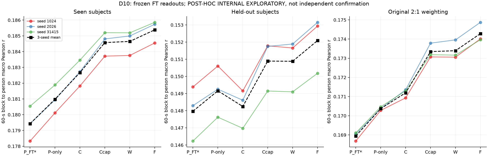
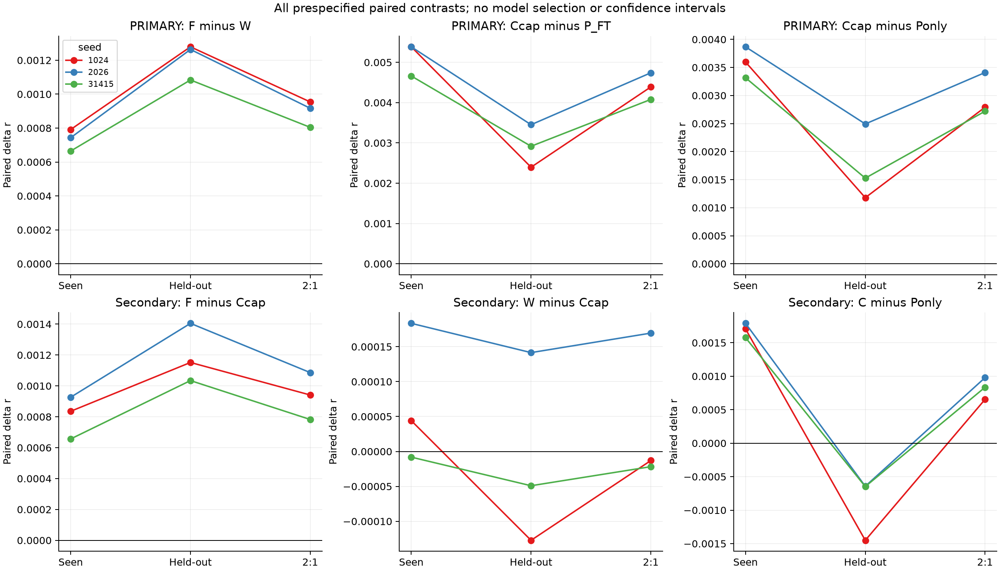
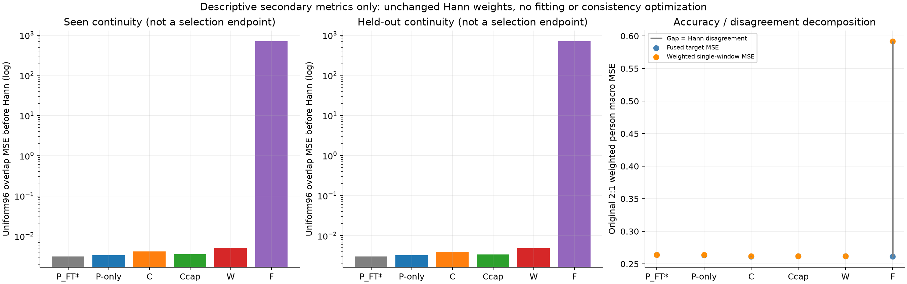

# D10：冻结强FT读出的旧内部泛化审计

**固定36/36项完成；三个预定主要内部比较在seen/heldout各三个seed均为正。** 原2:1加权r为P_FT*=.168945、P-only=.170374、C=.171197、Ccap=.173348、W=.173393、F=.174284。F−W均+.000892，Ccap−P_FT*+.004403，Ccap−P-only+.002973。

结果全部属于 **POST-HOC INTERNAL EXPLORATORY**：这些旧测试记录在round01等研究中已暴露，本轮虽冻结参数后才首次将D8/D9读出迁移到它们，仍不能称新的独立确认、无偏泛化或显著性。F的固定Hann融合点增益与严重单窗表示退化再次并存；C−P-only在heldout三seed均负，W对Ccap也不稳定。不能凭最高r关闭研究goal或宣称通用可用方法。

## 1. 固定矩阵、数据和解释范围

角色固定P_FT*/P-only/C/Ccap/W/F，seed1024/2026/31415。三seed原P_FT epoch4 encoder/head、D8 TRAIN正a,b/latent/P/平方统计、已有系数全程只读。P-only/C/Ccap共享λ为.01/.0001/.01，W/F为D9原λ_scalar=.01/192解；不重新拟合、调λ、换角色、做测试标定或选择。

所有角色仅原当前3秒EEG窗的FT latent/P，离线Hann192/stride96、64Hz；五个learned角色首4窗回退P_FT*，其余用已有读出。没有额外历史推理输入。F输出列0/191固定端点和其他大bias原样继承，没有因D9异常重训。原P_FT*是原head经D8 TRAIN单个正仿射，Pearson不变；下文MSE使用共同TRAIN标定单位，原未缩放head另用于实现桥。

P-only仅对原FT输出P作监督残差再读出；C使用当前FT latent与P，Ccap再加入按TRAIN标准化的latent平方。W/F继承同一Ccap特征及初始化、共同固定输出两端点，分别优化逐窗Hann加权MSE与Hann融合后的物理时间MSE。本轮直接应用已有系数，没有重新学习这些角色。

| 组 | records | people | source-family labels | windows | 有效60秒块 |
|---|---:|---:|---:|---:|---:|
| seen | 69 | 69 | 9 | 36573 | 872 |
| heldout | 75 | 13 | 8 | 48119 | 1172 |

heldout仅指相对原训练fold的13人，并非整个研究未暴露。人物/刺激/来源依赖不变，family描述表不是17个独立实验。原prediction-independent mask共2044块，按块→person宏r，再2/3 seen+1/3 heldout；不按记录/窗数重加权，不因虚拟窗口异常删窗/删人/删块。

三项主要内部诊断为F−W、Ccap−P_FT*、Ccap−P-only；次要为F−Ccap、W−Ccap、C−P-only。36格全部完成，无新fit/选择/下载/DTU前向，原D4-D9结论保持。没有p值/CI、等效或SOTA检验。

## 2. 原FT路径和全部实际桥

原FT测试路径`finetuned_predictions → predict_raw_phase`按每phase连续global64，可跨记录混batch。seen572批、尾29窗；heldout752批、尾55窗。复用原raw_windows的np.stack/astype(float32)，再由原helper重stack pending；保留FP32、eval/no_grad（非inference_mode）、requires_grad=True、TF32 matmul=False/cudnn=True及原默认benchmark/deterministic状态。

实际input stride[12288,1,192]、latent view[1536,1,8]，同forward先encoder→transpose→head，再同时保存Z/P。未从重排后Z重算head。旧native test latent属于另一encoder，未冒充FT；旧FT仅保存fused波形，故新增12个phase级float32 Z/P文件，历史cache/checkpoint不覆盖。

| 实际核验 | 范围 | 最大差 |
|---|---|---:|
| frozen VAL读出映射 | 六角色×三seed×首/尾record=36项 | 通过既定prediction1e−8/block r1e−10门 |
| 新capture对D8 VAL gold Z/P | 每seed首64/末36，共300窗 | Z/P均0 |
| 新capture对原Decoder同输入 | 两test phase首/尾，共636窗 | 原单位波形0 |
| 全原FT未缩放fused波形 | 144record×3seed=432条 | **0** |
| P_FT*对原FT已存block r | 全2044块×3seed | ≤4.44e−16 |

原单位波形门1e−6保持，没有用约.0016的a缩小误差。每seed全144桥完成后才应用五个learned读出。旧FT原单窗P没有保存，因此全432桥是**旧fused波形桥**，不是旧单窗raw gold或独立神经数学重写；额外同batch Decoder对照与VAL latent gold各自验证声明范围。

同三seed原FT历史seen/heldout/2:1 r=.179431046/.147972087/.168944726368672，本轮精确恢复给出的小数位；没有把原五seed均值用于三seed配对，也不把历史参考称新确认。

## 3. 图一：六冻结角色的三组绝对结果

左/中/右分别seen、heldout、原2:1加权。三色连线为同seed六个固定角色，黑方块虚线为三seed均值；三个panel纵轴独立缩放，无置信区间，不按新排名选方法。两组绝对r差异不能忽略，heldout仍整体较低。

| 角色 | seen r | heldout r | 原2:1加权r |
|---|---:|---:|---:|
| P_FT* | .179431 | .147972 | .168944726 |
| P-only | .180981 | .149161 | .170374306 |
| C | .182671 | .148247 | .171196650 |
| Ccap | .184575 | .150894 | .173347674 |
| W | .184648 | .150882 | .173392574 |
| F | .185381 | .152091 | .174284309 |

Ccap对强FT本身的增益也存在于旧内部评分，F相对匹配W和强Ccap也有小幅点增量。但D8/D9训练、标定、λ搜索和求解均有继承成本；原FT只完成已冻结的5个额外epoch，并非证明已收敛或所有可能baseline最优。不能声称本pipeline超过所有强方法、与其他预算等价或已形成发表级创新。

## 4. 图二：三个主要比较与完整阴性控制

上排三格为预设主要内部诊断，下排为三个secondary，横轴seen/heldout/2:1、三色seed、零线无差。所有panel保留实际负值，纵轴各自缩放；三seed共享人物/刺激，不当三份独立数据集。

| 主要比较 | seen均差 | heldout均差 | 2:1均差 | 三seed的2:1差值 |
|---|---:|---:|---:|---|
| F−W | +.000733 | +.001209 | **+.000892** | +.000954 / +.000917 / +.000804 |
| Ccap−P_FT* | +.005144 | +.002922 | **+.004403** | +.004389 / +.004740 / +.004080 |
| Ccap−P-only | +.003594 | +.001732 | **+.002973** | +.002791 / +.003409 / +.002720 |

三项在seen/heldout每seed均正，未靠2:1权重掩盖heldout负方向。这仍是暴露旧集合上的固定内部描述，不能升级为确认性统计。

| 次要比较 | seen均差（正seed） | heldout均差（正seed） | 2:1均差（正seed） |
|---|---|---|---|
| F−Ccap | +.000806（3/3） | +.001197（3/3） | +.000937（3/3） |
| W−Ccap | +.000073（2/3） | −.000012（1/3） | +.000045（1/3） |
| C−P-only | +.001691（3/3） | **−.000914（0/3）** | +.000822（3/3） |

W的VAL三seed微增未在旧内部每seed保持，不能写成稳定胜Ccap。C在heldout低于P-only的三个差分别−.001451/−.000643/−.000648，说明更完整latent访问并非所有条件下都增加点预测值。Ccap还改变平方特征/容量与λ，不能把它的增益单独归因非线性或新EEG机制；未据此改变任何模型/λ。

## 5. 图三：固定Hann增益与单窗退化同时保留

左/中是两组各自uniform96 overlap MSE的**对数轴**，使F的大值与其他角色都保留；右为原2:1 person宏Hann加权单窗MSE（橙）、fused target MSE（蓝），灰间距为disagreement。右图全范围展示F大间距，其他细小MSE差需查下表。uniform pair和Hann/person计权不同，这些指标不用于模型选择。

| 角色 | seen overlap MSE | heldout overlap MSE | 2:1 fused MSE | 2:1加权单窗MSE | 2:1 disagreement |
|---|---:|---:|---:|---:|---:|
| P_FT* | .003116 | .003040 | .263846881 | .264140864 | .000293983 |
| P-only | .003378 | .003253 | .263640200 | .263981219 | .000341019 |
| C | .004166 | .003989 | .261441464 | .261880479 | .000439015 |
| Ccap | .003581 | .003381 | .261770446 | .262131562 | .000361115 |
| W | .005113 | .004943 | .261699843 | .262070913 | .000371070 |
| F | **705.608421** | **706.262233** | .261612155 | **.591967403** | **.330355248** |

F−W加权单窗MSE增加.329896490，disagreement增加.329984178，因此融合MSE下降.000087688，符合固定Hann恒等式；逐点恒等误差最大2.58e−12。最一致的原P_FT*仍非最高r；C的fused MSE又低于r最高的F，相关与误差标准并非同一排名，不能用一个指标替代其他。

| 角色 | seen 3秒r | heldout 3秒r | seen均匀窗口MSE | heldout均匀窗口MSE |
|---|---:|---:|---:|---:|
| P_FT* | .166185 | .147807 | .260625 | .289465 |
| P-only | .165978 | .146765 | .260355 | .289415 |
| C | .166540 | .146073 | .257792 | .288413 |
| Ccap | .167801 | .147935 | .258260 | .288322 |
| W | .161267 | .141539 | .259720 | .289813 |
| F | **.003885** | **.004506** | **351.853848** | **352.247151** |

F的窗口表示退化在两组旧测试均出现，不可省略。其大逐坐标bias/近null方向抵消已在D9只读系数与物理边界代数中确认，参数本轮不改；近零Hann权重位置可以承载大单窗异常。它不等同于固定Hann最终输出无效/数值崩坏，也不证明其他边界/融合、单窗独立使用或完整低精度推理稳健。D9 coef-only float32代数检查不是这类新实验，本轮也未新增此类条件。

全部36格的3秒undefined均0，常量窗规则仍为null+覆盖且不删60秒主块。当前r微增不能当额外历史收益：推理输入仍只有当前窗，F改变的是训练时融合目标/输出坐标表示。

## 6. 实际成本与失败保留

唯一PID599747正常结束，main COMPLETED wall147.210秒/CPU539.147秒；最终STATUS elapsed147.707秒还含末次记录。stage wall/CPU和141.846/532.756秒，剩余为模型装载/身份与写出等，不虚构成纯GPU编码或纯readout延迟。原预训练/head、FT每seed5epoch/19725更新/1262270监督窗、D8标定/27fit、D9求解均为继承非零成本。

实际main encoder/head254076窗/3972批，VAL capture额外300窗、test原Decoder额外636窗，合计255012；36角色-split共2592record-role、1524456窗口评分、36792块评分是同原集合的重复，不当独立样本。没有新增神经网络或岭回归拟合，也未重拟合TRAIN统计、选择λ或模型。

峰RSS2002989056B（约1.87GiB），GPU allocated193392128B（约184.43MiB）；主run新root1793587668B（图文/review稍增），全SS07 NPY26225606304B=24.4245GiB，低于25GiB；free25860456448B高于20GiB。精确新增12NPY1756174848B，剩NPY预算617939296B；不删除历史cache、不复制learned fused全数组。信号、Z/P、权重/系数只在2203，本地/Git只有轻量表图和代码。

正式科学source2ce7df72…a23f675/protocol14b2cedd…babb78e在57a09ff、真实test前冻结，run期间未改。图表生成器首版沿用旧字段primary_comparisons，而实际D10协议为primary_pairs，产生呈现KeyError；原partial CSV/旧renderer/log已移入服务器presentation_attempt01，[记录](PRESENTATION_ATTEMPT01.json)原样回传。仅适配renderer读冻结schema后重生图表，没有重跑神经前向/36评分或改系数/数字。

## 7. 实际独立核验与产物

协调[实际独立audit](COORDINATOR_NUMERICAL_AUDIT.json)已核对306来源/600输入，全部36项原mask、逐人及2:1聚合差0；按成绩前scope对原两phase首/尾record×三seed×六角色=72项缓存重建，block r差≤2.78e−16、MSE/Hann≤2.70e−14，首4精确。另直接核原FT全block r差≤4.45e−16及历史加权均值恢复。复核另耗wall3.087秒/CPU17.644秒、RSS518979584B、重建41166个窗口；不含新NN、fit或NPY，与主run成本分列。它重用冻结神经来源和缓存，非外部实验室/独立神经数学复现。

完整[PLAN](PLAN.md)、[PROTOCOL](PROTOCOL.json)、[36cached VAL桥](VAL_MAPPING_CHECK.json)、[全评分摘要](SUMMARY.json)、[绝对值](report01/ABSOLUTE.csv)、[配对](report01/PAIRED_CONTRASTS.csv)、[全逐人](report01/ALL_PERSON.csv)、[逐块](report01/ALL_BLOCK.csv)、[record/3秒覆盖](report01/ALL_RECORD.csv)、[family描述](report01/FAMILY_DESCRIPTIVE.csv)、[数值汇总](report01/NUMERICAL_SUMMARY.json)、[窗口/计次/恒等细节](report01/NUMERICAL_DETAILS.json)、[成本](COST.json)、[正式完成](COMPLETED.json)均保留。最终原样audit、实际全文三图review、REVIEW三级判定与HTML归档据实际完成记录。

主结论限于冻结方法在旧暴露集合上的内部重复性。独立新数据确认、额外历史贡献、可移植/单窗适用边界及方法创新仍缺；没有冻结通用临床或患者artifact。下一科学工作由协调在既定边界审定，新OpenNeuro数据范围仍待用户明确答复，不取payload。PR6保持Draft、不合并，不因本轮阳性自动重启训练、改变F的bias约束或进入其他支线；科学goal仍ACTIVE。
