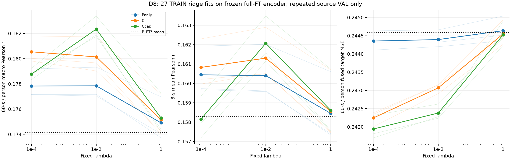
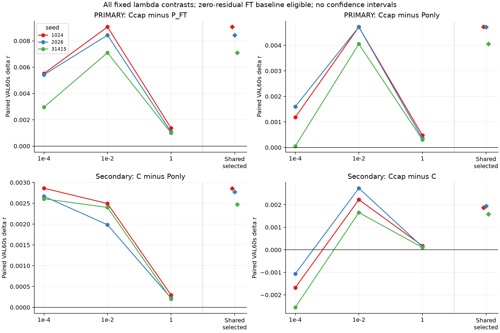
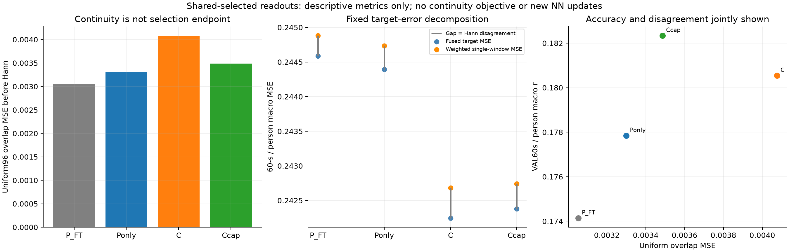

# D8：完整微调强encoder上的当前读出迁移

**固定27/27岭解完成；读出增益也存在于完整P_FT强encoder上。** 三seed选定VAL60秒/person宏r：P_FT*=.174141，P-only=.177842，C=.180541，Ccap=.182340。Ccap−P_FT*均差+.008199、Ccap−P-only均差+.004498，两项在三个seed均为正。不能把D4-D6增益全部解释为原冻结encoder较弱；但本轮仍只有**重复source TRAIN/VAL开发证据**，没有独立泛化、连续历史贡献、纯loss因果或新方法充分性。持续科学goal保持ACTIVE。

这与D7不同：D7是在旧内部测试上对native encoder已有读出的固定审计，Ccap与历史P_FT点均值几乎相同；D8则在原P_FT encoder上重新使用TRAIN拟合读出，仅评分原VAL。两者的集合/特征/拟合条件不同，不能把.182340与D7的.168945直接比差，或声称D8已经在测试上超过P_FT。D7及旧D4-D6证据冻结不改。

## 1. 固定设计与实际执行

复用原epoch4完整P_FT checkpoint（seed1024/2026/31415），其encoder/head原训练完成后全部冻结。本轮无NN参数更新、新seed、历史输入、新架构、下载、旧test或DTU。原P_FT已继承完整对比预训练与head训练，另有每seed5epoch/19725更新/1262270监督窗、3372617参数联合微调，继承成本不为零。

三个P_FT都没有既有TRAIN/VAL latent，故只在2203新增一次原路径编码。每seed TRAIN252454窗/426记录/70人，VAL30500窗/49记录/49人；原64Hz、3秒192点/stride96、Hann融合和prediction-independent VAL752块保持。VAL是已知被试/部分同书家族的重复开发集，不能称未见被试或独立故事确认。

| 角色 | 当前输入（标准化后） | 新读出参数 | 选定共同λ |
|---|---|---:|---:|
| P_FT* | 仅原head输出，经TRAIN单个正仿射 | 0岭参数；另2个TRAIN标量 | 零残差参考 |
| P-only | 当前P_FT*全192点 | 37056 | .01 |
| C | 当前Z1536 + P192 | 331968 | .0001 |
| Ccap | C + 当前标准化Z平方1536 | 626880 | .01 |

每角色3个固定λ(.0001/.01/1)×3seed，共27解，所有解/失败均保留。TRAIN只同记录i≥4的250750窗拟合y−P_FT*残差；VAL全部30500窗评分，首4窗共196窗共同回退P_FT*，不因无历史读出而另改边界。每角色按三seed平均VAL60s选共享λ，同分取较大λ；只有严格超过三seed baseline均值才采用，否则全seed回退。实际三臂均采用非零读出，不按seed单独挑λ。

输入EEG仍用该已训练模型原TRAIN normalization，避免改变固定模型。FT latent/P/平方分支统计与正仿射a,b则全部重新在对应FT TRAIN拟合；未套用nativeP latent、Gram、统计或系数。逐坐标标准化、每块除sqrt(dim)、float64中心化岭、共同自由截距/展开Frobenius正则沿用D4。`effective_df=Σ e/(e+λ)`为**每输出、排除截距**的岭自由度，不是总192输出参数量。

## 2. 三个原FT路径桥均零差

按原`finetune.RawWindows`连续phase global64批次（可跨记录）前向，保留原np.stack/astype输入layout、eval/no_grad、FP32、TF32 matmul=False/cudnn=True与requires_grad=True。encoder→transpose→head与原Decoder操作相同，当次保存Z和P；不从落盘后改变layout的Z重建基准P。实际input stride[12288,1,192]、latent view[1536,1,8]，落盘float32数组只留服务器。

每seed先完整VAL30500窗，用原同global64/float32 objective重聚合，与该selected checkpoint历史negativePearson核对；首64及末36窗另与原Decoder.forward做未缩放波形比较。桥通过后才编码TRAIN、拟合统计与岭，不用小a掩盖波形误差。

| seed | 历史selected VAL negativePearson | 重编码scalar差 | 首/尾raw波形最大差 |
|---|---:|---:|---:|
| 1024 | −.157073763453 | 0 | 0 / 0 |
| 2026 | −.157230083978 | 0 | 0 / 0 |
| 31415 | −.160608958461 | 0 | 0 / 0 |

预设scalar绝对门1e−7、raw波形绝对门1e−6保持。原FT没有持久化VAL波形，所以“全VAL历史loss桥+首尾同路径实现桥”不能称全VAL历史波形一致；旧FINAL_WEIGHT_VAL_BRIDGE没有核FT，未借用为本轮证明。

对应TRAIN全局a约.001572/.001599/.001580，b约.369865/.366927/.362622，每seed使用24275628个原Hann覆盖物理点。a均正，未截断/逐窗拟合；VAL逐块r的正仿射不变门1e−10通过，a小本身不是逐窗Pearson标度机制证据。

## 3. 图一：完整27格与共享选点

左/中/右分别为VAL60s/person宏r、窗口平均3秒r、60s/person融合target MSE；横轴是固定λ对数坐标。蓝/橙/绿为P-only/C/Ccap，浅线为每seed、粗线为三seed均值，黑点线为原P_FT*均值，无CI。三个panel纵轴各自缩放，MSE不从零起。**仅左图参与λ选择**，其余是预设辅助描述。

| 角色 | λ=.0001的r | λ=.01的r | λ=1的r | 选定3秒r | 选定60秒r |
|---|---:|---:|---:|---:|---:|
| P_FT* | 同一零残差参考 | 同左 | 同左 | .158304 | .174141 |
| P-only | .177828 | **.177842** | .174909 | .160400 | .177842 |
| C | **.180541** | .180135 | .175149 | .160825 | .180541 |
| Ccap | .178774 | **.182340** | .175288 | .162067 | .182340 |

更强正则将三种读出压近原P_FT*，但不是严格变成零残差。Ccap在.01较好、.0001较差，不能把增加平方分支称为所有正则下都改善。最高r与最低MSE也不在同一配置；没有按MSE追加选点或改λ。

## 4. 图二：所有λ配对与预设主要比较

上排两格是预设primary Ccap−P_FT*、Ccap−P-only，下排为secondary C−P-only、Ccap−C。三色为seed；前三个位置是同λ差，右侧菱形是按各角色三seed共享规则选定后的差，虚线将两种口径分开。零线为无差，纵轴范围各自缩放；没有置信区间、p值或独立重复数据声称。

| 选定比较 | seed1024 | seed2026 | seed31415 | 平均差 |
|---|---:|---:|---:|---:|
| Ccap−P_FT*（primary） | +.009060 | +.008438 | +.007099 | **+.008199** |
| Ccap−P-only（primary） | +.004721 | +.004719 | +.004055 | **+.004498** |
| C−P-only（secondary） | +.002854 | +.002771 | +.002471 | +.002699 |
| Ccap−C（secondary） | +.001867 | +.001948 | +.001584 | +.001799 |

Ccap−P_FT*、Ccap−P-only、C−P-only在全部3λ×3seed均正；平方相对C在λ=.0001的三个seed全负，.01/1全正。选定Ccap与C还使用不同λ(.01 vs .0001)，并增加容量，不是纯平方非线性或同容量因果效应。

P_FT*已有较强预测但输出再读出仍增益约.003701；进一步访问当前latent还有约.002699的C−P-only增量。由此支持读出开发增益不完全依赖原弱冻结encoder。原训练目标/solver/容量/共享约束/正则与预算同时不同，不能把全部增益归因于PCC→MSE或连续性。三seed共用相同记录、人物及刺激，不当三份独立实验。

## 5. 图三：一致性与准确度联合解释

左为相邻窗口同物理96点uniform overlap MSE，中心为VAL60秒/person宏Hann加权单窗target MSE（橙）、融合target MSE（蓝），灰间距为Hann disagreement；右为overlap MSE与宏r的四个均值点。只用共享选择后的模型，均为次要描述，不参与选择。中/右轴自适应缩放，uniform pair与Hann/person计权不同。

| 角色 | overlap MSE | fused MSE | 加权单窗MSE | disagreement |
|---|---:|---:|---:|---:|
| P_FT* | .003052721 | .244588390 | .244881878 | .000293488 |
| P-only | .003299928 | .244393043 | .244733151 | .000340108 |
| C | .004075109 | .242245379 | .242684253 | .000438874 |
| Ccap | .003486080 | .242378889 | .242740616 | .000361727 |

原P_FT*最一致但r最低。Ccap比C更一致、r更高，fused MSE却更高：加权单窗MSE增加约.000056363，disagreement减少约.000077147，所以融合MSE增加约.000133510。Ccap相对P_FT*则同时提高r、降低融合MSE，不能把局部比较混为所有指标一致排序。

固定Hann恒等式`weighted_single_MSE = fused_MSE + disagreement`逐点最大误差4.10e−15。disagreement包含融合相对单窗误差的分散收益，不能直接把overlap惩罚当科学目标。此轮没有连续性训练或历史输入，不能由散点相关/更一致而证明机制。

3秒辅助r遇常量时规定null+覆盖，不剔除有效60秒主块；本次所有27格的undefined均0。全部VAL块与人物保持，不因成绩删人/删窗。

## 6. 实际成本、保留记录与科学边界

唯一PID541227正常结束，无失败重跑/搜索扩大；全部27解及3个calibrated baseline保留。实际原encoder/head主前向848862窗/13266批，首尾桥额外300窗，总NN更新0。cache阶段合计207.105秒，TRAIN joint Gram99.455秒；27次solve+prediction共6.617秒、共享eigen13.842秒，27次完整VAL评分22.831秒，其他TRAIN统计/calibration/特征与记账另列。阶段wall/CPU之和377.426/1174.957秒，主COMPLETED总wall386.589/CPU1183.994秒；差额包含模型装载/记录等，不虚构成纯训练或纯solve时间。

峰RSS6107082752B（约5.69GiB），torch peakGPU allocated193490432B（约184.53MiB），driver每seed观测706MiB，口径不同。主run新root6236879663B（约5.81GiB）、全8个SS07根NPY24469431456B（约22.79GiB）、free27709083648B，守7GiB新root/25GiB总NPY/20GiB余量；报告与复核文件稍增，但不新增数组。所有权重、Z/P、Gram、统计/系数与信号只在2203，未回传Windows/Git。

source3f4d4786daa1533b504d48300dd287ef36044d3e498425a9ce4b7456955365a0与protocol54d424d5c26f1ab4aee4712c2efb149739a9e70ec876d2698391e4e5b6d0c980在任何新数值前已b659d39冻结。首次prepare仅因程序假设审阅键`approved_for_execution`而实际原件使用`status=PLAN_APPROVED`失败；无模型/cache/fit/协议产生，原source/记录保留在服务器preparation_attempt01及本地[记录](PREPARATION_ATTEMPT01.json)。读取实际批准status与PLAN/inventory SHA后修复，未改审阅原件、科学矩阵或门限。计划明确允许代码审阅并行；[实际CODE_REVIEW](COORDINATOR_CODE_REVIEW.json)在授权正式启动后写入，247来源/523输入核验通过，未伪称前置gate。

原参数不变不代表零额外学习成本：TRAIN标定、三臂×三λ的监督岭拟合、额外一次编码及重复VAL选择都计入。与原P_FT是“原强模型+额外读出”比较，不能称同预算、等容量或取代微调；与D6的point差也同时含encoder/head联合优化变化。普通ridge/平方展开本身不是ICML/NeurIPS方法贡献。

下一可检验假说仍是PLAN第6节：非退化窗口Pearson目标的正尺度/偏置自由度是否影响连续物理时间监督。应另行冻结同架构/初始化/更新的PCC、逐窗监督MSE、固定Hann融合监督MSE控制，联合看r/MSE/退化，不能由D8正向自动启动该模型或称机制已证实。D4/D5历史阴性保持，旧test/DTU不重开。

## 7. 产物与审阅

完整[27格](RESULTS.csv)、[全部λ选择及baseline](SUMMARY.json)、[逐角色/seed共享选择](report01/SELECTED.csv)、[所有固定配对](report01/PAIRED_CONTRASTS.csv)、[全逐人](report01/ALL_PERSON.csv)、[全逐块](report01/ALL_BLOCK.csv)、[全record/undefined](report01/ALL_RECORD.csv)、[数值汇总](report01/NUMERICAL_SUMMARY.json)、[阶段成本](COST.json)、[正式完成](COMPLETED.json)。图表共1470 person/record行、22560 block行是同一VAL的角色/λ/seed重复，不当独立样本。

独立审阅按预测前写定[scope](COORDINATOR_REVIEW_SCOPE.json)：全部27+3 baseline聚合/来源/相同mask，共享选择；所选3角色×3seed×原VAL首/尾record共18项缓存重建，不加NN前向。[实际数值audit](COORDINATOR_NUMERICAL_AUDIT.json)已通过247来源/523输入、全部27正规方程/截距、30项聚合（差0），18重建block r最大差3.33e−16、MSE/Hann差5.10e−18、3秒r及首4窗差0。原始VAL行无显式source_family，继承metric的字段使用story/clip fallback，它不是核验过的独立书籍/说话人family；首次audit仅metadata期望键缺失失败，在任何重建/评分前按既定fallback修复，见原样[实施记录](COORDINATOR_AUDIT_IMPLEMENTATION_NOTE.json)，正式模型、分组、数值和scope没有改变。

REPORT全文/三图实际审阅和最终三级判定由配套REVIEW记录实际完成状态。此轮交付不等于SS07、父任务或持续科学goal完成，PR#6保持Draft且不合并。
