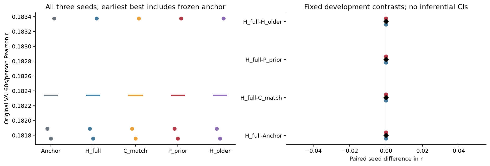
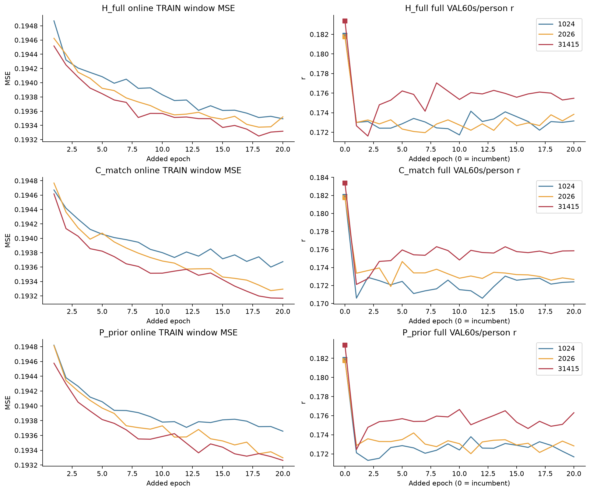
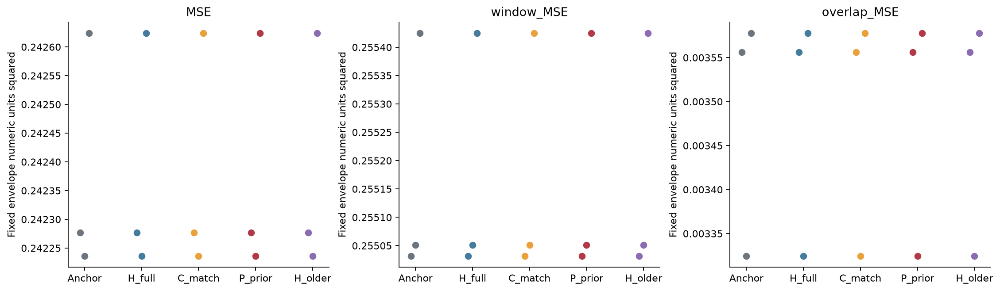
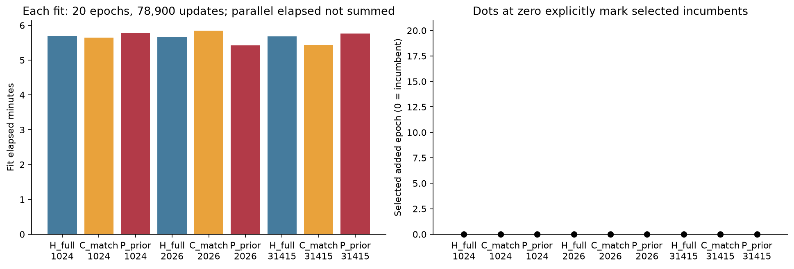

# 完整FT时序历史条件器：九fit完整开发结果

2026-11-02。**九fit×20轮全部完成，但没有新增checkpoint跨过冻结强FT+Ccap的收益门；九项均选择incumbent−1。** H_full各seed最好的已训练checkpoint仍低于锚点0.006335–0.007921 r。本轮未建立这一个条件器的额外历史收益，不能据此否定所有历史表征或宣称已达到科研goal。

180轮、710100更新、50522928个正式残差NN窗口前向均实际执行；新encoder/head前向0。队列wall1730.778秒、所有worker正常退出，无正式失败或自动重试。独立数学复核及全文/图表/轻量表审阅PASS_WITH_LIMITATIONS，科学收益门FALSE、GOAL ACTIVE。旧test、DTU、ds004408全程冻结，无新外部数据、权重、患者资料或外部评分。

## 本轮补测的有限问题与实际实现

此前D4的full1536历史只在native P的加性岭读出上测试，D5为native低维双线性交互，D11虽用FT+Ccap却把历史压成二阶协方差PCA8；不能将它们写成完整FT非线性条件器已阴性。本轮保留强FT encoder/head及Ccap(.01)冻结，输入确实读取所有8×192时序坐标，经两层Conv16/k9、flatten后监督投影32、两步GRU32与FiLM条件当前1536→32，末32→192残差头零初始化。完整输入之后仍有32维瓶颈，不是无损或任意历史网络。

H_full过去token为i−5、i−3，合计6秒；同record、互不重叠且位于Hann融合涉及的全部当前输入之前。older换为i−9、i−7，所以所有新增残差共同从i>=9拟合/应用，前9窗返回锚点，不跨record/phase。H/current各165792个新增活跃参数，current重复当前token两次、同GRU两步；参数和次数匹配不保证有效容量等价。P_prior直接输入冻结Ccap的过去预测包络，164784参数，是输出历史语义控制，不是官方DECAF，也不使用真实过去包络。所有新增网络都从同seed干净初始化重建；临时工程权重不继承。

唯一训练目标为逐点窗口MSE，Adam .001/no weight decay，无clip/网格/加轮数；每fit20轮、78900步。原global64每轮252454个位置，248620个有效残差窗、3834个fallback位置。checkpoint只按完整VAL60秒块→person r选最早最佳，incumbent−1及0…19共同候选，全部跑满。原FT、Ccap、数据划分和统计不重拟合；选点规则与旧FT的3秒loss规则不同，已在预测前明确冻结。

## 图1：selected结果相同的具体含义

左图每组显示三个seed，短横线为其均值；Anchor/H_full/C_match/P_prior/H_older的点完全一致。三个seed原锚点r依次为0.181888794、0.181756120、0.183374905，平均**0.182339940**。右图H减锚点/current/prior/older的每seed差及均差均精确0，四个预定三seed正向门均未满足，没有另做显著性或等价检验。

这不是五个独立训练函数恰好等效，而是九项都按规则回退到零残差锚点。selected>=anchor本来就由选点规则保证，不能将“不下降”当作新增改进。H_older=H也是所选零残差函数不使用历史的结构性结果，不能用它证明训练后的非零历史表征无信息。

固定warm辅助为703块/49人；平均r=0.183183997，四组差同样精确0。完整主评分仍是752块/49人，没有丢cold/transition块，也没有用warm挽救主门。每人/每块表见[ALL_PERSON](report01/ALL_PERSON.csv)、[ALL_BLOCKS](report01/ALL_BLOCKS.csv)，全15个role-seed数值含锚点/older warm见[MODEL_SUMMARY](report01/MODEL_SUMMARY.csv)。

## 图2：新增训练做了什么

三行分别是H/current/prior，颜色为seed；左列是轮内online TRAIN MSE，右列为每轮固定权重的完整VAL60s/person r。右列x=0与方框是incumbent，x=1…20对应新增轮次；表中epoch仍按0-based记录。三臂的TRAIN MSE总体下降，而VAL r在首轮明显下降，后续波动/部分恢复但始终未回到各自锚点。不能据此称没有学习，也不能只看train下降认定任务改进或全局收敛。

九项实际最佳**已训练**读数如下，仅从已有20轮日志描述性读取，不另存或重选模型；正式selected仍全部−1。

|seed|臂|best trained epoch（0-based）|best trained r|相对该seed锚点Δr|
|---:|---|---:|---:|---:|
|1024|H_full|10|0.174152708|−0.007736087|
|1024|C_match|13|0.173038614|−0.008850180|
|1024|P_prior|10|0.173793935|−0.008094860|
|2026|H_full|19|0.173834694|−0.007921426|
|2026|C_match|4|0.174658830|−0.007097290|
|2026|P_prior|5|0.174190786|−0.007565334|
|31415|H_full|7|0.177039677|−0.006335228|
|31415|C_match|7|0.176306782|−0.007068123|
|31415|P_prior|9|0.176645669|−0.006729235|

三seed各自best-trained再平均，H/current/prior为0.175009026/0.174668075/0.174876797，均低于锚点0.182339940。这些各自峰值已在同VAL内挑过，不能把H稍高的三seed均值当收益门已通过或历史机制成立；H对current/prior的best-trained方向也并非三个seed一致。

H/current/prior最后一轮的平均VAL r为0.174155041/0.173643028/0.173607700，但对应融合MSE为0.237691050/0.237814204/0.237769322，低于锚点0.242378889。**r退化与MSE改善同时保留**，不称所有指标恶化。目标MSE与主终点r之间的权衡是相容解释；本轮不能据此确定过拟合、欠训练、去噪或具体失败机制。TRAIN为轮内不同权重的在线量，不能与VAL直接相减称同checkpoint泛化gap。完整表含last数值见[FIT_RESULTS_WITH_TRAINED](report01/FIT_RESULTS_WITH_TRAINED.csv)，全部180轮见[ALL_EPOCHS](report01/ALL_EPOCHS.csv)。

## 图3：selected误差和边界

三个面板分别为融合块/person MSE、窗口MSE和无权重overlap MSE。五角色在每个seed上都重合，原因仍是回退同一锚点，不能称新条件器改善了输出稳定性。三seed平均分别0.242378889、0.255169387、0.003486080（最后一个仅为seed均值），3秒窗r为0.162067260；这些误差在不同时间/权重坐标下，不能互换。

固定prefix、首学习重叠区、tail、末single-window区及窗口/融合极值均已保存于[BOUNDARY_TAIL](report01/BOUNDARY_TAIL.json)和各selected原始JSON，并由独立实现核对。零残差selected的true/older边界同样一致；它不回答未选中非零头的边界机制。20轮MSE和最后一轮MSE的真实变化在图2与日志，不用selected一致性把它们隐去。

## 图4：完整预算和真实选点

左图逐fit约5.42–5.85分钟，每项都是20轮/78900更新，不能把并行elapsed相加当服务器总wall。右图九个黑点都在added epoch=0，即incumbent−1；它们是有观察的零值，不是漏绘或零训练预算。初版零高度柱不明显，保留[历史显示版](report01/figures/04_COSTS_AND_SELECTED_EPOCHS.png)，v2只加零值标记，数值不变。

正式总180轮/710100更新、45441720个监督窗口位置重复呈现，其中44751600个有效残差TRAIN窗。正式NN窗口前向50522928：TRAIN44751600、20次/fit有效VAL5410620、9项selected重放270531、3项older90177。incumbent完整评分不需残差NN。无新encoder/head前向、没有把临时工程或审核成本混成正式更新。

queue wall1730.778秒、九worker CPU合计3317.273秒，worker峰RSS约4.86–4.91GiB、峰GPU allocated约35.44–36.10MiB（不是含CUDA context的driver峰值）。共享缓存/两卡并行计时不是FLOPs、能耗或隔离部署延迟。

工程/审核另计：成功工程18个临时更新、92046个残差窗；首工程失败发生在反向传播调用中、optimizer.step之前，临时optimizer更新0、可追执行路径前向30169窗，wall/CPU缺测不记零。完整selected/older独立VAL审核360708窗，全部last19额外270531窗，非零TRAIN数值桥48 CPU+48 GPU窗；三项审核共631335个残差窗。正式、成功工程、可追失败路径及审核合计51276478个完整残差网络窗口前向；GRU合成自检7条短序列是不同计数类型，不混入该和。继承FT预训练/head/FT/Ccap与原处理成本非零，不能以本轮“不重编码”作总成本为零；完整[成本来源账](report01/COST_LEDGER.json)分列已测数值与缺失，非完整历史搜索总账。

## 独立核验和适用边界

[独立review](coordinator_review/REVIEW.json)重新核60个实际cache/target的SHA及身份，共6105835072B；不导入项目model/score模块，以手写GRU/functional Conv/Linear及独立Hann重放9 selected+3 older共360708残差窗、3个锚点，60690个数值项通过，r最大差约4.30e−16。20轮、78900步和含−1最早选点均符合。审核wall19.946秒/CPU50.022秒/RSS1217548KiB；技术通过不是方法改进。

[非零TRAIN桥](COORDINATOR_REVIEW_TRAIN_BRIDGE.json)固定seed1024、last epoch19、首record i9…24，不看VAL分数选checkpoint，三臂6144个输出权重都非零；CPU手写/GPU正式实现缩放残差最大差8.94e−8/8.34e−8/5.96e−8，原预定门通过，未在结果上放宽容差。它验证非零函数实现，不能由零selected相等蒙混。

[全部九个非零last19独立审阅](coordinator_last_review/REVIEW.json)按不依赖分数的统一最后轮规则，对完整VAL另外重放270531个残差窗，72个浮点汇总项全部通过，r最大差1.36e−8，wall10.612秒/CPU35.524秒/RSS1215468KiB，未改此前数值门。该证据补上selected都是零头的盲点；它不代表未保存的全部180个中间checkpoint均独立回放过。best-trained中间轮的分数来自完整原日志，而非另行推理。

[独立目标映射](COORDINATOR_TARGET_MAPPING.json)对原TRAIN/VAL全部282954窗、54327168个float32目标元素重建比对，逐值相同、最大差0。这排除该cache错序/时间坐标错误，不验证硬件同步或全部科学假设。

[呈现表独立重聚合](COORDINATOR_PRESENTATION_CHECK.json)核9 fit/180轮/735逐人/11280逐块/75 family/15 model行，全部record→family映射、shared标记和15个warm宏r一致，NN0。协调原样审阅说明见[COORDINATOR_REVIEW](COORDINATOR_REVIEW.md)。主数值proof SHA为`b7df3325c23d125a8ef27ccce8913eeb049bf6e20673c9666419edad045a87db`，last19 proof为`e075aa0d65ba01eea2591bdc4af03578de42e87d48ea053e55325f80a8af6648`。

VAL49人全部见于TRAIN；story标签无交集，但family共享audiobook_5/audiobook_13，其余三个VAL family为podcast_15/21/30。按预测前record metadata映射的[FAMILY_DESCRIPTIVE](report01/FAMILY_DESCRIPTIVE.csv)保留shared标记与原story/fallback字段，未以片段标签冒充独立family。selected的各family差为0仍由同锚点输出造成，不是五次独立历史阴性验证。

本轮仅约束该32维条件器、6秒几何、点态MSE、原训练/选点/预算，不能排除其他历史函数、瓶颈或优化解释。严格过去是既有预处理坐标中的Hann支持，不等于原物理预处理因果、硬件同步、信息独立或逐sample实时方法。组件与未测组合不构成新颖性；已有DECAF等相关原理不能忽略，P_prior不充当完整官方复现。

所有信号、latent、模型/优化状态、权重、计算仅2203；本地仅轻量代码/元数据/统计表/静态图与报告。[资源快照](FINAL_RESOURCE_SNAPSHOT.json)含轻量导出及审阅文件后run约69.46MiB<128MiB，home约21.51GiB、SATA166.38GiB，均保留20GiB；未生成新历史磁盘数组。旧test/DTU/ds004408不重开；不因本轮阴性改loss、加轮数、换网络、扩数据或合并PR。**科学收益门FALSE，SS07/持续goal仍未达到**；全文/图表已独立审阅，完成本轮轻量归档后封存此候选，不自动开启下一实验。
