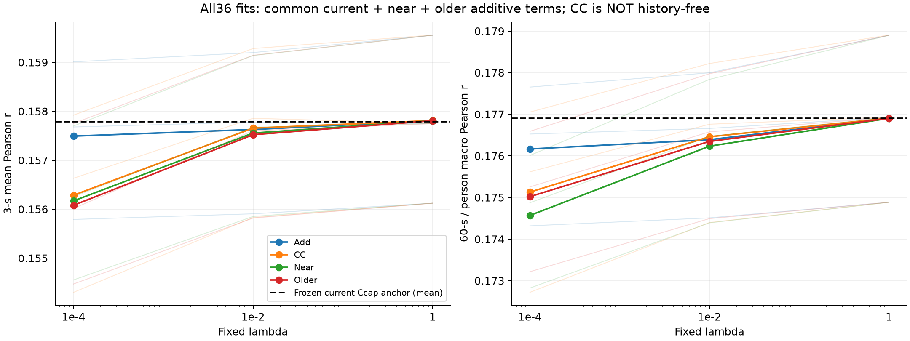
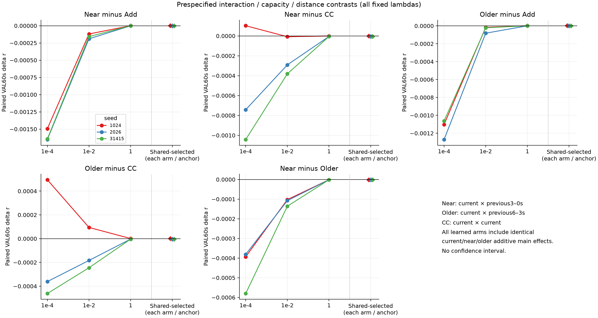
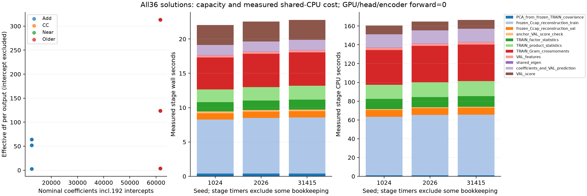

# D5：有限二阶历史交互是否改善强当前读出？

**36/36预定解完成，未获得历史改变当前映射的额外收益证据。** 近历史交互Near的共享选择VAL60秒/person r=.176902047，低于当前交互对照CC的.176905911；Near−CC三个seed均负，Near−Add只有1/3为正。未满足预设Near同时超过Add及CC、三个seed一致的开发性判读条件。

所有臂都选择网格中最强正则λ=1，结果与冻结强current Ccap锚点.176897359极接近。Near相对锚点三个seed虽都微正，均差仅约4.69e−6，而且共同主效应和当前交互控制已达到或超过Near，不能把微小正值称为历史机制。D4当前读出的源VAL增益保留，D5不改写它；研究goal仍ACTIVE。

范围：同一原TRAIN/VAL、三seed1024/2026/31415，冻结D4 Ccap(.01)锚点；4臂×3λ×3seed=36闭式岭解。server2203 CPU执行，GPU未初始化，encoder/head forward及NN优化均0，无下载或test/DTU推理。正式PID525296正常结束，无科学运行失败、自动重试或预算扩大。见[PLAN](PLAN.md)、[PROTOCOL](PROTOCOL.json)、[LAUNCH](LAUNCH.json)、[COMPLETED](COMPLETED.json)。

## 1. 共同控制与检验含义

锚点为D4已验证的强current Ccap，而不是原257参数P head。D4原TRAIN统计/正仿射/平方特征和λ=.01系数都不更新；重建后的三个seed锚点逐块/总体3秒及60秒评分与D4差均0。锚点λ曾用相同VAL选择，这是开发锚点，不是独立确认。

current latent在共同TRAIN上标准化、PCA32并白化；同一current坐标用于current、near和older。current前16分量u与后16分量v^C不重复；near/older分别用相同后16坐标v^N/v^O。所有臂共同包含加性A=current32+near16+older16（64维），因此CC应完整称为**当前交互＋共同历史加性主效应**，不是完全无历史。只有冻结Ccap是纯current参照。

Add只读A；CC/Near/Older分别在A上增加vec(u⊗v^C)、vec(u⊗v^N)、vec(u⊗v^O)，各256维。Near的Σ_jk u_j(current)v_k(near)B_jk使current因子系数依赖near，是固定的双线性映射检验，而非任意历史条件网络。每个主效应块和product坐标仅用TRAIN标准化/按块维度缩放；常量均0、PCA32分量全正，没有用VAL挑投影/维数。

near为当前起点前3–0秒，older为前6–3秒，窗口i−2/i−4严格在record内；不重叠当前原始输入、无未来/跨record/真实历史声音。原P当前仍有离线3秒权限。共同i≥4：每seed250750拟合窗、VAL30304窗可加新残差；首4窗返回共同锚点，保持全30500窗及原49person/752块评分，Hann重建/块起点均不改变。

原清单的TRAIN为70人/41clip，VAL为49人/5clip，49人均见于TRAIN；clip/env路径不交集，但部分同书家族共享（例如VAL audiobook_13_2、5_2与TRAIN13_1、5_1/5_3）。这是**已知被试、不同clip、部分同书来源的反复开发VAL**，不称独立被试/故事泛化。共享路径不重合不能解除历史开发暴露。

一个明确顺序偏差：PLAN原写任何新拟合前核对锚点，实际先从D4 current TRAIN covariance做无监督PCA32，再核对锚点。协调审阅到时run已启动，原source/顺序保留，不重跑。**所有新岭解前锚点门确实通过**，PCA无VAL/target拟合；不把执行顺序描述成与PLAN完全一致。

## 2. 图一：全部36格与共享选择结果

左右是3秒窗平均Pearson和60秒→person宏平均Pearson。细线为各seed、粗线为三seed均值、黑虚线为冻结Ccap均值；所有三个固定λ都呈现，连线不是连续优化，无CI。四臂在小λ下降低、强λ回到锚点附近，提示本固定残差在VAL上需要强收缩；不凭此断言精确等价、统计过拟合或所有交互无用。

| 臂 | d / 系数含截距 | 选λ | 3秒r均值 | 60秒r均值 | 三seed相对锚点Δr |
|---|---|---:|---:|---:|---|
| Anchor Ccap | 既有3264 / 626880 | 冻结.01 | .157790789 | .176897359 | 0 / 0 / 0 |
| Add | 64 / 12480 | 1 | .157806936 | .176902435 | +2.451e−6 / +1.227e−5 / +5.057e−7 |
| CC | 320 / 61632 | 1 | .157809597 | .176905911 | +2.915e−6 / +1.659e−5 / +6.149e−6 |
| Near | 320 / 61632 | 1 | .157807684 | .176902047 | +2.588e−6 / +1.131e−5 / +1.648e−7 |
| Older | 320 / 61632 | 1 | .157807197 | .176903531 | +3.893e−6 / +1.283e−5 / +1.799e−6 |

每臂一个跨三seed共享λ，原Anchor零新残差也可选，严格高于Anchor才选拟合；本轮四臂都微高于Anchor所以没有回退。没有按seed挑最优λ，也没有因全选λ=1增加更大λ；均完整保留。微小分数差的存在不满足有实际意义、显著或可泛化的历史增益。

## 3. 图二：预设交互、容量和距离比较

五个面板为Near−Add、Near−CC、Older−Add、Older−CC、Near−Older，空白格解释输入。前三个横轴点是相同固定λ，最右菱形为各臂共享选择（本轮全为1，故对应最后固定点）；三色为seed，零线为无差异，无CI。保留低λ的负值，未只放大最接近零的选定结果。

| 比较 | 共享选择均差 | 三seed差值（1024/2026/31415） | 正seed |
|---|---:|---|---:|
| Near−Add | −3.881e−7 | +1.372e−7 / −9.606e−7 / −3.409e−7 | 1/3 |
| Near−CC | −3.863e−6 | −3.270e−7 / −5.279e−6 / −5.984e−6 | 0/3 |
| Older−Add | +1.096e−6 | +1.442e−6 / +5.524e−7 / +1.294e−6 | 3/3 |
| Older−CC | −2.379e−6 | +9.776e−7 / −3.766e−6 / −4.349e−6 | 1/3 |
| Near−Older | −1.484e−6 | −1.305e−6 / −1.513e−6 / −1.635e−6 | 0/3 |

同λ=.0001/.01时Near−Add分别均−.001597/−.000156，三seed全负；Near−CC分别均−.000561/−.000227，只有1/0个正seed。没有出现可在本固定网格上稳定支持的近历史交互增量。

Older−Add在λ=1虽三个seed微正，但Older未一致胜CC，不能把辅助对照改称主发现。Near−Older在三个λ×三个seed均负；这不证明远历史机制，因为两者都未充分超过共同当前交互控制。Older不是预定零信息负对照，也不是长程记忆；不以近必须胜远作为一切条件信息的必要条件。

## 4. 图三：有效容量与完整CPU成本

左图为全36解的系数数与每输出有效自由度（不含截距），部分CC/Near/Older点重叠；相同320维/61632系数不等于相同有效rank。选定λ=1时Add有效df约2.852，三个交互臂约3.848，强收缩使新增函数容量很小；小λ时有效df明显更高。这与图一低λ下较差VAL一致，但不能单独证明所有交互只是在拟合噪声。

中/右图分别堆叠实际记录的stage wall/CPU：TRAIN PCA、冻结锚点重建及评分、因子/product统计、Gram、VAL特征、共享特征分解、系数形成/预测及评分。锚点TRAIN重建和Gram是主要开销，非只计算矩阵求解的时间。全部采用同一进程共享CPU，未将计时当隔离性能或效率优势。

整轮wall69.045秒、process CPU493.421秒；三个seed各22.115/22.635/22.845秒wall和160.582/164.915/166.477秒CPU。peakRSS3579019264B（约3.33GiB），主运行派生44818802B（约42.74MiB），GPU未初始化，NN更新与encoder/head前向0。来源hash/文件记账等部分不在stage堆叠内，因此图的分项和不强行等同总wall。原D4/原预训练成本仍是共享历史，未记作零成本方法。

每seed重建Anchor TRAIN252454窗及VAL30500窗；PCA从既有TRAIN Gram读取，无额外NN或VAL拟合；因子统计、product统计和回归Gram各250750共同训练窗，VAL特征30304窗。每seedAnchor一次加12解，共13次完整VAL评分；总39次=1189500窗次/29328块次，仍是同一开发VAL重复计数。36个联合192输出岭解及3次PCA分列，未把192输出当192个独立选择。

## 5. 验证、限制与交付

必要合成核验通过：乘积张量与手算双线性最大差8.88e−15，增广岭系数最大差3.25e−14，共同A和record近远索引检查通过。三个seed实际锚点逐块/总体差均0；所有target/缓存/既有transforms/coeff/source指纹在本轮新拟合前固定，结束时输入size/mtime保持不变。完整原样协调review及三层判定见配套REVIEW。

这是固定PCA32/16×16双线性投影的阴性/近零开发证据，不排除其他历史×当前非线性，也不覆盖全部current函数类。PCA按无监督方差而非目标优化，冻结current anchor也已由同VAL选择；共享被试/刺激和重复选参限制结论。没有统计显著性、等价/非劣、信息论独立、硬件同步或生物学机制证明，更没有新数据泛化或投稿充分性。

本轮不自动扩大λ、PCA维数、history距离、seed或新NN。后续须根据D4真实current增益与D5限制，另给明确假说、强current控制和有限预算，先由协调审定；不能继续在同VAL无界追分。SS07/S03/PUB和科学goal仍ACTIVE，D4/旧warm/round01原结论保持。

产物：[全36格](RESULTS.csv)、[共享选择逐seed](report01/SELECTED.csv)、[全λ预设比较](report01/CONTRASTS.csv)、[全部逐人](report01/ALL_PERSON.csv)、[全部逐块](report01/ALL_BLOCK.csv)、[逐record3秒](report01/ALL_RECORD_3S.csv)、[数值汇总](report01/NUMERICAL_SUMMARY.json)、[分项实际成本](COST.json)。仅轻量统计/图文回本地；latent/锚点预测、PCA、Gram、系数留2203，PR#6保持Draft，无患者/其他支线或远端Git。
