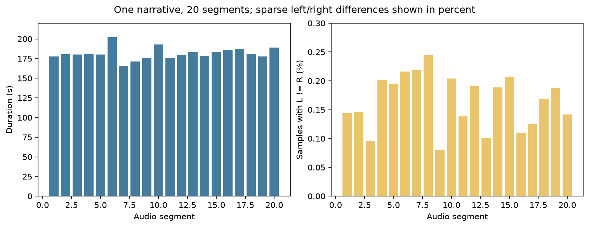
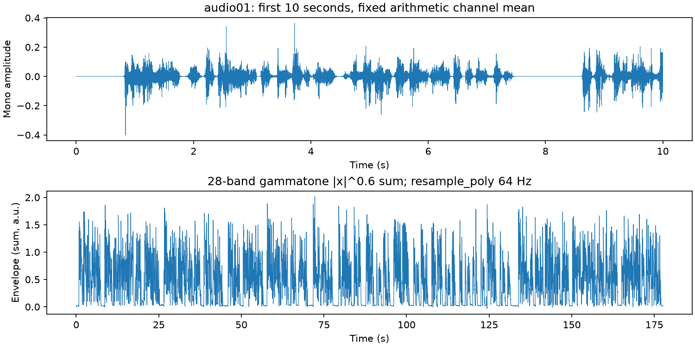
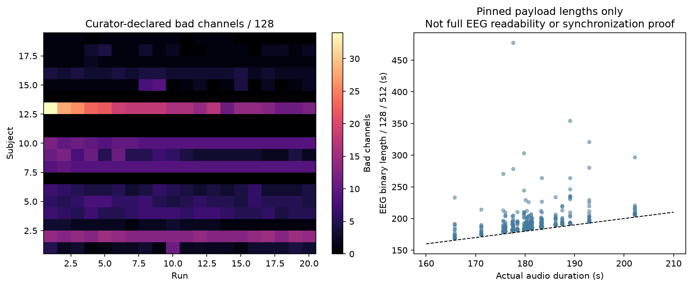
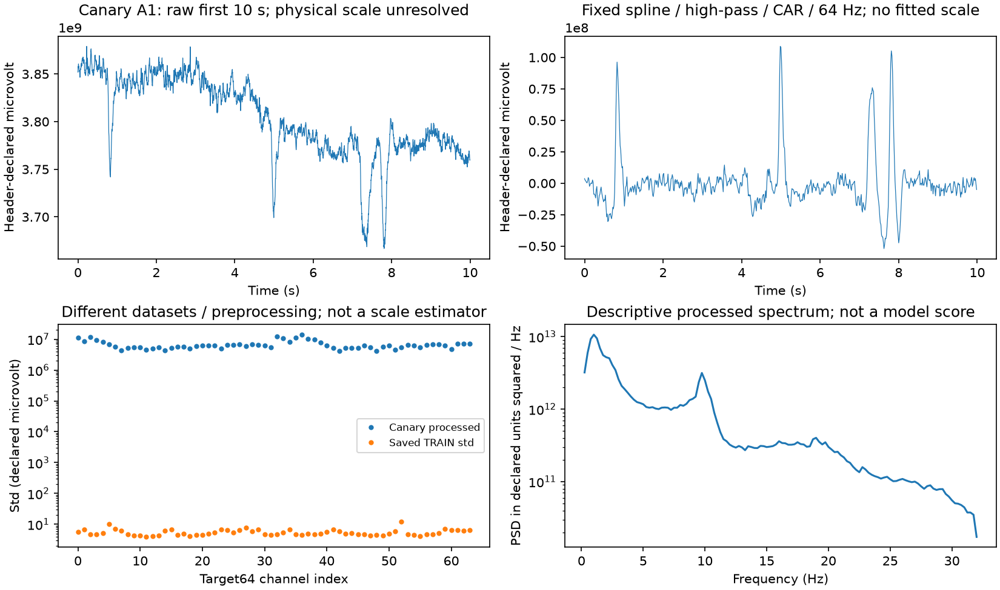

# ds004408数据概览与预测前输入修订

2026-11-02，PUB-01-S03_SS07。本报告是实际数据探索与预处理进展，尚无新模型性能结果。全部数据读取、计算和图形生成在server2203；本地仅轻量汇总及静态图。

**已完成**：固定版本760个header、119份唯一坏道表核验；20音频和首条EEG载荷完整长度/SHA核验；20段固定音频包络；共享适配的合成与真实首条检查；统计机械规则检查。**进行中**：380条EEG逐条内存获取、完整校验和预处理。其余EEG载荷没有预先宣称全部可读，988个主评分块仍是预测前布局。无新训练、模型预测或成绩选适配。

## 数据身份、规模和独立性

真人已授权[该范围](../../metadata_review/OPENNEURO_SCOPE_AUTHORIZATION_20261102.json)。固定[OpenNeuro ds004408](https://openneuro.org/datasets/ds004408/versions/1.0.8)，CC0，DOI10.18112/openneuro.ds004408.v1.0.8，[Git commit b2d91784](https://github.com/OpenNeuroDatasets/ds004408/tree/b2d91784a90c18e1d76bd77dcb2b29b0ce27a0be)。19人×20条记录；20音频是同一《The Old Man and the Sea》叙述的连续片段，不是20个独立故事/说话人。

全部实际header声明128通道A1..D32、512Hz、MULTIPLEXED/IEEE_FLOAT_32、resolution0.1µV；380个marker文件均无marker。README声明EEG与音频起点已对齐，并允许EEG拖尾。这支持预先固定零偏移的来源假设，不证明硬件同步；不搜索相关峰或拟合lag。

## 图1：音频长度与声道差异

20段均为44.1kHz、双声道PCM16；实测165.721–202.130秒，总计3629.372秒。不同于“每段约180秒”的粗略描述，一部分记录含第三个完整60秒块，另一些只有两个，不能硬编码相同块数。

左右声道仅约0.080%–0.245%的样本不同，但每个完整文件都有差异；首几秒相同不能推断全段相同。这里固定沿用librosa默认算术平均，不按模型分数挑左右声道。早版图以0–1显示fraction，使小差异不明显；原图保留，当前百分比坐标完整显示这些差异。

## 图2：固定声音包络示例

上图为第一段前10秒的静态单声道波形，下图为全段64Hz目标包络。包络使用已安装brain_pipe0.0.4的28个50–5000Hz ERB gammatone频带，abs^0.6后求和，再resample_poly至64Hz；不是频带均值，也没有新目标标准化、增益或lag拟合。语音与停顿的幅度结构可见，首段177.563秒得到11365个64Hz样本。

全部20段实际处理完成，无异常；wall196.609秒、CPU196.952秒、峰值RSS926200KiB，无GPU/NN。源码身份及逐音频长度、声道差异、目标摘要见[AUDIO_PREPARE_COMPLETED](AUDIO_PREPARE_COMPLETED.json)和[AUDIO_OVERVIEW](AUDIO_OVERVIEW.csv)。这不证明旧Sparr发布包络的具体处理revision与新包络相同；MSE需保留目标处理域差异限制。

## 图3：坏道与记录长度

左图显示原发布方标注的坏道数量，285/380条记录至少有一个坏道，范围0–34；个体及run差异明显，不能只检查一份全good表后外推。当前唯一空间适配排除已标bad的source电极，用其余good电极在标准BioSemi128→标准BioSemi64固定模板上做spherical spline映射，再CAR；不因坏道数另选被试或按成绩改变空间算子。标准模板是明确假设，个体实测坐标缺失，README与JSON的设备描述差异保留。

右图由已核固定payload长度除以128道/512Hz得到原始EEG时长；范围168.824–477.670秒。全部比对应音频长1.390–300.107秒，只按共同长度裁剪。这个图验证长度布局，不证明其余379条EEG信号可读、尾段是何实验内容或零偏移是物理真值。

实际音频和固定header长度的共同布局为380条、19人、45429窗及988个eligible完整60秒块，见[PROVISIONAL_DATA_MASK](PROVISIONAL_DATA_MASK.json)。每块至少3800个非零Hann覆盖点，目标finite且精确非恒定。尚需全量EEG处理与实际mask冻结；988块不能作988个独立样本。完整processed EEG预计1129921792B，三seed Z/P缓存预计942016512B，均纳入既有存储上限。

## 图4：发布单位异常与明确修订

首条EEG载荷51,380,224B的固定SHA匹配，MNE reader与手工float×1e−7 V逐值最大差0。但按header声明换算，原始good通道std中位约9.009e7µV；排除5个declared bad、固定高通/模板/CAR/64Hz后仍约6.236e6个声明µV，旧TRAIN std中位4.956µV。波形与谱有结构，不使其绝对幅度成为物理真值。两个reader一致遵循header，只证明解码一致。不能按新旧std比直接认定某个SI错误或挑一个效果好的倍率。

在新数据0 NN/0模型成绩时，协调决定了一个且仅一个无标签全record整体gain，原方案和异常证据保留，具体[AMENDMENT](AMENDMENT_GAIN_CALIBRATION.md)。固定DSP及共同长度裁剪在FP64完成；A_record是64道去各自时间均值后方差均值的平方根，A_source是原TRAIN std的RMS，乘单一正gain=A_source/A_record，然后才cast float32并用原TRAIN mean/std。去时间均值只用于估计gain，不从输出再减去均值。

原TRAIN的A_source=5.662644680；首canary共同长度11365，A_record=6659423.377，gain=8.503205697e−7。此gain不是发现了真实物理换算。该契约对整体正单位倍率不变：五个固定合成倍率1e−9/.01/1/1e6/1e9下输出最大差≤1.137e−13；不同record独立、filter前全good道时间常量拒绝均通过。最新[ADAPTER_V2_CALIBRATION_CHECK_V2](ADAPTER_V2_CALIBRATION_CHECK_V2.json)绑定实际源码，旧检查保留。

输出称“source-amplitude calibrated numeric units”，物理增益继续UNVERIFIED。全record含未来EEG用于校准，必须解释为**离线、无标签整体增益校准后的外部迁移**，不是纯零校准独立确认或在线因果方法。artifact和域差异仍能影响整体幅度；此修订不解决个体电极位置或同步问题。原TRAIN mean/std没有重拟合，但每record的A_record/gain是新计算的无标签输入统计；其实际次数应按成功处理记录单列。“新拟合0”仅指新学习模型拟合为0，不能解释为没有估计新数据统计。

## 下一评估的边界与当前验收

四角色P_FT*/Ccap/W/F、三seed1024/2026/31415不变，无新模型/权重/拟合。两个primary固定为Ccap−P_FT*和F−W。每record每个完整60秒块单独算r，每人在全部块间等权平均，再在人内平均三seed；equal-clip仅secondary，不跨segment拼接算r。每个seed必须使用完全相同且无重复的(record,start,stop)集合；等计数但身份不一致的反例已拒绝。

推断最多19个人；abs(mean(person差值))枚举全部2^n符号，含观察排列/1e−15 ties，仍依赖人独立与零假设符号对称/可交换。两primary用Holm2；20000次共同person bootstrap、seed20261102、[.0125,.9875]为Bonferroni family95近似区间。共享单一叙述/说话人的局限保留，不能把seed/时间块当新独立样本。合成统计检查[PASS](STATISTICS_SYNTHETIC_CHECK_V2.json)，不是新数据成绩。

当前仅获取/音频/适配canary/机械统计工程检查通过；完整EEG、最终预测freeze、一次正式评估和独立数值审阅仍待。SS07保持ACTIVE，科学目标未达到。D11及以前结果不改、不重开；PR6保持Draft，不合并；患者/STN、额外数据集/权重、旧test/DTU新推理均未启动。
