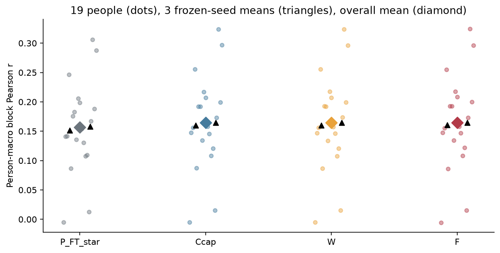
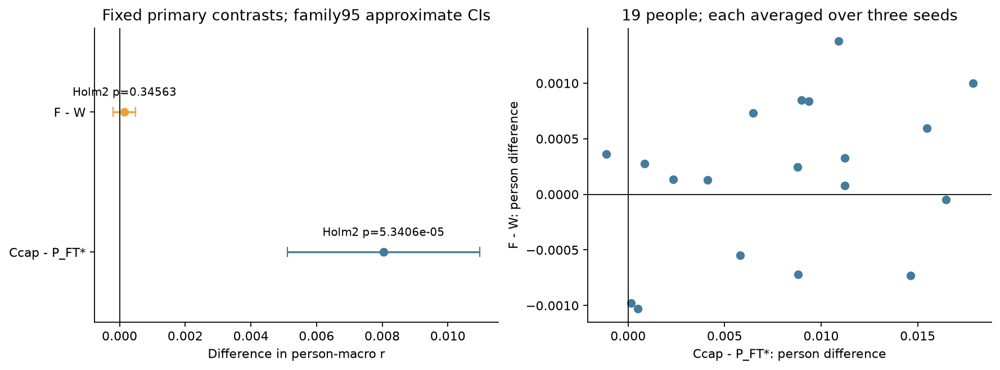
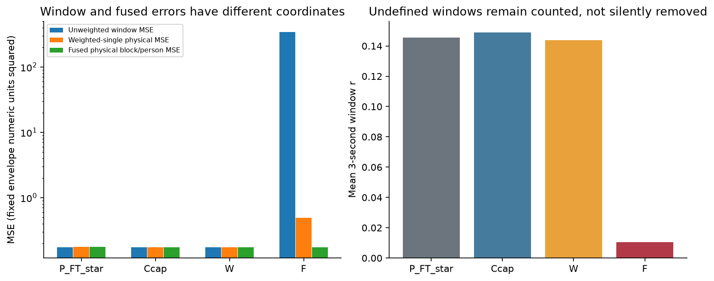
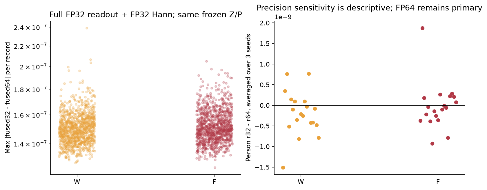
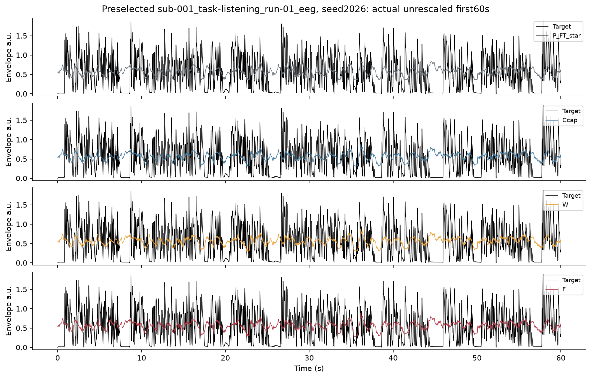

# ds004408外部迁移结果：无标签全record整体增益校准

状态：实际三seed四角色完成，独立全量数值复核PASS，全文/图表/轻量表和成本最终独立审阅PASS_WITH_LIMITATIONS；本阶段已验收，SS07科学goal未达到。固定19人/380条/988完整60秒块，三seed只在人内平均，不能算57个独立人。所有推断条件于同一叙述/说话人及固定offline/transductive输入适配。

Ccap-P_FT_star：Δr=0.00804082，family95近似CI[0.00511387, 0.01097443]，exact sign-flip p=2.6702881e-05，Holm2 p=5.3405762e-05；达到预定Holm2阈值的正向差异。
F-W：Δr=0.00015187，family95近似CI[-0.00020287, 0.00048958]，exact sign-flip p=0.34562683，Holm2 p=0.34562683；未达到预定Holm2阈值，不能据此认定等效。

这次实际支持的是**固定的当前窗口读出增益可以迁移到另一个collection**：Ccap优于强FT基线，而直接优化融合目标的F相对W没有达到预定统计阈值。F的低窗口相关和巨大单窗误差继续存在。不能把此结果写成连续历史有用、物理目标普遍更优或已经达到投稿目标。

P_FT*是既有XLSR19/Transformer强基线及其已冻结FT encoder/head（三个seed都选原VAL epoch4，星号表示沿用原标量输出标定）。Ccap在同一encoder/head上加固定的当前3秒潜变量、原预测及潜变量平方的静态残差读出；W/F复用相同特征，分别优化原TRAIN的加权single-window/融合物理轴目标。这里的“物理轴”指样本时间坐标上的固定包络numeric单位，不表示SI单位已验证。四者都没有新增历史状态，所有系数及原TRAIN统计均在新预测前冻结。

|角色|三seed/person r|equal-clip r（描述）|融合块/person MSE|3秒窗r|窗MSE|
|---|---:|---:|---:|---:|---:|
|P_FT*|0.15647677|0.15459864|0.17559276|0.14555176|0.17508970|
|Ccap|0.16451759|0.16258669|0.17433121|0.14887782|0.17398552|
|W|0.16444634|0.16253074|0.17422201|0.14377164|0.17377013|
|F|0.16459821|0.16294227|0.17449112|0.01052779|343.20054738|

## 图1：逐人及逐seed绝对表现

每个半透明点为一个人在三seed内平均后的块r；黑三角是每seed的被试宏平均，菱形是最终平均。点数19代表推断单位，seed三角不是独立样本。原TRAIN mean/std未重拟合；每record整体gain是新增无标签输入统计，共380次，使用未来EEG，不能称纯零校准确认。

四组个体分布均很宽，部分人接近0、另一些约0.3；跨人差异明显大于Ccap/W/F三个均值之间的距离。Ccap相对P_FT*并非只由最高表现者撑起：三个seed分别提高0.008718/0.008724/0.006680；人内平均后18人正、1人负。但这18人并非18种独立刺激，全部听同一英语叙述。绝对r约0.16仍只描述低层声音包络关联，不等于可听语音、语义重建或临床能力。

|角色|seed|60s/person r|物理MSE|3s r|窗口MSE|
|---|---:|---:|---:|---:|---:|
|P_FT_star|1024|0.15157551|0.17691718|0.14233134|0.17620768|
|P_FT_star|2026|0.15983809|0.17558897|0.14671666|0.17521550|
|P_FT_star|31415|0.15801671|0.17427214|0.14760729|0.17384591|
|Ccap|1024|0.16029380|0.17560612|0.14629428|0.17496427|
|Ccap|2026|0.16856203|0.17372546|0.15081118|0.17356765|
|Ccap|31415|0.16469695|0.17366204|0.14952799|0.17342463|
|W|1024|0.16006769|0.17550363|0.14019448|0.17475484|
|W|2026|0.16864146|0.17359485|0.14657501|0.17342278|
|W|31415|0.16462989|0.17356754|0.14454543|0.17313275|
|F|1024|0.16036018|0.17564251|0.01036702|347.47923261|
|F|2026|0.16901824|0.17375870|0.01059577|348.63923857|
|F|31415|0.16441622|0.17407214|0.01062059|333.48317097|

- Ccap-P_FT_star，seed1024/2026/31415差值依次为0.00871829, 0.00872394, 0.00668024；正向3/3。
- F-W，seed1024/2026/31415差值依次为0.00029249, 0.00037678, -0.00021367；正向2/3。

预定secondary仅描述：F-Ccap Δr=0.00008062、equal-clip Δr=0.00035558；W-Ccap Δr=-0.00007125、equal-clip Δr=-0.00005595。不据这些结果改变两个primary或模型。

完整228个逐seed逐人行见PERSON_BY_SEED.csv；每seed/角色表见SEED_SUMMARY.csv，全部固定块见ROOT的BLOCK_RESULTS.csv。不能只凭某个seed或最高均值下结论。

## 图2：两个预定主比较

左图Ccap−P_FT*的区间完整在0右侧，F−W则跨0，效应尺度相差约53倍。右图多数人横坐标为正，纵坐标则正负混合：Ccap差值范围−0.001136至+0.017867、中位+0.008810；F−W为13人正/6人负，范围−0.001030至+0.001377。F−W在seed31415均值为负，不能用两个正seed或13个正人代替预定检验。图只为横轴刻度拥挤做了显示补正，数据/区间不变，原PNG保留。

区间是共同person paired bootstrap的97.5% percentile区间（两比较Bonferroni family95近似覆盖），不是精确区间；p来自全部2^19符号的abs(mean差值)枚举，仍假定人独立和零假设下符号对称/可交换。Holm2另行调整；不能把20段共享故事当20个故事重复验证，也不能把相关改善解释成历史机制或因果机制。

## 图3：窗口误差与融合误差

窗口MSE、Hann加权single MSE与最终融合MSE在不同坐标下度量，不能互换。F已知可能靠低Hann权重处的大窗口值与重叠相消形成较小融合误差；单窗病态不自动证明融合输出无效，较好融合分数也不证明窗口表示稳健。四角色均保留窗口r/MSE、overlap、weightedSingle/fused/disagreement恒等式与边界/tail记录。包络来自当前固定gammatone处理，旧发布revision未知，MSE的幅度域限制保留。

F窗口MSE=343.2005，而融合块/person MSE=0.174491；窗口r仅0.01053，数值上低于其他三者约0.144–0.149的描述值（这里不另加显著性检验）。F实际单窗最大绝对预测254.071，但融合后最大绝对预测仅1.0328；无权重overlap不一致MSE的record-seed中位700.207，W为0.005592。固定Hann下weightedSingle MSE=0.493927、融合MSE=0.174491，disagreement=0.319436，恒等式最大误差2.58e−12，支持“巨大窗口值能在固定融合中相消”的数值解释。

这种相消在本轮没有带来F相对W可确认的主r增益，且F融合MSE比W高0.00026911，三seed差值均为正。MSE是描述性而非新增主检验。边界也并非一律恶化：首个学习重叠区的record-seed平均MSE，F/W=0.180725/0.166057；最终single-window尾端为0.121114/0.147216，完整块后的可评估tail为0.156366/0.162892（855个record-seed尾段，非独立样本）。这些区域不等长且只作原预定诊断，不可用较好tail挽救主结论，也不可用较差首边界宣称所有融合无效。前四窗回退使四者该区域完全一致。详见RESULTS_DETAILS及服务器逐record记录。

## 图4：全FP32敏感性

W/F诊断使用同一份FP32 Z/P，但读出、原TRAIN统计转换、Hann及累积均用FP32；主结果始终FP64读出/Hann。左图每点是一个record/seed的波形最大差，右图是完整块/人/seed层级的r32−r64，不依据这些差选择precision或删模型。本轮成功诊断2280/2280个record-seed-role，记录到的诊断异常0；异常单列，不能使有效FP64主结果被静默排除。逐record与逐人诊断见PRECISION_RECORDS/PRECISION_PERSON。

左图W/F波形差都约1.2–2.4×10⁻⁷，没有出现F独有的数量级放大；右图逐人r差在10⁻⁹量级，最大绝对值W=1.510e−9、F=1.874e−9，远小于F−W的均值与区间尺度。这说明本轮固定缓存和这组W/F参数下，主结论对该完整FP32读出/Hann诊断不敏感；不能外推到其他窗口、设备、舍入次序或在线实现，也不消除F的单窗退化。

## 图5：事先选定的实际示例

固定首条canonical record和seed2026，显示前60秒；四面板共用由目标与全部预测实际最小/最大值确定的同一纵轴，没有看成绩选例子、重新缩放预测、裁掉负值或目标驱动平移。示例只解释输出形态，不代替全部19人的比较，也不证明物理同步。完整目标/预测数组只保留2203。

四条彩色预测大体围绕约0.5–0.7的缓慢起伏，目标黑线则有尖峰及接近0的停顿；可见预测的幅度动态范围比目标窄，很多停顿没有降至0。Ccap/W/F相互看起来很接近，这与它们宏平均r差远小于对基线增益一致；不能凭视觉判断细小差异有无意义。F展示的是融合输出，因此看不到单窗254的极值；图3补足了这个限制。共享纵轴范围实际为[−0.0619944,1.9419700]，包含全部目标/预测有限值，不裁负值。

## 来源、限制与执行范围

物理增益UNVERIFIED；唯一标量适配来自输入EEG，不是SI修复。BioSemi128→64用标准模板，缺个体实测位置；README零偏移是来源假设，marker为空。Sparr源训练为另一个collection，当前英语叙述与原荷兰语/DTU丹麦语来源不同，但缺完整跨库原音频指纹，不能排除XLSR大规模预训练音频接触。source/model/mask/statistics、实际payload SHA和跨两盘总量均有记录。

完整数据仅一部书《The Old Man and the Sea》的20段，不能写20个独立故事/说话人。全record整体gain范围1.78795e−8至1.58610e−6，中位7.61108e−7，共380次新输入统计，含未来EEG；没有按该统计或分数删记录。原TRAIN norm保持不动不等于没有适配新数据。19人×20记录全部保留，每人52块，各角色/seed均988块且无undefined主块；3秒窗也没有undefined被静默去掉。来源元数据支持collection分离，不等于已经完成全量跨库音频同一性排查。

## 本轮与继承成本

header最终核验109.001秒，首轮中断经过321.666秒；WAV/首EEG预取v2为644.815秒、首轮中断经过736.359秒（保留五个已核WAV复用）。20段包络wall196.609/CPU196.952秒；完整EEG v2 wall7694.590/CPU1190.573秒、RSS1.886GiB，v1至v2总elapsed8590.281秒不重复相加。

三seed推理+四读出+评分分别wall33.869/33.643/28.029秒、CPU60.365/59.517/60.183秒；两卡并行，不能把wall相加当总历时。每seed主45429窗、额外原Decoder桥181窗，合计136287主窗+543桥窗；无新学习模型更新/拟合，另有380次无标签gain统计。实际GPU allocated/RSS与资源投影保存在COST_LEDGER和原COMPLETED引用中。

继承三seed预训练wall4051.134/6112.835/4394.759秒，head（含缓存）1502.593/1533.774/1364.667秒，FT3257.197/4013.408/3225.610秒；这些并非本轮重新训练，但不能按零成本比较。D8读出准备及27岭拟合wall386.588/CPU1183.993秒，D9六解总wall185.396秒、三个worker CPU合计347.091秒。完整每阶段epoch/更新/重复窗口及sample呈现、原manifest SHA见COST_LEDGER；未测CPU/RSS字段与上游XLSR预训练/norm准备成本明确缺失。该账不冒充全部SS07历史搜索成本，也没有完整测量审核/绘图等额外工程成本。

独立最终输入准入另wall2.833秒，CPU/RSS未单独测量；完整数值复算另wall61.426秒、CPU221.339秒、RSS395880KiB。追加账见[COST_LEDGER_WITH_REVIEW](COST_LEDGER_WITH_REVIEW.json)，初始账原样保留。

## 独立复核与证据级别

[协调输入复核](../COORDINATOR_FINAL_INPUT_AUDIT.json)重核1017个source pin、380 EEG完整SHA/shape/dtype/C-order/finite及独立Hann mask、119 TSV、20 target；每人20记录/52完整块。全380条校准后RMS与原TRAIN amplitude相对差max2.34e−9，只核该契约实现，不验证SI。

[协调数值复核](../COORDINATOR_INDEPENDENT_NUMERICAL_REVIEW.json)不import执行者evaluate/scoring，从同一6个已核Z/P缓存独立重建4560个role-seed-record、11856个块及2280个完整FP32诊断，重算两主比较的符号枚举/Holm/共同bootstrap，并核equal-clip、Hann、MSE与边界/tail。原Decoder九个额外桥batch最大差均0。独立实现确认当前结果数值成立；共同的来源单位/同步假设仍不由算法一致性消除。

[协调全文/视觉/表和成本最终审阅](../COORDINATOR_FINAL_REPORT_REVIEW.json)实际通读全文并看六PNG，核228个person-seed行、12个seed汇总、2280个precision记录、38个人precision行及唯一性，全部成本引用manifest SHA和90个直接字段匹配。最终机器记录SHA `53894fcfe85c6cd1b73d16b73298b9c500f783e53d40fe7eab897a360c0a1d64`，stage_accepted=true / scientific_goal_complete=false。

本轮没有新学习模型拟合、新权重、患者资料、旧test/DTU新推理或成绩驱动适配。所有训练模型/读出均在新预测前冻结；3seed主encoder/head各45429窗一次，工程原Decoder桥另计，实际wall/CPU/RSS/GPU及传输接续总耗时见COST_LEDGER.json，继承训练成本不能当零。此前D11及更早结果不改。本外部结果只检验固定读出在此校准条件下的迁移，不建立连续历史机制、方法新颖性或ICML/NeurIPS充分性；SS07科学goal不由本报告自动关闭。
