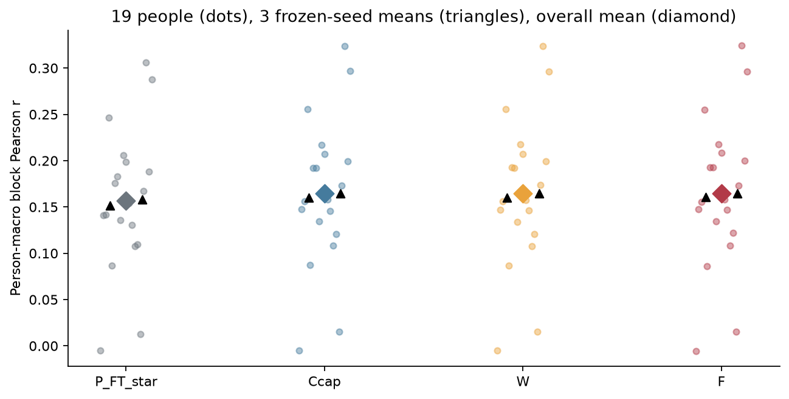
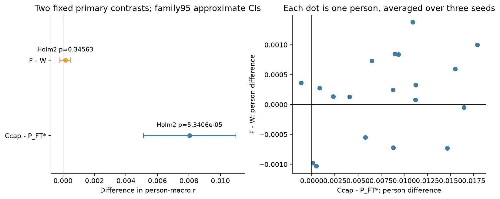
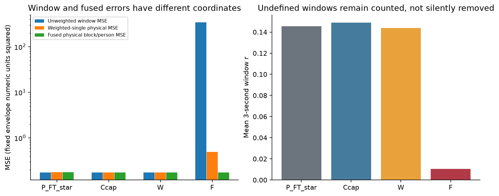
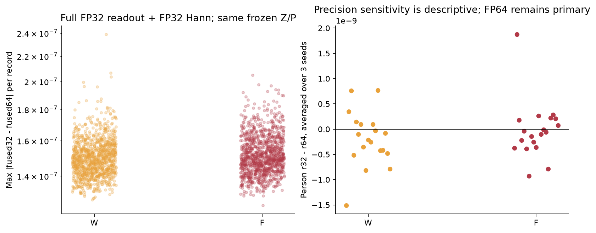
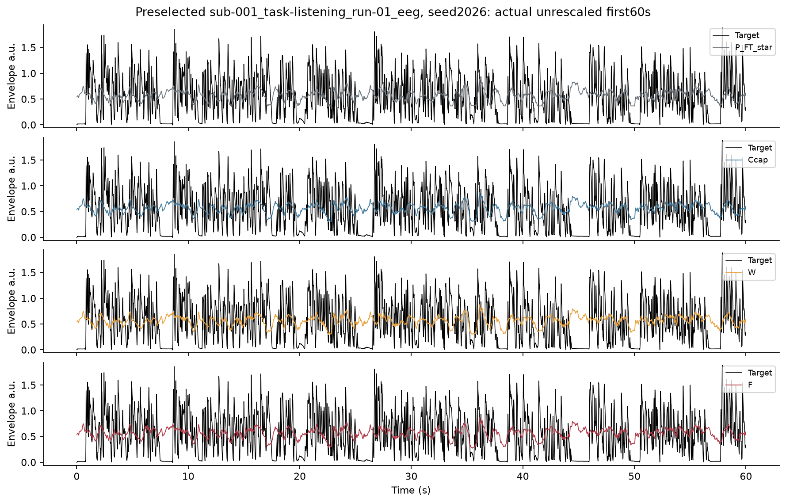

# ds004408外部迁移结果：无标签全record整体增益校准

状态：实际三seed四角色结果已汇总，独立最终数值审阅仍待；不是最终验收或goal完成。固定19人/380条/988完整60秒块，三seed只在人内平均，不能算57个独立人。所有推断条件于同一叙述/说话人及固定offline/transductive输入适配。

Ccap-P_FT_star：Δr=0.00804082，family95近似CI[0.00511387, 0.01097443]，exact sign-flip p=2.6702881e-05，Holm2 p=5.3405762e-05；达到预定Holm2阈值的正向差异。
F-W：Δr=0.00015187，family95近似CI[-0.00020287, 0.00048958]，exact sign-flip p=0.34562683，Holm2 p=0.34562683；未达到预定Holm2阈值，不能据此认定等效。

## 图1：逐人及逐seed绝对表现

每个半透明点为一个人在三seed内平均后的块r；黑三角是每seed的被试宏平均，菱形是最终平均。点数19代表推断单位，seed三角不是独立样本。原TRAIN mean/std未重拟合；每record整体gain是新增无标签输入统计，共380次，使用未来EEG，不能称纯零校准确认。

|角色|seed|60s/person r|物理MSE|3s r|窗口MSE|
|---|---:|---:|---:|---:|---:|
|P_FT_star|1024|0.15157551|0.17691718|0.14233134|0.17620768|
|P_FT_star|2026|0.15983809|0.17558897|0.14671666|0.17521550|
|P_FT_star|31415|0.15801671|0.17427214|0.14760729|0.17384591|
|Ccap|1024|0.16029380|0.17560612|0.14629428|0.17496427|
|Ccap|2026|0.16856203|0.17372546|0.15081118|0.17356765|
|Ccap|31415|0.16469695|0.17366204|0.14952799|0.17342463|
|W|1024|0.16006769|0.17550363|0.14019448|0.17475484|
|W|2026|0.16864146|0.17359485|0.14657501|0.17342278|
|W|31415|0.16462989|0.17356754|0.14454543|0.17313275|
|F|1024|0.16036018|0.17564251|0.01036702|347.47923261|
|F|2026|0.16901824|0.17375870|0.01059577|348.63923857|
|F|31415|0.16441622|0.17407214|0.01062059|333.48317097|

- Ccap-P_FT_star，seed1024/2026/31415差值依次为0.00871829, 0.00872394, 0.00668024；正向3/3。
- F-W，seed1024/2026/31415差值依次为0.00029249, 0.00037678, -0.00021367；正向2/3。

预定secondary仅描述：F-Ccap Δr=0.00008062、equal-clip Δr=0.00035558；W-Ccap Δr=-0.00007125、equal-clip Δr=-0.00005595。不据这些结果改变两个primary或模型。

完整228个逐seed逐人行见PERSON_BY_SEED.csv；每seed/角色表见SEED_SUMMARY.csv，全部固定块见ROOT的BLOCK_RESULTS.csv。不能只凭某个seed或最高均值下结论。

## 图2：两个预定主比较

区间是共同person paired bootstrap的97.5% percentile区间（两比较Bonferroni family95近似覆盖），不是精确区间；p来自全部2^19符号的abs(mean差值)枚举，仍假定人独立和零假设下符号对称/可交换。Holm2另行调整；不能把20段共享故事当20个故事重复验证，也不能把相关改善解释成历史机制或因果机制。

## 图3：窗口误差与融合误差

窗口MSE、Hann加权single MSE与最终融合MSE在不同坐标下度量，不能互换。F已知可能靠低Hann权重处的大窗口值与重叠相消形成较小融合误差；单窗病态不自动证明融合输出无效，较好融合分数也不证明窗口表示稳健。四角色均保留窗口r/MSE、overlap、weightedSingle/fused/disagreement恒等式与边界/tail记录。包络来自当前固定gammatone处理，旧发布revision未知，MSE的幅度域限制保留。

## 图4：全FP32敏感性

W/F诊断使用同一份FP32 Z/P，但读出、原TRAIN统计转换、Hann及累积均用FP32；主结果始终FP64读出/Hann。左图每点是一个record/seed的波形最大差，右图是完整块/人/seed层级的r32−r64，不依据这些差选择precision或删模型。本轮成功诊断2280/2280个record-seed-role，记录到的诊断异常0；异常单列，不能使有效FP64主结果被静默排除。逐record与逐人诊断见PRECISION_RECORDS/PRECISION_PERSON。

## 图5：事先选定的实际示例

固定首条canonical record和seed2026，显示前60秒；四面板共用由目标与全部预测实际最小/最大值确定的同一纵轴，没有看成绩选例子、重新缩放预测、裁掉负值或目标驱动平移。示例只解释输出形态，不代替全部19人的比较，也不证明物理同步。完整目标/预测数组只保留2203。

## 来源、限制与执行范围

物理增益UNVERIFIED；唯一标量适配来自输入EEG，不是SI修复。BioSemi128→64用标准模板，缺个体实测位置；README零偏移是来源假设，marker为空。Sparr源训练为另一个collection，当前英语叙述与原荷兰语/DTU丹麦语来源不同，但缺完整跨库原音频指纹，不能排除XLSR大规模预训练音频接触。source/model/mask/statistics、实际payload SHA和跨两盘总量均有记录。

本轮没有新学习模型拟合、新权重、患者资料、旧test/DTU新推理或成绩驱动适配。所有训练模型/读出均在新预测前冻结；3seed主encoder/head各45429窗一次，工程原Decoder桥另计，实际wall/CPU/RSS/GPU及传输接续总耗时见COST_LEDGER.json，继承训练成本不能当零。此前D11及更早结果不改。本外部结果只检验固定读出在此校准条件下的迁移，不建立连续历史机制、方法新颖性或ICML/NeurIPS充分性；SS07科学goal不由本报告自动关闭。
