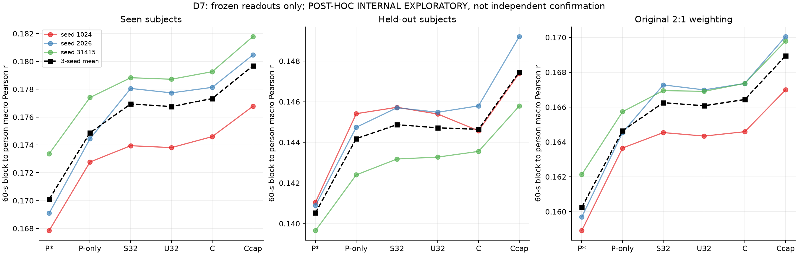
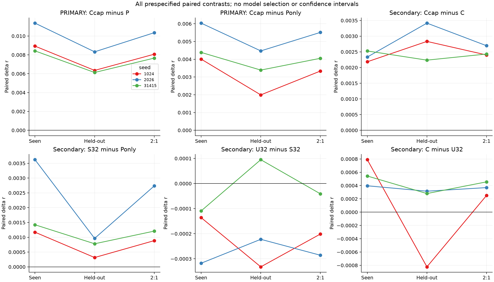
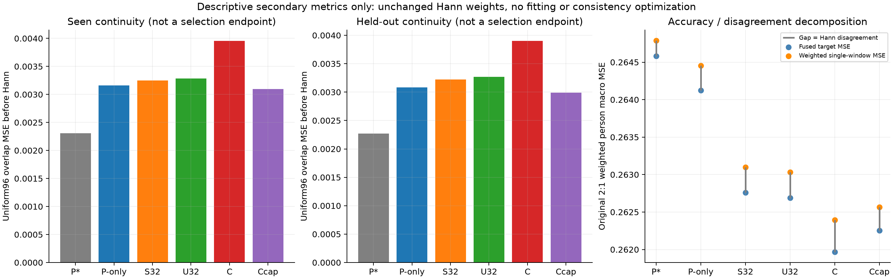

# D7：冻结强当前读出的内部泛化审计

**36/36固定角色–split评分完成，两个预设主要比较均在seen/held-out的三个seed上为正。** Ccap相对原P*的r均差为seen+.009575、held-out+.006936，原2:1加权+.008695；相对P-only分别+.004809/+.003284/+.004301。加权r由P*的.160248、P-only的.164642提高到Ccap的.168943，支持冻结当前读出的内部可重复增益。

所有结果均为 **POST-HOC INTERNAL EXPLORATORY**：这些旧测试记录已经在round01等研究中暴露，本次即使权重/λ在预测前冻结，也不能当独立确认或无偏泛化。增益来自当前读出，没有新增历史输入，不改变D4/D5的历史阴性结论。与原round01同三seed的P_FT强微调参考相比，Ccap加权点均值几乎相同、seed方向混合，**没有证明超过P_FT、等效或非劣**；不同额外预算见第6节。科学goal仍ACTIVE。

本轮无拟合、λ选择、新seed、encoder/raw EEG前向、DTU或下载。只复用冻结latent，必要原P head前向恢复window P，并在全部432record原P未缩放波形桥差为0后应用既定读出。实际PID535287正常结束，未失败/重跑/按成绩更换角色。原D4–D6保持冻结。

## 1. 设计、来源与测试暴露

角色固定P*/P-only/S32/U32/C/Ccap，seed固定1024/2026/31415，各角色只用原D6共享选择λ：P-only/S32/U32/C=.0001，Ccap=.01。来源为3个原head checkpoint及15套已有ridge系数，不是18套新ridge、更不是36组新训练。统计/正仿射a,b/标准差/平方特征全部继承TRAIN，测试无重新标定、逐窗校准或数据筛选。

| split | record | person | source_family | window | 原有效60秒块 |
|---|---:|---:|---:|---:|---:|
| seen | 69 | 69 | 9 | 36573 | 872 |
| held-out | 75 | 13 | 8 | 48119 | 1172 |

held-out指相对原P训练fold未纳入的13人，不表示整个研究过程从未暴露。两个组来自同一公开SparrKULee体系，刺激/被试/来源依赖不能忽略；17来源和82人都不当独立实验。统计以原60秒块→person宏平均，再2/3 seen+1/3 held-out，不按record/window数量重加权。source-family表只作person内块均值再family-person描述，不替换primary或构成新显著性检验。

各record首4窗都回退P*（seen276、held-out300窗/seed），其余用冻结系数；原Hann192/stride96、64Hz、phase顺序、mask及时间坐标不变。S32/U32只是Z分支local32，另有共同全窗dense P分支；共享定义在D4逐坐标TRAIN标准化后。当前encoder仍具有原3秒离线权限，不是实时因果解码。

## 2. 原P恢复桥与实现验证

既有test latent每seed144条，直接复用原cache_manifest，不将额外train_only_neutral_mean.npy误纳入。原P只存fused而未存window输出，所以只恢复原NativeHead，沿用原eval_common.predict_windows、phase_offset对齐64且record边界分段、torch.no_grad、FP32/TF32设置、grad标志和tensor布局。没有重新编码EEG。

每seed先全部144record的**原始未缩放P**与旧fused比较，再检验P*逐块r；完整seed桥通过后才计算5个候选。原输出单位绝对1e−6门没有放宽，也没有用约.002的a掩盖差异。三个seed各144条raw桥最大差均0，P*逐块r与旧P最大差≤3.33e−16；GPU driver各seed观测520MiB。首4回退未改变原P本身。

正式前实际18格固定VAL桥核对3秒/60秒r及target MSE/Hann分解：主指标最大差5.55e−17，MSE/分解宏差0，未做head/encoder或测试推理。合成检查覆盖完整60秒块、person层级、2:1加权、相同当前输入/首4回退和辅助undefined口径。正式前286来源代码SHA/893输入header指纹与原head SHA/epoch、cache最终manifest来源已冻结。初次仅metadata prepare原位归档preparation_attempt01，后补provenance/辅助口径再冻结；没有初次测试结果或训练被丢弃。

3秒r是辅助指标：若任一窗口预测/target常量，record/split全量3秒r记null并报告defined/undefined数，不挑有效子集冒充全量；MSE仍全量，合法60秒主块不因此丢掉。本次全部角色/seed/split的3秒undefined均0。60秒常量/非有限预测仍严格失败，不作预测依赖删块。

## 3. 图一：冻结模型在两个组的绝对表现

左/中/右为seen、held-out和原2:1加权的60秒→person r。三色折线连接同seed的固定角色，黑色虚线方块是三seed均值，无CI；三个面板的纵轴范围不同，应按数值而非线段高度比较。全部6角色、3seed结果呈现，没有用新排名选择胜者。

| 角色 | seen r | held-out r | 2:1加权r | 三seed加权r（1024/2026/31415） |
|---|---:|---:|---:|---|
| P* | .170106 | .140532 | .160248 | .158917 / .159697 / .162131 |
| P-only | .174872 | .144184 | .164642 | .163652 / .164538 / .165737 |
| S32 | .176944 | .144869 | .166252 | .164538 / .167273 / .166945 |
| U32 | .176756 | .144716 | .166076 | .164337 / .166987 / .166904 |
| C | .177332 | .144640 | .166435 | .164588 / .167356 / .167360 |
| Ccap | .179681 | .147468 | .168943 | .166988 / .170052 / .169791 |

P-only是监督的192维输出再读出与位置截距，不是Pearson不变的正全局仿射；它在本审计也改善原P。加入current latent后S32/C/Ccap仍有增量，故改善不全由P后处理解释。held-out各角色的r都低于seen，但这个组间差同时含被试、刺激和记录差异，不能单独归因被试泛化代价。

D6 VAL的Ccap−P约+.014535，D7原加权约+.008695，不把验证收益原幅度外推为测试收益；两集合计权/被试/clip不同，也不把差额直接当过拟合的单因素估计。这里存在内部迁移的正向点差，真正独立数据确认仍缺。

## 4. 图二：两个primary及全部次要比较

顶排前两格为预先固定的Ccap−P*、Ccap−P-only；其余四格是解释性次要。横轴seen/held-out/2:1，三色为seed，零线为无差异，无置信区间或显著性结论。三seed重复相同数据，不等于三份独立数据集。

| 主要比较 | seen均差 | held-out均差 | 2:1均差 | 三seed加权差值 |
|---|---:|---:|---:|---|
| Ccap−P* | +.009575 | +.006936 | +.008695 | +.008071 / +.010355 / +.007660 |
| Ccap−P-only | +.004809 | +.003284 | +.004301 | +.003336 / +.005513 / +.004054 |

两项primary在每组各3seed全正；并非只靠seen权重掩盖held-out负值。它们仍是固定内部描述，不能升级为确认性显著性或新方法验证。

| 次要比较 | seen均差（正seed） | held-out均差（正seed） | 2:1均差（正seed） |
|---|---|---|---|
| Ccap−C | +.002349（3/3） | +.002828（3/3） | +.002509（3/3） |
| S32−P-only | +.002072（3/3） | +.000685（3/3） | +.001610（3/3） |
| U32−S32 | −.000188（0/3） | −.000153（1/3） | −.000176（0/3） |
| C−U32 | +.000576（3/3） | −.000076（2/3） | +.000359（3/3） |

解除同local支持的共享仍未得到选定模型优势。完整latent C相对U32的VAL全λ/seed正向，不能不加区别写成held-out也稳定提高：此处held-out均值小负、seed1024为−.000823，其余两seed小正。没有据此换λ/删seed/改主比较。Ccap−C比较固定.01对.0001且增容，不能单独证明平方非线性因果或等容量优势。

## 5. 图三：一致性与target MSE不能替代r

左/中为两组各自同物理96点的uniform overlap MSE（每组内按pair等权），右为原2:1权重的person宏target MSE：橙点是Hann加权单窗误差、蓝点是融合误差，灰色间距是Hann disagreement。它们只是预设次要描述，不参与模型/λ选择；uniform pair计权与Hann/person计权不同。

| 角色 | seen overlap MSE | held-out overlap MSE | 2:1 fused MSE | 2:1加权单窗MSE | 2:1 disagreement |
|---|---:|---:|---:|---:|---:|
| P* | .002306 | .002268 | .264583 | .264790 | .000207 |
| P-only | .003160 | .003082 | .264126 | .264454 | .000327 |
| S32 | .003252 | .003222 | .262761 | .263099 | .000338 |
| U32 | .003285 | .003267 | .262689 | .263030 | .000341 |
| C | .003953 | .003900 | .261967 | .262393 | .000425 |
| Ccap | .003096 | .002988 | .262252 | .262566 | .000314 |

两组原P*依然overlap误差最小、r最低。Ccap比C更一致、r更高，但fused target MSE更高：Ccap−C加权单窗MSE增加.000173571，disagreement减少.000110861，故fused MSE增加.000284432。r对尺度/均值的性质与MSE不同，较小disagreement还减少融合相对单窗加权误差的分散收益。

固定Hann恒等式E_weighted_single=E_fused+disagreement逐物理点最大误差4.71e−15；单窗覆盖区域该项0，没有学习融合权重或新增一致性loss。不能由这些代数/描述关系声称更一致或更不一致会因果性提高准确度，也不能把Ccap较高r写成在所有误差标准上胜出。

## 6. 强参考、预算与尚未满足的结论

本次冻结矩阵的primary只对P*/P-only，不应借省略其他已知强参考而声称超过所有强baseline。原round01已有P_FT：从同一训练完成P出发再联合微调encoder/head，实际每seed额外5epoch/19725更新/1262270监督窗，其旧五seed内部加权r均值约.169800。该五seed数不能与本D7三seed直接当配对；同3seed历史参考应按原存量表对齐，作为预算不同、事后历史对照单列，不构成D7新增角色/推理、预设正式假设或重新择优。

协调已仅重聚合原保存的三seed P_FT结果，确认与D7同2044个block keys，未做任何新模型推理或训练。原样[历史FT参考](COORDINATOR_HISTORICAL_FT_REFERENCE.json)固定来源和checkpoint SHA；这是**结果后历史参考**，不改D7六角色/primary。

| 历史参考 | seen r | held-out r | 原2:1加权r |
|---|---:|---:|---:|
| P_FT（相同三seed） | .179431 | .147972 | .168944726 |
| Ccap（D7） | .179681 | .147468 | .168943486 |
| Ccap−P_FT | +.000250 | −.000504 | −.000001240 |

逐seed加权差为−.001693/+ .001004/+ .000685，方向混合。点均值近似并非等效检验，不能据此称冻结读出“取代/超过微调”。P_FT更新3372617个参数，Ccap继承冻结encoder、使用额外TRAIN ridge拟合/λ搜索，新增优化预算和函数类不同；两者原边界策略也非同一消融（D7首4窗回退P*，旧P_FT按原完整输出评分）。不以边界/预算差异为由改协议或追加测试。

P-only/C/Ccap都是常见再读出/岭/平方特征组合，当前证据没有建立ICML/NeurIPS方法新意。D4/D5的连续历史阴性不被当前无历史读出正向改写；也没有严格同架构/初始化/solver的PCC→MSE单因素消融。下一研究必须保留P-only、C/Ccap与适当P_FT等强控制、公开继承与额外成本，不能退回只与弱head比较或无限在同VAL找正值。

## 7. 实际成本、审阅与产物

本轮18角色-seed、36角色-split，共2592record-role、1524456窗口评分、36792有效块评分、1521864相邻对计次。只是同一原集合的角色/seed重复，不当独立样本。原P head前向254076窗，432个raw桥共比较24456972个原波形点；encoder/raw EEG/训练/新fit/选择/DTU/下载均0。

COMPLETED记录主run wall75.177秒、process CPU504.670秒；最终STATUS到75.635秒，包含末次计数/写出。已记录stage wall和73.307秒、CPU501.965秒，不把文件/来源记账等缺口虚构成纯head或solve时间。head阶段包含原P桥及P*评分，不是隔离GPU测速；原预训练/head、D4/D6拟合都是继承非零成本。

peakRSS1108152320B（约1.03GiB）、torch peakGPU allocated5189120B、driver观测520MiB，口径不同；新主派生234168747B（约223.32MiB），全七个SS07根NPY总18602095776B，低于25GiB。原inventory四root口径已以INPUT_INVENTORY_SUPPLEMENT补齐，额外warm30848B；不删除旧资料/缓存腾空间。只保存必要window P，不复制全量fused预测或latent；本地/Git无这些数组/系数。

独立数值核验按预测前选定scope进行：全部36cell来源/相同mask/聚合，原各phase首尾共4record×3seed×6角色=72缓存代数重建，不做新head/encoder前向。完整原样audit、最终review与三层判定见配套REVIEW；图表与全文实际审阅后归档，不把工程PASS或内部阳性当科学goal达成。

全结果：[36cell表](RESULTS.csv)、[绝对值及加权](report01/ABSOLUTE.csv)、[六组逐seed配对](report01/PAIRED_CONTRASTS.csv)、[逐人](report01/ALL_PERSON.csv)、[逐块](report01/ALL_BLOCK.csv)、[record及3秒undefined覆盖](report01/ALL_RECORD.csv)、[family描述](report01/FAMILY_DESCRIPTIVE.csv)、[数值汇总](report01/NUMERICAL_SUMMARY.json)、[计次/分解差值](report01/REPORT_DETAILS.json)、[成本](COST.json)。全部科学计算在2203，原预测、window P/latent和权重仅服务器；患者/STN禁令、PR#6 Draft/不合并及其他节点边界不变。
