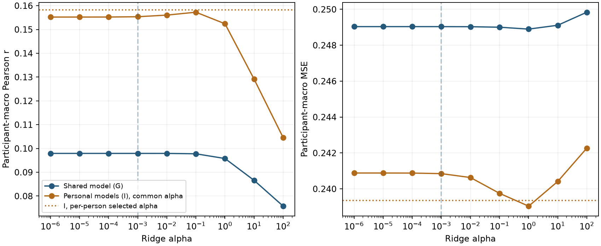
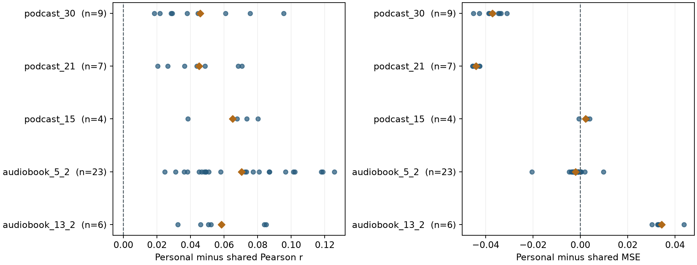

# D28 原始 EEG 时滞岭回归同协议对照

在同一开发 VAL 的 49 人、752 个块上，个人岭回归的 r 从共享模型的 **0.097929** 提高到 **0.158231**，MSE 从 **0.249037** 降到 **0.239358**。个人模型在 49 人的 r 均更高，36 人的 MSE 更低。个人 r 仍低于已冻结的 D22 B 三种子均值 **0.184581**，相差 **0.026350**。D28 补齐原始 EEG 的经典对照。此处的证据范围是反复使用的开发 VAL，个人选择利用各人的同一份 VAL，独立泛化和 SOTA 仍待建立。[全量完成回执](COMPLETED.json) · [候选汇总](CANDIDATE_SCORES.csv) · [冻结历史参照](../../contrastive_history/run01/HISTORICAL_REFERENCES.json)

## 模型与实际支持

G 用 70 人的 426 条 TRAIN 记录拟合一套共享参数。I 为 VAL 的 49 名已见被试各拟合一套参数，只使用各人的 TRAIN，合计 305 条记录。64 Hz EEG 的每个通道用整数 lead 0–32 点预测同一记录的当前包络，共 2,112 个系数加一个截距。每条记录仅对超出共同末端的 lag 元素在原通道归一化坐标填零，块边界使用同记录后续样本。全 TRAIN EEG 通道变换沿用原神经输入的 float32 坐标，随后提升到 float64。TRAIN 包络沿用原 float32 监督坐标，VAL 包络保留原保存精度。各拟合独立计算 TRAIN 列与目标的总体均值和标准差，在标准化坐标解固定九个 alpha。每套解预测后恢复到原包络幅度。[协议](PROTOCOL.json) · [实际几何](COORDINATOR_GEOMETRY.json) · [工程核验](ENGINEERING.json)

采用原预测无关正 Hann 共同支持。先在每个块计算 Pearson r 和原幅度 MSE，再在每人内等权平均，最终 49 人等权。G 选宏平均 r 最大的单一 alpha，I 逐人按个人 VAL 块均值 r 选 alpha，同分取较小值。TRAIN 统计固定，模型选点后直接读取得分。旧 SS01 的 10 人、9 个稀疏 lag、记录宏平均协议另列，历史方法这里只比较同原支持的 r。[完整候选块](VAL_BLOCKS.csv) · [逐人对照](PER_PERSON.csv) · [选择决定](COORDINATOR_DECISION.md)

| 对照 | 参数分配 | VAL Pearson r | 原幅度 MSE |
| --- | --- | ---: | ---: |
| G | 一套共享，alpha = 0.001 | 0.097929 | 0.249037 |
| I | 49 套个人，各自选 alpha | 0.158231 | 0.239358 |
| I − G | 49 人配对差的宏平均 | +0.060302 | −0.009679 |

## 正则曲线和个人选择

图 1 左右分别是 49 人等权的 Pearson r 与 MSE。横轴为 alpha 的对数刻度。蓝线表示 G，橙线表示同一个 alpha 下的全部 I 模型，橙色水平点线表示逐人选择的 I，蓝色竖虚线标出 G 的 alpha。G 在弱正则区几乎持平，r 最大值在 0.001。I 在共同 alpha 为 0.1 时达到最高 r **0.157259**，逐人选择再增加约 **0.000972**。因此即使所有个人模型共用一个 alpha，开发集上的 I 与 G 仍有大幅差距。该比较同时改变了训练数据范围和参数共享方式。I 的共同 alpha 为 1 时 MSE 最低，表明以 r 或 MSE 选点会得到不同的正则强度。个人 alpha 分布为 0.01 共 16 人、0.1 共 21 人、1 共 11 人，另有 1 人选中最低端点 10⁻⁶，结论限于冻结网格。图中无不确定性区间，各点来自同一份开发 VAL。[共同 alpha 的完整曲线](COMMON_ALPHA_CURVE.csv) · [完整选点与成本](RESULT_SUMMARY.json)

## 故事与来源组

图 2 按故事分行，蓝点为每人的 I − G，橙色菱形为故事内人均差。左侧的 49 个 r 差全为正，五个故事的均值差约为 +0.045 至 +0.070。右侧的 MSE 差方向随故事而变。podcast_21 与 podcast_30 的人均 MSE 分别降低约 0.044 和 0.037。audiobook_13_2 的人均 MSE 升高约 0.034，podcast_15 略升高。相关性改善在五个观察故事中方向一致，幅度误差的改善主要来自两个 podcast。五个故事人数不均，且每人只有一条 VAL 记录，这些差异是描述性的。[故事与来源组](STRATA.csv) · [逐人配对数据](PER_PERSON.csv)

| 分层 | 人数 | 块数 | G r | I r | G MSE | I MSE |
| --- | ---: | ---: | ---: | ---: | ---: | ---: |
| audiobook_13_2 | 6 | 84 | 0.08756 | 0.14591 | 0.12569 | 0.16002 |
| audiobook_5_2 | 23 | 345 | 0.10446 | 0.17479 | 0.13668 | 0.13471 |
| podcast_15 | 4 | 60 | 0.13172 | 0.19674 | 0.14149 | 0.14364 |
| podcast_21 | 7 | 119 | 0.07458 | 0.11957 | 0.46367 | 0.41958 |
| podcast_30 | 9 | 144 | 0.09128 | 0.13709 | 0.49927 | 0.46205 |
| TRAIN 已见来源族 | 29 | 429 | 0.10097 | 0.16881 | 0.13441 | 0.13995 |
| TRAIN 未见来源族 | 20 | 323 | 0.09352 | 0.14289 | 0.41525 | 0.38351 |

来源组以原来源族键划分。两组的 VAL 人均 r 均提高，原幅度 MSE 在未见来源族组下降，在已见来源族组略升高。故事与来源组是同一批记录的两种聚合，且 VAL 49 人均见于 TRAIN。这些结果不能外推为未见人的表现，已核对的来源键也不提供音频波形重复检测。[冻结分层与选择规则](COORDINATOR_DECISION.md) · [独立复核](COORDINATOR_RESULT_REVIEW.json)

## 历史开发参照

| 冻结参照 | 三种子均值 r |
| --- | ---: |
| D22 B | 0.184581 |
| D18 P | 0.184379 |
| D23 S | 0.183900 |
| 原 FT+Ccap | 0.182340 |

四个历史均值高于 D28 的 G 和 I。表中历史模型和 D28 的训练预算、数据共享及选点自由度各异。D28 的经典个人对照在该协议中优于共享岭回归，已有神经开发结果仍领先。D26 与 D27 尚未完成全矩阵，历史活动子集 MSE 保留在各自报告中。[历史参照及逐种子来源](../../contrastive_history/run01/HISTORICAL_REFERENCES.json) · [FT+Ccap 原锚点](../../crossfit_output/run01/REPORT.md)

## 成本与复核

正式在 2203 处理 426 条 TRAIN 的 24,297,126 个物理目标点，个人拟合逻辑使用其中 17,232,052 点。6,176 个块矩阵乘积形成 70 份被试原始统计，再合并得到 G。正式完成 50 次特征分解、450 套系数解、52,830,810 个候选预测点和 13,536 个候选块评分。G 推理参数为 2,113 个 float64 数，约 16.5 KiB。I 为 49 套合计 103,537 个数，约 0.79 MiB。服务器选中归档另存拟合归一化和等效坐标权重，实际大小约 3.44 MiB，正式证据占约 2.39 GiB。峰值 RSS 约 0.80 GiB。[预算](BUDGET.json) · [正式成本](RESULT_SUMMARY.json) · [逐记录统计](MOMENT_LEDGER.json)

正式耗时 1,040.9 秒，CPU 时间 13,470.1 秒。TRAIN 逐记录统计耗费 CPU 12,151.4 秒，50 套系数阶段耗费 CPU 266.3 秒和墙钟 36.7 秒，VAL 逐记录预测和评分耗费 CPU 292.0 秒。初始两个 OpenBLAS 池合计短时平均使用 20.79 个逻辑 CPU。核对原进程身份后，将其全部 31 个注册线程限制在同一组 16 个逻辑 CPU 上，5 秒复测平均使用 12.49 个，原进程继续完成。工程另计三次线性解。GPU、神经前向、神经更新和旧测试读取的正式计数均为零。[启动纠正回执](FORMAL_AFFINITY_000.json) · [运行期独立复核](COORDINATOR_RUNTIME_REVIEW_000.json) · [完成回执](COMPLETED.json)

独立审阅核对 17 个源、522 个输入身份、70 份原始统计与 G 的逐项合并、50 个拟合的全部 450 个正规方程，最大残差 **1.154×10⁻¹⁴**。另外从保存得分重建原 752 块支持、全部 13,536 个候选块的汇总和逐人选择。独立审阅另耗 CPU 24.73 秒，使用保存的统计、系数与得分。真实信号评分桥接由先前两段 TRAIN 工程核验支持。技术验收 **PASS_WITH_LIMITATIONS**，登记启动期资源偏差与独立复核的范围。经典对照验收 **PASS_WITH_LIMITATION**，父任务一致性 **PASS**，SS07 仍为 ACTIVE。[独立终验](COORDINATOR_RESULT_REVIEW.json) · [工程评分桥接](ENGINEERING.json)
