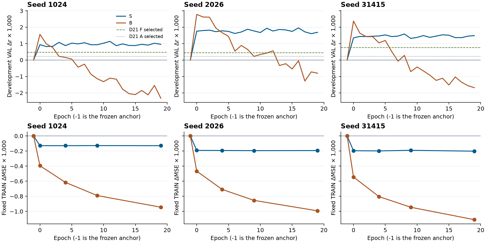
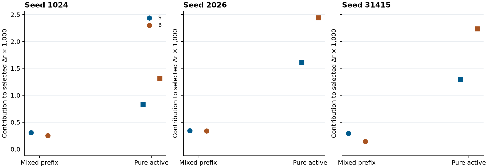

# D23 无历史的非线性输出对照

2026-11-06 · PUB-01-S03_SS07 · 2203

**只用当前冻结预测的 S 在全部 60 个训练轮次都高于锚点。** 三 seed 选中开发 r 的均值为 **0.183899636**，较锚点高 **0.001559696**。D22 历史模型 B 的最佳已训练轮次在三个 seed 都高于 S，平均领先 **0.000681269**。反过来，S 在 **52/60** 个同 seed、同轮次比较中高于 B，末轮也在三 seed 都高于 B。当前标量的非线性校准已能取得持续的开发增益，历史模型的额外优势出现在各自最佳选点的比较中。[正式终态](COMPLETED.json) · [逐 seed 指标](SEED_RESULTS.csv)

## 冻结对照

S 的当前和上下文分支均只输入当前 b(t) 的同一个 FP32 标量，统计沿用同 seed 的 D20 P TRAIN 标量值。B 的当前分支同样输入 b(t)，上下文仍有 96 个过去预测箱。S 保留乘法门和共同网络层，将 context_in 的输入维数由 96 改为 1，原第一列乘 √96，其他共享权重、bias 与 CPU/CUDA 随机流保留。S/B 参数数为 3,361/9,441。固定原 TRAIN/VAL、锚点、起点 1344、物理 MSE、20 pass、Adam、全局乱序、752 块和 49 人的主评分。冻结预测 b(t) 来自原离线整窗 EEG，S 的无历史定义是后处理输入级别。工程确实改动真实过去的预测区间，重建输入表并保护当前 b，S 输出逐值保持一致。[方案](PLAN.md) · [工程回执](ENGINEERING_COMPLETED.json)

## 最佳轮次与末轮

| Seed | 原锚点 r | D21 线性 F r | S 选中 epoch | S 选中 r | B 选中 r | B − S | S 末轮 r | B 末轮 r |
| --- | ---: | ---: | ---: | ---: | ---: | ---: | ---: | ---: |
| 1024 | 0.181888794 | 0.182370915 | 11 | 0.183024217 | 0.183454562 | +0.000430345 | 0.182847474 | 0.179562531 |
| 2026 | 0.181756120 | 0.182201518 | 16 | 0.183713917 | 0.184535569 | +0.000821652 | 0.183444607 | 0.180950860 |
| 31415 | 0.183374905 | 0.184142650 | 8 | 0.184960773 | 0.185752582 | +0.000791809 | 0.184863119 | 0.181688413 |
| 三 seed 均值 | 0.182339940 | 0.182905028 | — | 0.183899636 | 0.184580904 | +0.000681269 | 0.183718400 | 0.180733935 |

S 的选中 r 在三个 seed 都高于 D21 仿射 A 和线性 FIR F。相对各 seed 锚点，S 有 **30、38、31** 人提高；与 B 的正式选中值相比，S 有 **20、22、19** 人更高。三组均沿用旧执行器的两个评估槽，两槽都输入同一个当前值并得到完全相同的保存指标。这一重复只计执行成本，无历史干预含义。[逐人表](PEOPLE.csv) · [正式终态](COMPLETED.json)

上排按 seed 分列，纵轴为开发 VAL 相对锚点 Δr×1,000。绿色与蓝灰水平线为 D21 F、A 的冻结选中参考。B 三组在第 0 轮达峰，之后回落。S 较平稳，三个 seed 的全部训练轮次均高于锚点；相同 epoch 下分别有 **18、16、18** 轮高于 B。下排显示固定 TRAIN 的活动 ΔMSE。S 第 0 轮降低后接近平台，B 仍持续下降。末轮 TRAIN 活动 MSE 均值从锚点 **0.191850855** 降至 S 的 **0.191675775** 和 B 的 **0.190834946**。S 较小的训练拟合改进与持续的开发 r 同时出现。[逐轮表](EPOCH_METRICS.csv)

## 前缀与纯活动块

两组横轴类别为 49 个混合前缀块和 703 个纯活动块。纵轴为相对锚点 Δr×1,000 的贡献，按每人原全部块数加权，两项相加复现正式 Δr。S 平均混合前缀贡献 **+0.000313938**、纯活动 **+0.001245758**；B 分别为 **+0.000243857**、**+0.001997107**。B−S 的纯活动差 **+0.000751350** 被混合前缀差 **−0.000070081** 抵消一部分。只在纯活动块另算人宏 Δr，S 和 B 分别为 **+0.001337265**、**+0.002142592**。两种拆分均只使用保存分数，选点保持原协议。[块贡献](PREFIX_SPLIT.json)

S 选中的开发活动 MSE 均值 **0.250982128**，高于原锚点 **0.250262038** 和 B **0.250558977**。S 末轮平均活动 MSE **0.250454487**，仍高于原锚点。这保留了相关和误差的异向结果。[逐 seed 指标](SEED_RESULTS.csv)

## 结论边界与成本

当前标量的非线性校准已经达到 B 相对锚点的多数开发增益，并在 20 轮中更稳定。B 在固定训练和评分下得到更高的最佳选中 r，优势集中于纯活动块。S/B 同时改变上下文信息、输入维数和相应初始化尺度，差值无法作为纯历史信息的效应量。49 人均见于 TRAIN，且开发 VAL 反复用于选点。S 的平均选中 r 高于 D21 F **0.182905028**，低于 D20 **0.184090511** 和 D22 B **0.184580904**。较早的 D9 F **0.183874**、D18 P **0.184379162** 是跨协议开发参考。SS07 总体目标仍在进行。[D21](../../output_ridge/run01/REPORT.md) · [D20](../../recent_prediction_context/run01/REPORT.md) · [D22](../../output_query/run01/REPORT.md) · [D9](../../physical_objective/run01/REPORT.md) · [D18](../../preprojection_memory/run01/REPORT.md)

| 阶段 | 实际成本 |
| --- | --- |
| 有限工程 | 6 TRAIN、3,447 个缓存窗、0 VAL。25,056 当前 stem、24,960 上下文输出、96 个单独上下文码、24,576 backward 点，0 更新。3.743 秒墙钟 / 8.478 CPU 秒 |
| 正式 | 3×20 pass，86,820 更新、1,422,210,600 backward 点。1,887,261,057 当前 stem 和 1,895,861,454 上下文输出，含三组重复评估槽。351.972 秒墙钟 / 1,146.637 CPU 秒 |
| 固定上游与资源 | 原 EEG encoder 和 FT 神经头新增前向 0。用既有 latent/P 对 848,862 窗重建固定锚点，含原回退。峰 RSS 5.191 GB、torch allocated 2.592 GB，终态 writer 12.51 MB。66 个参数 checkpoint、3 份统计副本 |
| 独立保存审计 | 1.241 秒墙钟 / 1.298 CPU 秒。核对全部评分、选点、重复槽及 60 个恢复文件的命名和数量，实际加载三个末轮和三个选中权重与相应恢复状态，无新网络前向 |
| 独立功能重放 | 1.873 秒墙钟 / 2.694 CPU 秒。三个末轮与三个选中模型，生产实现与独立 NumPy 各 1,536 个物理点及 3,756 个冻结读出窗。双输入和锚点差 0，预测最大差 5.59×10⁻⁹ |
| 独立科学汇总 | 0.111 秒墙钟 / 0.111 CPU 秒。用保存评分复算逐人、同轮、选中、纯活动和混合前缀差值，无新网络前向 |

[工程回执](ENGINEERING_COMPLETED.json) · [正式准入](EXECUTION_REVIEW.json) · [正式终态](COMPLETED.json) · [独立验收](REVIEW.md)
