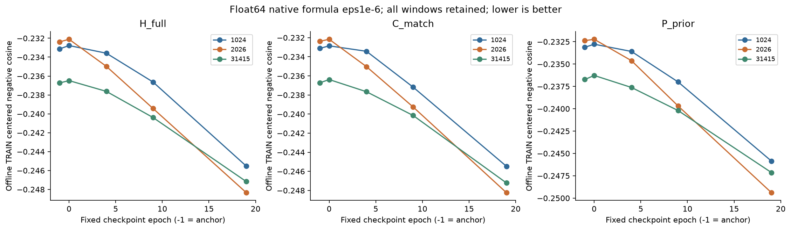
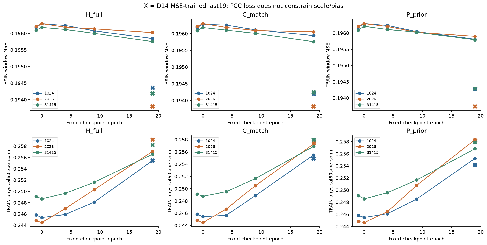
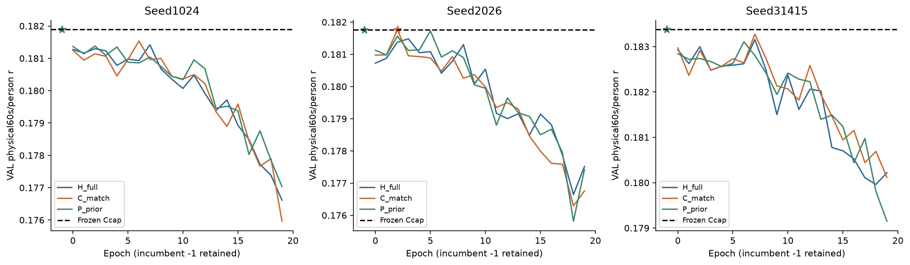
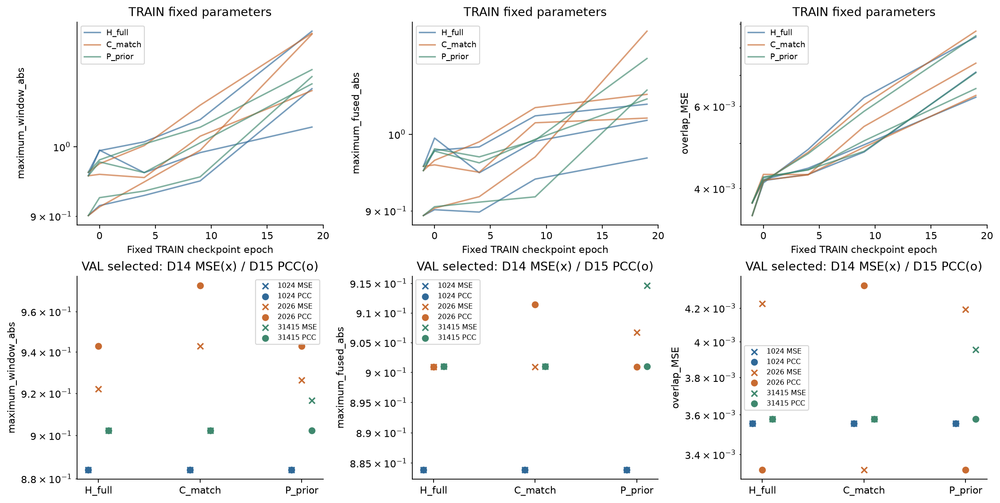

# D15：原负相关公式的float64目标对照

2026-11-02；PUB-01-S03_SS07。**仅将训练MSE换为原3s centered negative cosine的float64适配后，训练目标改善，但完整历史仍未建立稳定VAL收益。三个H_full都选回冻结强FT+Ccap锚点；唯一非零选点是C_match/2026的极小开发增益。后期首批日志仍见token/GRU梯度为零或极小，因此不能声称已解决历史支路退化，也不能把阴性结果推广成历史信息不存在。**本轮诊断完成，科研goal仍未达到。

## 对照对象和唯一科学改变

当前锚点是**已完整监督FT的encoder及其冻结Ccap当前读出**，不是原native head。原native/FT提供训练目标来源；当前强FT+Ccap、完整历史条件器及其匹配对照是本轮实际对象。来源差别见 [LOSS_SOURCE_AUDIT](LOSS_SOURCE_AUDIT.md)。不把旧round01/warm的摘要历史表示或较弱锚点当作同一组合。

沿用D14的seed1024/2026/31415、H_full/C_match/P_prior、干净component RNG初始化、全部60个固定排列、Adam .001/no wd、20epoch、global64/尾38、全部252454窗和3834 fallback、同TRAIN426记录/70人及VAL49记录/49人。H/C165792新增参数，P164784；encoder/head/Ccap均不更新。唯一目标变化：

```python
pc = pred - pred.mean(-1, keepdim=True)
yc = y - y.mean(-1, keepdim=True)
loss = -F.cosine_similarity(pc, yc, dim=-1, eps=1e-6).mean()
```

直接使用已有float64 p/y，不cast float32，不混合MSE或搜索LR。latent/residual仍float32，p=a_float64+0.1*res.double，目标来自原float32 cache再转float64。它是原公式的数值适配，不是原native float32路径的位级复现，也不是新训练目标或新框架。保留同学习率不意味着两目标的参数步长或逐窗权重相同。

历史仍按原record-local i−5/i−3，older i−9/i−7，i<9严格返回Ccap，fallback保留在loss分母；batch邻接不当历史。训练目标与完整60s/person主评分不同：后者仍固定FP64 Hann192/hop96，TRAIN6104块/70人、VAL752块/49人，逐块→人→phase宏平均。TRAIN物理目标继承float32→float64，VAL原连续float64。VAL按0…19与incumbent−1的strict >、最早tie规则选点，selected VAL一次、H selected older一次。

原TRAIN/VAL分别252454/30500窗，无原值精确常量或中心化精确零目标；TRAIN有12窗中心化norm≤1e−6，VAL0。全部保留，两个范数分别取max(norm,eps)，是有限数值目标而非所有窗都等于严格Pearson。未按分数排人/窗。新ROOT `/home/fanyu/auditory_simulation_m6a/pub_01/s03_full_ft_objective_control_20261102`；六源冻结commit `b75ab0ab3e017a69e98e857d7200ff24912352d9`，v2 [PROTOCOL](PROTOCOL.json) SHA `b80f9aeffada112c012ce23f944279027d4219250fdf2999a28c4878d336506f`。[协调执行审阅](COORDINATOR_EXECUTION_REVIEW.json)在正式更新前实际核六源、123 pins、63输入身份。

## 固定参数TRAIN与MSE对照

固定−1/0/4/9/19分别一次预测，同时算新目标、原MSE、物理r/MSE、幅度与overlap。−1用锚点0NN，四个非零点各一次。D14已验收MSE/物理/VAL结果直接复用，没有为补旧3s loss追加旧TRAIN NN。在线每batch不同参数轨迹另存，不代替固定参数离线值。

| 三seed均值 | H_full | C_match | P_prior |
|---|---:|---:|---:|
| anchor TRAIN negative cosine | −.234079 | −.234079 | −.234079 |
| D15 last TRAIN negative cosine | −.247010 | −.246966 | −.247457 |
| anchor TRAIN window MSE | .196161 | .196161 | .196161 |
| D14 MSE last window MSE | .194114 | .194091 | .194101 |
| D15 PCC last window MSE | .195873 | .195916 | .195836 |
| anchor TRAIN物理r | .246590 | .246590 | .246590 |
| D14 last TRAIN物理r | .257599 | .256791 | .256759 |
| D15 last TRAIN物理r | .256368 | .256566 | .256774 |
| D14 last TRAIN物理MSE | .202345 | .202302 | .202341 |
| D15 last TRAIN物理MSE | .204164 | .204169 | .204130 |



**图1。** 三面板H/C/P，横轴固定checkpoint epoch−1/0/4/9/19，纵轴float64 centered negative cosine，越低越好；三色为三个seed。epoch0可有微小退步，之后预设检查点总体下降，last均优于anchor，三臂均值约−.247。说明新目标确实在TRAIN上被优化，不能把它等同于完整60s相关、额外历史收益或独立泛化。D14未保存同定义的3s loss，因此图中没有捏造MSE模型的旧目标曲线，也不把其物理r代作该量。面板纵轴范围略有差别，按数值比较。



**图2。** 六面板，上排为TRAIN window MSE、下排为完整6104块/70人的物理r；三列H/C/P，线是D15五个固定检查点，同色X是同seed D14 MSE-trained last19。相关性目标下MSE改善很小，last约.1958–.1960，明显高于D14约.1941；下排物理r均随训练增加，但并未一致超越MSE对照：H/C均值略低、P几乎相同。失去逐点幅值约束后，目标收益不能自动换算为MSE或物理相关收益；这里也没有由图证明输出必然爆炸。X与线统一last19对照，未换成最优epoch，未作新显著性检验或收敛声称。

## 完整VAL结果及历史收益门

| Seed | 强FT+Ccap r | H selected epoch / r | C selected epoch / r | P selected epoch / r |
|---|---:|---:|---:|---:|
| 1024 | .181888794 | −1 / .181888794 | −1 / .181888794 | −1 / .181888794 |
| 2026 | .181756120 | −1 / .181756120 | 2 / .181768492 | −1 / .181756120 |
| 31415 | .183374905 | −1 / .183374905 | −1 / .183374905 | −1 / .183374905 |
| 三seed均值 | .182339940 | .182339940 | .182344064 | .182339940 |



**图3。** 三面板为三个seed，三色为H/C/P，黑虚线为冻结Ccap，星号为包含−1的实际选点。多数训练曲线波动后随epoch下降；只有C2026 epoch2略超锚点，Δr=+1.23723×10⁻⁵，其余八组回退−1。H三seed均未超过anchor，也未显示对两个匹配对照的稳定优势。训练目标下降与该VAL行为并存，不能把训练集改善当创新性或连续历史贡献。各面板尺度不同，细小差异不据视觉斜率作显著性判断；这里没有独立测试或新置信区间。

H/C/P的D15 last VAL r=.178116/.177612/.177869，均高于D14对应last的.175009/.174811/.174044，但仍低于anchor.182340。只在已训练0…19中描述的best-trained均值=.182019/.182192/.182070，也不替代包含incumbent的正式selected规则。D15所选H/P相对D14所选分别低.000064647/.000128408；C提高.000004124。**相对旧训练后差检查点的改善不等于超越强锚点。**逐seed值见 [MATCHED_SUMMARY](report01/MATCHED_SUMMARY.csv)。

三seed H−C selected为0/−.000012372/0，H−P全0；H near−older全0，因为三个所选H均是零增量incumbent。这是结构相等，不能作为有效历史依赖检验，更不能证明任意历史内容都等价。原要求H对anchor/C/P三seed均正并有一致近历史收益的门未满足。当前VAL反复用于开发，小的C容量/目标敏感性结果不是独立确认，更不是历史新框架创新。

## 幅度、重叠与梯度通路



**图4。** 上排为固定TRAIN参数的三项诊断：最大单窗绝对输出、最大融合绝对输出、相邻窗口未加权overlap MSE；三色为三臂、每色三条seed线，纵轴为log尺度。随着训练，幅度和overlap普遍上升，但此轮last最大单窗三seed均值H/C/P仅1.105/1.154/1.112、最大融合约1.010/1.077/1.074，不能描述成D9式巨大相消病态。TRAIN overlap均值约.00727/.00748/.00737，较起点增大，表示同一物理点的单窗预测一致性变差。下排是**VAL所选**模型的D14 MSE(X)/D15 PCC(圆点)比较，颜色改为seed；多数点重合，因为所选模型为锚点，C2026是唯一非零PCC点。下排不是上排last模型，也不能用所选锚点的稳定幅度掩盖训练后输出变化。无额外幅值校准、裁剪、正则或图像轴裁掉极端值。

TRAIN last prediction mean约.5592，RMS约.5713–.5716；这些是全部窗口/点等权摘要，与person宏r的权重不同。幅度与overlap完整逐record保存在45份离线文件，VAL保留窗口MSE、overlap/disagreement、边界/tail和window/fused extrema。目标没有直接约束DC/尺度，不代表本轮已经出现灾难性幅值漂移；诊断只记录实际量。

初始零输出头的epoch0首批token/GRU/film/current梯度0是设计预期。之后每epoch只记录**既定首个shuffle batch**、原backward后/step前的梯度，不新增forward或update，也不参与选点。所有180条日志已独立核验。晚期H1024/2026的token/GRU在last首批精确0；H31415的GRU L2约1.10×10⁻¹⁴、token约1.33×10⁻¹⁵。epoch1…19的19个首批中，H1024 token/GRU各15次精确0，H2026 token15次/GRU13次；H31415没有精确0，但可极小。current/output/film同时仍有非零梯度。见 [GRADIENT_ACTIVITY](report01/GRADIENT_ACTIVITY.csv)。**这不是“全程历史梯度有效”或“已解决饱和”。**首批输入随shuffle变化，不能当固定输入梯度趋势；也不能据这些抽查断言全部3945批均零、参数完全不动或量化各路径的因果贡献。

正式训练前授权的192窗probe另有受限证据：同seed1024/固定64窗（48有效）下，fresh模型仅临时赋固定非零output权重，H/C token输入147456项、GRU_hh3072项都有非零梯度，通路本身可传递梯度；探针不进入正式初始化。完全不改的D14 late H/C在这批输入上token max约3880.7/568.4、GRU状态84.375%接近±1，H输入梯度0，C约1.9×10⁻²⁷。该小批现象与饱和退化相容，不能外推全部样本/所选模型或证明全部性能差异的原因。详见 [PATH_PROBE](PATH_PROBE.json)与 [GUARD_AMENDMENT](GUARD_AMENDMENT.md)。

## 独立复核与完整成本

协调预声明manual GRU/独立Hann实现经依赖runner自动执行**一次**： [REVIEW.json](coordinator_review/REVIEW.json) SHA `46486c0dc82b14f1cfd72f25b90dc4f398b757b76e15e74e08d6c1d0f23bb35c`，48,624比较无失败，最大r/其他数值差1.135×10⁻⁷；全180排列、180已有梯度日志及45离线TRAIN文件聚合通过。独立新回放631239残差窗，0新fit/optimizer/encoder，CPU70.841s/wall23.458s。未第二次完整TRAIN NN重算目标/MSE/幅度，也未回放未保留中间epoch，限制不由聚合通过消除。详见 [三级验收](REVIEW.md)。

| 实测阶段 | 残差NN窗 | CPU秒 | wall秒 |
|---|---:|---:|---:|
| 正式九fit及预设评估 | 59,473,248 | 8824.642 | 1010.799（queue） |
| v1原数值工程 | 288 | 42.078 | 16.390 |
| fresh/late通路probe | 192 | 35.823 | 10.032 |
| 存储序列化预检 | 0 | 43.338 | 12.236 |
| IO mock/AST/refreeze proof | 0 | .091 | .091 |
| 独立数值review | 631,239 | 70.841 | 23.458 |

总已知残差NN **60,104,967**，正式9fit/710100 optimizer更新，新encoder/head0。ENGINEERING_CHECK v2累计480NN，但顶层计时仍是原288工程；上表逐阶段读取实际证据，未误称累计。已记录阶段CPU和9016.813s，不包含全部管理/导入/图文处理开销；runner等待时间不当作额外NN或重复review。正式前向分解、内存/磁盘及完整定义见 [COST_LEDGER](COST_LEDGER.json)。

并发资源按授权最多九进程/cuda0五、cuda1四，每worker torch2/BLAS4；每次launch核空闲/本轮自有PID、UID/start_ticks/argv及余量，未改变MPS或全局GPU设置。一次运行快照GPU0/1利用率99%/97%，只是快照而非平均FLOPs。更小的queuewall不代表方法计算量减少；workerCPU和实际前向/更新分别报告。正式worker峰RSS最大5120432KiB/GPU allocated37170688B；原数值工程与probe峰值另列（不能把累计CPU与峰内存相加）。

原128MiB存储估计略超，协调仅批准160MiB并绑定 [STORAGE_DECISION](STORAGE_DECISION.md)；在途写入保留28MiB，消失临时文件容错mock通过，其他OSError仍抛出。正式/独立结束后root约116.55MB<160MiB，两盘均保留20GiB，18checkpoint只留2203，无新.npy/.npz磁盘数组或运输tar。仅白名单取回代码、JSON/CSV统计、静态PNG，无原始信号/权重/特征张量回传；v1及preflight源证据保留。

本轮Technical PASS_WITH_LIMITATIONS / 诊断Acceptance PASS_WITH_LIMITATION / Parent PASS，历史收益门FALSE。D12/D13/D14/D9、旧test/DTU/ds004408冻结；不按本轮阴性自动加模型、改目标/LR/预算或重开外部。已知相关性目标、容量收益、历史贡献、独立泛化与创新性分开判断，后续科学问题由协调另行界定。
