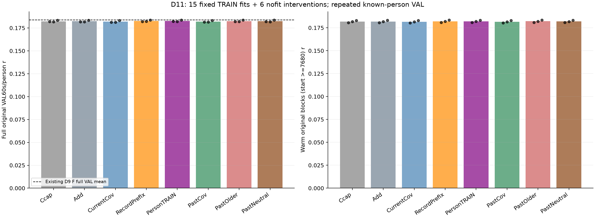
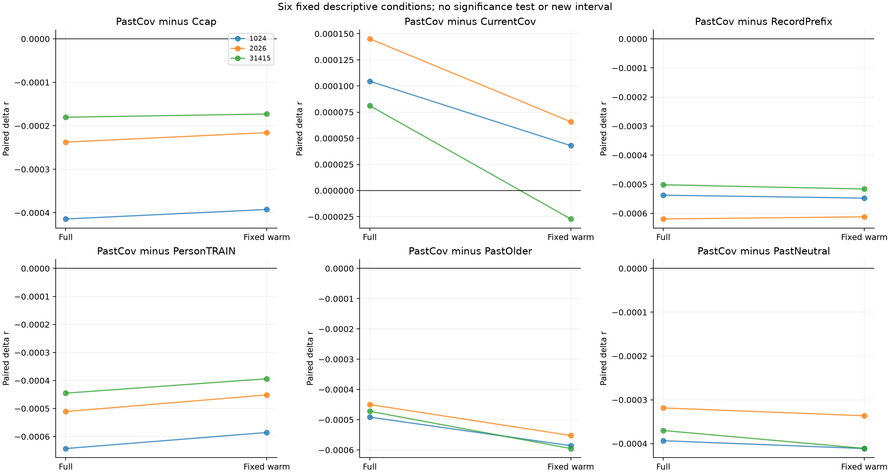
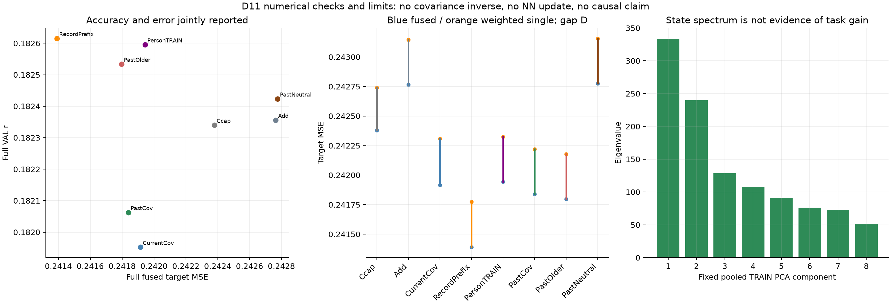

# D11：30秒过去协方差未给出强当前读出之外的稳定历史增量

本轮完整完成15个固定岭解、6个无拟合干预和24个角色×seed评分集合。**预设六条件不满足：PastCov相对强Ccap平均Δr=−0.000277407，三个seed均负；相对固定record前缀、TRAIN被试参考、更早历史和中性状态也都在三个seed上为负。** 它仅优于当前3秒协方差控制，且这一优势在固定warm敏感性里降为2/3 seed正。额外current重拟合Add及已有最强full-VAL Pearson参考F也均高于PastCov。

这是所选PCA8二阶观测状态、32维current latent、固定λ=.01及窗口残差岭模型的有界阴性证据，不证明所有EEG历史或协方差信息无用。本轮不支持长过去估计噪声后改善解码的机制，也未获得新方法、独立泛化或论文目标充分性。独立数值审核已实际PASS，最终全文/三图acceptance见REVIEW；SS07与科学goal继续ACTIVE。

## 实际问题、数据与冻结访问

当前原强Transformer/XLSR19和native head已完成上游训练，本轮复用三个完整FT seed1024/2026/31415的冻结D8 latent/P、TRAIN标定/统计与Ccap(.01)系数，不新增encoder/head前向或神经更新。TRAIN为70人426条记录，VAL为49人49条记录；全部VAL人均见于TRAIN，仍是反复开发、不同clip且存在来源依赖的known-person VAL，不能作为独立确认。

[最终方案](PLAN.md)、[独立方案/源码审阅](COORDINATOR_PLAN_REVIEW.json)、[冻结协议](PROTOCOL.json)和[独立审核范围](COORDINATOR_NUMERICAL_REVIEW_SCOPE.json)在正式评分前固定。科学源码commit为5c50719，协议SHA a238ed63fd5c050fd66e88c07cf5b998f3bd15690bbe989d609459c947cb5f11；正式唯一PID656537、UID1012、start_ticks745413342，无重启、网格扩张或失败seed删除。展示入口后续补充既定Add/F参考和诊断，不改变run/core或协议。

64Hz、stride96、当前3秒窗i输入为[96i,96i+192)。完整Hann当前输入并集最早点是s=96(i−1)，PastCov只读[s−1920,s)，Older只读[s−3840,s−1920)，各30秒，均在并集之前且不跨record。RecordPrefix固定读当前record首30秒；PersonTRAIN先对同人其他TRAIN record前30秒协方差等记录平均再取descriptor，TRAIN leave-record-out，VAL仅引用该人既有TRAIN记录。它是已知被试的静态先验，不是对未知人的部署证明。

共同训练/应用mask为i>=41，TRAIN234988窗、VAL28491窗；每条记录前41窗原Ccap精确fallback，Ccap本身前4窗沿用P_FT*。所有475条记录保留。完整VAL30500窗/49人/752原60秒块不裁；固定warm使用原网格start>=4032的654块，首个合格网格start7680；cold为start0的49块，start3840的49个过渡块只纳入full。[mask计数](MASK_COUNTS.json)仅来自冻结元数据，未按结果改边界。

输入是encoder前的发布预处理EEG，不是原始BDF。原值先float32→保存原TRAIN mean/std归一化→最终float32，之后才转FP64累计局部去均值协方差。公开管线含SosFiltFilt、MWF、CAR和resample64，实际旧derivative生成revision仍UNKNOWN；数组严格过去不能证明端到端在线因果或硬件同步。

## 模型、匹配与全部结果

状态descriptor为64个log方差和2016个上三角相关系数。只用四状态臂共同TRAIN i>=41等臂等窗统计标准化/PCA8，Older/VAL不拟合；允许CAR秩亏，不对64通道EEG做协方差逆变换、矩阵log或空间白化。PCA投影确实按正特征值平方根缩放（basis=V/sqrt(eigenvalue)），后续再按TRAIN因子统计标准化。固定每坐标舍入界及1e−8方差下限，本轮实际修正/floor/clip次数均0。

current q32从D8旧TRAIN i>=4的centered G当前块×1536恢复PCA；后续q/h/product统计才用共同i>=41。状态PCA8缓存先float32，所有后续TRAIN/VAL均以同一缓存转FP64使用。四状态臂共享归一化规则、296维[q,h,q⊗h]、57024个参数，Add只有q32/6336参数；所有解共用λ=.01、未惩罚截距，目标为y−Ccap的窗口MSE。相同参数上限不等于相同有效容量：每输出、不含截距effective df约Current126.4–126.6、Prefix94.3–94.5、Person82.1–82.3、Past99.3–99.4，Add24.24，详见[拟合诊断](report01/FIT_DIAGNOSTICS.csv)。

| 角色 | seed1024 r | seed2026 r | seed31415 r | full均r | 固定warm均r |
|---|---:|---:|---:|---:|---:|
| Ccap强anchor | .181888794 | .181756120 | .183374905 | .182339940 | .181795695 |
| Add current再拟合 | .181832320 | .181785969 | .183449078 | .182355789 | .181845414 |
| CurrentCov | .181369851 | .181373488 | .183113420 | .181952253 | .181508118 |
| RecordPrefix | .182011969 | .182137926 | .183696459 | .182615451 | .182093910 |
| PersonTRAIN | .182117220 | .182029394 | .183639665 | .182595426 | .182012196 |
| PastCov | .181474431 | .181518572 | .183194594 | .182062532 | .181535305 |
| PastOlder，无拟合 | .181965976 | .181968575 | .183666786 | .182533779 | .182113082 |
| PastNeutral，无拟合 | .181867902 | .181837219 | .183564729 | .182423283 | .181921533 |

| 预设primary：PastCov减对照 | full平均Δr | 正seed/full | warm平均Δr | 正seed/warm |
|---|---:|---:|---:|---:|
| Ccap | −.000277407 | 0/3 | −.000260390 | 0/3 |
| CurrentCov | +.000110279 | 3/3 | +.000027187 | 2/3 |
| RecordPrefix | −.000552919 | 0/3 | −.000558604 | 0/3 |
| PersonTRAIN | −.000532894 | 0/3 | −.000476891 | 0/3 |
| PastOlder | −.000471246 | 0/3 | −.000577777 | 0/3 |
| PastNeutral | −.000360751 | 0/3 | −.000386227 | 0/3 |

冻结condition_met=false，不能把单独Past−Current的正值解释为额外历史证据。两个静态参考的均r高于滑动过去，Older/Neutral替换也没有导致预期下降，反而均更高；这与本模型的预期方向相反，不证明静态身份或更旧历史就是唯一真实机制。干预同时可能改变状态分布/时效，协方差还混合刺激、神经活动及其他成分。

既定secondary Past−Add full均−.000293257，三seed−.000357889/−.000267397/−.000254484；warm均−.000310108，各seed亦负。[逐seed](report01/SECONDARY_PAST_MINUS_ADD.csv)/[逐人](report01/SECONDARY_PAST_MINUS_ADD_PERSON.csv)完整保留。对49人的Past−Ccap full差值，正人数分别23/20/20，负人数26/29/29；不能将宏均值三seed负说成每个人都受损。三次随机seed也不是三个独立人群。

已有D9 F full r=.183873843，Past−F均−.001811310，三个seed均负；F仅从已冻结JSON引用，没有新推理、warm评分或参数选择。[逐seed F参考](report01/F_FROZEN_FULL_REFERENCE.csv)和[来源SHA](report01/REFERENCE_PROVENANCE.json)可核对。F的单窗MSE约352、3秒r约.003435和近相消bias退化仍然存在，不能称其通用稳健最优；也不能因该限制省略它在原full Pearson端点上的较高成绩。D11没有超过这一既有参考。

## 图1：全矩阵和固定warm

左为原完整60秒/person宏r，右为固定warm块宏r；柱为三seed均值，黑点为各seed，无CI。左侧黑虚线仅表示已有F full参考，右侧没有F新成绩。纵轴从0开始便于看整体水平，细小差异需结合图2和数值表，而不是看柱高猜显著性。

RecordPrefix/PersonTRAIN约.182615/.182595，比Past .182063更高，Add .182356亦高于Past；八角色整体仍约.182。cold49块在全部角色上精确一致，三seed平均r=.170396742，说明预定fallback保持，不能用cold一致性证明其后的模型正确或有效。warm后Past−Ccap仍全负，阴性并非仅由前41窗fallback稀释造成。

## 图2：六个方向条件及真实历史干预

每面板横轴是full与事先固定warm，同色为同seed，零线表示无差；各面板纵轴独立，没有p值/置信区间。Past−Ccap、Prefix、Person、Older、Neutral在两种范围中均全seed负。唯一full全正的Past−Current在warm seed31415变为−.000027176，不能泛化为稳健优势。

这里Older/Neutral使用同一个PastCov系数及完全相同的当前EEG/latent、q、anchor和mask，不重新训练。更早历史改变时效，Neutral是在共同TRAIN h空间置0、保留既定product标准化常数，均不是把所有模型参数清零。该结果没有支持“需要正确近期状态才能发挥作用”的预期干预模式；不据阴性换时长/PCA维数/λ。

## 图3：误差、融合与状态谱

左为full均r对fused target MSE，各点带角色名。Past MSE=.241838737低于Ccap .242378889，但Pearson更低；因此有MSE收益不能挽救本轮预设Pearson判读。RecordPrefix同时有较高r和较低MSE .241390097，仍只是重复known-person VAL的静态参考表现。

中图蓝点为fused MSE，橙点为Hann加权单窗MSE，间距为disagreement，不是额外独立损失。Ccap加权/融合/D为.242740616/.242378889/.000361727；Past为.242221254/.241838737/.000382517；Prefix为.241773483/.241390097/.000383386。Past相对Ccap的融合MSE下降伴随D增加，不能称“更一致所以更准”。全部24集合的Hann恒等式最大误差3.6245e−15。

右图是共同TRAIN状态PCA8特征值，约333.45/240.03/128.74/107.57/91.25/76.36/73.01/51.80，有效8维。它只说明descriptor统计结构，不能把谱大小、状态平稳或方差保留当成任务可用信息。PCA8只覆盖所选摘要，本阴性不排除其他协方差信息；本轮也没有拆分h加性与q⊗h交互，不能单独判断交互机制。

## 既有方法与结论边界

旧M2/M5只看8×6 latent均值摘要，D4/D5处理近邻latent/PCA历史；本轮改为encoder前30秒二阶状态和更强FT+Ccap起点，并非同一输入。但它仍是通用协方差摘要加条件双线性岭读出，输入或时标变化本身不构成新颖性。

[EA](https://arxiv.org/html/1808.05464v2)已使用被试平均协方差及逆平方根对齐；[AEA](https://repository.essex.ac.uk/39235/1/Lightweight_Source-Free_Domain_Adaptation_based_on_Adaptive_Euclidean_Alignment_for_Brain-Computer_Interfaces.pdf)已有学习轻量输入投影并保留预训练模型的先例。我们没有实现EA/AEA，不能据本对照宣称优于它们。[Riemannian auditory decoding](https://simongeirnaert.com/publication/riemannian2021geirnaert/riemannian2021geirnaert.pdf)已有EEG协方差和TRAIN参考，但任务是注意方向分类；[rASR](https://pmc.ncbi.nlm.nih.gov/articles/PMC6499032/)针对伪迹校正，需要不同校准/评价证据。D11没有干净噪声标签、当前EEG校正或伪迹验证，不能称去噪、ASR复现或生物机制。

同一known-person/部分来源依赖VAL被多次使用，未作新推断性CI/检验；各seed全方向一致也不等于独立泛化。Current3秒与Past30秒有估计样本量差异，静态30秒/同人TRAIN参考控制了部分身份及时间因素，但不穷尽替代解释。离线预处理和旧revision/物理同步不确定性保留。

## 技术、成本与验收记录

[工程证明](MATH_CHECK.json)：隔离合成rolling/direct descriptor最大差5.16e−15，岭与augmented-lstsq差2.40e−15，指标/常数/支持检查通过。三seed原Ccap全部752块r桥最大差0，在任何新state统计/拟合前完成。32个实际直接区间descriptor核对最大差1.0814e−13，所有状态floor/clip/负variance修正均0。15解生产正规方程最大差7.03e−17；没有修改门限。

主run [COST](COST.json)/[COMPLETED](COMPLETED.json)：wall3023.156秒（50.39分钟），CPU11262.107秒，峰RSS2800222208B约2.61GiB；新NN前向/更新0、15岭解、6干预、24评分集合。大量逐record资源巡检和既有cache读取包含在wall中，不将其当纯线性代数或GPU吞吐计时；上游NN训练、D8统计/拟合与D9搜索成本也非零。

10个共享state NPY新增45273920B；全SS07 NPY26270880224B<25GiB。主完成root133219178B，生成表图后142462631B；其中数值数组101036740B<128MiB、root<256MiB，free约25.60GB>20GiB。报告/独立审阅另计成本，不回传任何原EEG、音频、latent、PCA载荷、Gram、系数或预测数组。[同环境版本查询](RUNTIME_AFTER_LAUNCH.json)为启动后元数据，Python3.11.15、NumPy1.26.4、SciPy1.13.1，不冒充启动前完整二进制锁定。

本报告三张PNG已实际查看；[全绝对值](report01/ABSOLUTE.csv)、[全部配对](report01/PAIRED_CONTRASTS.csv)、[逐人](report01/ALL_PERSON.csv)、[逐块](report01/ALL_BLOCK.csv)、[逐record](report01/ALL_RECORD.csv)、[来源描述](report01/FAMILY_DESCRIPTIVE.csv)和[结构化细节](report01/NUMERICAL_DETAILS.json)齐备。source_family沿用既有story fallback，并非核实后的book/speaker家族，不能把描述性表当独立刺激检验。

独立数值审核已在2203首尝试全PASS，见[原样audit](COORDINATOR_NUMERICAL_AUDIT.json)及[独立脚本](independent_review/COORDINATOR_NUMERICAL_AUDIT.py)：26来源hash、551输入size/mtime指纹、475记录支持/静态cache、15正规方程、60实际原EEG状态重建、48缓存读出及全部24full/warm/cold聚合。正规方程max7.03e−17，直接状态cache差max1.135e−7（固定atol/rtol2e−6内），缓存及聚合r/MSE/r3s差0。输入载荷未新做全内容hash，不能把size/mtime核对称完整数据内容审计。独立audit wall3.276秒，无新fit/NN/NPY，另于主run成本。

协调端已实际独立读完全文及三张PNG，同意数值与图示；要求把“无白化”精确区分为没有对64通道EEG空间白化、PCA投影有特征值缩放，现已修正，数值与科学源码未变。Technical PASS_WITH_LIMITATIONS / 本次诊断Acceptance PASS_WITH_LIMITATION / Parent consistency PASS，详见[REVIEW](REVIEW.md)及最终独立审阅记录。

科学决定为：预设历史条件未满足，不自动扩λ/时长/PCA/新backbone，不读旧test/DTU或新OpenNeuro载荷，不把工程完成当goal完成。无患者/STN/私有临床材料，parent范围不变。
