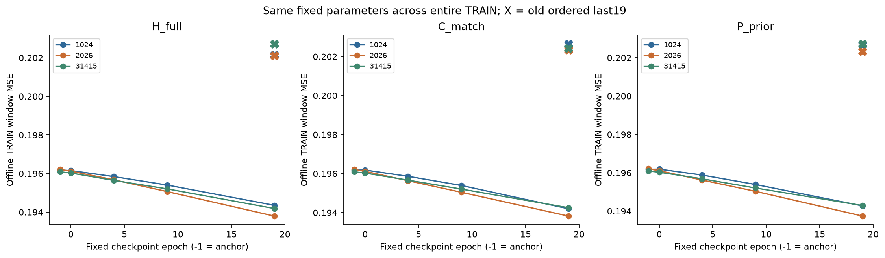
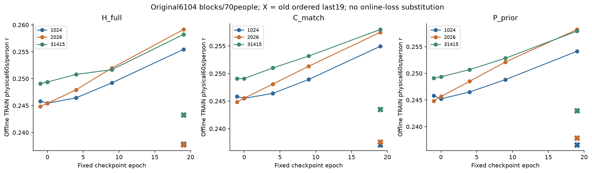
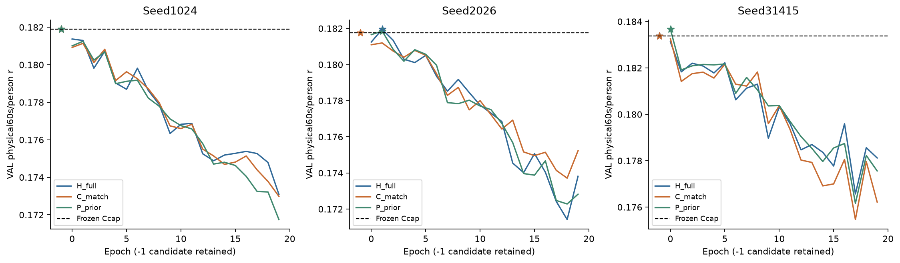
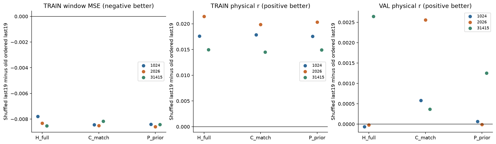

# D14：固定训练顺序对照

2026-11-02；PUB-01-S03_SS07。**逐epoch打乱完整TRAIN窗口顺序后，九组固定最后参数的训练损失和物理相关性都改善，D12原先的TRAIN退化消失；但完整历史并未建立稳定VAL收益或额外历史贡献。**三seed所选H/C/P的VAL r为.182405/.182340/.182468，强Ccap锚点.182340。H只有seed2026出现微小开发增益，H对P的配对方向混合，near/older主r几乎相同。诊断获得实质结果，整体科研目标仍未达到。

## 唯一干预与固定评价

[PLAN](PLAN.md)冻结原三seed1024/2026/31415、H_full/C_match/P_prior、完整FT+Ccap锚点、两token Conv→GRU32条件器及初始化、Adam .001/no weight decay、20epoch、global64/尾38、全部252454窗（含3834 fallback）、原TRAIN426/70人和VAL49/49人。**只改变训练遍历顺序及由此产生的batch组成**，没有换loss/LR/容量、更新encoder/head、下载或改划分。三臂每seed/epoch共用同一完整索引排列；history始终用原record-local i−5/i−3，older i−9/i−7，batch邻接从不当作历史。

独立NumPy SeedSequence([seed,20261102,epoch])产生60个固定排列，digest在结果前冻结，不消耗torch初始化RNG；全排列双射，每batch至少一可学习窗，前九fallback仍保留在loss分母。H/C各165792新增参数，P164784，为既定语义对照而非严格等参。零输出头初始精确回锚点。

训练目标仍是未加Hann权重的逐点192窗MSE。浮点路径保持normalized latent/history float32，anchor float64，p=a+0.1*res.double，训练目标原cache float32→float64。主评分仍FP64 Hann192/hop96→完整60s块→person宏r；VAL752块/49人，TRAIN6104块/70人，TRAIN物理目标同D13 float32再float64。VAL0…19与incumbent−1比较，strict >且最早tie；selected重放一次，H selected older一次。重复使用的开发VAL不构成独立确认。

新ROOT `/home/fanyu/auditory_simulation_m6a/pub_01/s03_full_ft_order_control_20261102`；源冻结 `f5134d7c7a5e486e291082ad3f9d48816e6003ef`，[协议](PROTOCOL.json) SHA `83b05eafcb126952d48750930106b5fb04c56d49f82d2b0128ba7d2c813d0172`；[协调执行审阅](COORDINATOR_EXECUTION_REVIEW.json)在正式训练前实际核源/协议/工程，approved=true。D12/D13旧结果和外部数据保持冻结。

## 固定参数的TRAIN结果

在epoch−1/0/4/9/19分别以**同一套固定参数遍历全部TRAIN**，记录未加权window MSE和原完整块/person物理指标。另对九个旧D12 last19各做一次仅TRAIN matched参考，物理指标与D13一致；未重放旧全部epoch或旧VAL/外部。

| 三seed均值 | anchor | 旧顺序last19 | 新顺序last19 |
|---|---:|---:|---:|
| H window MSE | .196161 | .202329 | .194114 |
| C window MSE | .196161 | .202466 | .194091 |
| P window MSE | .196161 | .202579 | .194101 |
| H物理60s/person r | .246590 | .239596 | .257599 |
| C物理60s/person r | .246590 | .239388 | .256791 |
| P物理60s/person r | .246590 | .239152 | .256759 |
| H物理MSE | .204885 | .209657 | .202345 |
| C物理MSE | .204885 | .209805 | .202302 |
| P物理MSE | .204885 | .209866 | .202341 |

**图1。** 三面板分别H/C/P，横轴固定checkpoint epoch−1/0/4/9/19，纵轴完整TRAIN未加权窗口MSE；蓝/橙/绿为三个seed，同色X是旧顺序last19的真实一次固定回放。九条新曲线最终都低于各自锚点和旧last，旧X约.202而新last约.194。新旧last差九组全负，约−.0078至−.0086。它直接修正了原TRAIN目标本身的退化，而不是仅靠更换person权重得到改善。部分epoch0尚有小波动，图不是逐步单调收敛证明；只有预设五个离线检查点，不能推断未保存的每个epoch离线值。

**图2。** 同三臂/三seed，纵轴原6104块/70人的物理宏r，同色X为旧last。九组新last均高于自身anchor，而旧last低于anchor；相对旧last提高约.0145–.0214。三seed H/C/P均值分别.257599/.256791/.256759。改善同时出现在历史和两个对照中，说明它首先是共同训练顺序/优化问题的证据，不能把H训练r稍高称为历史的泛化贡献。没有把记录当作独立样本或加入未预设显著性检验，也没有把20轮预算用尽称为已收敛。

D12在线末轮window MSE均值H/C/P=.193444/.193379/.193406，新顺序在线末轮反而是.194757/.194747/.194742；单看在线数值会误判旧顺序更好。然而旧last固定离线约.2023–.2026，明显差于新last约.1941。在线值来自每个batch**不同当时参数**下的loss，既不是完整固定模型loss，也不是物理person MSE。本轮严格分开两者，详见 [完整九组表](report01/MATCHED_SUMMARY.csv) 与 [离线五检查点表](report01/OFFLINE_TRAIN.csv)。

## VAL选点与历史对照

| Seed | anchor r | H epoch / r | C epoch / r | P epoch / r | H−C | H−P |
|---|---:|---:|---:|---:|---:|---:|
| 1024 | .181888794 | −1 / .181888794 | −1 / .181888794 | −1 / .181888794 | 0 | 0 |
| 2026 | .181756120 | 1 / .181950060 | −1 / .181756120 | 1 / .181853444 | +.000193940 | +.000096616 |
| 31415 | .183374905 | −1 / .183374905 | −1 / .183374905 | 0 / .183662803 | 0 | −.000287898 |
| 三seed均值 | .182339940 | .182404586 | .182339940 | .182468347 | +.000064647 | −.000063761 |

**图3。** 三面板对应三个seed，横轴epoch0…19并保留−1候选，纵轴原752块/49人VAL宏r；蓝/橙/绿分别H/C/P，黑虚线为固定Ccap，星号为实际规则所选。曲线整体随训练下降，少数很早期点仅略超anchor；H仅2026选非零epoch1，P另在31415 epoch0稍高。九个last19都低于anchor，尽管TRAIN改善。训练拟合恢复与VAL增益是不同命题；该分离与过拟合式表现相符，但没有识别生物机制或证明某个具体优化机理。面板纵轴范围不同，比较实际数值而非视觉斜率；无误差带，不作独立确认性声称。

H三seed best-trained（只在已训练0…19描述，不改变selected规则）均值.182149，C .181867，P .182256；小于H/C/P包含−1的selected均值。新H last均值.175009，相对anchor−.007331；新C/P last为.174811/.174044。旧H best-trained恰约.175009，与新H last接近只是两个不同统计量的数值巧合，不能混为同一checkpoint或“已恢复全部泛化”。

**图4。** 横轴三臂，颜色为seed；三面板纵轴分别为新shuffle last19减旧ordered last19的TRAIN窗口MSE、TRAIN物理r和VAL物理r。前两面板九组都朝改善方向，量级约−.008和+.015–.021；右面板VAL变化小得多，且H1024/2026略负，H31415为正，C三seed为正，P方向混合。这说明顺序干预对训练退化有一致影响，但不能由此推定VAL同向或H特异受益。此图对比统一last19，不用最优epoch替换差值；固定所选结果另在表和图3中保留。

同一H selected权重的near−older r：1024=0、2026=−2.5446×10⁻¹⁰、31415=0，三seed均值−8.4821×10⁻¹¹。两个0来自selected−1零残差的结构相等，不是历史机制的有效阳性检验；唯一非零H选点的宏r也几乎不变。其49人最大绝对r差7.95×10⁻⁹、752块最大1.58×10⁻⁷，处于本实现数值一致性误差尺度，不能用符号判断历史有益或有害，见 [数值尺度记录](H2026_NEAR_OLDER_NUMERICAL_SCALE.json)。这里不声称非零模型逐点预测完全相同，也不能由这种替换推出所有历史都未使用；older同时改变内容与recency，不能当纯内容随机干预。见 [逐seed配对](report01/PAIRED_COMPARISONS.csv)。

原收益门要求H相对anchor/C/P在三seed均正，并有一致near>older；本轮未满足。P的小幅开发增益不能替代H的历史贡献，负结果也不能推出一般历史信息不存在。没有将小数差升级为统计显著、方法创新或独立外部迁移。

## 工程、计账与边界

正式九worker均正常退出，queue PID1692090已结束。每fit78900更新，总710100；正式61,710,828残差NN窗，其中新模型59,473,248（训练44,751,600、逐epoch VAL5,410,620、固定非零TRAIN8,950,320、selected VAL270,531、H older90,177），旧九last仅TRAIN参考2,237,580。新encoder/head前向0，正式9个新fit如实计账。主queue wall1880.763s，worker CPU和3663.547s，峰RSS最大5,127,292KiB/GPU allocated37,170,688B。

成功工程另1230残差NN窗、0opt/fit，wall20.126s、CPU29.873s。attempt01漏切train模式导致cuDNN GRU backward失败，旧source/protocol/log映射保留；失败工程362窗为实际失败行的路径重建，CPU/wall/峰资源UNKNOWN，不虚构实测。见 [工程amendment](ENGINEERING_AMENDMENT.md)。没有因为工程失败改科学范围。

[资源快照](RESOURCE_AFTER_FORMAL.json)显示含轻量打包的新root111,634,324B<128MiB，home22,917,804,032B、sata178,649,985,024B均保留20GiB。只回传代码、JSON/CSV统计和四张静态PNG，checkpoint/原信号/张量均留2203；没有历史/预测/梯度数组磁盘cache。生产训练源在执行中未修改，图表为独立JSON-only reader，0新NN。

以上是正式完成时历史快照。独立review及干预数值尺度证据加入后的最终资源以 [RESOURCE_FINAL_REVIEWED](RESOURCE_FINAL_REVIEWED.json)为准，约127.7MB，仍低于128MiB=134,217,728B，两个文件系统余量仍分别高于20GiB；没有为了预算删掉失败/历史证据。

协调预声明的独立数值复核与最终三级验收见 [REVIEW](REVIEW.md)及 [实际JSON](coordinator_review/REVIEW.json)。独立手写GRU/Hann对九selected、九last19和三H older回放631,239残差窗，48,624项比较无失败，最大r/其他比较差约1.18×10⁻⁷；180实际排列日志、54离线TRAIN文件聚合和18旧last/D13对照通过。额外CPU72.036s/wall23.907s、GPU0。未独立做第二次完整TRAIN NN以重算windowMSE，也未回放未保留中间epoch，这些限制不由聚合核对消除。含成功工程与失败路径重建的已知总残差前向62,343,659窗（失败CPU/峰值未知）；不含任何新encoder/head。主结果与四张实际PNG已逐张目视，完整逐人/逐块输出保留；Technical PASS_WITH_LIMITATIONS / 诊断Acceptance PASS_WITH_LIMITATION / Parent PASS，历史收益门FALSE。

并行只读 [原目标来源核对](LOSS_SOURCE_AUDIT.md)确认旧native/FT的3s centered negative cosine eps1e−6与当前D12/D14 MSE不同；旧round01/warm不能冒充同强锚点/完整时序条件器组合。换PCC会改变均值/幅度约束、常量/eps语义和梯度尺度，保持Adam/LR也不等于相同优化步长。该核对0新NN/fit，不构成新训练批准，PCC本身不是创新。

本轮仅建立“固定顺序导致的共同训练退化可被此预设shuffle对照修正”的受限优化证据；没有诊断其全部因果链，也未达到额外历史贡献或科研goal。D12/D13/D9、旧test/DTU/ds004408冻结，不自动换目标/扩数据/合并PR6。后续科学必要性由协调在完整独立验收后判断。
