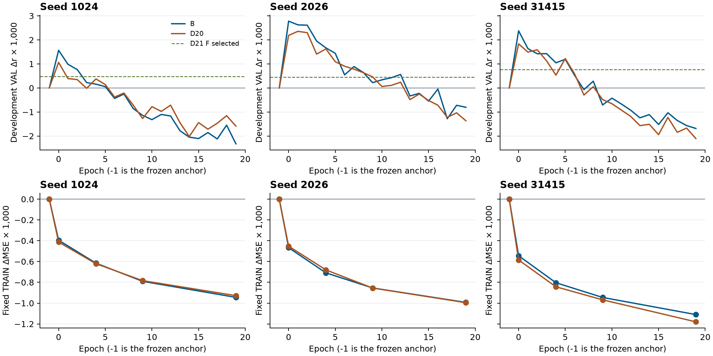
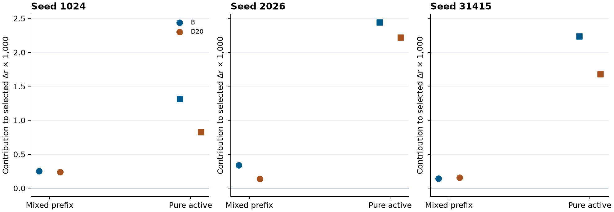

# D22 输出端非线性竞争对照

2026-11-06 · PUB-01-S03_SS07 · 2203

**仅输入冻结包络预测的 B，在三个 seed 的早期选点均超过 D20。** B 的开发 VAL r 均值为 **0.184580904**，比原 FT+Ccap 锚点高 **0.002240965**，比 D20 高 **0.000490394**，比 D21 线性 FIR 高 **0.001675877**。B 的均值也比 D18 P 高约 **0.000201742**，逐 seed 只有 31415 高于 D18 P。这个结果表明在当前开发协议下，仅依靠冻结 EEG 解码输出的非线性后处理已经可以达到并略超过 D20 的选中 r。三个末轮仍低于锚点，尚无独立泛化证据。[正式终态](COMPLETED.json) · [逐 seed 指标](SEED_RESULTS.csv)

## 对照范围

B 的当前 query 只接收冻结 b(t) 的 FP32 标量，历史仍为同一冻结预测在 t 前的 96 个四点均值。输入统计沿用同 seed 的 D20 P TRAIN 标量统计，锚点在加回残差时仍为 FP64。B 保留 D20 历史门与输出层，第一层由 8 输入改为 1 输入，从原第一列乘 √8 得到初始权重，保留 bias 及其他共享张量。B/D20 的参数数分别为 9,441/9,665。两臂使用同一冻结锚点、原 426 条 TRAIN、49 条 VAL、同一活动起点 1344、原物理 MSE、20 pass、Adam、全局无放回排列和 752 个评分块。B 使用经过 EEG 解码的冻结输出，当前 8 维 latent 无独立输入通路。工程对真实 Record latent 做扰动并重建输入表，固定 b 时输出逐点一致；改动 b 则当前码发生变化。[冻结方案](PLAN.md) · [工程回执](ENGINEERING_COMPLETED.json)

## 开发选点与真实轨迹

| Seed | 原锚点 r | D21 F r | D20 r | B 选中 epoch | B r | B − D20 | B 末轮 r | 固定 B 近 − 远 |
| --- | ---: | ---: | ---: | ---: | ---: | ---: | ---: | ---: |
| 1024 | 0.181888794 | 0.182370915 | 0.182952500 | 0 | 0.183454562 | +0.000502061 | 0.179562531 | +0.004463998 |
| 2026 | 0.181756120 | 0.182201518 | 0.184110349 | 0 | 0.184535569 | +0.000425220 | 0.180950860 | +0.004846205 |
| 31415 | 0.183374905 | 0.184142650 | 0.185208683 | 0 | 0.185752582 | +0.000543899 | 0.181688413 | +0.005785802 |
| 三 seed 均值 | 0.182339940 | 0.182905028 | 0.184090511 | — | 0.184580904 | +0.000490394 | 0.180733935 | +0.005032002 |

每 seed 的 49 人中，B 相对原锚点分别有 **31、36、34** 人提高，相对 D20 有 **28、28、33** 人提高。B 与 D20 在同一开发 VAL 选点。固定 B 选中权重、当前 b 码、锚点与评分点，仅替换为 lag288，三个 seed 的 r 都下降到原锚点以下。换入的远历史使用同一近历史训练统计，干预包含分布变化。[逐人表](PEOPLE.csv) · [正式终态](COMPLETED.json)

上排以 seed 分列。横轴为 epoch，纵轴为相对原锚点的开发 VAL Δr×1,000，绿虚线是各 seed D21 F 的选中参考。B 三组都在 epoch 0 达峰。B 在 20 个同轮对比中高于 D20 的次数分别是 **5、16、16**，超过原锚点的次数为 **6、13、8**。峰值同向，整条曲线有交叉。末轮 B 三组均跌到锚点以下。下排显示固定 TRAIN 的活动 ΔMSE×1,000，B 与 D20 曲线接近。B 末轮平均 **0.190834946**，D20 **0.190816292**，两者都比原锚点 **0.191850855** 低。开发 r 的早期上升与 TRAIN MSE 持续下降并不同步。[逐轮表](EPOCH_METRICS.csv)

## 前缀与纯活动块

图中三列为三个 seed，纵轴是相对锚点的 Δr×1,000 贡献，两个组别按原每人的全部评分块数加权后相加，复现正式 Δr。每 seed 有 49 个混合前缀块和 703 个纯活动块。B 的三 seed 平均纯活动贡献为 **+0.001997107**，混合前缀贡献为 **+0.000243857**；D20 相应为 **+0.001574155** 与 **+0.000176416**。B 对 D20 的均值差约有 **86%** 来自纯活动块。只在纯活动块重新做人宏平均时，B 和 D20 的描述性增益分别为 **+0.002142592** 和 **+0.001689638**。该拆分使用保存结果，原选点和指标不变。[块贡献表](PREFIX_SPLIT.json)

选中 B 的开发 VAL 活动 MSE 均值 **0.250558977**，高于原锚点 **0.250262038** 和 D20 **0.250371819**。B 的优势落在 Pearson r，活动点幅值误差并未同步改善。三个 seed 都沿用了同一个物理 MSE 训练目标。[逐 seed 指标](SEED_RESULTS.csv)

## 结论边界与成本

B 的开发结果超过 D21 线性 FIR 及 D20 的平均和逐 seed 选中 r。在这个固定协议下，达到 D20 的选中 r 可以只使用冻结预测，省去额外的当前 8 维 latent 输入。B 与 D20 第一层的维数、初始化尺度和当前特征不同，差距不能单独归因于其中一个因素。近历史与当前冻结预测可以共享原始 EEG 支持，D22 沿用 D20 的离线权限。49 名 VAL 受试者均见于 TRAIN，结果限于反复使用的开发 VAL。冻结参考按各自协议，D9 物理 F 为 **0.183874**，D18 P 为 **0.184379162**，D19 P 正式选点为原锚点 **0.182339940**。SS07 的总体科研目标仍在进行。[D20](../../recent_prediction_context/run01/REPORT.md) · [D21](../../output_ridge/run01/REPORT.md) · [D18](../../preprojection_memory/run01/REPORT.md) · [D19](../../physical_stream/run01/REPORT.md) · [D9](../../physical_objective/run01/REPORT.md)

| 阶段 | 实际成本 |
| --- | --- |
| 有限工程 | 6 条 TRAIN 记录、3,447 缓存窗、0 VAL。36,960 当前 stem、49,152 上下文输出、24,576 backward 点、0 更新。3.611 秒墙钟 / 7.013 CPU 秒 |
| 正式 | 3×20 pass，86,820 更新、1,422,210,600 backward 点。1,887,261,057 当前 stem、1,895,861,454 上下文输出点，含三组实际近远配对。369.145 秒墙钟 / 1,207.400 CPU 秒 |
| 固定上游与资源 | 新 EEG encoder 或原 FT 神经头前向为 0。用旧 latent/P 对 848,862 窗重建固定锚点，含原回退。峰 RSS 5.211 GB、torch allocated 2.592 GB，正式终态 writer 17.03 MB。66 个参数 checkpoint、3 份统计副本；新增信号、特征、预测数组文件为 0 |
| 独立保存审计 | 1.179 秒墙钟 / 1.236 CPU 秒。实际加载末轮与选中权重及相应恢复状态，核对 Adam/RNG、9,441 参数、共享初始化、复制统计及选点。最大聚合差 1.11×10⁻¹⁶ |
| 独立功能重放 | 1.913 秒墙钟 / 2.808 CPU 秒。3 个末轮及 3 个选中权重，生产实现与独立 NumPy 各 1,536 前向点、各 3,756 个冻结读出窗。输入和锚点差为 0，预测最大差 6.71×10⁻⁸ |
| 独立科学汇总 | 0.111 秒墙钟 / 0.111 CPU 秒。复算三个 seed、37/60 同轮比较、逐人、纯活动分解和活动 MSE，0 新网络前向 |

[工程回执](ENGINEERING_COMPLETED.json) · [正式准入](EXECUTION_REVIEW.json) · [正式终态](COMPLETED.json) · [独立验收](REVIEW.md)
