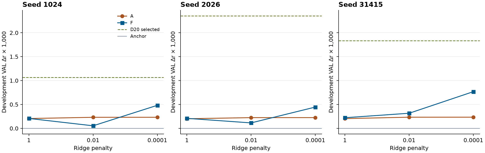
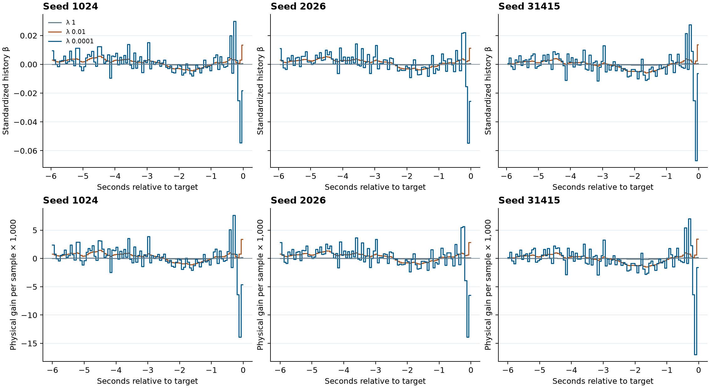

# D21 输出端仿射与 FIR 强对照

2026-11-06 · PUB-01-S03_SS07 · 2203

**只用冻结包络输出的 FIR 在三个 seed 都改善了开发 VAL，但仍低于 D20。** 三 seed 的宏 r 均值为冻结 FT+Ccap **0.182339940**、仿射 A **0.182570113**、FIR F **0.182905028**、D20 **0.184090511**。F 平均比锚点高 **0.000565088**、比 A 高 **0.000334915**、比 D20 低 **0.001185483**。本轮的输出端线性对照取得部分开发增益，现有比较仍无法分解 D20 的当前 latent、非线性门和优化各自的作用。[正式回执](COMPLETED.json) · [全网格标量](GRID.csv)

## 同一目标与两个函数类

A 只取当前冻结预测 b(t)。F 另取 b[t−384:t] 的 96 个有序四点均值。两者直接在原 D20 的 64 Hz 物理点上学习残差，结果加回同 seed 冻结锚点。输入和归一化按原 D20 P TRAIN-only 标量统计用 FP32，再转 FP64 并除以 √D。A 的 D 为 1，F 为 97，两者各有一个不惩罚的截距。所有 426 条 TRAIN、49 条 VAL、活动起点 1344 和 752 个原 VAL 评分块均保留。原始 EEG 的最晚支持沿用 D20，F 的历史点与当前可以共享原始 EEG。训练目标为活动点物理 MSE 加岭惩罚，三个预定 λ 各求一次。开发端按原 60 秒块 Pearson r、受试者内、49 人宏平均与冻结锚点比较。固定岭解和 D20 的 SGD 使用不同优化预算。[冻结方案](PLAN.md) · [原始支持](../../recent_context_review/run01/COORDINATOR_SUPPORT_CHECK.json)

## 全网格与正式选择

三面板的横轴是同一组预定 λ，纵轴是相对同 seed 锚点的开发 Δr×1,000。灰线为锚点，绿虚线为原 D20 selected。三 seed 的 A 和 F 都在 λ=0.0001 达到各自最高 r，且三组均超过锚点。A 的三条结果随 λ 变化很小。F 在 seed 1024 和 2026 的 λ=0.01 低于对应 A，在 λ=0.0001 三组都超过 A。全部 18 个点均低于对应 seed 的 D20，图内没有确认性统计区间。[全 λ、逐 seed 指标](GRID.csv) · [逐人原值](PEOPLE.csv)

| 角色 | λ | seed 1024 r | seed 2026 r | seed 31415 r | 三 seed 均值 r | VAL 活动 MSE 均值 |
| --- | ---: | ---: | ---: | ---: | ---: | ---: |
| A | 1 | 0.182094207 | 0.181957094 | 0.183579113 | 0.182543471 | 0.250868323 |
| A | 0.01 | 0.182120084 | 0.181980468 | 0.183608336 | 0.182569630 | 0.250932336 |
| A | **0.0001** | 0.182120560 | 0.181980901 | 0.183608877 | **0.182570113** | 0.250933816 |
| F | 1 | 0.182096257 | 0.181965317 | 0.183597221 | 0.182552932 | 0.250814685 |
| F | 0.01 | 0.181942335 | 0.181870397 | 0.183690908 | 0.182501214 | 0.250751466 |
| F | **0.0001** | 0.182370915 | 0.182201518 | 0.184142650 | **0.182905028** | 0.250726863 |

F 相对锚点的三 seed 分差为 **+0.000482121、+0.000445399、+0.000767745**，相对 D20 为 **−0.000581585、−0.001908830、−0.001066034**。每 seed 的 49 名受试者中，F 分别有 30、32、34 人高于原锚点，A 为 44、46、45 人。A 的人均提升量更小，且来源可定位到前缀衔接。每 seed 的 49 个混合锚点前缀与活动预测的块，其 A 平均 Δr 为 **+0.003638、+0.003541、+0.003674**，其余 703 个纯活动评分块的最大绝对差均不超过 **9.25×10⁻¹⁰**。对纯活动块，正斜率仿射近似保持 Pearson r，完整评分还保留前缀与 FP32 舍入。[正式选点](SELECTED.csv) · [逐人原值](PEOPLE.csv) · [前缀分块核对](ARRAYS_AND_PREFIX.json)

协调按原每人的全部块数做加权分解。A 的平均 r 增益 **0.000230173451** 全部来自混合前缀块，纯活动项仅约 −4.74×10⁻¹²。F 的平均增益由前缀 **0.000238881** 和纯活动 **0.000326207** 组成；D20 分别为 **0.000176416** 和 **0.001574155**，后者约占 D20 增益的 90%。因此 A 的边界现象不足以解释 D20 的增益。只在纯活动块重新做人宏平均时，F 和 D20 的描述性差为 **+0.000349224** 与 **+0.001689638**。该分析使用保存评分，不改变主指标或选点。[独立科学汇总](COORDINATOR_SCIENTIFIC_REVIEW.json)

原锚点的活动点 TRAIN MSE 平均 **0.191850855**，正式选择的 A 与 F 为 **0.191793587**、**0.191721587**。VAL 活动 MSE 却从锚点 **0.250262038** 升至 A 的 **0.250933816**、F 的 **0.250726863**，且各 seed 都升高。D20 选中轮的均值也升至 **0.250371819**。完整覆盖记录的宏 r 可在逐 seed 表查到，正式选点仍只使用冻结的 60 秒块指标。[完整网格标量](GRID.csv) · [独立科学汇总](COORDINATOR_SCIENTIFIC_REVIEW.json)

## 实际系数与等效物理核

上排为三个 seed 的 96 个实际历史 β，每列同时画三种 λ。下排将各四点箱的物理斜率均分到箱内四个采样点，纵轴为单点增益×1,000。历史显示窗从 −6 秒到目标前 1 个点。最弱正则的 F 在紧邻端出现正负结构，三个 seed 的最大绝对历史单点增益都落在 t−8 至 t−5 的同一四点箱，分别约 **−0.013897、−0.013910、−0.016970**。中间与较远处也有较小的有符号系数。λ=1 的历史权重最小，λ=0.01 让近期形状更平缓。四点阶梯来自固定分箱。图为忽略 FP32 舍入的物理等效展开，实际预测经过 FP32 归一化。图只放历史系数，当前总增益单列如下。

| Seed | A 当前总增益 | F 当前总增益 | F 历史核有符号和 | F 历史核 L1 |
| --- | ---: | ---: | ---: | ---: |
| 1024 | 1.070634 | 1.130712 | +0.075592 | 0.532517 |
| 2026 | 1.064532 | 1.118763 | +0.089425 | 0.529885 |
| 31415 | 1.070615 | 1.126099 | −0.078958 | 0.533557 |

三份实际全精度系数与 Gram 保存在 2203 的 `/sata5/fanyu/auditory_simulation_m6a/pub_01/s03_output_ridge_20261106/fit/seed{1024,2026,31415}_COEFFICIENTS_AND_GRAM.npz`。每个组合保存标准化系数、自由截距、名义物理截距与 385 点名义物理核。Windows 的网格表只留可核查标量和静态图。[远端数组索引](ARRAYS_AND_PREFIX.json)

## 证据范围与成本

D19 P 的正式选点均回锚，最佳已训练均值 **0.182050**。D21 F 超过该均值，仍低于 D9 物理目标 F **0.183874**、D20 **0.184091** 和 D18 最强 P **0.184379**。D9 F 与本报告中 D21 F 使用不同参数化，名称各来自本轮对照。D21 的 A/F 函数类维数不同，本实验也没有把 D20 的单个组件拿出来做同预算比较。只能说在冻结的函数类、正则范围与开发端点下，简单输出滤波尚未追平 D20。49 名 VAL 受试者均见于 TRAIN，原始 EEG 的离线支持重叠仍在。[D19](../../physical_stream/run01/REPORT.md) · [D20](../../recent_prediction_context/run01/REPORT.md) · [D9](../../physical_objective/run01/REPORT.md) · [D18](../../preprojection_memory/run01/REPORT.md)

| 阶段 | 实际成本 |
| --- | --- |
| 工程 | 6 TRAIN / 6 VAL、3,447 / 3,756 缓存窗，1,536 个 Gram 点，18 个小岭解和 18 个独立参考解，1.642 秒墙钟 / 6.173 CPU 秒。93 个锚点块 r 最大差为 0，显式分箱差 0，岭输出最大差 1.64×10⁻¹⁴ |
| 正式 | 80.529 秒墙钟 / 636.402 CPU 秒。18 个精确岭解；71,110,530 TRAIN Gram 点、8,600,397 VAL 特征点、51,602,382 VAL 候选点评估、13,536 个候选块和 2,256 个锚点块 |
| 上游与资源 | 固定 Ccap 用已有 latent/P 重建 848,862 个窗，含每记录首四窗回退。新增 EEG encoder、神经头前向、优化器更新均为 0。峰 RSS 2.507 GB，正式终态 writer 5.626 MB |
| 独立终验 | 1.712 秒墙钟 / 2.344 CPU 秒。核对 18 个正规方程和 15,792 个保存评分块及逐人聚合。生产实现与独立显式分箱各重放 4,608 个线性输出，重建 3,756 个冻结读出窗，无新拟合或 NN |
| 独立科学汇总 | 约 0.056 秒墙钟 / 0.056 CPU 秒。用已保存块分解 A、F、D20 的混合前缀和纯活动贡献，0 新模型计算 |

正式研究边界保持在既有 TRAIN/VAL。证据支持这一简单滤波对照的开发收益，SS07 总体科研目标仍未达。[工程回执](ENGINEERING_COMPLETED.json) · [正式准入](EXECUTION_REVIEW.json) · [正式终态](COMPLETED.json) · [独立复核](REVIEW.md)
