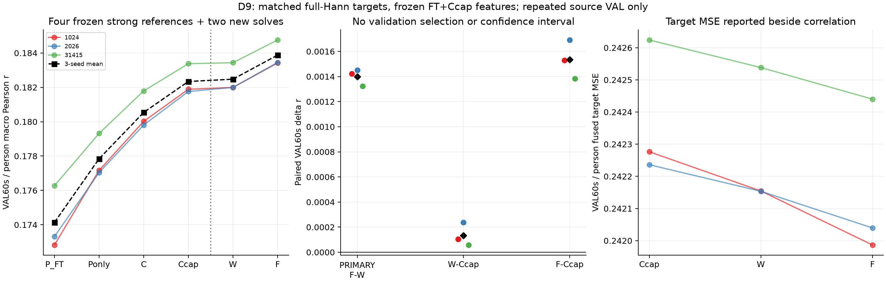
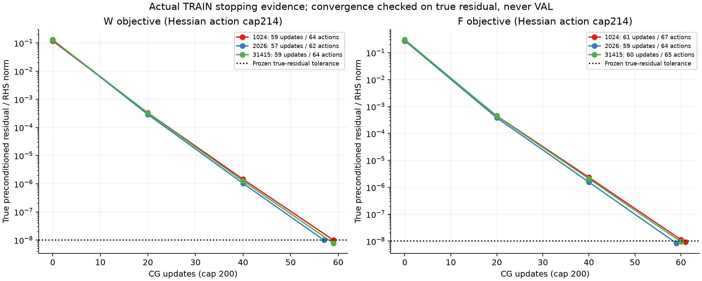
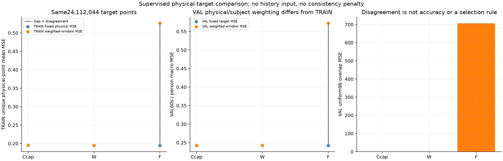
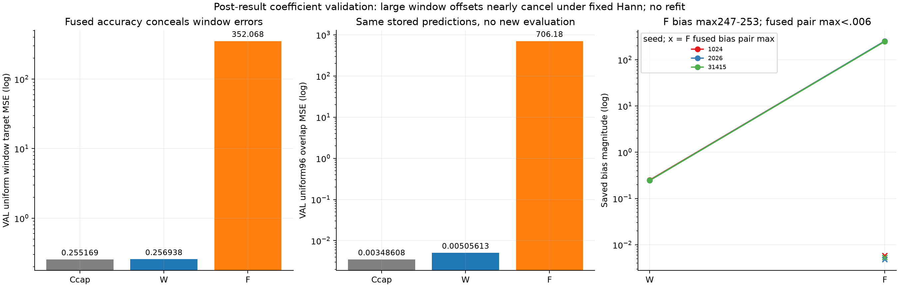

# D9：融合目标的小幅增益与严重单窗相消表示

**固定六解全部收敛，融合监督F的VAL60秒/person宏r比逐窗加权监督W高.001400，三个seed均正；同时F出现严重单窗表示退化。** Ccap/W/F的r分别为.182340/.182474/.183874，融合target MSE为.242379/.242282/.242156。但F的均匀单窗MSE升至352.068、3秒r降至.003435，uniform overlap MSE约706.180；相邻输出的大偏置在固定Hann下近乎抵消。

这不是可以忽略的辅助指标，也不能据此直接判定最终连续输出无效：**本次固定离线Hann协议下的小幅融合增益与严重单窗退化同时存在。** 它不证明稳健实用方法、额外历史机制、独立泛化或ICML/NeurIPS创新。原结果不改、不中途加bias约束/正则/λ，不以主指标微正关闭科学goal。

## 1. 两个目标与共同强框架

原D8完整P_FT encoder/head、FT TRAIN标定/标准化和Ccap(.01)为三seed各自共同起点。W/F只优化同一当前读出的B/b，不重新编码EEG或更新encoder/head；Z/P/平方特征、输入权限、target、参数空间和正则保持一致。没有新增历史状态或推理输入。原P_FT/P-only/C/Ccap是只读强参考，不按本轮分数重新选λ。

每记录首4窗固定P_FT*，融合时保留其与第一可学习窗的边界贡献，末尾也保留原单窗口覆盖。共同物理集合A只含至少一个可学习窗有正Hann贡献的点：每记录从385起，到最后完整窗口倒数第二点。426 TRAIN记录/70人、252454总窗/250750可学习窗，T=24112044个唯一目标点；47682544个正Hann贡献中40044个来自固定边界上下文。原不覆盖尾部、Hann零端点及无参数梯度的早期点不进入两臂分母，不将60秒块边缘变成重复优化目标。

训练y继承原窗口缓存float32后转float64，原252454窗的重叠标签及与原record目标转float32一致性均已实际全核通过。验证仍按原float64连续目标、30500窗/49人/752个prediction-independent块、60秒块→person宏平均；TRAIN物理点等权与VAL块/person计权不同，不能直接把两个误差数值当同一集合。

令α_it为原完整Hann归一化贡献、p̄_t=Σα_it p_i(t)。两个固定目标：

```
J_W = mean[t∈A] Σ_i α_it (p_i(t)−y_t)^2 + λ̄ ||B_free||²
J_F = mean[t∈A] (p̄_t−y_t)^2           + λ̄ ||B_free||²
λ̄ = .01/192 = 5.208333333333334e−5
```

精确关系是`J_W−J_F=mean_A Σ_i α_it(p_i−p̄)^2`，共同正则抵消。F取消的是W内含的disagreement惩罚，**不是增加一致性惩罚**，允许不同窗口误差相消。这种目标变化不能自动称为“连续记忆”。

D8是每窗192输出**求和**MSE加λ=.01，整体除192时正则需同步除192。该等价只在同一完整窗口/样本支持整体缩放时成立；D9改变物理点/贡献权重、固定边界及端点约束，不能宣称与D8具有相同经验目标或相同有效正则强度。此轮不新加window-PCC角色，故不构成原Pearson标度失败的纯loss因果实验。

## 2. 端点、病态bias与实际数值验证

输出列0/191的Hann权重始终0，两臂将其B和bias共同固定在D8初值；6530参数固定，620350参数可学习，其余bias不加隐藏ridge。固定端点仍参与辅助3秒r的相同输出，Hann主指标权重0。

融合只将输出列j与j+96耦合。保留第一可学习窗与固定前邻居、最后窗单覆盖边界后，几何上的有效bias小块正定，但F最小特征值仅2.586e−12、最坏条件数4.019e9；W最坏约3694。**正定不代表良好识别或良好数值条件。** 使用原D8特征二阶矩和各目标1×1/2×2 bias块的确定性预条件，未加jitter/clip或按VAL换求解器。

修改所需合成验证实际通过：W/F逐物理点目标差0，Hessian非共线方向对称差5.55e−17、方向梯度误差2.30e−12，PCG对小直接解参数差3.39e−13，首4固定/端点约束通过。真实TRAIN标签/物理数/geometry核对通过；三seed原VAL首/尾6条记录初始恢复D8 prediction最大差2.22e−16、block r差0。原D4/D7公式和D8 encoder不重跑。

## 3. 图一：主指标点增益真实存在，但不覆盖窗口退化



左为四个冻结D8强参考加两个新解的VAL宏r：三色seed、黑色三seed均值，虚线分开参考和新解；中为唯一primary F−W及两个secondary W/F−Ccap的配对r差；右为同三个角色的融合target MSE。纵轴独立自适应缩放，右图不从零起；没有CI、p值或按VAL选择。

| 角色 | seed1024 r | seed2026 r | seed31415 r | 三seed平均r | 融合MSE |
|---|---:|---:|---:|---:|---:|
| P_FT*（冻结） | .172829 | .173318 | .176276 | .174141 | .244588 |
| P-only（冻结） | .177168 | .177037 | .179320 | .177842 | .244393 |
| C（冻结） | .180022 | .179809 | .181791 | .180541 | .242245 |
| Ccap（共同起点） | .181889 | .181756 | .183375 | .182340 | .242379 |
| W | .181994 | .181995 | .183433 | .182474 | .242282 |
| F | .183417 | .183447 | .184757 | .183874 | .242156 |

| 比较 | 三seed配对r差 | 平均r差 | 平均融合MSE差 |
|---|---|---:|---:|
| F−W（primary） | +.001423 / +.001452 / +.001324 | **+.001400** | −.000126614 |
| W−Ccap（secondary） | +.000105 / +.000239 / +.000058 | +.000134 | −.000096705 |
| F−Ccap（secondary） | +.001528 / +.001691 / +.001382 | +.001534 | −.000223319 |

三个seed共享同一反复开发的known-person/部分同书VAL，不当三份独立实验或显著性。F的固定Hann输出确有这些点增益，不能因低3秒r直接抹去；但独立新数据、其他融合/边界条件与可移植性均未验证，不能据此称实用成功或新方法充分。

## 4. 图二：六解均通过真实TRAIN残差门



左W、右F，横轴CG更新、纵轴真实预条件残差/RHS范数的对数值。曲线点是初值、每20步及末次实际检查，连线不表示每步都保存了真残差；黑点线为预设1e−8门。图例列实际更新/Hessian动作，未按验证分数早停。

| seed | W更新 / Hessian | W末真残差 | F更新 / Hessian | F末真残差 |
|---|---|---:|---|---:|
| 1024 | 59 / 64 | 9.957e−9 | 61 / 67 | 9.184e−9 |
| 2026 | 57 / 62 | 9.952e−9 | 59 / 64 | 8.384e−9 |
| 31415 | 59 / 64 | 7.743e−9 | 60 / 65 | 9.440e−9 |

共355更新/386 Hessian动作，全部低于共同200/214硬界，无cap未收敛或失败重跑。小递推残差会触发真残差，但实现统一计数并预留末次检查，未超214。实际迭代不同，不宣称等SGD更新或等实际算力；共同的是输入/参数权限、目标支持、初始化、正则和收敛标准。独立真实物理轴重建已实际确认六个仍通过原1e−8门，残差差≤1.31e−16，不只凭求解器自报收敛。

## 5. 图三：F降低融合误差，却允许大单窗误差相消



左为共同TRAIN物理点的融合MSE（蓝）和Hann加权单窗MSE（橙），灰间距为disagreement；中为原VAL60秒/person口径的相同分解；右为VAL均匀96点overlap MSE。F的大幅度值使Ccap/W小差在此全范围图中不易分辨，图一右panel已单独展示小融合差，图四补充对数尺度，不裁掉大退化值。

| 角色 | TRAIN融合MSE | TRAIN加权单窗MSE | TRAIN disagreement | 共同自由B正则 |
|---|---:|---:|---:|---:|
| 初始Ccap | .194831034 | .195205607 | .000374574 | .000359105 |
| W | .194693535 | .195079607 | .000386073 | .000376789 |
| F | .194476240 | .526786671 | .332310431 | .000440024 |

W在其目标上由初值.195564713降至.195456397，F在其目标上由.195190139降至.194916263；没有用VAL调整求解。两个目标的正则、分母、输入相同，但F不惩罚窗口间disagreement，使W数据误差可明显升高。自由B正则不包含共同固定端点的常数。

| 角色 | VAL加权单窗MSE | VAL融合MSE | VAL disagreement | 均匀窗口MSE | 3秒r | uniform overlap MSE |
|---|---:|---:|---:|---:|---:|---:|
| Ccap | .242740616 | .242378889 | .000361727 | .255169 | .162067 | .003486 |
| W | .242654607 | .242282184 | .000372423 | .256938 | .156198 | .005056 |
| F | **.572774522** | .242155570 | **.330618952** | **352.067648** | **.003435** | **706.179654** |

F−W加权单窗MSE增加.330119915，disagreement增加.330246529，因此融合MSE反而减少.000126614，符合固定Hann恒等式。均匀窗口误差与Hann计权误差不是同一量：接近零Hann权重的位置可以有大幅单窗异常，固定融合仍较小。此次全部18个角色/seed（含只读参考）的3秒undefined均0；低r不是因为剔除了常量窗，主752块亦不删。

## 6. 图四：已存系数支持近相消解释，而非自动判定最终输出无效



这是**结果后必要风险核验的展示补图**：只读已保存六组系数代数与原数值汇总，不新拟合/推理/选择。左/中为对数尺度的均匀窗口MSE与overlap MSE，三角色均标数值；右为每seed保存bias最大绝对值（W→F连线），叉号是F内部Hann加权bias对的最大值。原三张主图完整保留，补图不改变冻结科学矩阵。

| seed | W最大绝对bias | F最大绝对bias | F bias峰列 | F内部加权bias对最大绝对值 |
|---|---:|---:|---:|---:|
| 1024 | .250602 | 252.632931 | 1 | .005869 |
| 2026 | .245591 | 253.171754 | 1 | .004807 |
| 31415 | .244818 | 247.375984 | 1 | .005280 |

F的B Frobenius仅约2.91–2.92（W约2.66–2.73），大幅窗口异常与不受惩罚、病态识别的逐坐标bias相符。例如seed1024的b[1]=252.632931、b[97]=−.066694，按对应`α_right*b[97]+α_left*b[1]`得到.001688806；巨大单列值没有直接等量进入正常内部融合。这是保存参数的实际代数关系，不是生物学机制。

独立[已存bias代数核验](COORDINATOR_BIAS_DIAGNOSTIC.json)进一步确认：F内部物理bias最大≤.00587、首可学习边界bias贡献≤.12165、末尾single-window bias≤.30603，均远低于虚拟窗口的约250。bias-only TRAIN disagreement为.32353–.33493，对应总值.32547–.33641，说明大disagreement主要由bias表示解释，但这不是重新拟合的消融，特征/交叉项仍存在。仅将已存bias转float32计算的内部融合差≤1.45e−8，也不是完整低精度推理或鲁棒性测试。

因此必须分开内部窗口表示、物理边界贡献和最终连续输出：当前证据支持近null坐标抵消，**未证明固定融合输出无效或已数值崩坏，也未证明通用稳健可用**。不能把内部近相消自动等同物理边界爆炸，也不能因最终r小幅提高就忽略表示退化。未按异常结果改bias惩罚、冻结全部bias、换Hann或添加另一组模型；所有原解保持。

## 7. 成本、证据与仍未完成的目标

唯一queue563655及workers563760/563761/565393均正常退出，无重复启动。总queue wall185.396秒；三worker wall91.809/89.212/83.096秒因并行不能相加当总wall，CPU分别119.363/117.299/110.428秒、和347.091秒。构建既有缓存上的FP64工作特征耗13.538/13.603/6.141秒，不是encoder计算。

六解386次Hessian、355更新；按每role保存counter为392次A与392次AT，另有三次初始TRAIN目标A，合计787次全TRAIN矩阵乘。RHS每解一次，迭代使用固定真实目标形成的RHS；重复算子不等于新独立标签。原TRAIN唯一目标点24112044、正贡献47682544与实际计算次数分别报告，不能当NN新epoch。额外encoder/head前向、NN优化器更新、新NPY、旧test/DTU、下载均0。

峰GPU allocated9172116992B（约8.54GiB），峰RSS3426803712B（约3.19GiB），守16/8GiB worker界。主run新root35763009B（约34.11MiB；图文/review稍增）、free27663896576B，守256MiB新root/20GiB余量。全SS07 NPY仍24469431456B<25GiB。所有特征、工作张量、参数和预测只在2203；本地/Git仅代码、JSON/CSV汇总与静态图文。

科学源/core/protocol在a27c620、任何新真实计算前冻结：driver61f80f5c…413f38f，coredaa4d5c7…f058628，protocol86704273…e4f1499；正式计算期间未改。D8旧强参考、D4/D5历史阴性及旧内部/DTU证据不改。现有数据的重复VAL、共同人物/刺激依赖和既有暴露限制继续适用；本轮没有独立新holdout确认。

完整[PLAN](PLAN.md)、[冻结协议](PROTOCOL.json)、[必要真实桥](REAL_INPUT_CHECK.json)、[六解汇总](SUMMARY.json)、[完整成本/完成](COMPLETED.json)、[六角色绝对值](report01/ABSOLUTE.csv)、[三组固定配对](report01/PAIRED_CONTRASTS.csv)、[逐人](report01/ALL_PERSON.csv)、[逐块](report01/ALL_BLOCK.csv)、[record/3秒覆盖](report01/ALL_RECORD.csv)、[TRAIN目标](report01/TRAIN_OBJECTIVES.csv)、[全部求解历史/数值](report01/NUMERICAL_SUMMARY.json)、[结果后coef核验](COEFFICIENT_RANGE_DIAGNOSTIC.json)保留。

独立[实际数值audit](COORDINATOR_NUMERICAL_AUDIT.json)已通过：275来源/535输入、六解完整TRAIN独立物理轴目标/梯度/真预条件残差（不调用本core adjoint），目标差≤2.69e−14、残差差≤1.31e−16且六个均仍小于原1e−8；全部VAL聚合差0，原首尾12条缓存重建block r差≤2.22e−16、MSE差≤2.70e−14，固定端点保持。此处同样不把独立代码审查称外部实验室复现。

独立audit另耗wall69.714秒/CPU72.972秒、峰GPU allocated6993585152B（约6.51GiB）/RSS4504588288B，实际读出窗口重建1514724次；encoder/head、新拟合与NPY均0。它是额外复核成本，不并入主run185.396秒或宣称免费。

完整中文REPORT与全部四张实际PNG已由协调实际读看，解释和数值一致。最终原样review、REVIEW三级判定与轻量HTML归档由配套记录给出，不以数值PASS当科学goal完成。下一科学选择交协调明确审定，不自动追微正改参数或打开旧test/DTU；PR6保持Draft、不合并，患者/STN和其他支线仍禁。
