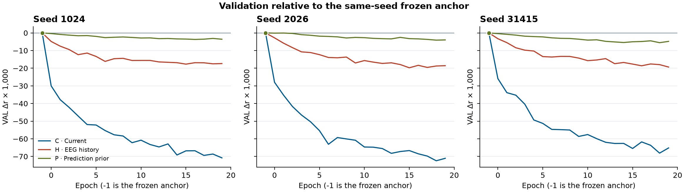
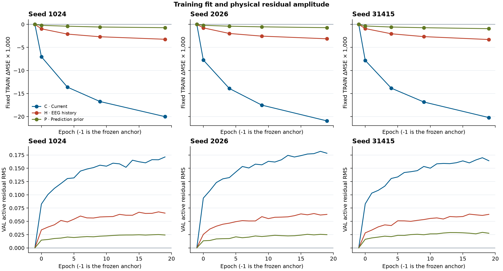
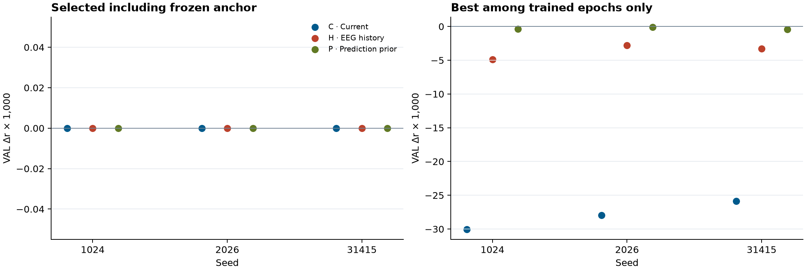
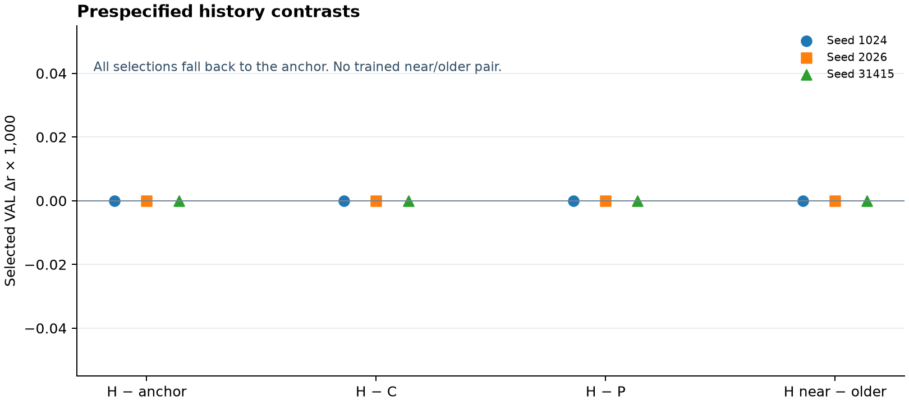

# D19 唯一物理时间轴残差解码

2026-11-06 · PUB-01-S03_SS07 · 2203

**九组完成训练，全部回退到冻结 FT+Ccap 锚点。** 九组的 180 个已训练轮次中，没有一个开发 VAL r 超过同 seed 锚点。C、H、P 在固定 TRAIN 上均降低物理 MSE，但各自最佳已训练轮次的三 seed 平均 VAL r 分别比锚点低 **0.027964、0.003651、0.000290**。D19 未达到预先规定的历史增益门。这个结果针对冻结 D19 的模型与开发协议。它给出了这一候选的阴性证据，整体科研目标仍在进行。[原始标量汇总](SUMMARY.json)

## 实验与评分

D19 对每个物理采样点只生成一个标量残差，叠加在同 seed 冻结的 FT+Ccap 预测上。C 读取当前点的正 Hann 贡献窗。H 读取离当前特征时刻至少 288 点的完整 384 点 EEG latent 历史。P 读取同时间段的冻结预测历史。H/P 均采用 96 个有序四点箱。与当前特征相关的原始 EEG 并集完全晚于两种历史的原始并集。Older 在 lag 960 复用相同长度，当前码、锚点和评分坐标固定。原 encoder 是双向的，当前预测可用到 190 个未来原始采样点，属于离线设定。[执行方案与边界证明](PLAN.md) · [模型契约](COORDINATOR_MODEL_CONTRACT.md)

原 TRAIN 有 426 条记录、70 人。每轮 23,703,510 个活动点全局无放回乱序，实际 1,447 个更新。开发 VAL 有 49 条记录、49 人、752 个 60 秒评分块。49 人均见于 TRAIN。主指标先计算块内 Pearson r，再在人内取平均，最后对 49 人等权平均。严格更高才替代最早最优，epoch −1 是原冻结锚点。三 seed 全部使用相同协议。C/H 各 52,673 参数，P 为 9,665；C/H 具有同结构和名义容量，实际可用的信息不同。P 的上下文维数和输入层参数更少。[冻结几何与预算](PREPARATION_METADATA.json)

## 1. 开发 VAL 轨迹

图 1 的三列对应三个 seed，横轴为轮次，纵轴为相对同 seed 锚点的 VAL Δr×1,000。epoch −1 的三个角色标记重叠。三 seed 均从第一轮训练后落到零线下方，C 的降幅最大，P 最接近零线，H 居中。随训练继续，三种残差的曲线普遍进一步下降，存在局部回升但没有越过锚点。唯一最接近锚点的已训练结果为 seed 2026 的 P，出现在 epoch 1，差 **−0.000081836**。该最优轮也由同一开发 VAL 描述性选出。图中的重复 seed 方向可作为开发阶段的可重复观察，图未提供推断区间。[逐轮记录](EPOCH_METRICS.csv)

## 2. TRAIN 拟合与物理残差幅度

图 2 上排按 seed 显示锚点与 epoch 0/4/9/19 的固定 TRAIN 活动物理 ΔMSE×1,000。下排是开发 VAL 每轮相对锚点的物理残差 RMS，三列同排共享纵轴。末轮相对锚点的 TRAIN MSE 平均下降量为 C **0.020375**、H **0.003219**、P **0.000795**。三 seed 的末轮 VAL 残差 RMS 分别落在 C **0.1641–0.1782**、H **0.0631–0.0655**、P **0.0243–0.0276**。相同角色在三个 seed 的幅度排序一致。原锚点的活动点 VAL MSE 平均为 **0.250262**，末轮 C、H、P 分别为 **0.275545、0.251738、0.250039**。P 末轮的物理 MSE 略低，相关 r 仍低于锚点，两个目标衡量的是不同性质。

首批日志也显示训练通路确实进入非零残差。epoch 0 首批仅输出头有梯度，符合零头初始化。epoch 1 和 19 首批，九组的当前层、上下文层和交互层权重梯度均非零。图 1 和图 2 一起显示，在本协议下更低的 TRAIN 误差伴随更大的残差和更差的开发相关，特别是 C。现有结果无法把这一模式单独归因于坐标、损失、输入信息、容量或某个优化因素。[逐轮记录](EPOCH_METRICS.csv) · [首批梯度](FIRST_BATCH.csv)

## 3. 正式选点与已训练模型分开看

图 3 左侧是含锚点的正式选择，九点均为零差，因为九组都返回原锚点。右侧只在实际训练的 epochs 0–19 中取最高 r，用另一纵轴展开真实差值。这一描述性比较下，H 在三个 seed 均高于 C，也均低于 P 和锚点。下面同时保留实际最好轮、末轮和固定 TRAIN MSE。三个角色的正式 selected r 均为同 seed 锚点，九组的共同三 seed 平均值为 **0.182339940**。各角色的最佳已训练 r 均值为 C **0.154376266**、H **0.178689370**、P **0.182049852**。末轮 r 均值为 **0.113334790、0.163915074、0.178217316**。[逐 seed 原数值](SEED_RESULTS.csv)

| Seed | 角色 | 锚点 / 正式 selected r | 仅已训练最佳 epoch | 最佳已训练 VAL r | 末轮 VAL r | 固定 TRAIN 活动 MSE 锚点 → 末轮 |
| --- | --- | ---: | ---: | ---: | ---: | ---: |
| 1024 | C | 0.181888794 | 0 | 0.151852367 | 0.111093926 | 0.191871704 → 0.171871139 |
| 1024 | H | 0.181888794 | 0 | 0.177028420 | 0.164521304 | 0.191871704 → 0.188636549 |
| 1024 | P | 0.181888794 | 0 | 0.181510298 | 0.178301740 | 0.191871704 → 0.191145451 |
| 2026 | C | 0.181756120 | 0 | 0.153786806 | 0.110708847 | 0.191908271 → 0.170985149 |
| 2026 | H | 0.181756120 | 0 | 0.178948454 | 0.163186395 | 0.191908271 → 0.188777118 |
| 2026 | P | 0.181756120 | 1 | 0.181674284 | 0.177783206 | 0.191908271 → 0.191187420 |
| 31415 | C | 0.183374905 | 0 | 0.157489625 | 0.118201597 | 0.191772590 → 0.171569847 |
| 31415 | H | 0.183374905 | 0 | 0.180091237 | 0.164037524 | 0.191772590 → 0.188481564 |
| 31415 | P | 0.183374905 | 0 | 0.182964973 | 0.178567001 | 0.191772590 → 0.190834188 |

## 4. 历史准入门与缺失的拟合态干预

图 4 横轴为四项预设比较，颜色和符号区分 seed，纵轴为正式 selected VAL Δr×1,000。H−锚点、H−C、H−P、H near−older 均为 0，来源都是同一锚点回退。逐人 selected 分差也为 0。按照冻结协议，H/P 选中 −1 时直接返回锚点，没有运行已训练模型的配对 VAL；因此图中的零差无法判定已训练残差对历史的敏感性。预设要求四项在三个 seed 都严格大于零，本轮未通过。有限工程的临时非零头在固定当前码时能响应历史替换，仅验证路径连通。

P 的标量 prior 来自冻结模型。原锚点活动区与 lag 288/960 的逐记录相关在三 seed、147 个记录–seed 项中算术平均为 **0.000182 / 0.009643**。单个滞后的相关无法概括整个 6 秒输入能提供的信息，也不支持解释 P 表现的机制。[历史对比](HISTORY_CONTRASTS.csv) · [逐人表](PEOPLE.csv) · [预测自相关](ANCHOR_AUTOCORRELATION.csv)

## 运行与证据边界

| 阶段 | 实际成本与范围 |
| --- | --- |
| 元数据与源码 | 73 个输入文件印记及 6 个小型来源；228,000 几何边界坐标与 950 个全局 ID 边界。无信号或特征载荷读取 |
| 工程 | 12.39 秒墙钟 / 60.08 CPU 秒。110,592 当前 stem 点、135,168 上下文/输出点、73,728 backward 点、0 更新。冻结 VAL 752 块逐 seed 精确复现 |
| 正式 | 1,079.96 秒墙钟 / 3,065.77 CPU 秒。9 fit、260,460 更新、4,266,631,800 backward 目标点；当前 stem 和上下文/输出各 5,635,981,980 点。无拟合态 selected 历史配对前向 |
| 正式资源 | 峰 RSS 5.339 GB，峰 torch allocated 3.043 GB。回执时写入根 106.87 MB。180 个逐轮恢复 checkpoint 加 9 个末轮 checkpoint，3 份 TRAIN 统计。新增 encoder/head 前向和信号、特征、预测数组文件均为 0 |

开发 VAL 反复用于选点，49 名受试者都见于 TRAIN。H/P 的四点均值损失组内动态，原 encoder 的双向整窗依赖仍然存在。C/H/P 实际内容和 P 的参数容量不同。D9 与 D18 使用不同模型和目标，D19 的负结果无法单独识别时间轴或目标函数的因果作用。旧 test、DTU、ds004408 与患者侧维持冻结。工程和正式计数可审计，科学验收仅为这一个固定候选的阴性开发证据。[工程回执](ENGINEERING_COMPLETED.json) · [正式标量回执](SUMMARY.json)
