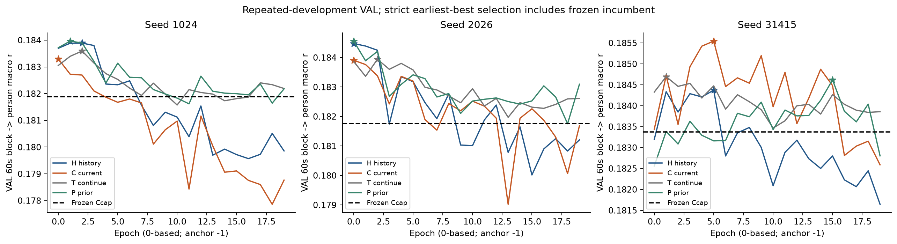
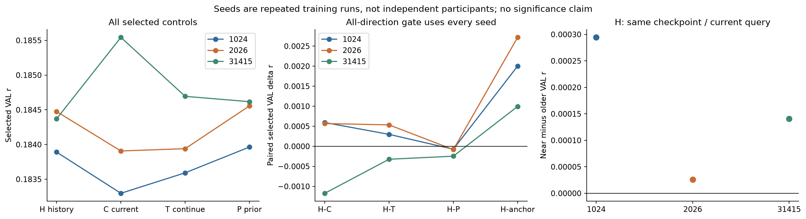
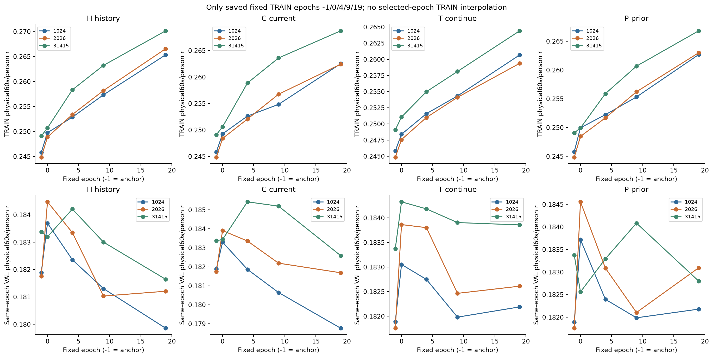
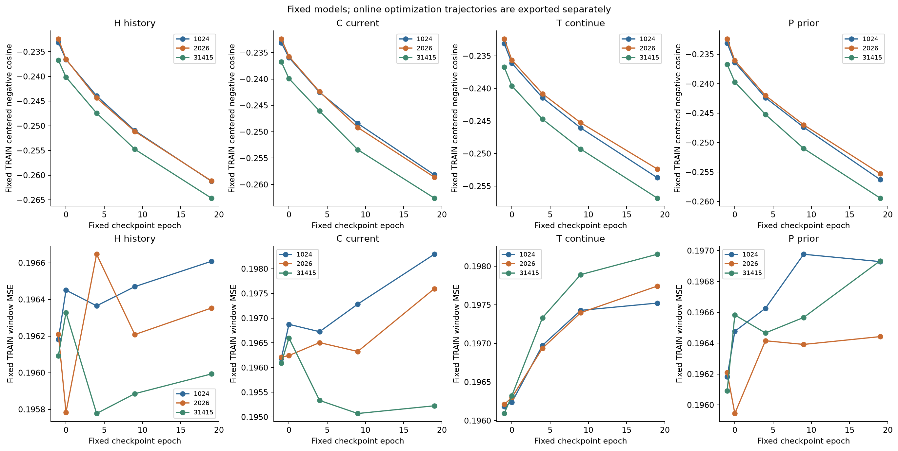
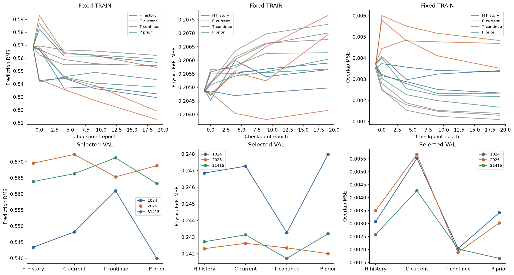
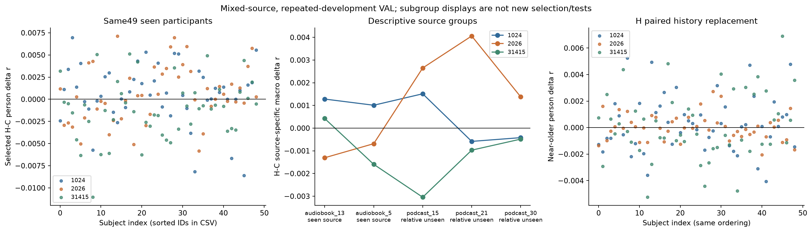
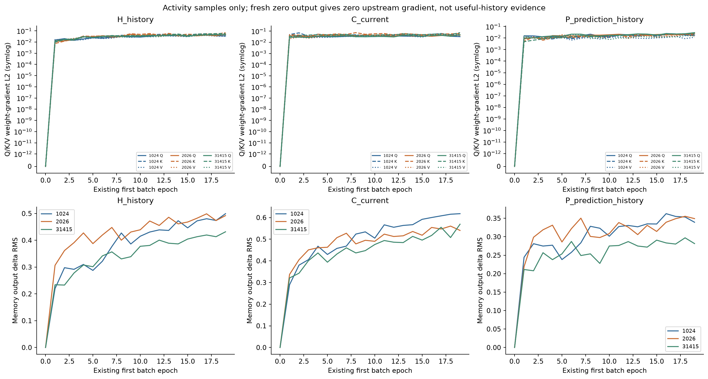
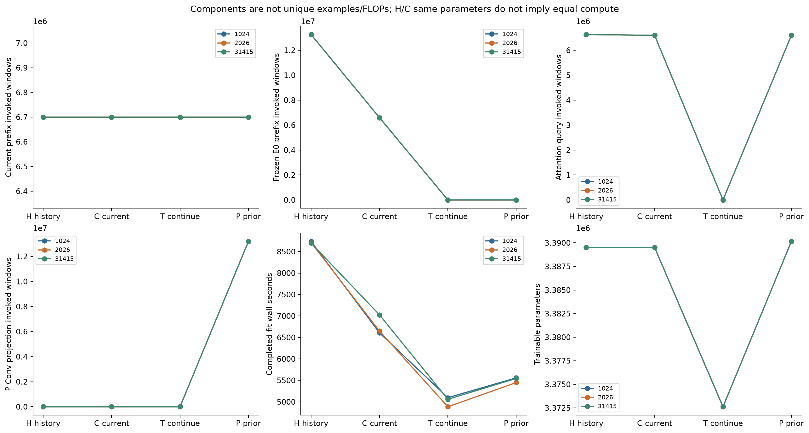

# D18 投影前记忆的全量对照结果

2026-11-06 整理。PUB-01-S03_SS07 候选 D18 完成四臂、三种子、每组 20 轮训练。真实过去 EEG 臂 H **未满足预先设定的历史收益门**。H 相对同参数的当前信息臂 C 在两个种子上略高，第三个种子低 0.001173，三种子平均差 −0.000004008。H 在三个种子上均低于预测历史臂 P。固定当前 query 后，H 对近、远历史替换表现出小幅且同方向的评分变化。这项变化说明所选模型对替换敏感，四臂比较仍缺少稳定的真实历史收益。

## 对照设计与评分

四臂从同种子已选强 FT encoder/head 和固定 D8 Ccap(.01) 起步。H 在原 64→8 投影前增加单层、64 维、8 头的记忆注意力。当前编码器输出 192×64 的 query，可继续训练。历史 E0 是同源冻结副本，以 eval 模式编码两个过去窗。C 在同一注意力结构中只计算一次冻结 E0 的当前窗，并复用到两个位置槽。T 仅继续训练原当前编码器和读出头。P 将两个冻结 Ccap 过去预测经 k9 卷积投到 64 维再进入注意力。H/C 各有 3,389,513 个可训练参数，T 有 3,372,617 个，P 有 3,390,153 个。固定 Ccap 的系数、统计与标定保留，float64 读出允许任务梯度回到当前编码器和原 head。零初始化输出投影让新支路在起点保持原输出。训练后整臂回退采用旧 Ccap 锚点。［[冻结方案](PLAN.md) · [恢复后执行协议](PROTOCOL.json)］

TRAIN 含 426 条记录、70 人和 252,454 个目标窗。VAL 含 49 条记录、49 人和 30,500 个目标窗。历史输入在同一记录和划分内选取。near 使用 i−5/i−3，older 使用 i−9/i−7，历史支持最晚止于当前窗起点前 96 个采样点。前九窗沿用旧 Ccap，仍进入损失分母。当前窗保留原离线 3 秒输入权限。older 使用 near 的固定位置槽编码，输入替换同时改变历史内容和新近程度。［[协调方向](COORDINATOR_DIRECTION.md) · [冻结方案](PLAN.md)］

采用原确定性全局顺序、Adam 和 float64 中心化负余弦目标。每次完整拟合执行 78,900 次更新，全部使用原超参。VAL 主指标按 Hann 融合的 60 秒块算 r，再按参与者宏平均。每臂以含 epoch −1 锚点的最早严格最大值选点。预设推进门要求 H 在每个种子均超过 C、T、P 和该种子旧 Ccap，且同检查点 near 优于 older。12 组均选到训练后检查点。逐窗回退规则和锚点成绩均有保留。［[配对比较](report01/PAIRED_COMPARISONS.csv) · [边界指标](report01/BOUNDARY_SELECTED.csv)］

## 四臂结果与选点

| 臂 | selected VAL r均值 | 相对旧锚点 | last VAL r均值 | last TRAIN r均值 |
|---|---|---|---|---|
| H真实历史 | 0.184245389 | +0.001905449 | 0.180902358 | 0.267357732 |
| C当前信息 | 0.184249397 | +0.001909457 | 0.181013329 | 0.264573273 |
| T继续训练 | 0.184075622 | +0.001735682 | 0.182886305 | 0.261492034 |
| P预测历史 | 0.184379162 | +0.002039222 | 0.182692086 | 0.264162982 |

| seed | 臂 | selected epoch | selected VAL r | last VAL r | 对应固定TRAIN |
|---|---|---|---|---|---|
| 1024 | H真实历史 | 2 | 0.183890875 | 0.179855499 | 缺失，未补跑 |
| 1024 | C当前信息 | 0 | 0.183297816 | 0.178765890 | 有 |
| 1024 | T继续训练 | 2 | 0.183592703 | 0.182190180 | 缺失，未补跑 |
| 1024 | P预测历史 | 1 | 0.183963980 | 0.182179256 | 缺失，未补跑 |
| 2026 | H真实历史 | 0 | 0.184474798 | 0.181207348 | 有 |
| 2026 | C当前信息 | 0 | 0.183907155 | 0.181686681 | 有 |
| 2026 | T继续训练 | 2 | 0.183940263 | 0.182611514 | 缺失，未补跑 |
| 2026 | P预测历史 | 0 | 0.184556448 | 0.183095293 | 有 |
| 31415 | H真实历史 | 5 | 0.184370492 | 0.181644225 | 缺失，未补跑 |
| 31415 | C当前信息 | 5 | 0.185543219 | 0.182587416 | 缺失，未补跑 |
| 31415 | T继续训练 | 1 | 0.184693900 | 0.183857221 | 缺失，未补跑 |
| 31415 | P预测历史 | 15 | 0.184617058 | 0.182801708 | 缺失，未补跑 |

| seed | H−C | H−T | H−P | H−anchor | H near−older |
|---|---|---|---|---|---|
| 1024 | +0.000593059 | +0.000298173 | -0.000073105 | +0.002002081 | +0.000294387 |
| 2026 | +0.000567643 | +0.000534535 | -0.000081650 | +0.002718678 | +0.000025832 |
| 31415 | -0.001172727 | -0.000323408 | -0.000246565 | +0.000995588 | +0.000140572 |

三种子的旧锚点均值为 0.182339940。四臂在 selected VAL 上均有所提高，T 也提高了 0.001735682，H 相对旧锚点的增量因此无法单独归因于过去 EEG。H 与 C 的均值接近，种子 31415 的负差抵消了另两个种子的正差。H 在种子 31415 也低于 T，且三个种子均低于 P。P 的 selected r 均值最高，但种子 31415 的最高 selected r 来自 C，其他误差指标的排序也有变化。［[全量数值](report01/SUMMARY.json) · [每组结果](report01/SELECTED_SUMMARY.csv)］

三个 H 的 near−older 分别为 +0.000294387、+0.000025832 和 +0.000140572。替换时复用同一 H 检查点与当前 query。H/C 比较中的当前编码器分别经过训练，检查点也可能不同。两项比较分别描述冻结当前 query 的输入替换响应，以及完整方法在同一协议下的成绩差。均值接近零未建立统计等效性，三种子同方向的 near−older 也只适用于这项固定槽位的替换。［[逐人配对](report01/PERSON_PAIRED.csv) · [H/C 协调核验](COORDINATOR_H_C_THREE_SEED_AUDIT.json)］

## 固定检查点与逐图结果

| 臂 | epoch | TRAIN r均值 | 同epoch VAL r均值 | TRAIN负cosine | TRAIN物理MSE | TRAIN窗口MSE |
|---|---|---|---|---|---|---|
| H真实历史 | -1 | 0.246589611 | 0.182339940 | -0.234079151 | 0.204884700 | 0.196161291 |
| H真实历史 | 19 | 0.267357732 | 0.180902358 | -0.262319392 | 0.205509426 | 0.196318076 |
| C当前信息 | -1 | 0.246589611 | 0.182339940 | -0.234079151 | 0.204884700 | 0.196161291 |
| C当前信息 | 19 | 0.264573273 | 0.181013329 | -0.259778040 | 0.206250834 | 0.197038155 |
| T继续训练 | -1 | 0.246589611 | 0.182339940 | -0.234079151 | 0.204884700 | 0.196161291 |
| T继续训练 | 19 | 0.261492034 | 0.182886305 | -0.254303172 | 0.207034733 | 0.197806842 |
| P预测历史 | -1 | 0.246589611 | 0.182339940 | -0.234079151 | 0.204884700 | 0.196161291 |
| P预测历史 | 19 | 0.264162982 | 0.182692086 | -0.256983697 | 0.205998299 | 0.196768401 |

**图1。** 三个面板按种子排列，横轴为从 0 计的训练轮次，纵轴为 60 秒块到参与者宏平均的 VAL r。虚线为各自旧锚点，星号标出最早最优检查点。H 和 C 的选点都在第 0 至 5 轮，且三个种子的 H/C 末轮都跌到各自锚点以下。T 的末轮均高于各自锚点。P 的 31415 组在第 15 轮才达到峰值，其他两个 P 在第 0 或 1 轮选中。图中完整轨迹显示了选点与末轮表现的区别，评估使用同一反复开发的 VAL。

**图2。** 左侧按种子连出四臂 selected r，中间为 H 分别减去 C、T、P 和旧锚点的差，右侧只画 H 内部同检查点和同 query 的 near−older。H−C 与 H−T 在 31415 变负，H−P 三个点均低于零。三组 H 虽都高于旧锚点，额外历史贡献的预设门仍未通过。右侧三点虽为正，量级仅约 0.000026 至 0.000294。左、中两侧使用各臂独立选点的结果，右侧固定 H 检查点。图中种子是同一 VAL 上的重复训练，差值用于描述方向。

**图3。** 列为 H/C/T/P，上排为固定模型的全量 TRAIN r，下排取相同轮次的 VAL r。实际检查点只有 −1、0、4、9、19。所有臂的三个种子在这五个 TRAIN 观测点上均持续提高，H 的末轮三种子 TRAIN 均值最高，为 0.267358，而其同轮 VAL 均值降至 0.180902。H/C 末轮回落比 T/P 的三种子均值更明显。八个 selected 检查点缺少对应的固定 TRAIN 成绩，含 P31415 的第 15 轮。线段仅连接实际观测，TRAIN 和 VAL 的参与者组合、记录及来源构成也有差别。

**图4。** 上排为固定检查点的 TRAIN 中心化负余弦，越低表示训练目标拟合越好，下排为相同检查点的窗口 MSE。四臂负余弦持续下降，H 的三种子均值从 −0.234079 降至 −0.262319。窗口 MSE 则有种子差异，H31415 末轮低于自己的锚点，而四臂末轮的三种子窗口 MSE 均值都高于共同锚点。T 的三条窗口 MSE 曲线均向上。中心化目标与幅度误差的不同趋势说明需要单列评价量。逐轮在线轨迹另存，包含一轮中持续变化的参数。

**图5。** 三列依次为预测 RMS、原包络时间坐标的 60 秒 MSE 和相邻窗 overlap MSE。上排为固定 TRAIN 检查点，下排为各臂各自选中的 VAL 模型。TRAIN 上多数曲线末轮 RMS 降低，T 的重叠误差下降明显，C 则在初期有较高的重叠误差并保留较大种子差异。selected VAL 的 C 重叠误差在三个种子中均高于 H 和 T。T 的 selected 物理 MSE 三种子均值最低，约 0.242445，P 的相关均值最高。上排和下排通常来自不同轮次，不能用末轮 TRAIN 和 selected VAL 构成同模型幅度差。相关、物理误差与窗间一致性是不同读数。

**图6。** 左侧为相同 49 名参与者的 selected H−C，右侧为同一排序下的 H near−older。H−C 为正的人数按种子是 33、27、15，后者为正的人数是 27、23、23。near−older 的宏均值同为正，但两个种子在多数人上为负，说明均值方向与逐人方向计数有别。中间五个来源组的 H−C 均随种子变号，例如 podcast_15 在 2026 为 +0.002651，在 31415 为 −0.003044。来源组描述保留各自样本范围，所有参与者已在 TRAIN 出现，也没有将同一个人的三个种子当成三个独立样本。

**图7。** 三列为带注意力的 H/C/P。上排对称对数纵轴展示 Q/K/V 权重梯度的 L2 范数，下排为记忆输出增量的 RMS。每个点来自该轮既有训练首批。第 0 轮首批的上游零梯度符合输出投影从零起步的设计。第 1 至 19 轮抽取的首批中，三个臂的三个种子及 Q/K/V 权重梯度都观察到非零值，末轮 H 的增量 RMS 约为 0.43 至 0.50。抽样输入与模型权重都随轮次变化，梯度和增量说明该通路参与计算，稳定的任务增益仍需看图 2 的对照。

**图8。** 六个面板分别展示当前 prefix、冻结 E0 prefix、注意力 query、P 卷积投影的调用窗数、完整拟合的实际壁钟和可训练参数。预算相同的当前 prefix 点重合。H/C 同参数，但 H 的每组冻结 E0 调用约 1326 万窗，C 约 660 万窗。T 的注意力调用为零，P 的卷积调用独立记录。完整 H 拟合约用 8700 秒，C 约 6600 至 7000 秒。壁钟反映实际系统环境，组件窗和参数图分别呈现计算路径和容量，不能作为同 FLOPs 证明。P 的预测历史还依赖已存在的上游 FT 与 Ccap。

## 评价范围

49 名 VAL 参与者全部见于 TRAIN。五个来源组中，audiobook_13 和 audiobook_5 共 29 条记录，来源家族与 TRAIN 重叠。podcast_15、21、30 共 20 条，仅相对当前冻结 TRAIN 清单来源未见。record、story 和文件路径的元数据无交集，声学波形重叠未核验。逐来源描述保留在 CSV，完整 49 人仍是主评价范围。该划分是已见参与者、混合来源的重复开发 VAL，独立泛化、总体等效性、时延因果及显著性均未建立。［[划分核验](COORDINATOR_SPLIT_SCOPE.md) · [逐来源配对](report01/SOURCE_PAIRED.csv)］

固定 TRAIN 的 60 个记录覆盖 12 组各五个检查点。所选轮次中只有 4 组恰有固定 TRAIN 结果，其他 8 组保留缺失。图 3 的 TRAIN 与 VAL 同轮配对。图 5 则明确展示固定 TRAIN 和各自 selected VAL 两组读数。固定 TRAIN 的拟合变好、VAL 多数早选后回落和误差指标分离同时存在。本轮数据无法区分固定 E0、固定读出、单层注意力、样本构成与优化轨迹分别造成的影响。此候选收束为有限范围的阴性证据，总体历史增益与创新目标未达。［[固定检查点表](report01/FIXED_TRAIN_MATCHED_VAL.csv) · [八个缺口](report01/SELECTED_TRAIN_GAPS.csv) · [在线轨迹](report01/ONLINE_TRAJECTORY_AND_VAL.csv)］

## 执行成本与保留记录

| 组件调用窗 | 12 个完整拟合 | 含两个中断拟合的正式尝试区间 |
|---|---:|---:|
| 当前 encoder prefix | 80,392,752 | 84,073,980–84,080,380 |
| 当前原 projection | 80,484,252 | 84,165,480–84,171,880 |
| 当前原 head | 80,484,252 | 84,165,480–84,171,880 |
| 冻结 E0 prefix | 59,563,425 | 64,717,310–64,729,938 |
| 注意力 query | 59,473,248 | 63,098,721–63,105,035 |
| P 卷积投影 | 39,588,714 | 39,588,714 |

12 个完整拟合总计 946,800 次优化器更新和 60,588,960 次监督窗呈现。原 home 空间守卫触发后，C 中断组确切执行 23,000 次更新，H 中断组保守界为 18,400 至 18,500。原件保留，两个拟合按原协议从起点重跑，partial 检查点仅留作证据。14 次正式尝试共计 988,200 至 988,300 次更新，监督窗呈现 63,238,326 至 63,244,726 次。H 的组件上界可能包含未完整结束的调用。未知的中断 CPU 时间、完整峰值和 H 精确终止计数保持未知。各组件重复处理相同输入，分列计数适用于描述调用量。［[中断记录](INTERRUPTED_FORMAL_COSTS.json) · [恢复核验](STORAGE_RECOVERY_VALIDATION.json) · [组件阶段表](report01/COMPONENT_COUNTS_BY_STAGE.csv)］

完整拟合 worker 的 CPU 合计为 78,154.930 秒。原队列壁钟为 42,800.050 秒，已包含第一次尝试、恢复停机及等待空闲 GPU 的时间。逐拟合计时已覆盖相应的数据准备、训练及评估。等待器壁钟嵌在训练与呈现时段内，单列不相加。28 次工程临时更新全部丢弃，含两次修复前共 4 次及最终通过矩阵的 24 次。工程中的生产 current prefix/projection/head 各 2,816 窗，原生参考各 640 窗，冻结 prefix 2,211 窗。读出代数及梯度验证另外记录，原始上游 FT、缓存和 Ccap 成本未完全摊销。［[正式队列](QUEUE_COMPLETED.json) · [拟合资源](report01/FIT_RESOURCE_COSTS.csv) · [工程验证](ENGINEERING_CHECK.json) · [成本账本](report01/COST_LEDGER.json)］

24 个正式 best/last 文件实计 326,294,298 字节。先前恢复协议的 643,174,935 字节估计保留，协调按实测文件结构作保守修正到 719,087,919 字节，原 768 MiB 硬上限继续作为执行边界。呈现输出后的实际根目录计量为 417,432,950 字节。呈现一次消耗 CPU 12.500 秒、壁钟 10.538 秒，正文数值提取 CPU 0.0196 秒。两者均使用保存的标量证据，新增神经前向、反向与优化器更新均为 0。［[序列化估计审阅](COORDINATOR_CHECKPOINT_AUDIT_seed1024.json) · [呈现回执](report01/PRESENTATION_COST.json) · [正文数值](report01/NARRATIVE_NUMERIC_FACTS.json)］

[成本审阅清单](report01/REVIEW_COST_INVENTORY.csv) 保留呈现时刻的快照。后续的 P31415 拟合与选点、固定 TRAIN、第三种子全矩阵及该种子的八份检查点核验，按各自实际回执另列。审阅的顶层计时逐项披露，嵌套计时没有叠加。［[复核及补充计时](REVIEW.md)］

## 可复核材料

图表和数值来自 2203 的保存指标。评分与选点、全部固定 TRAIN、24 份序列化检查点以及 H 的配对替换均有协调核验。检查点审阅检查参数、形状、有限性和元数据，保存指标的审阅重算块与逐人汇总。工程桥及有限梯度抽样按原范围执行。证据范围限于保存指标、工程桥、参数与源码核对，独立原始神经预测复算留空。公开项目边界与旧外部评估冻结按原协议执行。［[复核记录](REVIEW.md) · [保存的逐人值](report01/PEOPLE_SAVED_METRICS.csv) · [逐块标量](report01/BLOCK_SAVED_METRICS.csv) · [源文件清单](report01/SOURCE_MANIFEST.csv)］
