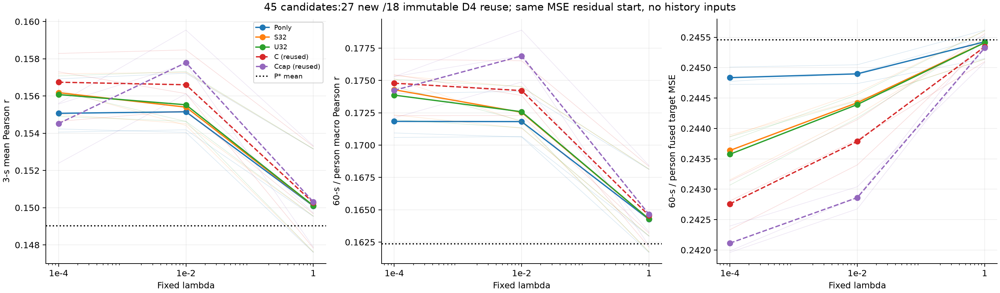
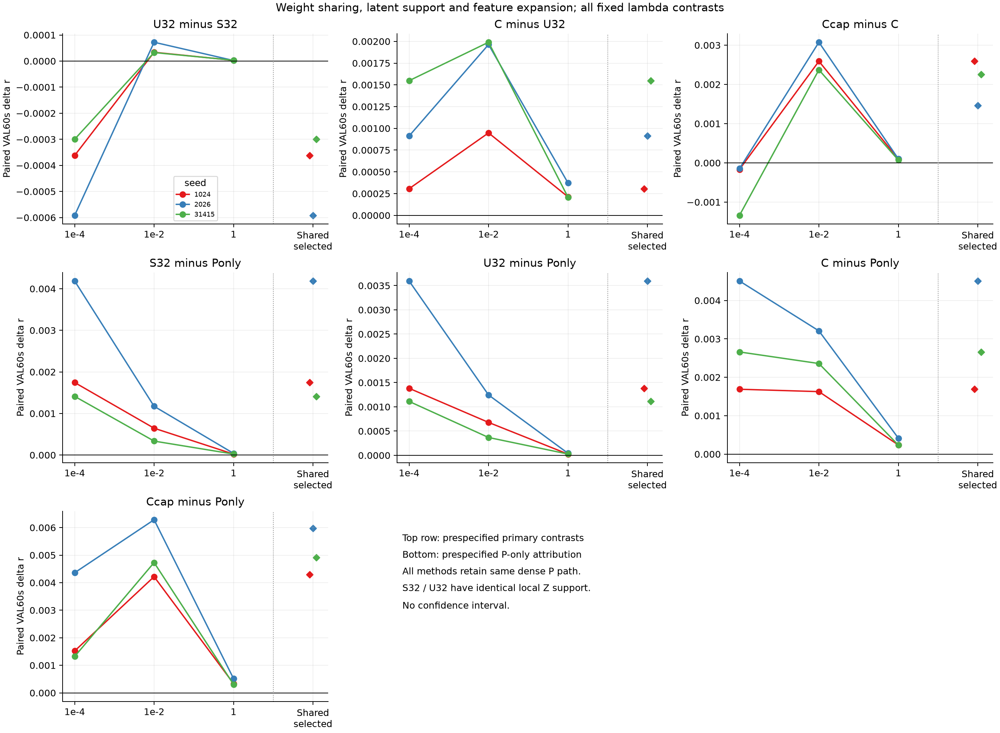
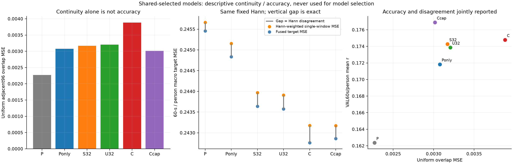

# D6：强当前读出增益来自什么？

**27套新解与18套D4原样复用全部完成，得到更具体的读出归因。** 对原P输出单独再读出的P-only已将source VAL60秒/person r从.162362提高到.171837；加入局部latent共享读出S32进一步到.174284。相同local32支持下解除共享的U32为.173867，没有在选定结果中胜过S32；完整latent读出C为.174789，在全部三个λ×三个seed都优于U32。原D4平方扩展Ccap仍最高r=.176897，但它的收益依赖正则强度，不能概括为“更多参数/解除共享/非线性总会更好”。

连续性提供另一项明确限制：**原P*同物理点跨窗预测最一致，却准确度最低。** 所有选定候选比P*有更高r，但uniform overlap MSE都更高。Ccap较C一致性更好、r更高，却有略高的Hann融合target MSE；固定权重的误差分解解释了这个排名差异。因此较小overlap误差不能单独当成优化目标，也没有据此训练一致性loss。

这是已知被试/不同clip/部分同书来源、反复开发VAL上的证据，不是独立确认、纯loss因果消融、新方法或发表充分性。D4/D5关于短历史加性/双线性的阴性结论保持，当前仍没有额外历史收益。SS07和goal继续ACTIVE。

## 1. 精确控制、复用与共同权限

只原TRAIN/VAL、seed1024/2026/31415。直接复用D4的TRAIN centered G/H、特征统计、P正仿射P*=aP+b与C/Ccap全部18套系数，不读取新的TRAIN latent/target载荷、不拟合新PCA/normalization。新P-only/S32/U32×三seed×三λ共27套model-λ解；另18套D4候选只重建预测/补充指标，**不是45套新训练**。原C/Ccap逐块/总体评分复现最大差≤1.67e−16，共享选择与D4完全一致。

共同目标是TRAIN每seed250750个i≥4窗上的MSE残差Y−P*，float64 ridge，192维截距不惩罚；固定λ=.0001/.01/1。首4窗一律P*，VAL保持30500窗/49person/752块，原192点Hann、96步长和60秒→person宏平均不变。当前原encoder仍看完整离线3秒，latent局部支持不是raw EEG因果窗口，推理没有新增历史或候选声音。

所有臂都保留同一位置不共享dense P192×192分支和b192，P-only只保留它；共同分支本身有37056参数，不能隐藏为“相同原P”。S32/U32只约束Z残差分支，前者共享local32权重，后者逐位置独立，支持均为t−15…t+16，边界zero-pad，不循环。共享定义在原D4逐坐标TRAIN标准化后的Z坐标中，不是未经标准化raw latent上的原native Conv32复现。

| 臂 | Z分支 | 参数含截距 | 角色 | 共享选择λ |
|---|---|---:|---|---:|
| P* | 无新残差 | 0 | 零残差锚点 | — |
| P-only | B_Z=0，只重读P | 37056 | 新9解 | .0001 |
| S32 | local32，跨输出位置共享 | 37312 | 新9解 | .0001 |
| U32 | 同local32，逐位置独立 | 84160 | 新9解 | .0001 |
| C | 完整Z1536→192 | 331968 | D4原样复用9套 | .0001 |
| Ccap | C加完整Z平方1536→192 | 626880 | D4原样复用9套 | .01 |

所有线性臂用展开B_Z/B_P的相同Frobenius惩罚。S32用θ=sqrt(m_k)w，m_k=192−|k|，故展开B_Z的范数等于θ范数，不把共享系数少惩罚192倍。P分支Schur消元后解共享θ，再回代P系数。U32只解真实有效local列；pad零列不计参数。有效df报告整个192输出系统、不含截距：S32使用耦合系统trace，其他按输出求和，不能将S32套用D4每输出公式。

每臂λ跨三seed共享，原VAL60秒/person均值选择，P*零残差亦可选，严格高于才选拟合；本轮均选择拟合。没有按overlap/MSE选点，没有添加更大λ、seed或历史距离。旧Pearson P与本轮MSE还同时改变solver/参数化/正则，不能声称MSE本身已单因素获证。

## 2. 图一：完整固定矩阵与绝对准确度

左/中/右为3秒r、60秒→person r、同一计权的Hann融合target MSE；粗线是三seed均值，细线各seed，C/Ccap虚线标明原样复用，黑点线为P*。三λ所有45格均呈现，连线不是连续寻优，没有CI。r越高较好，MSE越低较好；不同指标没有被混作同一个胜负标准。

| 臂 | 选定3秒r | 选定60秒r | 相对P*的三个seed Δr |
|---|---:|---:|---|
| P* | .149022 | .162362 | 0 / 0 / 0 |
| P-only | .155071 | .171837 | +.009443 / +.011352 / +.007627 |
| S32 | .156180 | .174284 | +.011188 / +.015539 / +.009039 |
| U32 | .156078 | .173867 | +.010826 / +.014948 / +.008739 |
| C | .156741 | .174789 | +.011132 / +.015860 / +.010288 |
| Ccap | .157791 | .176897 | +.013732 / +.017327 / +.012546 |

P-only是一般192维线性再读出和位置截距，能改变时间形状，不等于正全局仿射校准；后者本身对Pearson无增益。P-only仅利用原P当前输出已获得明显开发增益，说明不能将整个C/Ccap−P差都归因于latent信息、记忆或新EEG表征。另一方面，S32/C/Ccap相对P-only仍在三个seed正向，保留了新增latent映射的实际开发贡献。

## 3. 图二：共享约束、latent支持与特征扩展

顶排是三个主要比较U32−S32、C−U32、Ccap−C；其余四面板是预设P-only辅助归因。每个面板前三点使用相同λ，右菱形为各臂自身跨seed共享选择，三色为seed，零线为无差异，无CI。

| 主要比较 | 共享选择均Δr | 三seed Δr | 正seed |
|---|---:|---|---:|
| U32−S32 | −.000418 | −.000362 / −.000592 / −.000300 | 0/3 |
| C−U32 | +.000922 | +.000307 / +.000912 / +.001548 | 3/3 |
| Ccap−C | +.002108 | +.002600 / +.001467 / +.002258 | 3/3 |

解除共享并非无条件获益：U32−S32在同λ=.01/1时三seed微正、均+.000046/+2.72e−6，但在两臂都选择的.0001时三seed负。更大的自由度和位置不共享本身不是可靠提高来源，也不能由此证明共享必优或两者等价。

C−U32在全部3λ×3seed为正，均差按λ=.0001/.01/1为+.000922/+.001634/+.000265。这支持本固定模型族中读取更完整current latent位置的开发收益；它也增加参数与有效容量，且encoder原本就具有全3秒权限，不证明更长raw EEG感受野或生理时标。

Ccap−C在相同λ=.0001时三个seed全负、均−.000550；.01和1时均+.002680/+.000091、三个seed正。共享选择后的+.002108同时包含两个臂不同λ，不能将其概括为与正则无关的平方非线性收益，也不能分离增加函数类与增加参数的作用。

P-only辅助比较也保留全部λ。S32−P-only共享选择均+.002448；U32/C/Ccap分别+.002030/+.002952/+.005061，所有相同λ及seed也均为正。P输出后处理并非全部增益来源，但确实是重要强控制，不再用弱257参数P作为唯一baseline。

## 4. 图三：一致性、target误差与Hann融合分解

此图只呈现按r共享选择的模型；一致性没有参与选择。左图为每record相邻窗同物理96点预测差的pooled uniform MSE；每seed30451对，record间reset。中图橙点为Hann加权单窗target MSE、蓝点为融合target MSE，垂直间距为Hann disagreement；按同60秒块→person计权。右图同均值的overlap MSE与r联合显示。数字刻度/细小误差差距已改为可读呈现，report01原图保留；展示调整不改数值/统计/模型。

| 模型 | uniform overlap MSE | overlap NRMSE | 加权单窗MSE | fused MSE | disagreement |
|---|---:|---:|---:|---:|---:|
| P* | .002269 | .629912 | .245664 | .245458 | .000206 |
| P-only | .003076 | .714714 | .245156 | .244836 | .000321 |
| S32 | .003170 | .717746 | .243968 | .243638 | .000330 |
| U32 | .003205 | .718338 | .243908 | .243576 | .000332 |
| C | .003882 | .777873 | .243179 | .242759 | .000420 |
| Ccap | .003016 | .702557 | .243171 | .242862 | .000309 |

原P*最一致、r最低，所有改进候选overlap差异反而增大。C的overlap误差最大，却有低于其他选定模型的fused MSE；更一致不自动更准。Uniform overlap对每96点计权，与Hann和person宏计权不同，不能把第一列直接当最后一列。

固定归一权重α、1−α满足：α(p1−y)²+(1−α)(p2−y)² = [αp1+(1−α)p2−y]² + α(1−α)(p1−p2)²。单窗覆盖区域disagreement为0，原Hann权重不学习；实际45候选逐物理点恒等误差最大3.80e−15。disagreement也是融合相对两预测加权误差的分散收益，不是必须最小化的目标。

以Ccap−C为例，weighted single MSE降低7.77e−6，但disagreement降低1.10349e−4，fused MSE因而**增加1.02576e−4**；r同时提高.002108。误差分解既解释融合排名，也显示Pearson与MSE不同。它是代数/描述关系，不是“提高不一致性会导致更好预测”的因果建议；没有据此追加一致性loss、学习融合权重或逐窗校准。

## 5. 有效容量、成本与实际验证

选定模型的整个192输出有效df（不含192截距）：P-only约13436–13732，S32约13514–13817，U32约26879–28933，C约91395–103196，Ccap约27497–28020。共同P分支贡献不小，名义参数数不能等同独立信息数、有效df或等容量。S32共享Z部分仅新增256参数，不代表整个模型只有256参数。

实际新27套model-λ解、18原样复用，U32内部1728个按输出小系统、S32九个共享Schur和P回代、P-only九个联合输出求解另列。全过程没有新的TRAIN载荷遍历，复用的是D4已有TRAIN统计；这不是零上游成本。45候选+3P*共48次完整VAL评分=1464000窗次/36096块次，连续性1461648对次，均为重复同一VAL而非独立样本。

全run wall62.767秒、process CPU348.898秒，peakRSS2522185728B（约2.35GiB）、主派生94125140B（约89.76MiB），GPU未初始化、NN更新和encoder/head forward0；报告/图形呈现另计。已记录stage wall和60.806秒、CPU346.905秒，文件/来源及记账开销不在stage和内。共享CPU计时不宣称隔离延迟、FLOPs或效率优势。

必要合成验证：共享Schur系数对显式增广受约束解最大差1.17e−15，整个耦合df对显式hat trace差3.55e−15，S/U同支持/非local扰动canary及Hann恒等检查通过。实际new/reused normal equation最大残差1.06e−16；原C/Ccap重评分最大差1.67e−16，选择规则不变。最终独立实际review与三层结论见本目录配套REVIEW。

## 6. 解释边界与后续

这是相同P*残差、MSE与展开正则下的匹配**读出约束归因**，不是旧PCC目标对MSE的单因素实验；新模型还改变solver/参数化/容量。P-only不是无监督校准；S32不是原native head；C−U32不证明更长raw EEG时间范围；平方扩展也同时增容。已知被试、different clip/部分同书家族的反复VAL选择仍限制独立性，无显著性、等价/非劣、历史机制、生物因果或论文接收结论。

下一阶段需保留P-only和强current C/Ccap等实际控制，针对明确新假说给有界矩阵及确认性证据缺口，不能继续同VAL无界追分，也不能自动改成优化较低overlap误差。当前不扩大D4/D5/D6网格/λ/seed或自动训练NN。SS07/S03/PUB及goal保持ACTIVE。

产物：[45格全部结果](RESULTS.csv)、[共享选择逐seed](report01/SELECTED.csv)、[七个全λ配对](report01/CONTRASTS.csv)、[逐人r与MSE分解](report01/ALL_PERSON.csv)、[逐块](report01/ALL_BLOCK.csv)、[record级连续性覆盖](report01/ALL_RECORD_CONTINUITY.csv)、[record级3秒](report01/ALL_RECORD_3S.csv)、[数值汇总](report01/NUMERICAL_SUMMARY.json)、[分解差值/成本计数](report01/REPORT_DETAILS.json)、[分项成本](COST.json)。本地仅这些轻量统计/图文和代码；latent、Gram、系数/预测仅2203。PR#6保持Draft，不合并，无患者、额外下载、服务器Git或其他支线。
