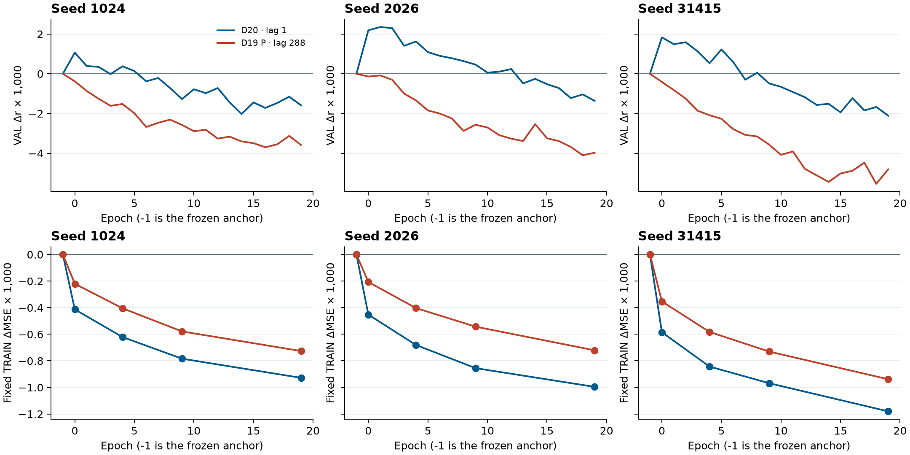

# D20 紧邻预测历史的单因素结果

2026-11-06 · PUB-01-S03_SS07 · 2203

**紧邻冻结预测历史使三个 seed 都选出了超过冻结 FT+Ccap 的已训练轮次。** 原锚点的开发 VAL r 均值为 **0.182339940**，D20 为 **0.184090511**，平均提高 **0.001750571**。对照 D19 P 的最佳已训练轮次，D20 平均提高 **0.002040659**。三个末轮均低于锚点，收益依赖早期选点。该结果来自同一个反复使用的开发 VAL。[正式回执](COMPLETED.json) · [逐 seed 原值](SEED_RESULTS.csv)

## 单因素与两个对照

D20 只把 D19 P 的历史从 `b[t−671:t−287]` 移到 `b[t−384:t]`，仍为 384 点和 96 个四点箱。当前 `g(t)`、强锚点 `b(t)`、9,665 参数解码器、三 seed、训练/验证目标集合、物理 MSE、初始化、全局乱序、早期选点和 20 pass 均沿用原 P。当前统计直接复用 D19 TRAIN，历史统计仅按新 TRAIN 输入重估。历史输入来自冻结预测，真过去包络未输入模型。正式比较同时保留独立训练的 D19 P，以及只替换历史的固定 D20 模型。[方案](PLAN.md) · [DECAF 审计](../../metadata_review/code_review/decaf_protocol_20261106/REPORT.md)

| Seed | 锚点 / D19 P 正式 r | D19 P 最佳已训练 r | D20 选中 epoch | D20 选中 r | D20 − 锚点 | 固定 D20 改用 lag288 的 r | 固定模型近 − 远 |
| --- | ---: | ---: | ---: | ---: | ---: | ---: | ---: |
| 1024 | 0.181888794 | 0.181510298 | 0 | 0.182952500 | +0.001063706 | 0.178754431 | +0.004198070 |
| 2026 | 0.181756120 | 0.181674284 | 1 | 0.184110349 | +0.002354229 | 0.177730843 | +0.006379506 |
| 31415 | 0.183374905 | 0.182964973 | 0 | 0.185208683 | +0.001833778 | 0.178012399 | +0.007196284 |
| 三 seed 均值 | 0.182339940 | 0.182049852 | — | 0.184090511 | +0.001750571 | 0.178165891 | +0.005924620 |

D19 P 三组的正式选择都是 epoch −1，即原锚点。与其三个最佳已训练轮次相比，D20 的 r 提高分别为 **0.001442203、0.002436065、0.002243710**。逐人比较正式 D20 与各自同 seed 锚点，49 人中分别有 **29、37、32** 人提高，其余 **20、12、17** 人下降。这些是同一组开发受试者在不同训练 seed 的结果，不能把 147 项当独立样本。[逐人表](PEOPLE.csv)

固定 D20 的当前特征、当前码、锚点、网络权重和评分坐标，只换回 D19 的 lag288 输入，三个 seed 的 r 均下降，并低于各自锚点。该干预采用 D20 的近历史训练统计，测的是已训练模型对远历史替换的反应，输入和模型训练分布同时发生错配。它与分别训练近/远模型的比较互补，两个效应量不能互换。[正式回执](COMPLETED.json)

## 轨迹与末轮

图上排三列分别对应三个 seed，纵轴为相对同 seed 锚点的开发 VAL Δr×1,000。D20 在 **60/60** 个相同 seed 与 epoch 的对照中高于冻结 D19 P；各 seed 分别有 **5、13、8** 个已训练轮次超过锚点。两条曲线整体随训练下降。D20 三 seed 末轮 r 分别为 **0.180301482、0.180388947、0.181267255**，均低于锚点，但均高于 D19 P 的末轮。

图下排显示固定 TRAIN 的活动点 ΔMSE×1,000，测量轮次为 −1、0、4、9、19，同行使用相同纵轴。D20 各固定训练轮次的 MSE 降幅都大于 D19 P，末轮平均由锚点 **0.191851** 降至 **0.190816**，D19 P 降至 **0.191056**。D20 末轮开发 VAL 活动 MSE 均值 **0.250064**，D19 P 为 **0.250039**。训练拟合持续改善而开发 r 在早期后回落，结果不支持将更低的 TRAIN MSE 当成更晚轮次的开发增益。[逐轮原值](EPOCH_METRICS.csv)

## 与既有强结果的关系

在各自已冻结协议下，D20 的开发 VAL 均值 **0.184091** 略高于 D9 的物理目标 F **0.183874**，低于 D18 的 H **0.184245**、C **0.184249** 和 P **0.184379**。这些对比涉及不同模型与目标，并未作为 D20 的配对组件检验。D20 给出了紧邻冻结预测相对 D19 远历史 P 的开发收益，尚未超过现有最强开发参考。49 名 VAL 受试者都见于 TRAIN，整体科研目标仍未达成。[D9 报告](../../physical_objective/run01/REPORT.md) · [D18 报告](../../preprojection_memory/run01/REPORT.md) · [D19 报告](../../physical_stream/run01/REPORT.md)

历史特征在时间坐标上严格位于当前点之前。由于原 encoder 依赖整窗，紧邻冻结预测的原始 EEG 与当前预测可以共享同一支持。正 Hann 的最晚贡献窗单调，因而在固定当前和锚点的设定下未增加最晚原始 EEG 读取权限。这个证据范围是离线的预测连续性，不建立独立过去 EEG 信息、递归融合回授或在线解码收益。[协调原始支持核验](../../recent_context_review/run01/COORDINATOR_SUPPORT_CHECK.json)

## 实际计量

| 阶段 | 实际成本 |
| --- | --- |
| 有限工程 | 6 TRAIN 记录、3,447 个缓存窗、0 VAL。24,576 当前 stem、36,864 上下文输出、24,576 backward 点，0 更新；4.213 秒墙钟 / 7.471 CPU 秒 |
| 正式 | 3 组各 20 pass、86,820 更新、1,422,210,600 backward 目标点。当前 stem 1,887,261,057 点、上下文输出 1,895,861,454 点，包含 3 组实际配对。383.121 秒墙钟 / 1,210.953 CPU 秒 |
| 冻结上游与输出 | 原 EEG encoder 和原 FT 神经输出头重跑 0，固定 Ccap 用旧缓存对 848,862 窗重建，含原 FT 回退。新增信号、特征和预测数组文件 0，D20 保存 66 个参数 checkpoint 和 3 份 TRAIN 统计 |
| 正式峰值 | 主存 5.256 GB，torch allocated 2.834 GB。正式终态 writer 17.19 MB |
| 独立保存证据审计 | 1.101 秒墙钟 / 1.162 CPU 秒。核对 60 个恢复文件的数量和命名，实际加载三组末轮及选中轮的恢复状态与权重，并验证选点、逐人与 752 块聚合。最大聚合差 1.11×10⁻¹⁶，无网络前向 |
| 独立功能重放 | 1.772 秒墙钟 / 2.667 CPU 秒。固定两条 VAL 记录的首末活动点，覆盖 3 个 last 和 3 个 selected。原实现和 NumPy 各 1,536 前向点及 3,756 个固定读出窗。输入和锚点差为 0，预测最大绝对差 2.086×10⁻⁷ |
| 独立科学汇总 | 0.064 秒墙钟 / 0.064 CPU 秒。重核三 seed 分差、60 个同轮对照、逐人方向和各 seed 超锚点的轮次，无网络前向 |

工程对三 seed 的显式历史分箱误差为 0，D19 初始化和首轮全排列结束的实际 PCG64 状态一致。原 TRAIN/VAL 与活动点不变，正式 VAL 强锚点以原 752 块核对。旧 test、DTU、ds004408 和患者侧均未开启。[工程回执](ENGINEERING_COMPLETED.json) · [正式执行审阅](EXECUTION_REVIEW.json) · [独立验收](REVIEW.md)
