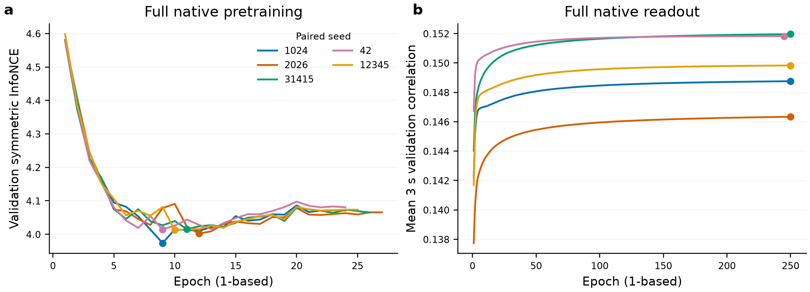

# SS07 实现与接续阶段复核（2026-11-01）

当前结论仅为工程/协议通过，不能据此声称超过baseline。原完整baseline五seed训练中；1024正式预训练24epoch/19680更新、best epoch8、patience15停止，正在生成其新encoder的train/val缓存。没有读取test载荷或候选test成绩。

协调chat 01a134e4-2036-7e02-81e9-1289a07606f2已独立读取2203代码、JSON与实际进程，核对select/full_queue/history/history_check四文件与本地来源一致；确认控制器PID4176245实际在WAIT_ALL54_SCREEN，接受先54完整配对screen、再15full、然后固定primary五seed和同预算控制的有界流程，无自动失败重试/缺失平均。此独立复核不等于SS07科学验收。

| 证据 | 核验要点 |
|---|---|
| INCREMENTAL_ENGINEERING_CHECK_v2.json | 17组synthetic，恒等、梯度、未来/重叠排除、奇数分块；注明single-call跨窗不冒充跨forward证据 |
| TRAINER_ENGINEERING_CHECK.json | 全426/252454窗/3945更新；420个混record batch；单步与native差9.31e-10；真正两forward不断开状态的前块梯度.000581449，detach后None且数值相同；M3两teacher mask/次数相同 |
| SELECTION_ENGINEERING_CHECK.json | 6项metadata fixture，覆盖54/15全数要求、失败/缺失/nonfinite拒绝、定宽/定family、五seed与不可变child；fixture保留engineering_history，科学选择不读取 |
| HISTORY_ENGINEERING_CHECK.json | 6family非零残差预测与冻结forward差0；current不变/逐窗错历史、内容盲不同于reset；15组Hann支持首尾/尾差与EMA0/gap reset |
| STRONG_CONTROLS_ENGINEERING_CHECK.json | 随机完整encoder raw混record与独立切片精确一致；组合forward差0；encoder/head梯度；EMA0与原49人752块macro逐块误差0；无随机性能报告 |

后续协调已独立通过强FT/EMA phase，并要求真实incumbent验证loss一致性。已补入固定1e−4绝对误差门，raw重编码/B64与原cached/B512全30500窗比较，0optimizer steps时保存INCUMBENT_EQUIVALENCE；不一致则失败保留，不调阈值/换checkpoint。FINETUNE_PROTOCOL/EMA_PROTOCOL冻结，五FT与一个EMA driver排队等待各自完整native head。旧随机工程proof对应v1来源，v1源在服务器engineering_history/strong_controls_v1保留；新增门由实际启动核验，不把随机组装检查冒充真实checkpoint一致。

实际首个核对已PASS：seed1024完整两阶段head250epoch/986250更新完成，FT raw/B64与原cached/B512的全30500窗验证loss差1.3955303856949541e−8，0optimizer-step时通过预定1e−4阈值；不是随机权重替代检验。head选249、按250上限结束，保留预算未收敛风险。

统计/干预规则经协调五点澄清后冻结EVALUATION_RULES，代码合成PASS；metadata-only SOURCE_FAMILY_JOIN/DONOR_METADATA_PLAN已保存144个目标的唯一供体/缺失原因。最终checkpoint/target-mask child仍未具备，不产生test预测。外部DTU两文件扩展获协调授权，range确认18个MAT、zip+extraction3.43GiB，在2203白名单下载中，无外部模型表现；AUDIO/EEG/Dryad/新权重未批准。sub-077暴露、sub-017未知/质量问题继续分开保留。SS07保持ACTIVE，未作性能或科学成功声明。

后续DTU下载/官方MD5/安全提取与18人1080trial全审计完成，报告与轻量证据已同步本地。profile工程v1独立backward强bitwise失败保留服务器engineering_history/profile_v1；修订为同一真实梯度/初始参数/Adam状态隔离finite谓词，非mutation/参数/梯度/Adam差0、NaN/±Inf一致。共享GPU交替短块全step中位13.606ms→6.928ms仅为工程测量，不保证完整训练加速或bitwise一致。经协调独立审阅批准，future full独立v2/helper39项实际NaN/Inf判定PASS，FULL_ENGINEERING_AMENDMENT/FULL_V1_V2_SOURCE.diff关联来源。live检查旧等待controller无children/无fullcells/WAIT54后仅停止该等待进程，新PID14537及独立lease/status接续；不改/重启baseline/screen/FT/EMA。原scientific protocol、所有旧源/lease/status保留。完整三seed比较及科学验收尚未到达。

## 五次完整native与平滑控制（后续实际进展）

五seed预训练分别24/27/26/24/25 epoch，均按patience15停止；selected epoch（0-based）8/11/10/8/9。五个head均实际250epoch/986250更新、达到原预算上限，不称patience早停或已收敛；selected249/249/249/244/249。BASELINE_BUDGET.csv及SNAPSHOT.json来自完成的实际history/completed，图横轴为1-based，点为验证所选checkpoint。右图仅原3s checkpoint criterion，不是60s逐人主测试成绩。

实际EMA入口数值审阅发现whole-phase64不拆record与主macro验证的global64/record split不同；旧随机预测tau0检查仅覆盖融合计分，不能证明真实NN输出恒等。live核对原EMA等待driver4187874的exact argv、无children、无selection/results后仅停止该等待进程，原源/lease/status/protocol保留；EMA_V2_HANDOFF、NUMERICAL_AMENDMENT及精确diff完整记录，新driver48661已完成。真实P1024完整VAL752块：旧分块最大r差1.449e−5，修正为原forward_global_batch后差0，未放宽数值阈值、未重训。预设5tau/3seed均值选优/5seed复用规则不改，最终tau0；所有三个seed下其余四个平滑tau均较差。EMA_SELECTION保留tau0恒等alias，并保留预设M6/7中的重复保守对照，不扩大范围追改善。

FT五个真实incumbent检查均在0更新前通过（最大绝对差3.70e−8，固定阈值1e−4）。其中1024/31415已各5epoch/19725更新完成，另三个继续。本阶段PROGRESS_02快照为screen24/54；不对不完整seed排名，正式候选full尚待54配对结果。

## 最终执行链的工程复核

新checkpoint builder在任何test payload之前核验全部54screen、五family初始full、最终primary/control5seed、P/FT/EMA，独立重算screen宽度/full前三seed赢家/EMA选择、核验真实checkpoint key/shape/seed/epoch/最早validation tie。成本账本显式包含全部未入选screen、5次共享pretrain各计一次、native head、FT及去重full，整个搜索成本与赢家正式预算分开；probe/profile不混入科学训练总账。

最终真实weights就绪后，先在每seed至少两合法VAL record（含非64起点）自动复核primary正常forward/true-history桥和P/EMA0同预测，再固定target/coverage/donor/shuffle mask，之后才推理。P/增量/history保留phase-global64拆record；FT保留其原mixed-record完整global64 raw decoder；P_EMA直接复用P相同window预测。内部技术失败保留partial并阻止该seed后续DTU，低分不触发停止。每种donor只与相同key子集的true-history配对，不把119记录对子集与144记录全体相减。

FINAL_EVAL_COMMON_ENGINEERING_CHECK_v2：真实native VAL752块r差0，实际拟合非零M2 true bridge差0，六family非零/奇数首块恒等差0，FT真实P incumbent两VAL record混batch raw路径差0；错key/person/seed/epoch/tie拒绝；提前builder调用payload读取0。FINAL_EVAL_PIPELINE_ENGINEERING_CHECK_v2：隔离合成输入/小模型走完整一seed caller，显式克隆合成metadata测试五seed聚合，覆盖1080trial/EMA同波形/FT独立源/不同donor keys/缺stratum不重权/内部技术失败external calls0。FINAL_MANIFEST_ENGINEERING_CHECK仅合成完成metadata+显式checkpoint stub检验全账本/排名与错均值拒绝，不冒充实际权重完成。失败probe/初版语法/fixture浮点修订均保留服务器engineering_history。

协调端已独立读取上述当前代码、实际proof和source hash并批准按原门冻结/自动排队；无新增用户审批。最终实际checkpoint manifest/READY目前未创建，无真实test或DTU NN成绩。预估最坏8主条件的新数组约9.06GB，加现有8.69GB低于25GiB并保留磁盘20GiB。正式权重桥、真实推理、原始预测复算、图表和科学验收仍待完成，goal保持ACTIVE。
