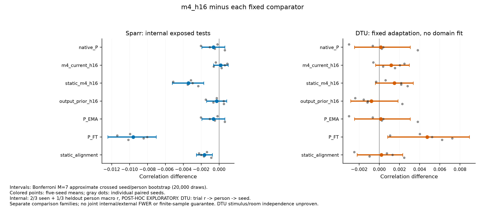
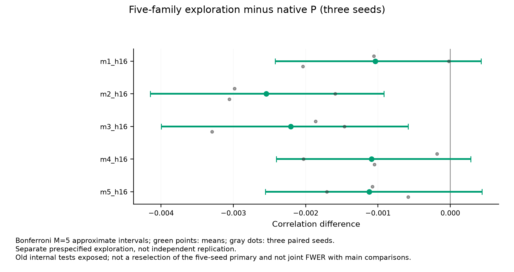
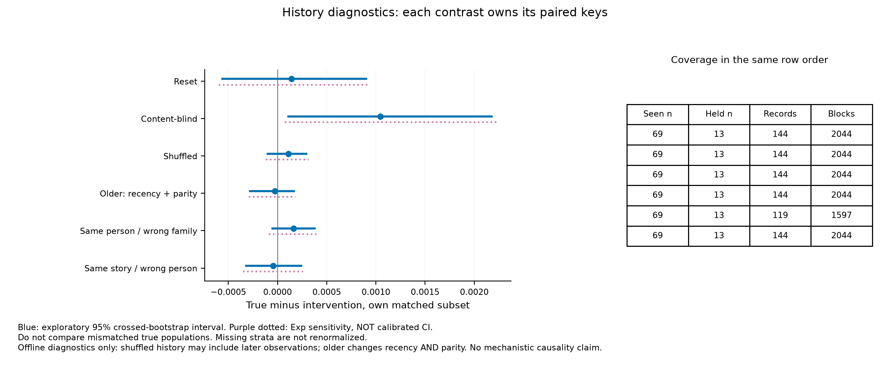
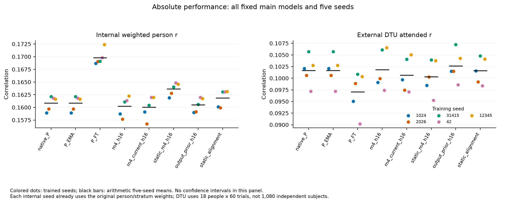
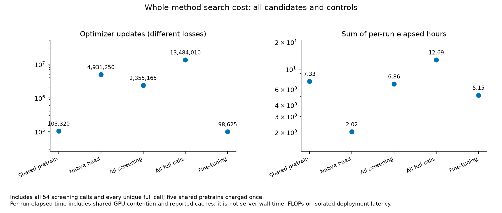
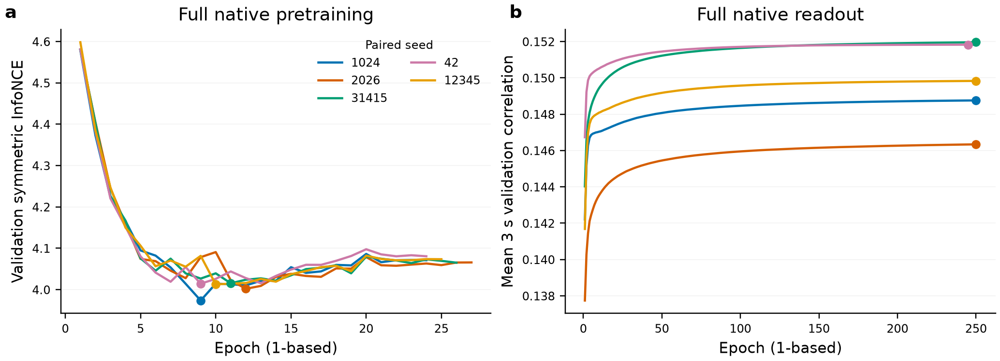
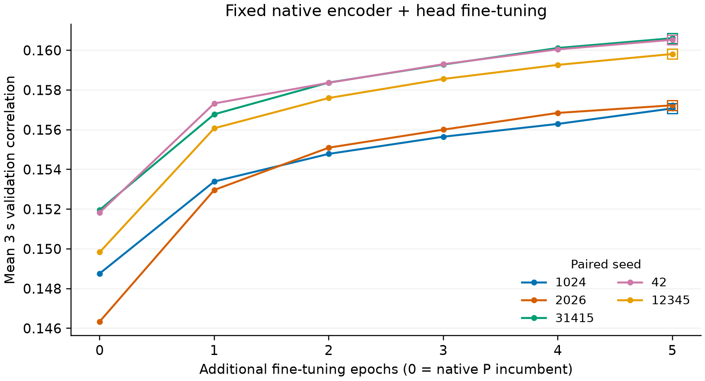
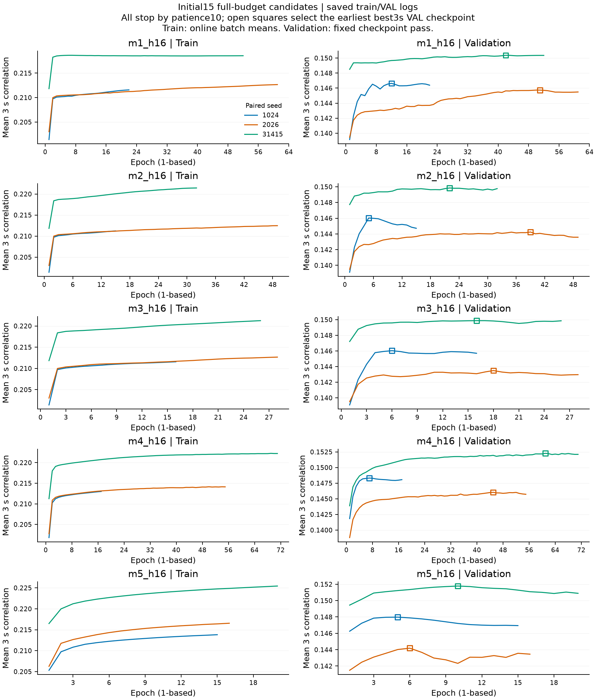
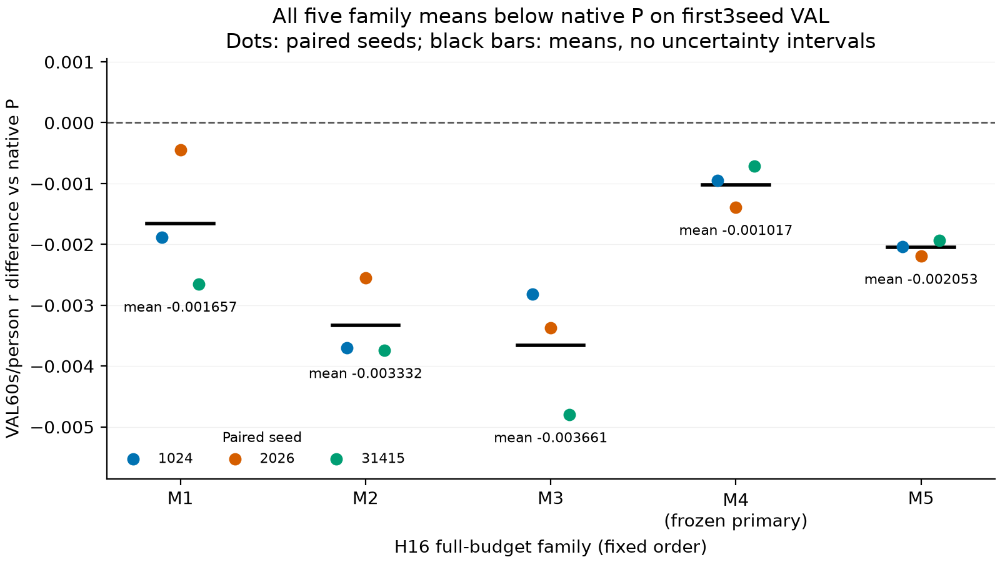

# SS07 round01：全量强基线与连续性残差结果

本轮没有建立连续性主模型M4相对原P的稳健增益，也没有达到所要求的方法创新、机制与投稿证据标准。预设训练、统一评分、实际raw/metric复核及图表已完成；这是有效的有限制阴性实验交付，不是整个持续goal完成。

五seed内部原加权r：M4 **.160217**、P **.160838**，差−.000621，M7近似校正区间[−.001937, .000649]。DTU固定适配下：M4 **.101815**、P **.101666**，差+.000149，区间[−.002481, .003069]。两区间均跨0，既不能宣称超越，也不是等价或非劣证明。内部测试已有历史暴露，仅为POST-HOC INTERNAL EXPLORATORY；DTU没有目标域模型拟合，但刺激/房间独立性未证明。

## 1. 实际执行与问题范围

保留原native EEG Transformer/XLSR19两阶段方法和Conv32+LeakyReLU读出，使用既有完整合法fold：train426 / val49 / seen69 / heldout75 records。当前窗为64Hz的3s、192点，hop96；原3s离线当前输入权限保留。历史只读取不与当前窗重叠的i−2/i−4等窗，按奇偶流维护状态，record/phase/epoch重置。因当前encoder双向、评分又经Hann融合，不能称逐sample因果或硬件同步证明。

五seed固定为1024/2026/31415/42/12345。每seed重新预训练一个encoder，P与相应增量/控制共享其冻结表征。原P head与五family从同随机head起点训练；残差末投影为零使初始函数回到该随机head，**没有从训练完成的P head继续加入历史**。只有FT训练臂加载已训练P encoder/head后联合更新；EMA是无拟合后处理。详见[初始化与失败机制核查](FAILURE_MECHANISM_CHECK.md)。

54个筛选单元（18条件×3seed）全部保留，五family按原规则均选H16；随后初始15个fresh full按原三seed VAL60s/person规则冻结M4。主模型及四控制最终五seed25cell，加其余四family的三seed12cell，共37个唯一full，未重复计M4三seed，没有在新增seed或测试后重选。各checkpoint仍按原3s VAL选择；max250/pat10相同不等于实际更新数相同。

内部最终有69 seen、13 heldout人，144 records、2044个有效60s块（seen872 / heldout1172）。先块→人，再按2/3 seen+1/3 heldout加权。DTU为18人×60trial=1080，每trial50s、64Hz；固定物理64导联映射、scalp CAR和当前3s内z变换，全部trial保留，评分有效覆盖3166/3200点。没有目标域模型拟合，也没有排除S11、调整lag或改变适配。

## 2. 主比较：未获得超越原P的证据

图1横轴均为M4减去固定比较器的r差；蓝色为内部原加权终点，橙色为DTU attended r，灰点为五个配对seed。横线是20,000次交叉seed/person bootstrap的M7近似Bonferroni区间，名义水平99.2857%，不是有限样本覆盖保证。两域分属比较族，不主张联合FWER；P_EMA的tau0与P精确别名仍保留为重复对照和M7的一部分。

| M4减比较器 | 内部差值 | 内部M7近似区间 | DTU差值 | DTU M7近似区间 |
|---|---:|---|---:|---|
| 原P | −.000621 | [−.001937, .000649] | +.000149 | [−.002481, .003069] |
| 同结构current输入控制 | +.000181 | [−.000618, .001030] | +.001166 | [−.000382, .002971] |
| 静态容量控制 | −.003413 | [−.005235, −.001708] | +.001484 | [−.000390, .003356] |
| 输出历史prior | −.000268 | [−.001401, .000849] | −.000798 | [−.002850, .001838] |
| P_EMA（tau0） | −.000621 | [−.001937, .000649] | +.000149 | [−.002481, .003069] |
| P_FT | −.009583 | [−.012424, −.007017] | +.004751 | [.000821, .008923] |
| 静态对齐 | −.001634 | [−.002547, −.000739] | +.000209 | [−.002202, .002317] |

内部M4低于静态容量、FT和静态对齐控制，其预设近似区间均为负；与同结构current控制的差接近0且区间跨0。因此本轮没有建立超出当前输入映射/容量的历史优势。DTU唯一全正区间是M4−FT，不能用它代替M4−P：M4对P的区间仍跨0，外部相对FT的优势不足以构成稳定跨域提升。

内部M4−P在seen与heldout的点差分别为−.000831和−.000201，支持性95%区间均跨0。这些分层区间不在主加权M7保证内。共享来源Exp重加权仅作敏感性，不是校准CI。测试涉及17个来源family；每个family_only切片都缺一个stratum，原2/3–1/3终点不可定义，保留null而不重赋权。17项leave-family-out的M4−P点差均为负（约−.000946至−.000456），但人口已改变，仅作描述，不能冒充新的跨刺激确认。

## 3. 五family探索：没有用测试重新选择赢家

图2只用预定前三seed，横轴为每family减原P，绿点为均值，灰点为配对seed，横线为单独M5比较族的近似99%区间。M1至M5的均值分别约−.001039、−.002546、−.002208、−.001089、−.001122；M2与M3区间全负，其余跨0。这里的五family指五种方法框架，不是上文17个刺激来源family。

所有框架均未显示对P的稳健优势。该探索既不是独立复现，也不与主M7构成联合FWER。不能因某个框架或seed在这张测试图上更接近0，就替换已按VAL冻结的M4；本轮没有进行这种重选。

## 4. 历史诊断：部分敏感性不足以证明机制

图3横轴为相同当前EEG/模型权重下的true history减去干预历史。蓝线为探索性95%交叉bootstrap区间，紫色虚线为来源Exp敏感性范围，后者不是校准CI。右表与左图同序列出覆盖，所有差值使用该行自己的true/intervention配对keys。

| 干预 | true减干预 | 未校正95%近似区间 | records / blocks |
|---|---:|---|---|
| 每窗reset | +.000142 | [−.000572, .000913] | 144 / 2044 |
| content-blind训练均值 | +.001046 | [.000101, .002189] | 144 / 2044 |
| shuffled | +.000109 | [−.000112, .000304] | 144 / 2044 |
| older | −.000028 | [−.000290, .000177] | 144 / 2044 |
| 同人错family | +.000161 | [−.000061, .000388] | 119 / 1597 |
| 同故事错人 | −.000043 | [−.000329, .000250] | 144 / 2044 |

content-blind是唯一未校正95%区间为正的诊断，说明这一替换与部分性能变化相容；它不是经六项校正后的机制证据，也不能抵消主比较未获历史增益的结果。reset/shuffle/older/错配没有形成稳定区间优势。同人错family虽五个seed点差都为正，其person不确定性区间仍跨0，不能只凭seed同号下结论。

同人错family保留69 seen和13 heldout人，但heldout只剩50/75 records、725/1172块；不能拿全体true均值与该子集的干预均值相比。shuffle可引入更晚观察，older同时改变recency与parity；分布变化、表征限制、优化与历史内容本身尚不能分离。这里不是神经/生物学因果干预，也没有证明历史信息普遍不存在。

## 5. 绝对性能与域差异

图4左侧为内部加权person r，右侧为DTU attended r；彩点是各训练seed，黑横线是五seed算术均值，本图没有置信区间。DTU的独立抽样单位是18人，不是1080个独立被试。两域任务/输入适配不同，不能用左右r尺度直接度量域差异。

| 固定条件 | 内部加权r | DTU attended r | DTU辅助2AFC（描述） |
|---|---:|---:|---:|
| native_P | .160838 | .101666 | 73.30% |
| P_EMA | .160838 | .101666 | 73.30% |
| P_FT | .169800 | .097064 | 71.44% |
| m4_h16 | .160217 | .101815 | 73.76% |
| m4_current_h16 | .160036 | .100649 | 73.52% |
| static_m4_h16 | .163630 | .100331 | 73.17% |
| output_prior_h16 | .160485 | .102613 | 73.65% |
| static_alignment | .161851 | .101606 | 73.54% |

FT在内部的点均值最高，外部点均值却低于原P和M4；因此源域微调改善不能外推为跨域稳定改善。这里没有另算或新增FT−P的确认性检验。图1中的预设M4−FT外部区间为正，应与M4−P未建立优势一起解释。辅助2AFC不是主终点，没有据其选择模型、适配或trial，也不由此宣称语义/注意机制或部署性能。

## 6. 全搜索成本与强基线完整性

图5以对数纵轴显示各阶段优化更新数和逐run elapsed小时之和，包含全部54screen与37个唯一full，五个共享预训练仅计一次。不同loss的一次更新计算量不同；elapsed含同期GPU争用和已报告缓存，不是服务器wall time、FLOPs或隔离部署延迟。

| 阶段 | cells | 更新数 | 监督窗口重复呈现 | 辅助teacher呈现 | elapsed小时之和 |
|---|---:|---:|---:|---:|---:|
| shared pretrain | 5 | 103,320 | 0（非此监督目标） | 0 | 7.33 |
| native head | 5 | 4,931,250 | 315,567,500 | 0 | 2.02 |
| screen | 54 | 2,355,165 | 150,715,038 | 32,708,260 | 6.86 |
| full | 37 | 13,484,010 | 862,887,772 | 17,612,140 | 12.69 |
| fine-tune | 5 | 98,625 | 6,311,350 | 0 | 5.15 |

预训练另有13,224,960个随机对比窗呈现，监督窗口列为0不表示没有预训练数据成本。37full共3418epoch和165,674,452,224个目标时间sample重复呈现；这些不是独立数据量。仅M4五seed正式full为199epoch、785,055更新、50,238,346窗，仍需另计共享预训练与完整搜索成本。不能用更少早停步数加上区间跨0，就宣称计算效率、等效或非劣。

### 原完整P的实际验证轨迹

图6左侧为对比预训练VAL symmetric InfoNCE，右侧为head的平均3s VAL r；圆点为选中checkpoint。预训练分别24/27/26/24/25轮按pat15结束，最佳0-based8/11/10/8/9；head均运行250轮，最佳249/249/249/244/249。曲线支持“按原可用数据/资源协议完整复跑”，不证明全局收敛、最优性或官方全人数/500epoch/ensemble条件。3s曲线不能替代60s/person主终点。

### FT五seed完整固定预算

图7横轴0为已训练P incumbent，1–5为新增微调轮次，纵轴是3s VAL相关，空方框为选中点。五seed均改善并在第5轮选中，实际各19,725更新；此图的Fixed指固定预算方案，encoder和head均被更新。它是测试开启前已经保存的源域证据，不证明收敛、连续终点一致改善或外部泛化。

### 初始15个full的优化轨迹

图8每行一个H16框架，左为在线训练batch均值，右为固定验证遍历，空方框为最早最佳3s checkpoint。495条实际epoch日志全部保留。M2/M3的若干验证曲线持平或回落，M5三个验证峰在第5/6/10轮，M4峰在第7/45/61轮；不同seed动态不同。在线train随轮内权重变化且样本池不同，不是同checkpoint泛化误差。轨迹与多种优化/泛化机制相容，不能单独证明过拟合、训练不足或历史信息无效。

图9的彩点为原三seed配对VAL60s差，黑线为均值，没有置信区间。全部15点为负；M4均值差约−.001017，是候选中下降最小者，但不是超过P。另有明确的排序不一致：M4/31415的best3s为.1522685305，P为.1519646136；相应VAL60s却为.1656389903与.1663503571。因而不能把某条3s曲线较高等同于连续评分改善。VAL也参与训练/候选选择，这些不是独立确认。

## 7. 实际复核、可追溯性与证据边界

最终[checkpoint清单](FINAL_CHECKPOINT_MANIFEST.json)锁定5个原encoder和47个checkpoint角色，106条成本记录等于54screen+5pretrain+5head+5FT+37full。[READY](EVALUATION_READY.json)在预测前绑定权重、10条实际最终权重VAL桥与四份掩码；VAL桥差均0、包含非64起点、当前z不变、P/EMA0精确恒等。

[实际raw复核](independent_raw_review/RAW_INPUT_REVIEW.json)按预先metadata选定的3条Sparr和6条DTU×五seed×八main检查360项，最大波形差1.82×10⁻¹²，小于预设10⁻⁶。它重新读raw与各自checkpoint并核对批次/适配/融合，但复用冻结NN forward，不是全量raw重放、独立神经数学或history干预NN重放。

[实际metric v2复核](independent_review/METRICS_REVIEW.json)完成583,129项检查，复算165,373个内部块、43,200个DTU trial配对。Pearson最大差5.56×10⁻¹⁶，描述性MSE/R²最大缩放差约1.24×10⁻¹⁵；均符合预先冻结门。大幅度R²的缩放核验在测试前已由合法VAL修订并独立审阅，未依据测试放松标准。[综合V2标记](INDEPENDENT_REVIEW_COMPLETED_V2.json)已通过，实际图表只用已审V2入口。协调端另行核对37full/来源/预算和五张真实结果图；这不是外部实验室独立复现或期刊审稿。

逐seed、逐人、record/story/family结果见[final_summary](final_summary/INTERNAL_PER_SEED.csv)与其同目录CSV；DTU逐人/逐seed统计见[EXTERNAL_DTU_MAIN](final_summary/EXTERNAL_DTU_MAIN.json)。[REPORT_NUMERICS](REPORT_NUMERICS.json)仅在2203对已复核汇总复制字段及计算seed算术均值，没有新拟合、评分、重采样或模型选择。完整成本见[COSTS](final_summary/COSTS.json)。

Sparr旧测试已有开发暴露，不能重新命名为独立确认；DTU固定适配不等于刺激/房间独立。近似bootstrap、17个共享来源family、五seed和13个heldout人都限制外推。Pearson没有校准输出幅度，MSE/R²只作描述；DTU物理单位/历史预处理revision等未决信息不因r较好而自动解决。来源/许可与适配限制保留在既有DTU记录，不排除S11或改变数据范围。

方法新意仍未建立。多尺度、状态、辅助预测、动态滤波和prior等组件不能因组合命名就成为新贡献；output_prior并非完整DECAF复现，M3不是CPC，M4不是生理延迟估计，M5不是已校准Kalman filter。已核验的一手比较及不可直接比数值的条件见[RELATED_WORK_COMPARISON](RELATED_WORK_COMPARISON.md)。本轮既没有稳健胜强控制，也没有内容/时间特异机制及新的确认性证据，不能据此宣称ICML/NeurIPS级结果。

## 8. 本轮决定与后续边界

Technical **PASS**；本轮预设实验交付 **PASS_WITH_LIMITATION**（阴性证据有效）；超越基线/机制/投稿充分性目标 **未达到**；Parent consistency **PASS**。SS07和持续goal保持ACTIVE，不自动合并PR#6，不启动患者或其他支线。

当前仅准备可审阅的下一步源域train/val方案：依据测试前已记录的14/15 best3s低P、随机head联合训练而非已训练P起点、FT五seed VAL改善，检查未覆盖的初始化与encoder联合训练因素。尚未执行下一阶段；不以本轮DTU或旧test选择超参、改预算或追阳性。任何新的确认测试必须重新明确未暴露证据资格。本轮所有信号、权重和预测数组继续仅保留2203，本地仅代码、轻量结构化汇总、静态图与报告。
