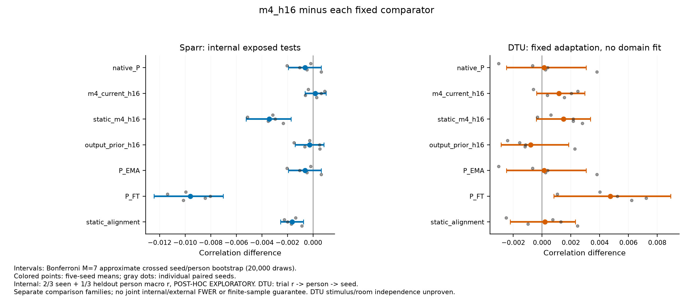
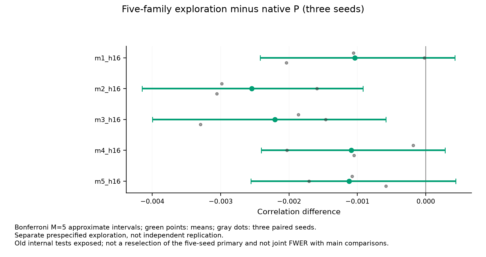
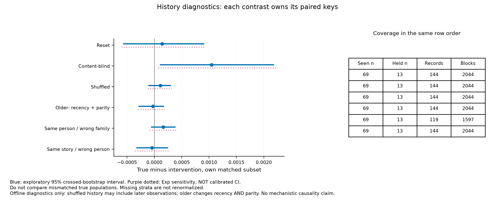
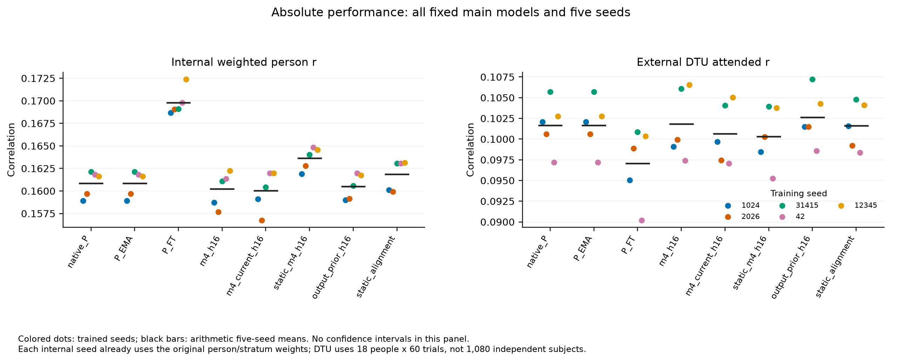
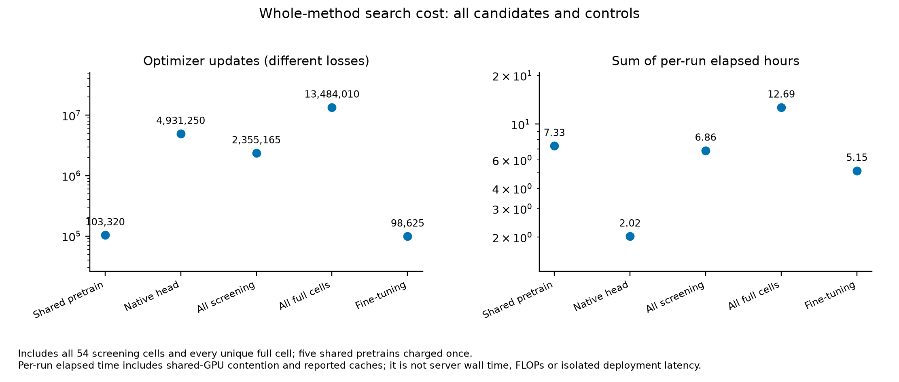

# SS07 已复核数值汇总（科学解释待完成）

冻结主模型：`m4_h16`；五seed：[1024, 2026, 31415, 42, 12345]。以下仅转述已复核数据，不自动认定goal完成或投稿充分。

## 主比较

| 比较 | 内部原weighted差值 | 内部Bonferroni近似区间 | 外部DTU差值 | 外部Bonferroni近似区间 |
|---|---:|---|---:|---|
| primary-native_P | -0.000621 | [-0.001937, 0.000649] | 0.000149 | [-0.002481, 0.003069] |
| primary-current | 0.000181 | [-0.000618, 0.001030] | 0.001166 | [-0.000382, 0.002971] |
| primary-static | -0.003413 | [-0.005235, -0.001708] | 0.001484 | [-0.000390, 0.003356] |
| primary-output_prior | -0.000268 | [-0.001401, 0.000849] | -0.000798 | [-0.002850, 0.001838] |
| primary-P_EMA | -0.000621 | [-0.001937, 0.000649] | 0.000149 | [-0.002481, 0.003069] |
| primary-P_FT | -0.009583 | [-0.012424, -0.007017] | 0.004751 | [0.000821, 0.008923] |
| primary-static_alignment | -0.001634 | [-0.002547, -0.000739] | 0.000209 | [-0.002202, 0.002317] |

内部为已暴露测试的POST-HOC INTERNAL EXPLORATORY；外部固定适配、无目标域拟合，但刺激/房间独立性未证明。两套比较各自M6/7，不主张联合FWER或有限样本覆盖。

## 五family与历史诊断

五family只使用预定前三seed、单列探索M5；不是新主模型选择或独立复现。历史差值都使用其自身同key true子集，缺分层不重新赋权。

## 逐seed与成本

| 阶段 | Cell数 | 更新数 | 监督窗口呈现 | 辅助teacher呈现 | 逐run elapsed秒之和 |
|---|---:|---:|---:|---:|---:|
| shared_pretrain | 5 | 103320 | 0 | 0 | 26403.6 |
| native_head | 5 | 4931250 | 315567500 | 0 | 7267.0 |
| screen | 54 | 2355165 | 150715038 | 32708260 | 24693.2 |
| full | 37 | 13484010 | 862887772 | 17612140 | 45677.5 |
| finetune | 5 | 98625 | 6311350 | 0 | 18528.5 |

预训练的负样本/样本呈现预算另见COSTS与原BASELINE_PROTOCOL，不能把本表监督窗口列中的0理解为没有预训练数据成本。各loss一次更新计算量不同，逐run elapsed相加不是设备隔离计时或总服务器wall time。

原始输入重放范围、实际metric复核、暴露/泛化限制及相关工作/新意缺口须与本表一起解释。技术通过、单seed阳性或图上区间不跨0均不自动构成论文级科学接受。
