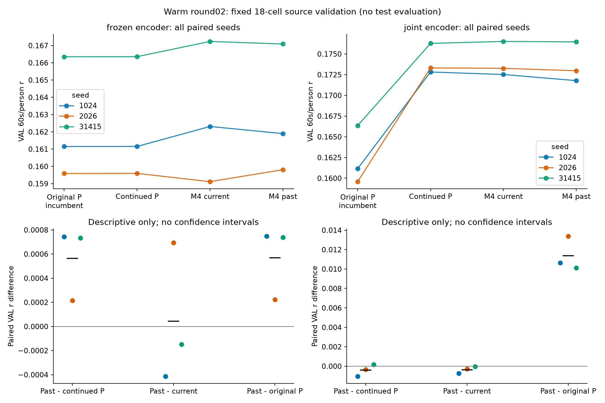
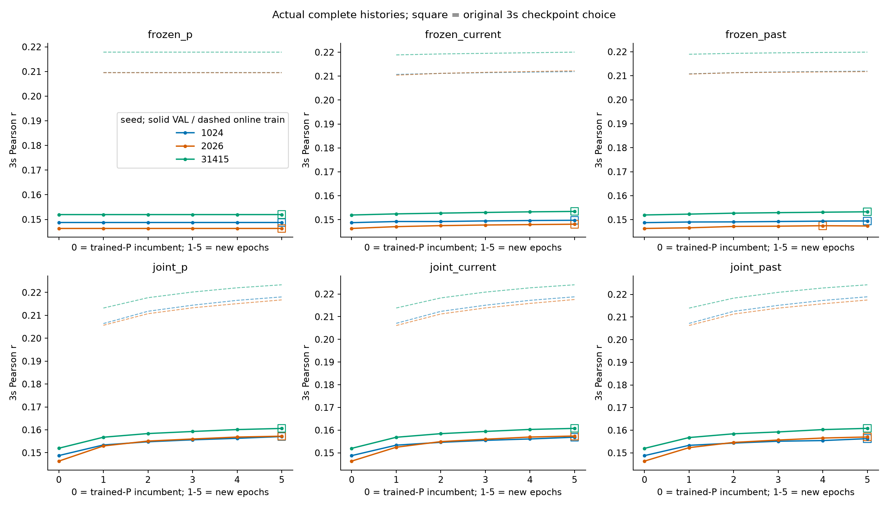
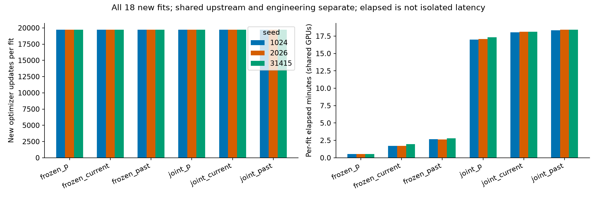

# SS07 warm round02：已训练P起点的完整对照结果

**未建立稳定的额外历史收益。** 从训练完成P出发，冻结encoder的past相对继续训练P三个seed均提高，但相对同容量current有两个seed降低；联合训练时past对current三个seed均降低、对继续P两个seed降低。joint继续P本身取得主要源VAL提升，不能把相对未继续P的提升归因于历史。18fit、完整结果、三图及恢复真实执行路径后的wholeVAL复核均已完成；整体科学goal仍未达到。

这是原TRAIN/VAL开发，不是新测试或独立泛化证据。固定三seed1024/2026/31415，没有新架构、宽度、LR、数据、test或DTU推理，也没有因途中分数改设计。

## 实际执行与比较对象

从同seed原完整预训练encoder及训练完成head起步，六格为encoder frozen/joint × P继续/current-M4/past-M4。M4-H16/core/tau30/4、8、16 latent shift及.1残差系数不变；新增末投影零初始化，初始函数为训练完成P。此处与round01“同随机head联合训练”的问题不同，但上游训练/预算也不同，不能把跨轮差别当初始化因果效应。

所有格固定5epoch、每fit19725更新/1262270监督窗，原426 TRAIN与49 VAL，不shuffle，global64先做完整joint encoder，再按record处理历史、拼回global64 head。past仅i−2/i−4等非重叠parity历史，record/phase/epoch reset、更新后detach。frozen保持encoder eval；joint同时改变参数更新与train/eval随机行为，行间差异不是纯encoder梯度效应。当前3s offline权限保留，不能称逐sample因果。

epoch−1原P是合法checkpoint候选，原全30500窗3s负Pearson严格最早改善选点；60s/person只报告，不重选。全18实际均选训练后checkpoint：frozen_past/2026选0-based3，其余选4；全部仍跑满5epoch。额外M4构造隔离CPU/CUDA RNG。旧FT历史随机路径未获直接snapshot证明，故在新fit前已固定18格共同实现，未按成绩补跑或声称旧FT函数不匹配。

## 图1：绝对源VAL与配对差

上排左/右分别为frozen/joint encoder，每条彩线连接同一seed的原P incumbent、继续P、current、past；纵轴均为原Hann融合→有效60s块→person均值。全部49人/752块，三个seed算术均值如下：

| 条件 | 原3s VAL r | VAL60s/person r |
|---|---:|---:|
| 原P incumbent（frozen计算路径） | .149022289 | .162362485 |
| frozen P继续 | .149025882 | .162368388 |
| frozen current | .150440753 | .162888084 |
| frozen past | .150069523 | .162932558 |
| joint P继续 | .158303125 | .174139935 |
| joint current | .158349158 | .174100032 |
| joint past | .158025362 | .173740247 |

joint原P incumbent为3s .149022293、60s .162362486；与frozen路径的约1e−9差属于实现数值边界，不能算科学增益。冻结P再训5轮的连续分数变化也很小；这不证明已全局收敛。joint三格均明显高于原未继续P，但继续P控制同样提高，因此单看past−原P会误归因。

下排显示预定past−比较器的三个配对seed和黑色均值横线，没有置信区间、显著性或泛化保证。全seed数值如下：

| 行 / past减比较器 | 1024 | 2026 | 31415 | 三seed均值 | 正方向seed |
|---|---:|---:|---:|---:|---:|
| frozen / 继续P | +.000744 | +.000215 | +.000734 | +.000564 | 3/3 |
| frozen / current | −.000413 | +.000695 | −.000148 | +.000044 | 1/3 |
| frozen / 原P | +.000749 | +.000222 | +.000739 | +.000570 | 3/3 |
| joint / 继续P | −.001042 | −.000342 | +.000185 | −.000400 | 1/3 |
| joint / current | −.000737 | −.000291 | −.000052 | −.000360 | 0/3 |
| joint / 原P | +.010633 | +.013390 | +.010111 | +.011378 | 3/3 |

frozen past均值略高于current是一个正seed抵消两个负seed，不能记为稳定历史优势；joint past的current比较三个方向均负。两个encoder模式均未满足既定“past在全部三seed超同模式current与继续P”的开发推进条件，也不是等价/非劣或历史信息普遍无用证明。

## 图2：完整实际训练轨迹与3s选点

每列P/current/past、上排frozen下排joint；颜色为seed，实线固定3s VAL、虚线在线train，空方框为原准则选中的checkpoint。横轴0是训练完成P、1–5为新增轮次。frozen P变化极小，两个frozen增量的3s VAL缓慢上升；joint各格在固定5轮内的train/VAL均上升。17格选第5轮，frozen_past/2026选第4轮，未因末端更好而追加预算。

原3s排序与60s排序仍不相同：frozen past三个seed的3s均低于current，但60s有一个seed转为更高；joint/31415的past 3s高于current约.000046，60s却低约.000052。不能从单条3s轨迹或最后轮改善断定连续评分最好、训练已收敛或历史信息缺乏。在线train在轮内权重变化、样本池不同，不是同checkpoint泛化差；本图不单独证明过拟合/欠训练。

## 图3：固定更新预算与实际成本

左图每个fit均19725更新，三色为seed；右图是各fit elapsed分钟。frozen使用既有latent缓存，joint重新编码raw derivative并更新encoder，因此相同窗口/更新数不代表相同FLOPs或耗时。current与past容量相同：frozen均5161可训练参数，joint均3377521；P分别257和3372617。

| 条件 | 新fit数 | 总更新 | 逐fit elapsed秒之和 |
|---|---:|---:|---:|
| frozen P | 3 | 59175 | 97.11 |
| frozen current | 3 | 59175 | 322.80 |
| frozen past | 3 | 59175 | 485.59 |
| joint P | 3 | 59175 | 3084.31 |
| joint current | 3 | 59175 | 3260.54 |
| joint past | 3 | 59175 | 3311.22 |

总90epoch、355050更新、22720860监督窗口重复呈现、4362405120目标time-sample重复；原共享预训练/head成本不重计为新增，完整先前搜索成本仍在round01账本。126次完整VAL遍历另计；工程探针、失败定位、wholeVAL重放与本轮TRAIN诊断也单列于各记录，不是训练更新。逐fit elapsed合计10561.58秒（约2.93小时）排除模型/数据构造；队列wall5880.16秒（约1.63小时）包含并行和调度。共享GPU/缓存影响计时，不称隔离推理延迟、效率优势或FLOPs。

## 真实wholeVAL复核：保留v1失败，恢复实际执行路径后原门通过

初始独立v1在首格失败，原source/日志/失败与三个有界定位probe均保留。其global64重编码未复现frozen缓存的逐record256路径，且np.asarray(list)改变原stack/astype张量布局，selected frozen wrapper的参数grad标志也不同；输入数值相同不代表实际GPU kernel路径相同。原重放wave差.005340576，修batch后仍6.103516e−5，均未通过原绝对1e−6门，没有用小指标差掩盖失败。

独立v2恢复原np.stack/astype布局；frozen使用原fullnative encoder、原参数grad状态但eval/no_grad，先逐tensor验证其与选中encoder相等，再逐record256含tail编码、global64 head/state解码；joint保持原global64路径。独立分支自建loader/readout/float64算术，参考分支显式采用未改的primary Data.batch；复用冻结neural模块，不是独立神经数学或原BDF/音频预处理重建。

实际全18格/549000窗/13536块完成。**wave最大绝对差0，原绝对1e−6主门全部通过**；归一化误差也为0，仅附记，未替代原门。3s均值最大差9.35e−10、60s均值5.55e−17、block4.44e−16、person2.22e−16，原各门保持。冻结encoder权重逐tensor不变、选中checkpoint角色/hash及完整最早选点/预算均核验；逐组实际参数变化在[final_review02](final_review02/COMPLETED.json)的同目录文件中保留。

协调端独立核查31项训练/proof、90项报表输入、18checkpoint、完整epoch/预算/选点，实际查看三图，并核验v2的12项来源及全部逐格证据。[COORDINATOR_RESULT_REVIEW](COORDINATOR_RESULT_REVIEW.json)为其直接在2203写入、原样回传，未重写归因。它仍将旧v1失败作为历史失败保留；路径修复没有重训、更改checkpoint、分数或选择。

## 综合判断、限制与下一工作

本轮从训练完成P起点检验了原轮缺失的问题，仍未建立超同容量current及等更新继续P的稳定历史优势。joint源VAL改善主要可由继续训练P实现；三seed、固定5轮和重复使用VAL不足以证明独立泛化、收敛或投稿充分性。没有新的测试、DTU推断或目标域拟合，不能把旧暴露数据重新叫作新确认集。

追加[SOURCE-TRAIN诊断](../train_diagnostics/run01/REPORT.md)显示六bin均值仅保留约13%的窗内centered latent能量，但不测有用预测信息；双向半窗正仿射误差比均>1，未支持该修正；3/6/12s低无条件目标自相关不排除条件历史贡献。三个问题不能互相代替或自动解释本轮阴性。

本轮技术复核通过并保留上述限制，有限制阴性实验交付有效；独立科学决定为**NO_STABLE_INCREMENTAL_HISTORY_BENEFIT_ESTABLISHED**。Parent consistency PASS，SS07/goal ACTIVE，PR#6仍Draft不合并。所有数据、权重、cache与科学计算继续仅在2203，本地只有代码、轻量统计、静态图和报告。

后续先交最小D4可审方案：在控制当前EEG及原P后，比较真实非重叠dense历史、六bin摘要与同容量当前/更早历史控制的条件预测贡献；当前尚未执行D4拟合，不根据本轮负向增加epoch/架构或开放新数据/test。

证据入口：[原始全格表](results01/FIT_RESULTS.csv)、[配对表](results01/VAL_COMPARISONS.csv)、[逐person](results01/VAL_PER_PERSON.csv)、[90epoch日志](results01/EPOCH_HISTORY.csv)、[完整汇总](results01/SUMMARY.json)、[轻量读数](REPORT_NUMERICS.json)、[v2固定协议](FINAL_REVIEW_V2_PROTOCOL.json)、[v2完成](final_review02/COMPLETED.json)、[旧v1失败](FINAL_REVIEW_FAILURE.json)。
