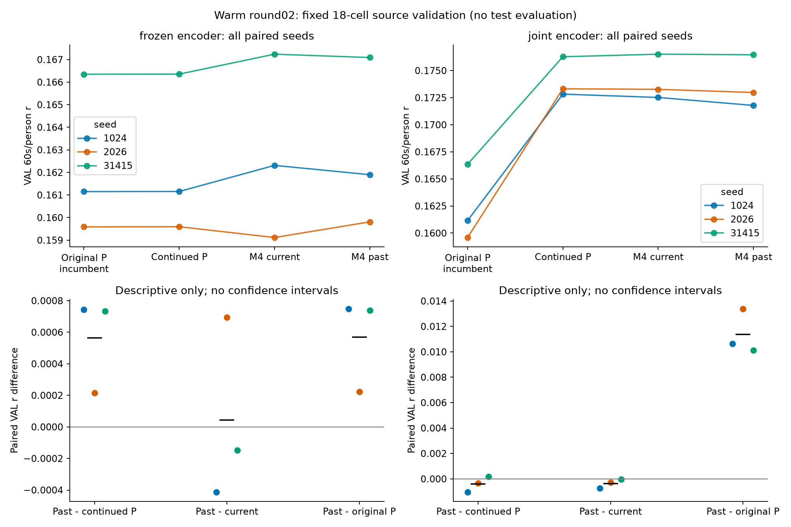
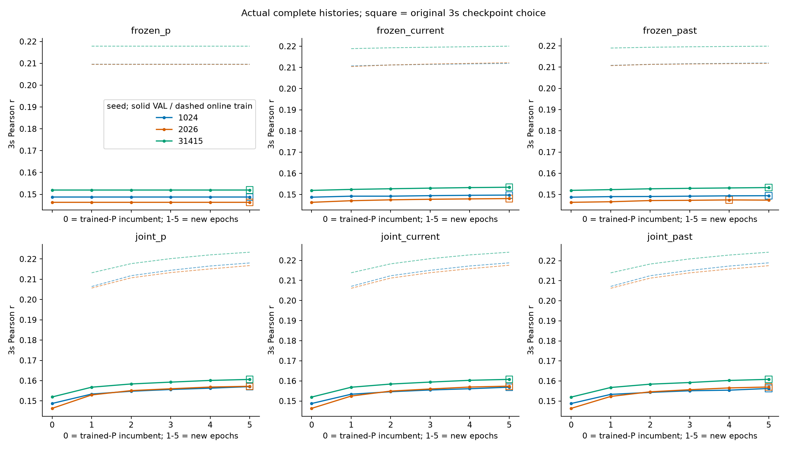
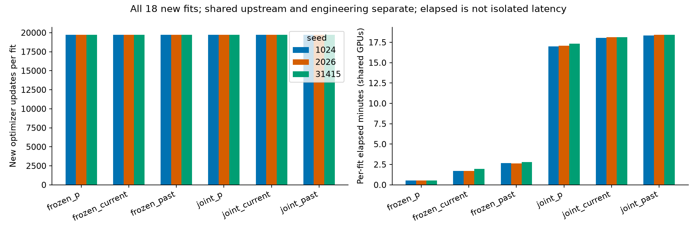

# Warm round02全格源验证数值（非测试）

全部18fit、90epoch、355050更新；以下均为train/val开发，不能作确认性结果。

| condition | 三seed VAL3s均值 | VAL60s/person均值 | selected 0-based epoch（−1为原P） |
|---|---:|---:|---|
| frozen_p | 0.149025882 | 0.162368388 | [4, 4, 4] |
| frozen_current | 0.150440753 | 0.162888084 | [4, 4, 4] |
| frozen_past | 0.150069523 | 0.162932558 | [4, 3, 4] |
| joint_p | 0.158303125 | 0.174139935 | [4, 4, 4] |
| joint_current | 0.158349158 | 0.174100032 | [4, 4, 4] |
| joint_past | 0.158025362 | 0.173740247 | [4, 4, 4] |

所有seed与配对差见CSV；不按单seed或途中分数重选，不计算新测试或显著性。原/新P约1e−8差属于实现数值边界。

frozen/joint同时改变train/eval随机行为，不是纯encoder梯度效应；warm与旧随机起点预算/上游不同，不是初始化因果消融。

