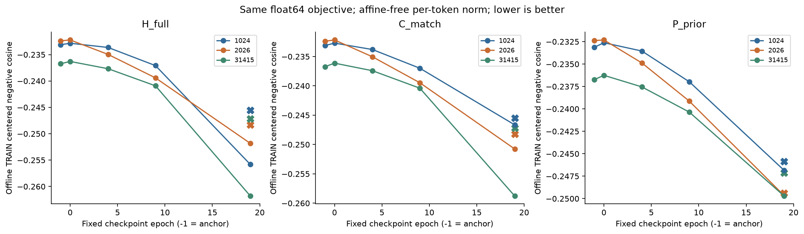
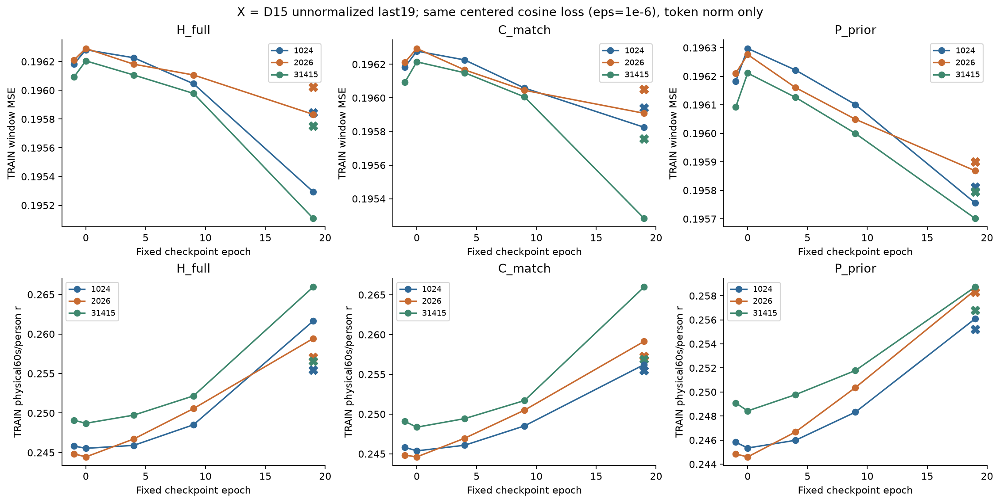
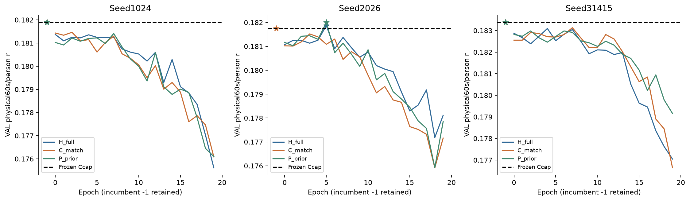
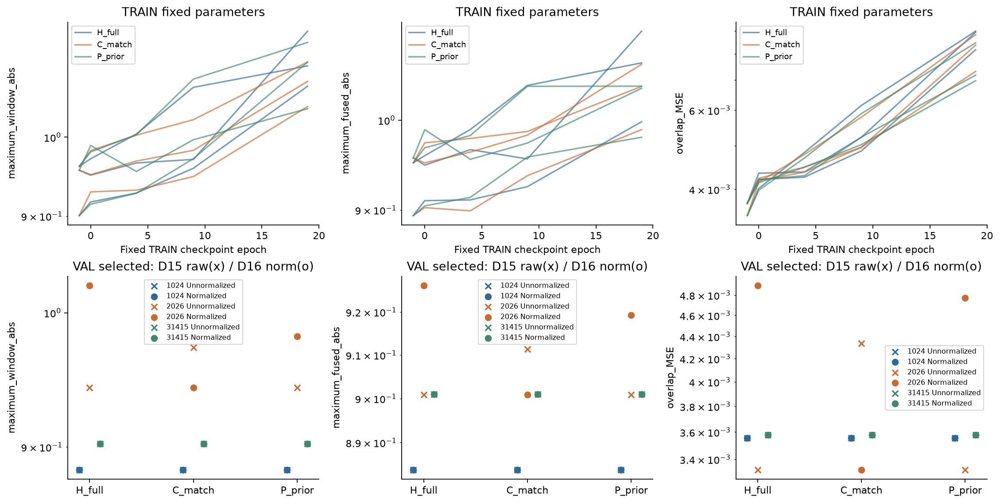
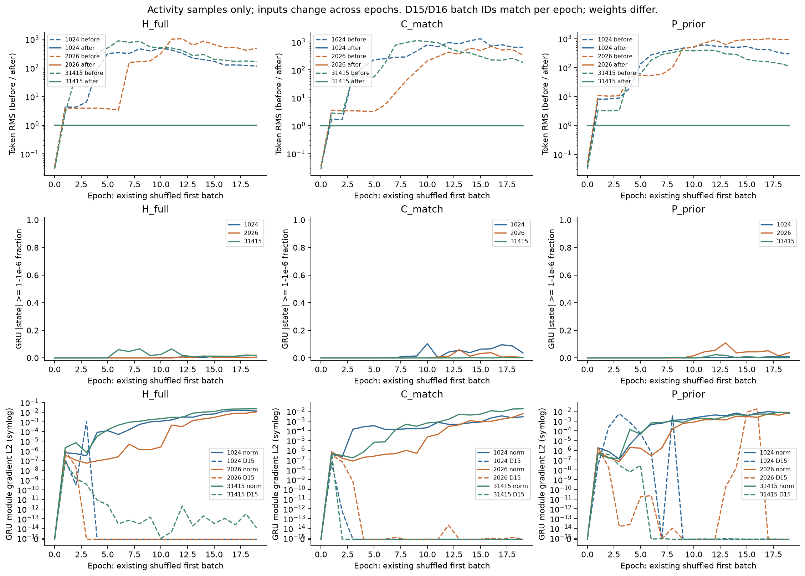

# D16：逐token归一化改善抽样通路活动，但未建立稳定历史收益

2026-11-02；PUB-01-S03_SS07。**在末端token GELU之后、两步GRU之前加入单一无仿射归一化，九组均完成20轮。与D15相比，抽查首批的历史支路梯度不再出现后期精确零/极小值，固定TRAIN目标和物理相关改善；但H只有seed2026略超强FT+Ccap，且低于同seed的P_prior。另两个H仍选回锚点，历史收益门FALSE，整体科研goal未达到。**通路活动、训练集学习、历史贡献及独立泛化分别判断。

## 实际对象、唯一改变与冻结规则

锚点是已完整监督微调的encoder及冻结Ccap当前读出，区别于原native head。沿D15的完整1536维历史条件器H_full、同容量当前条件C_match、预测包络历史对照P_prior，seed1024/2026/31415，共九fit；P_prior输入是过去Ccap预测包络经原TRAIN统计标准化后的两窗口，不是真实声音包络。原encoder/head/Ccap不更新。唯一网络改变：

```python
tokens = F.layer_norm(tokens, (32,), weight=None, bias=None, eps=1e-5)
```

每个B×2×32 token只在最后32维使用population correction0均值/方差和sqrt(var+eps)，不跨batch、两个时刻、record或split估计统计，没有running统计和可学习仿射参数。H/C/P均加入，参数仍165792/165792/164784；所有九初始化state_dict与D15精确相同。算子定义核对[PyTorch2.11文档](https://docs.pytorch.org/docs/2.11/generated/torch.nn.LayerNorm.html)。它改变输入表示的平移/尺度信息及可表示函数，并非纯优化器干预；零新增参数不等于零新增算术或相同FLOPs。[Layer Normalization](https://arxiv.org/abs/1607.06450)是已有方法，本轮输入token无仿射适配不等于原论文完整归一化RNN，也不构成新框架创新。

float64 centered negative cosine eps1e−6、Adam .001/wd0、20epoch、global64/尾38、60个冻结全窗口排列、干净component RNG、252454 TRAIN窗/3834 fallback/248620有效窗全部保持。TRAIN426记录/70人，VAL49记录/49人；完整60s主评分仍为固定FP64 Hann192/hop96、块→人→phase宏平均，TRAIN6104块/70人、VAL752块/49人。H按record-local i−5/i−3，older i−9/i−7，i<9严格返回Ccap；batch邻接不作历史。

训练目标仍先逐窗中心化再分别以max(norm,eps)计算cosine；12个TRAIN低范数目标窗全部保留，VAL无此窗，未按成绩筛选。它不是每窗都严格等于Pearson。latent/residual为float32，p=a_float64+0.1*res.double，TRAIN物理目标继承float32 cache→float64，VAL原连续目标float64。原VAL0…19与incumbent−1按strict >及最早tie选点，不以诊断选模型。每轮已有首shuffle batch只增加detached标量，不增加forward/update或保留图。正式源commit `fd8c3af3fe17655b8c4d25f8c48927871c172a5a`，v2 [PROTOCOL](PROTOCOL.json) SHA `56f4be8214ec7b5402b1c6ea3e4ff2154f082150b95c30538743bd1fa170b3a2`；[协调执行审阅](COORDINATOR_EXECUTION_REVIEW.json)核实际六源/221 pins/62输入和工程桥后启动。

## 固定TRAIN结果

−1/0/4/9/19各固定参数一次预测，同时记录目标、窗口MSE、物理r/MSE、幅度与overlap；−1直接锚点0NN。在线每batch参数轨迹另存，不替代离线量。旧D15对应last和selected统计直接复用，无旧模型新推理。

| 三seed均值 | H_full | C_match | P_prior |
|---|---:|---:|---:|
| anchor TRAIN negative cosine | −.234079 | −.234079 | −.234079 |
| D15 last negative cosine | −.247010 | −.246966 | −.247457 |
| D16 last negative cosine | −.256477 | −.252057 | −.248736 |
| anchor TRAIN window MSE | .196161 | .196161 | .196161 |
| D15 last window MSE | .195873 | .195916 | .195836 |
| D16 last window MSE | .195412 | .195672 | .195775 |
| anchor TRAIN物理r | .246590 | .246590 | .246590 |
| D15 last TRAIN物理r | .256368 | .256566 | .256774 |
| D16 last TRAIN物理r | .262342 | .260453 | .257760 |
| D15 last TRAIN物理MSE | .204164 | .204169 | .204130 |
| D16 last TRAIN物理MSE | .203679 | .203833 | .204061 |



**图1。** 三面板为H/C/P，横轴固定检查点−1/0/4/9/19，纵轴centered negative cosine，越低越好；颜色为三个seed，X为同seed D15未归一化last19。D16曲线在起始轻微波动后下降，H/C的last收益尤其明显，多数低于对应X；H均值−.256477、C−.252057、P−.248736。说明新网络在同目标和更新预算下更充分降低TRAIN损失，尚不证明达到最优或历史信息独有作用。图中X只表示旧last、不是旧完整曲线或最佳epoch；各面板范围不同，不按视觉坡度比较收益大小。eps低范数语义保持，不能把该目标直接写成完整60s/person相关。



**图2。** 上排TRAIN window MSE，下排固定6104块/70人物理r，三列H/C/P，颜色为seed，X同样是D15 last19。D16后期窗口MSE降低、物理r提高；H均值MSE .195412、物理r .262342，均优于D15 .195873/.256368，C也有明显改善，P改变较小。H31415的窗口MSE约.195109、r约.265950，但C31415也达到约.265984，不能把H的单次训练表现描述成普遍历史特异优势。三臂在TRAIN上的共同收益与VAL阴性可同时成立；没有新显著性检验、收敛证明或独立测试。

## 完整VAL、选点与历史替换

| Seed | 强FT+Ccap r | H selected epoch / r | C selected epoch / r | P selected epoch / r |
|---|---:|---:|---:|---:|
| 1024 | .181888794 | −1 / .181888794 | −1 / .181888794 | −1 / .181888794 |
| 2026 | .181756120 | 5 / .181872521 | −1 / .181756120 | 5 / .182002553 |
| 31415 | .183374905 | −1 / .183374905 | −1 / .183374905 | −1 / .183374905 |
| 三seed均值 | .182339940 | .182378740 | .182339940 | .182422084 |



**图3。** 三面板为三个seed，三色为H/C/P，黑虚线为强锚点，星号为包含−1的真实选点。1024和31415全部回退锚点；2026的H/P同在epoch5略超过锚点，增量分别+.000116401和+.000246434，C没有超过。后期三臂普遍下降，last均值H/C/P=.176925/.176631/.177704，不能用早期轻微开发增益声称训练后持续改善。P2026高于H2026，H没有在三个seed稳定超过锚点和匹配对照。三面板尺度不同，小差异未检验显著性；VAL已反复开发，不是独立确认。

H−C selected为0/+.000116401/0，H−P为0/−.000130032/0。相对D15，H selected均值提高.000038800，P提高.000082145，C降低.000004124；改进集中于一个seed且P更大，历史收益门不满足。D16 last VAL三臂均值均低于D15对应.178116/.177612/.177869，训练集拟合改善没有换来末轮VAL改善。只在已训练0…19描述的best-trained均值H/C/P=.182112/.182038/.182131，不替换正式含锚点选点规则。完整逐seed见 [MATCHED_SUMMARY](report01/MATCHED_SUMMARY.csv)。

H near−older为0/−1.4275×10⁻¹⁰/0：1024/31415所选−1是零输出头的结构相等；2026所选epoch5虽非零模型，差异也远低于独立实现约10⁻⁷级r误差尺度，只能记录数值近似一致，不能称近历史优于旧历史或将微小负号解读为损害。不能把这个结果推广成所有历史内容都无用；当前只说明本候选没有建立稳定额外历史贡献。

## 幅度、overlap与抽样通路活动



**图4。** 上排三个log纵轴分别为TRAIN最大单窗绝对输出、最大融合绝对输出和未加权overlap MSE；三色为臂，每色三条seed线。幅度与overlap随训练总体增大，last最大单窗均值H/C/P约1.107/1.075/1.093，最大融合1.059/1.032/1.020，未出现D9式巨大输出相消；overlap均值.008709/.008176/.007545，较起点增大，也高于D15对应均值，说明窗口一致性没有随TRAIN相关同步改善。下排是VAL selected的D15 X与D16圆点，颜色改为seed；2026的H/P圆点偏离锚点，C的旧X是D15所选非零epoch2。其他点重合主要源于选择锚点。下排不是last模型，不能用所选锚点稳定掩盖上排训练后变化。坐标为log且范围较窄，数值差异按表读取；没有裁剪、幅值校准或新正则。

TRAIN last prediction mean H/C/P≈.55894/.55874/.55896，RMS≈.57216/.57155/.57129，都是全部窗口/点等权摘要，与person宏r权重不同。完整45份离线文件和VAL逐record/tail指标保留。归一化约束输入token，不直接约束最终输出的DC/幅度或重叠一致性。



**图5。** 三列H/C/P；上排为既定首批token归一化前虚线/后实线RMS（log），中排为GRU两步状态|h|≥1−10⁻⁶的比例，下排为同一epoch/batch身份的D16实线与D15虚线GRU模块梯度L2（symlog，保留精确零）。归一化前RMS仍可达到数百至约千，后RMS约1，说明约束作用发生在算子输出，不能说上游token本身不再增长。GRU仍有少数近饱和状态，H抽样最大比例约1.13%/1.44%/6.63%，不能称完全消除饱和。D16的H三seed在epoch1…19的19次首批中，token/GRU均无精确零；last GRU L2≈.01323/.01087/.02238，而D15对应为0/0/1.10×10⁻¹⁴。通路活动退化在这些样本中明显缓解，但不等于全TRAIN每批都有效、因果贡献成立或VAL收益。epoch0上游0仍是fresh零输出头的预期。首批输入随epoch shuffle变化，D15/D16仅同epoch batch IDs相同，训练权重已不同；不能作为固定输入纵向响应或纯同权干预。曲线未参与选点。

全部180首批日志的post RMS均值约.9996–.9998（初始eps影响也在内），每token均值/方差边界、最大绝对值与模块梯度由独立程序核验。H三个last token梯度L2约.02448/.00828/.04340，与旧0/0/1.33×10⁻¹⁵不同。见 [TOKEN_STATE_SAMPLE_SUMMARY](report01/TOKEN_STATE_SAMPLE_SUMMARY.csv)、[GRADIENT_ACTIVITY](report01/GRADIENT_ACTIVITY.csv)。这支持“抽样活动改善”的有限结论；是否有效编码了特定历史，仍须任务与替换证据，当前门未满足。

## 独立复核、工程与成本

原528窗工程验证CPU/GPU公式、轴独立、常量有限梯度、九初始化精确一致、RNG不变和日志开关等价；fresh零头/固定非零output/旧D15 late小批均为预先批准probe，0fit/optimizer，未进入正式初始化。原Tensor未留存，后到独立参考请求只补GPU144+manual CPU144逐点桥，共288窗，误差最大1.066×10⁻⁶≤2×10⁻⁶；累计工程816，而非重复整套。v1 source/PLAN/protocol/工程原文保留，v2只是绑定桥及证据，生产四源未改。详见 [ENGINEERING_CHECK](ENGINEERING_CHECK.json)、[REFERENCE_BRIDGE](REFERENCE_BRIDGE.json)、[REFREEZE_RECORD](REFREEZE_RECORD.json)。

协调自有依赖runner在九组成功后仅运行一次独立manual normalization/GRU及Hann复算，未调用生产归一化forward。[REVIEW.json](coordinator_review/REVIEW.json) SHA `c6696649ecec5d0090b042b1ce51423a6f3bdc0783367e257fef73a4a8dcc77d`：48,624比较无失败，最大r差2.3282×10⁻⁷，其他量最大差4.3531×10⁻⁶，均在预定容差内。九selected+九last19+三H selected older无同状态复用，共631239残差窗；全180实际排列、180已有反传/新归一化诊断日志和45离线TRAIN聚合通过。未第二次完整TRAIN NN重算目标/MSE/幅度，未回放未保留的中间epoch；聚合通过不能消除这两个限制。

| 实测阶段 | 残差NN窗 | CPU秒 | wall秒 |
|---|---:|---:|---:|
| 正式九fit及预设评估 | 59,473,248 | 8852.713 | 1015.811（queue） |
| 原v1工程 | 528 | 42.855 | 16.422 |
| 独立逐点桥 | 288 | 47.648 | 14.922 |
| 证据refreeze | 0 | .168 | .176 |
| 协调独立复算 | 631,239 | 75.525 | 24.751 |
| 只读JSON/五图 | 0 | 7.100 | 5.334 |
| 只读成本账本 | 0 | .004 | .004 |

总已知残差NN **60,105,303**，正式9fit/710100 optimizer更新，新encoder/head0。正式分解：TRAIN更新44751600、每轮VAL5410620、四非零离线TRAIN8950320、selected VAL270531、H older90177。工程GPU672/manualCPU144。ENGINEERING_CHECK v2顶层计时只描述原528，不是累计816；桥与refreeze分列，继承D15存储估计未作为本轮新计算。上述已测CPU和9026.013s；另依赖runner自身CPU .021s、等待加子进程wall956.116s不重复当子进程计算时间。SSH/审批等待/复制/本地归档/计时前导入启动及全部行政时间未完整测量，账本最后序列化也在其计时范围外。完整证据见 [COST_LEDGER](COST_LEDGER.json)、[PRESENTATION_COST](PRESENTATION_COST.json)、[runner回执](COORDINATOR_REVIEW_RUN_COMPLETED.json)。

并发按两GPU5+4、torch2/BLAS4，逐launch核PID/UID/start_ticks/argv及余量，无陌生进程终止或MPS改变。正式worker峰RSS5124184KiB、GPU allocated37188096B，阶段峰值分别报告，不把内存峰相加。queuewall与workerCPU不同，不能把并发wall缩短称方法计算量减少，也没有宣称准确FLOPs。结束时root117469638B<160MiB，训练期间额外保留28MiB在途；home/sata余量22663213056/178649985024B均大于20GiB，18checkpoint仅留2203，无新.npy/.npz或运输tar。回传只含结构化汇总、代码和静态PNG，无信号、权重或特征数组。

Technical PASS_WITH_LIMITATIONS / 诊断Acceptance PASS_WITH_LIMITATION / Parent PASS，**历史收益门FALSE**。旧D12/D13/D14/D15/D9、test/DTU/ds004408继续冻结，不读取患者/STN，不增加数据/权重/目标/LR/位置网格，不合并PR6。已知归一化及这次开发收益不构成独立泛化或研究创新；下一具体问题由协调依据已验收证据界定。
