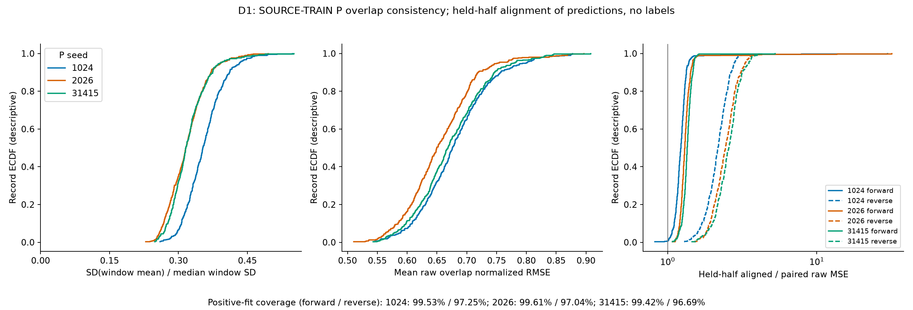
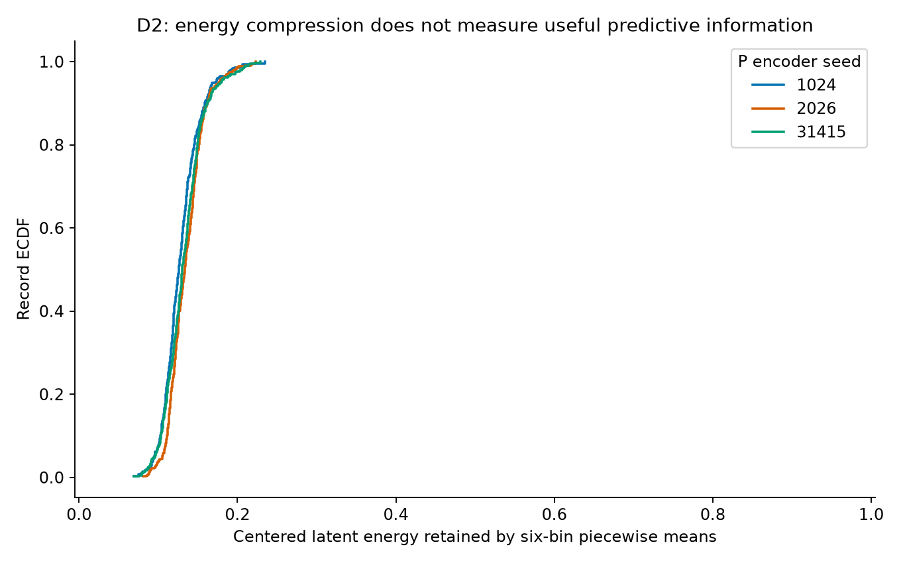
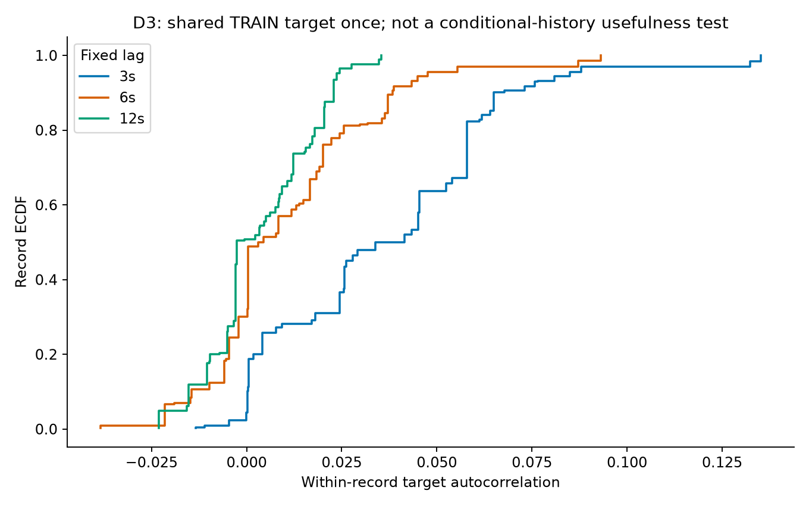

# SOURCE-TRAIN诊断：48维历史输入压缩与重叠预测一致性

**实际诊断及协调独立数据核验完成，有限制的描述性证据交付。** 三seed的六bin均值只保留约12.8%–13.5%的窗内去均值latent能量；原P在同一物理时间的两次预测存在差异，但预定跨半段正仿射对齐没有降低其误差。这两项是表示/预测结构的描述证据，尚未证明有用历史信息丢失、改动会改善解码，或解释全部实验阴性。warm 18fit设计没有改变，持续goal未完成。

## 范围与实际覆盖

定义先于分析冻结，见[DEFINITION](DEFINITION.md)与[DIAGNOSTIC_PROTOCOL](DIAGNOSTIC_PROTOCOL.json)。仅原426条TRAIN、seed1024/2026/31415；每seed252454窗、252028个record内相邻overlap对。合计1278个seed-record、757362次原P head CPU窗推理；70名参与者、41个story标识及41条目标路径。不同record/seed不等于独立声音/被试重复实验。

2203上单计算线程、CUDA不可见，nice15/idle I/O；使用既有train latent与训练完成P head，不做encoder前向、NN拟合或新选点。目标仅用于共享D3，一次读取TRAIN的既有包络。全部访问完成、零记录错误；统计阶段约28.98秒，绘图另计。没有VAL/test/DTU读取、新下载、预测/信号cache回传或患者资料。Windows仅结构化统计、静态图及报告。

## 图1：预测差异存在，跨半段仿射规则未提供稳定校正

图左横轴为record内P窗均值的标准差，除以该record窗std中位数；三色是三个seed，纵轴为record经验累积分布。对应record中位数为.3528/.3162/.3161，表明窗均值在变化，不能视为统一固定偏置。窗std变异系数的record中位数为.2267/.2304/.2426；这些变化也可能反映真实内容变化，不能直接称全部为误校准。P输出没有物理单位，原始MSE不跨seed直接比大小。

图中横轴是同一物理96点overlap两次预测的归一化RMSE，分母为两者centered population variance的均值。record中位数为.6761/.6496/.6684，显示相同时间的两次预测并不恒等。每个record的所有合法相邻对均参与raw统计，未跨记录配对。

图右横轴为held-half的aligned/raw MSE比，1为无变化；实线以overlap前48点拟合正尺度仿射、后48点评估，虚线反向。图采用symlog横轴显示长尾，未截去大误差record。比例分母使用同一有效正尺度对的raw误差；下方给出覆盖率。三个seed的pooled比值如下，均大于1：

| seed | 前→后正尺度覆盖 | 前→后held误差比 | 后→前正尺度覆盖 | 后→前held误差比 |
|---|---:|---:|---:|---:|
| 1024 | 99.53% | 1.3333 | 97.25% | 2.1739 |
| 2026 | 99.61% | 1.4314 | 97.04% | 2.4563 |
| 31415 | 99.42% | 1.3702 | 96.69% | 2.5777 |

这里拟合的是同一模型的两段预测，没有用真实包络标签；拟合常量/非正斜率等无效对被明确计数，raw统计仍保留。比例大于1说明该固定参数迁移到overlap另一半后误差反而增加。它不支持“一个局部仿射校正即可稳定解决重叠差异”，也不能由此认定校准普遍无效；局部拟合不稳定、两窗encoder上下文不同及非仿射差异仍不能分离。前/后只是离线诊断方向，不代表因果部署。

另从已存abs(meanA−meanB)的均值/方差还原E[(meanA−meanB)²]，其占pooled raw overlap MSE约37.93%/30.20%/31.72%。这说明均值项贡献了一部分差异；剩余项尚未拆为尺度与形状，不能仅据该比例断言“主要不是均值尺度”。上述也是两次预测之间的差异，不是对真实标签的解码误差或泛化检验。

原始D1图在[results01](results01/D1_OVERLAP_AFFINE.png)保留。报告图由独立presentation renderer从同一轻量CSV重绘，修复左轴缺少数字刻度并补覆盖率；没有重读信号、重拟合或更改统计。

## 图2：六bin summary压缩了大量窗内时间变化

横轴为逐record的E6/E0：每个8×192窗按channel去均值后，以六个32点均值分段常数重建；纵轴是record ECDF。三个seed的分布接近，多数record约处于.10–.18，完整范围约.069–.235。按全部窗channel能量加权的保留比例分别为**12.8445%、13.5239%、13.2520%**，未保留部分约86.5%–87.2%。

| seed | pooled E6/E0 | record比例中位数 | record 5–95%范围 | 零能量窗channel |
|---|---:|---:|---|---:|
| 1024 | .128445 | .125983 | [.095283, .171234] | 0 |
| 2026 | .135239 | .133590 | [.105613, .176573] | 0 |
| 31415 | .132520 | .130511 | [.096444, .179297] | 0 |

每seed覆盖2019632个窗channel，E0≈E6+Er的最大相对数值误差约7.2×10⁻¹⁶，符合预定1e−10门。这里扣除了每窗channel的DC均值；summary仍保留该均值，因此不能写为“只保留全部latent信息/能量的13%”。原P仍读取完整8×192，五框架历史支路的48维观察才受到这个压缩约束。

较低E6/E0说明许多窗内时间变化未进入这个summary，并不测量其与包络的条件相关性、互信息或任务价值。现有结果不能证明87%有用信息被丢失，不能保证更丰富的历史表示会提升，也不构成新方法或神经机制证据。

## 图3：3/6/12s目标自相关较低，但不是历史无用检验

横轴是在record边界内、两段分别去均值后的目标Pearson相关；纵轴是record ECDF。3s分布相对右移，6s与12s更接近0，负值保留。

| lag | record均值 | record中位数 | record 5–95%范围 | 有效记录 |
|---|---:|---:|---|---:|
| 3s | .037166 | .037669 | [.000217, .084951] | 426 |
| 6s | .011156 | .003728 | [−.021568, .047635] | 426 |
| 12s | .003671 | −.002548 | [−.015747, .023644] | 426 |

共享目标只计算一次。每个lag实际只有41个不同相关值，对应重复使用的41条目标路径；426条record ECDF不代表426个独立声音刺激，图中阶梯也反映这一重复结构，没有置信区间或显著性检验。该统计没有检验EEG条件下的额外历史贡献，也没有检查所有更短lag；低无条件自相关不能推出历史普遍无用、神经延迟不存在或硬件同步正确。

## 综合判断与验证状态

D1确认同一物理时间的P预测存在上下文相关差异，局部正仿射跨半段没有稳定降低差异；D2确认历史观察的六bin投影丢弃大量centered时间变化；D3限定这批目标在固定3/6/12s的无条件相关。这些证据分别约束预测一致性、表示压缩和目标时间结构，不能互相替代，更不能自动解释warm表现。

技术检查包括合成正仿射/负尺度与常量拒绝、分段常数/零均值高频能量例子、逐record覆盖、E0/E6/Er恒等式及轻量CSV→summary重聚合；均通过。协调端另行直接核验2203的13项source pin、各seed426条cache offset/windows/phase映射、1278个seed-record及426条D3完整覆盖，并独立重聚合CSV，结果一致。其接受的是上述受限定的真实描述证据，可用于下一步决策；不是外部实验室复现、机制或投稿充分性签署。三张实际图已查看，D1仅作呈现修复，统计原文保留。

本诊断Technical PASS / Acceptance PASS_WITH_LIMITATION / Parent consistency PASS；SS07及整体goal仍ACTIVE，warm完整结果仍优先交付。后续若需继续，应先定义并检验dense历史相对summary、在给定current信息后的条件预测贡献，再决定架构或预算；当前没有启动该检验，不凭13%能量直接扩容，也不把负D1包装为校准方法机会。本报告不声明ICML/NeurIPS新意或泛化胜出。

证据：[原统计](results01/SUMMARY.json)、[逐record D1](results01/D1_PER_RECORD.csv)、[D2](results01/D2_PER_RECORD.csv)、[D2逐channel](results01/D2_PER_CHANNEL.csv)、[D3](results01/D3_PER_RECORD.csv)、[轻量读数与重聚合](presentation02/REPORT_NUMERICS.json)、[合成检查](SYNTHETIC_CHECK.json)。全部信号与权重仍仅在2203，没有按这些诊断改变warm矩阵或新增拟合。
