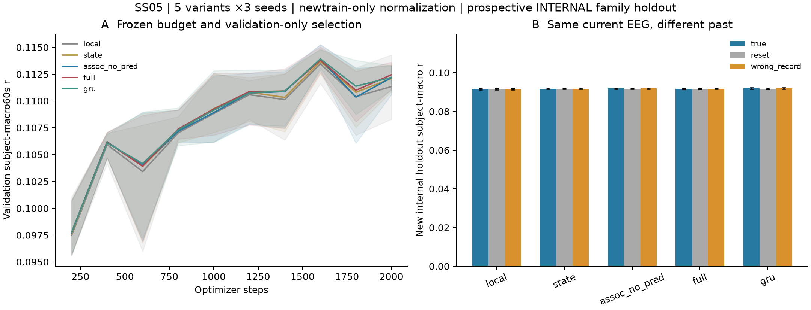
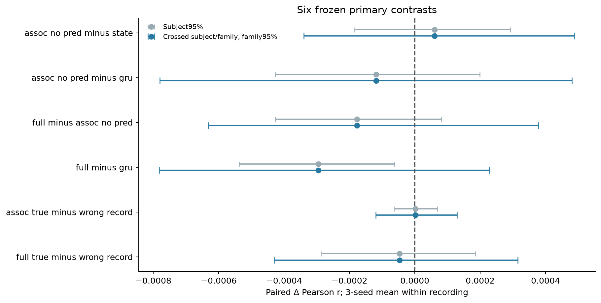
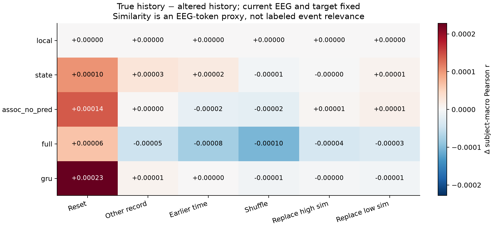

# SS05真实EEG结果：本轮未检出复杂历史记忆的稳定增益

2026-10-19，Issue#5 / PR#4，Codex实际执行。**五组×三seed、冻结的新内部holdout和7种同当前EEG历史条件均已完成。本轮未支持关联记忆优于state/GRU，也未支持full历史残差的额外必要贡献；不能把合成成功外推为EEG机制成功。** Technical PASS / Acceptance PASS_WITH_LIMITATION / Parent consistency PASS。这是有效阴性结果，不是工程失败或等价性证明。

## 数据、预算和实际结果

只从旧SS03 train的426条记录、37个真实source family内预先冻结新split：train353条/23family/70人，val26条/7family/17人，holdout47条/7family/21人。人可跨phase，故是音频family留出而非新被试。来源曾进入SS03训练，最多称prospective INTERNAL holdout，不是外部独立复现；旧SS03已打开test信号、分数与checkpoint未使用。

旧SS02归一化含新划出的val/holdout，现只在新353train重拟合并另存，旧统计不改。五组×四lag×100步train/val pilot仅用validation选lag8samples；随后在holdout信号读取前冻结2000优化步、每200步完整val、batch2、AdamW.001、clip1和seed1024/2026/31415。全部15训练完成并核查后才开放holdout；每selected checkpoint一次测试全部7条件，不根据结果改模型/预算/lag。

每query当前3s EEG固定，只看同record前20窗即60s历史；局部前端离线、跨窗因果。每60s评分段有20当前窗，record前120s统一不评分以保证错时历史支持；共517个完整holdout段，无无效/恒定段删除。指标为60s Pearson→record等权→person等权→macro，不把窗口或seed当独立人。详细坐标和限制见DATA_CONTRACT，正式冻结字节身份见FORMAL_PROTOCOL。

| 模型 | True-history r（三seed均值±seed SD） |
|---|---:|
| local（无过去输入） | 0.091448 ± 0.000381 |
| state | 0.091769 ± 0.000286 |
| assoc_no_pred | 0.091829 ± 0.000298 |
| full（历史残差分支） | 0.091652 ± 0.000274 |
| 标准GRU | 0.091947 ± 0.000349 |

五组数值接近；GRU点估计最高也不足以宣称稳健胜出。全部15run的最高validation均在1600步，仍按共同2000步预算跑满；最终仅使用validation选点。这里的r不可直接与SS02的.1593或SS03的.10663排名，split/lag/归一化/窗口/历史/聚合均不同。

## 图1：学习曲线与同当前EEG对照

**A**为三seed平均validation曲线，阴影为seed最小至最大，不是置信区间。五组随训练提高但几乎重叠，1600步附近达到当前预算中的峰值；没有显示复杂模块更快的每步学习收益。不得据此断言任意长预算下都会相同。

**B**固定当前EEG/目标，仅换过去或reset。真实历史、reset和异录音历史的bar几乎重叠；误差条只反映seed SD，不能代替person/family不确定性。local各条件完全相同，确认已修正原型暗含两past窗的问题，而不是把带历史模型误作无历史基线。

实测计算代价也不相同：full单60s目标段推理约52ms，GRU约4.09ms；优化加validation耗时full约333–393s/run，GRU约28–34s/run，local约27–36s/run（数据预加载后计时，硬件测量非普遍复杂度证明）。本实现没有获得可支持额外成本的性能证据。名义MACC虽接近，实例化/活动参数及运行差异见CODE_AUDIT，不能把消融说成全部等容量、等墙钟。

## 图2：预设配对比较与分组不确定性

每record先平均三seed，再按person汇总。灰线仅subject95% bootstrap，蓝线同时按subject/source-family交叉权重bootstrap，且对六primary contrasts作Bonferroni校正（各99.1667%区间，名义family95%）。每种10000次，7个family很少，区间仍是有限样本近似。

| 预设Δr | 均值 | 交叉分组、校正后区间 |
|---|---:|---:|
| assoc−state | +0.000060 | −0.000340 至 +0.000489 |
| assoc−GRU | −0.000118 | −0.000780 至 +0.000481 |
| full−assoc | −0.000177 | −0.000632 至 +0.000378 |
| full−GRU | −0.000295 | −0.000781 至 +0.000228 |
| assoc真实−异录音历史 | +0.000002 | −0.000120 至 +0.000129 |
| full真实−异录音历史 | −0.000047 | −0.000431 至 +0.000315 |

六项均跨0。尤其full−GRU的subject95%本来为负，但纳入family不确定性后跨0；不能只挑更窄的区间称GRU显著更好。当前没有关联矩阵相对递归/GRU的独立收益证据；full相对assoc的点估计略低，未支持保留其额外历史残差作为关键贡献。该分支还没有显式forecast监督，即便数值有增益也不能自动归因预测误差。

## 图3：历史干预没有建立内容特异收益

数值为true减干预r，整张图色阶仅约10的负4次方；颜色不是显著性。assoc/full相对reset的Δr分别+.000140/+.000065，但交叉分组95%区间分别[−.000152,+.000428]/[−.000277,+.000399]，也跨0。对同record更早历史、打乱次序，多数差值近0或略负。不能把“换错历史能影响输出”说成“真实历史有用”，更不能只凭跨录音替换的分布变化推断按内容检索。

最高/最低EEG-token相似事件替换也只带来极小、方向不一致的描述性变化；这不是有真标签的相关/无关事件。wrong_time输入较早窗口但未插时间空档，检验错时内容，不是额外60s遗忘曲线。有限60s历史、每query reset、目标低层包络、3s中心化Pearson损失（不直接校准跨窗mean/scale）都限制了本轮能识别的历史收益。因此H1未建立稳定的真实历史增益，H4的EEG内容特异机制也未确证，不等于所有长期记忆或其他任务都无用。

## 合成能力与真实EEG必须分开

原10tests与新增5tests在冻结源码上重跑通过。旧合成accuracy全部复现，A-assoc MSE未精确复现，已保留old/new值；GRU600也能学会key任务，但不是与160步公平比较。另在有真实事件标签的toy中，assoc/full对相关写入翻转敏感、对无关写入较稳定，延长16/32空白token仍100%。这些只证明该计算通路可以工作；assoc没有预测残差也成功，不能证明预测误差必要，更不能覆盖本轮EEG阴性结果。来源与机制对标见CODE_AUDIT。

## 复核、局限与停止

同一agent另作separate post-execution pass，不是第三方审查。逐段→record→person→macro、预算/lag/检查点/冻结source身份/新train统计和一次测试均核验，汇总误差0。另从原始EEG重新标准化并CPU重建15run×2record×3条件=90个60s相关，最大r差8.13e-6；不是仅复读结果表。新holdout在全部训练后才读取的时序也已核验。

除有限数据/预算/三个seed外，7个family、共享刺激、与训练人重叠、原发布方预处理历史及physical_sync UNKNOWN均保留。常数train mean的Pearson因零方差未定义，未伪填0。没有删负结果、挑seed、追加训练或换架构；也没有SOTA、原创算子、精确生理时延或患者泛化结论。

SS05 COMPLETED / PASS_WITH_LIMITATION：真实内部holdout成立且交付完整阴性证据。S03/PUB仍ACTIVE；PR#4保持Draft，不自行合并、不启动SS04/S04/父S05或artifact。PR#3按用户新授权已由协调者合并，这不改变其历史科学结果。
