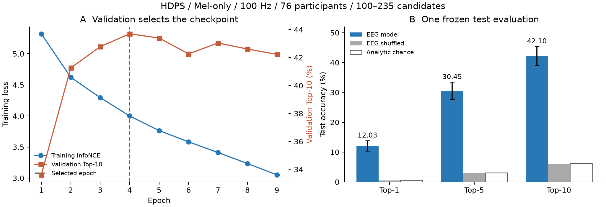
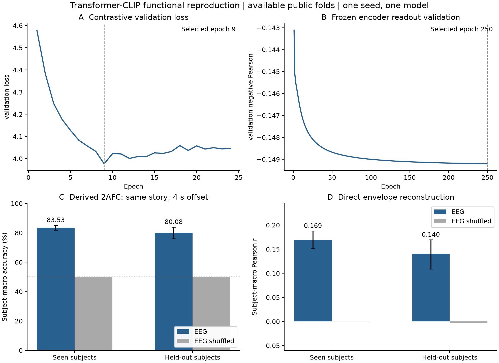

# 强基线复现执行报告（2026-10-15更新）

## 2026-10-15：真实训练与测试结果（最新）

用户明确允许缺少部分记录，撤销此前完整cohort才训练的门。**两套方法及Transformer直接包络重建均已完成实际测试与独立复核，SS02 COMPLETED / PASS_WITH_LIMITATION**。HDPS为76人100Hz/M，Transformer为70人训练、69人seen/13人heldout的可用公开fold；原完整论文条件仍未复现。下述10-13“无正式训练/整体HOLD”保留历史，不代表当前状态。

| HDPS ConvConcatNet / M only | Test subject-macro | EEG shuffle | 解析chance |
|---|---:|---:|---:|
| Top-1 | **12.03%**（subject bootstrap95% CI10.37–13.87%） | 0.53% | 0.62% |
| Top-5 | **30.45%** | 2.93% | 3.10% |
| Top-10 | **42.10%** | 6.06% | 6.20% |

76人、12776 test queries，每人100–235候选，中位175；这是候选检索，不是可听语音生成或语义还原。保留作者每名train/val/test/valid索引，原100Hz/M/seed1024，按validation macroTop10选择epoch3（0-based），共9epoch/936秒，连续5epoch无改善停止，随后一次test评分。未用test成绩筛人/调参/改候选。

图A：训练loss继续下降，validation Top10在第4轮达到峰值后不再提高，checkpoint选择发生在test之前。图B：真实EEG的Top1/5/10均高于打乱EEG和解析chance，说明当前任务中存在可检索匹配信号；误差条为被试bootstrap95%CI，不能外推为完整论文一致、语音生成或因果机制证据。

独立按逐query rank重算逐被试及macro，max误差4.77e-8；检查最佳checkpoint、phase特征ID无交集、候选身份唯一且完整、一次test及选中输入完整均通过。5个缺必要输入被试在拟合前排除（019/020/021/022/026），保留严格完整模式并新增明确授权available模式。subject-bootstrap不包含模型seed变化或共享刺激的不确定性。

候选范围溯源：完整81人固定公开索引尚未裁切时已100–235（median157）；本轮76人未裁切仍100–235（median176），按作者feature长度规则裁切后median175，范围未变。公开release与论文描述104–208存在版本/目标长度定义差异，不强行裁为208；作者论文具体mask revision与三特征共同长度仍未核实。M对应论文表格数字仍空，**不以MWG20.0%比较M**。

个体Top1 min/median/max为1.65/9.74/42.58%；76/76高于各自解析chance且高于EEG shuffle，均为描述性事实而非76次显著性检验。按固定候选数量分组：100–150候选9人Top1=14.48%；151–200候选61人=11.66%；201–235候选6人=12.20%。候选数量与Top1的描述性相关r=−0.112，候选数同时混杂被试/story/时长，不能解释为候选数量的因果效应。详见`descriptive_errors.json`、`candidate_size_summary.png`；未据此改候选或追加训练。

结果与review：`evidence/available_20261015/hdps_m/{result.json,test_per_subject.csv,history.json,review.json,candidate_trace.csv,candidate_trace.json}`。2203运行根`pub_01/s03_strong_baselines_20261015/hdps_m_available01`，weights/数组/query ranks仅服务器；配置`configs/pub_01_s03_hdps_m_available_20261015.json`。第二基线独立原fold4、70可用train subject/13heldout、XLSR19与重建±4s2AFC，非原180人/15ensemble/official hidden test；不能跨候选任务直接比百分比。SS02完成后停止，不启动SS03/S04。

## Transformer-CLIP：真实可用公开fold二选一结果

原架构功能复现（不是clean-room声明，未import作者未明确许可的模型源码），使用作者fold4，70人训练，原XLSR Dutch-large hidden_states[19]。现有合法READY发布方64Hz EEG，在train拟合全局逐通道mean/std并冻结；train/val/seen-test精确story ID无交集，heldout被试从未进入训练。426/49/69/75条train/val/seen/heldout记录，在拟合前冻结，训练后没有按test表现删人或改片段。

| Derived long-record 2AFC | 被试数 / query数 | Subject-macro accuracy（subject bootstrap95%CI） | EEG shuffle |
|---|---:|---:|---:|
| 已见被试的新故事 | 69 / 18299 | **83.53%**（81.88–85.15%） | 49.96% |
| 未见被试 | 13 / 24069 | **80.08%**（75.91–83.88%） | 49.97% |
| 2/3 seen + 1/3 heldout | 82 / 42368 | **82.38%** | 49.96% |

每query3s/192samples，匹配与负例在同一story/record，起点相隔±4s；方向及candidate顺序在拟合前seed冻结、边界不合法时使用另一个合法方向。EEG shuffle在同record循环置换latent，保留被试和故事特征而破坏局部对齐；chance=50%。这里“新故事”指作者精确story ID留出，不自动代表完整source-family/所有内容来源隔离。未见被试组不额外保证其全部故事在训练中未见，不能把它解读为同时跨被试和跨故事的严格双重泛化。

seed1024，batch128同story不同时间负例，AdamW1e-3/wd.01，StepLR10/gamma.1；原默认memory辅助权重0；验证batch固定。24轮/2065.77秒后validation CE连续15轮无改善，选择epoch8（第9轮）；未触及预先100epoch预算。完成后仅一次test；独立重算query argmax→per-subject→macro与weighted，误差0，并复核candidate身份/±4s/support/phase隔离与validation selection，**PASS_WITH_LIMITATION**。

这是single-model、可用公开cohort、原长记录生成的测试query，缺原official packet/sample ID与完整180人训练及15模型ensemble；**不把82.38%与论文87.01%相减判定复现差距**。64Hz发布方derivative、统一train-only归一化、固定3s grid、固定validation batching和XLSR末尾context边界修复等差异在冻结config/result逐项记录。声音预训练权重仅2203、Apache2模型版本`46f221381d200f7bef268309b3f02023ccf11fcc`；不是以base权重代替large19。

EEG shuffle高于/接近chance的判断仅用于当前对照，不是硬件同步证明或语义重建证明。已有物理同步`UNKNOWN`限制保留；单seed被试bootstrap不覆盖模型seed和共享刺激的全部不确定性。没有另行拟合audio-only/prior-only分类器；原相似度任务没有脱离EEG query的唯一音频排序预测器，不能把未定义的prior-only分数填0或称已通过。当前匹配EEG与同record错误EEG对照提供了可执行的局部对齐检验。

结果及review：`evidence/available_20261015/transformer/contrastive/`；2203根`pub_01/s03_strong_baselines_20261015/transformer_available01/training_seed1024_attempt04`。

## Transformer冻结编码器：直接包络重建结果

使用上述验证集选中的EEG encoder，参数冻结。原helper读出结构Conv1d(8→1,kernel32,padding same)+LeakyReLU(.01)，负Pearson损失、Adam1e-3、batch64、不shuffle、预定max250/patience10。3s窗口、50%重叠，Hann overlap-add后按60s完整段算Pearson，再segment→person→组macro；这是长记录派生评价，**不是官方30s test packet**。预测仅EEG，不输入候选声音、声音特征或音频ID；XLSR声音先验仅用于此前对比训练。网络使用完整3s上下文，是离线非因果重建，不声称实时输出。

| EEG-only direct envelope | Subject-macro Pearson r（subject bootstrap95%CI） | 错配EEG latent |
|---|---:|---:|
| Seen 69人 | **0.1688**（0.1511–0.1877） | 0.0014 |
| Heldout 13人 | **0.1403**（0.1091–0.1694） | −0.0027 |
| 2/3 seen + 1/3 heldout | **0.1593** | 0.000015 |

共250轮，validation仍缓慢改善，因此达到预定上限而非early-stop收敛，最佳epoch249（第250轮）；编码/拟合/测试共994.28秒，未据test延长预算。随后一次test，0段因无效support/常数排除；不含未满60s的尾段。独立CPU从全部test latent和读出权重重新计算预测、Hann融合及Pearson，最大r误差8.18e-6，逐人/组/weighted重算误差0；Technical PASS、Acceptance PASS_WITH_LIMITATION、Parent consistency PASS。详见`evidence/available_20261015/transformer/envelope/{result.json,review.json,test_per_segment.csv,test_per_subject.csv,excluded_segments.json,history.json}`。

当前r支持有限的低层包络重建，不代表完整音频、文本或语义恢复。不能将0.1593与原ensemble0.176或SS01的10人TRF r≈0.1819直接排名：cohort、split、目标区间、aggregation/packet和模型条件不同。当前未形成统一预算、同split的模型优劣结论。

图A：验证CE在第9轮最低，此后训练继续但没有改善验证，因此第24轮停止。图B：包络readout在250轮仍有细小改善，按预定上限停止。图C：两个泛化组的匹配识别均高于同record错配EEG的约50%。图D：包络r有限但高于错配的近0；误差条为被试bootstrap95%CI，只覆盖当前组内被试变化。

## 本节点交付与停止

`RESULTS.csv`保留10行原完整条件NOT_RUN/HOLD，并新增7行真实可用条件结果（HDPS1、Transformer2AFC三组、包络三组），不以空值覆盖真实结果，也不以partial补填official。所有信号、权重、features和逐query评分在2203；本地仅代码/config、静态图、结构化汇总。独立技术、验收和父一致性review后，当前SS02完成有限制；S03/PUB仍ACTIVE，SS03/SS04/S04仍BACKLOG，无ART-AUDREP-v1，不自动开始后续研究。

### 10-15工程失败与恢复（完整保留）

Transformer feature首次受默认CUDA13 torchaudio与torch cu128不兼容影响；复用隔离cu128 target。第二次发现尾部短clip长度不同不能stack，改为同实际长度分组，并限制每段只输出其核心8s帧，避免末尾context重复；70story完成后未重做。第一次训练在首个validation因DataParallel线程与cuDNN LSTM的InferenceMode张量冲突停止，未产生test/checkpoint选择；修复为no_grad，真实train→val→train双GPU工程smoke通过后，相同seed从头执行attempt04。所有失败源码/日志保留，未根据测试成绩选择重试。最终训练没有OOM或数值失败；这些是工程恢复，不是四组科研结果。

### 代码与环境provenance

本轮代码尚未提交；Windows main起点`ec3adefc5c7d3dd37e1b043fb1956a7dda11cda1`不代表包含新增代码。实际执行source/config在2203各运行根`input/`，训练修复版本明确为`pub_01_s03_transformer_train_v2.py`；Python为10-13隔离`env01/bin/python`，torch2.11.0+cu128、transformers5.14.1，2×L40。保留用户既有未提交修改，没有reset/切换分支/远端Git初始化。命令见COMMANDS，文件路径/字节数见SERVER_MANIFEST；不做额外hash审计。

## 2026-10-13历史执行与资源记录

**当前结论：尚无同论文条件的测试结果，不能判断一致或不一致。** SS02保持HOLD。原raw100Hz、70story Mel和论文功能模型真实输入batch256前向/反向已执行；正式训练/测试未启动。固定作者split仍缺47条必要raw，不跑76人、64Hz适配或新模型替代用户所需的论文对照。

## 追加执行与当前事实

- 2203 `pub_01/s03_strong_baselines_20261013/continuation01`：81个原raw作业均已结束，生成602条100Hz EEG工程产物，覆盖77人部分输入。与固定作者647 record-phase对精确匹配且支持M的600对就绪；剩47对=37train/5val/5test受限。另2条无作者story精确匹配的restricted BDF不计必需。没有后台训练作业。
- 公开原索引在2203安全限定为纯dict/list/int读取，70story。原raw1024Hz→0.5Hz highpass→插值→原trigger漂移处理/epochs→MWF→CAR→100Hz→40Hzlowpass，参数对应作者公开版本；没有64Hz上采样。首条64×90900 finite；刺激first trigger0秒，原48k音频906.10860秒，16k后906.108625秒，误差小于一个16k样本。首条212个有效索引均支持；不据此宣称硬件同步。
- 原Mel参数70story全部生成、finite，直接按NPZ实际fs重采样到16k，避免作者代码写错WAV采样率头；未保存错误WAV。按作者`get_feat_SparrKUL`既有规则移除超feature长度的尾索引（如audiobook7_2/7_5末项），这是原流程，不是新筛窗；初次summary把尾项误列为10个不支持的val/test对，已保留检查快照并纠正为600/47。
- 独立环境`env01`不修改原conda：numpy1.26.4/scipy1.13.1/mne1.6.1、GPL brain_pipe0.0.4、torch2.11.0+cu128、librosa0.11.0。默认torchaudio CUDA13不兼容，失败保留；cu128版本另装独立target目录，没有卸载旧环境。
- 按CC-BY4.0论文公式独立实现，已阅读作者架构，**非clean-room**，不import无LICENSE作者模型。实际100Hz/M batch16/256执行Adam前向/反向，梯度有限；256约0.35秒、两L40各约10.3GiB。重复实际窗口仅用于资源smoke，loss不是性能指标。
- 单独数值review：NumPy逐通道Pearson与Torch矩阵实现max差1.19e-7；raw两次不同BLAS线程数max差1.69e-10μV、relativeL2差3.97e-12，数值一致但非bit-exact。第一次bit-exact要求REWORK保留，不能将容差一致称为逐位一致。
- sub022初次v6因APR缺失失败；核对GPL源后证明APR只添加snr，选定grouper与EEG数值流程不消费snr，公开events也给SNR100/原路径坐标。v7显式记录容器适配，恢复公开run09；不请求APR，不改变trigger/crop算法。原失败与修复目录并存。
- 论文同一Implementation段的lr1e-3、EEGsubject_dim320、FFL80/768/64已核对；按论文优先预先固定M配置。公开code的lr5e-5、GELU、log(clamp)、StepLR、WAV头与环境差异在`configs/pub_01_s03_hdps_paper_m_20261013.json`显式记录，不test选配置。M表格数值尚未视觉核验，留空，不能拿MWG20.0%作M对照。

## 仅剩同条件资源依赖

[恢复清单](RESOURCE_RECOVERY.md)及`evidence/continuation01/restricted_raw_mapping.csv`定位必要47条raw与train/val/test，不从已有64Hz逆向恢复，也不删人重划分。正式训练入口硬拒绝inputfailures；保存未执行入口，未生成预测/checkpoint/性能。原方法固定GPT2特征属于HDPS复现范围，不再误解为一律禁止；对应权重条款仍待明确，不从关联repo Apache推定，GPT新模型/重排序仍不执行。

Transformer两个作者EEGcheckpoint入口实际失效；有界迁移查询结束，官方测试载荷/映射未齐。原XLSR Dutch声音权重按明确Apache2条款仅在2203取得，revision见恢复清单；不是EEG冻结模型。无非公开训练集请求。

三级审阅：Engineering **PASS限定**，Acceptance **HOLD**，Parent consistency **PASS**。轻量证据在`evidence/continuation01/`，全信号/权重/feature与cache留2203；不改S01/S02/SS01科学结论，不产ART-AUDREP-v1，不启SS03/S04。缺资源由协调会话集中向用户询问；执行会话不重复发过程性清单。

## 首次preflight记录（历史原文，非当前资产状态）

以下保留初次事实与判断。“未取得索引/未安装依赖/无100Hz产物”等已由追加执行更新，不再作为当前停止理由。

**本次结论为 HOLD，未完成两套强基线的性能复现。** 完成了4个官方项目的版本/协议/许可核对、2203资产盘点、首被试真实数据读取smoke、GPU运行smoke和审计工具测试。训练、作者模型smoke与性能评估均 **NOT_RUN**；`RESULTS.csv`中的指标留空，`subjects=0`表示实测评价人数。协议审查可交付，但不能据此将SS02标为COMPLETED或启动SS03。

## 实际输入与可复用范围

- Windows唯一Git工作区保持`main`，起点`ec3adefc5c7d3dd37e1b043fb1956a7dda11cda1`。原两处tracked脚本改动、旧CNN configs/报告/脚本和stash未动；没有branch切换、stash apply、删除或覆盖历史证据。新增内容只归属本SS02。
- 所有信号读取、GPU运算与测试发生在SSH别名`server2203`，Linux hostname=`nercn`，公共项目根`/home/fanyu/auditory_simulation_m6a`。未读取患者/STN路径；没有新数据集/权重下载、训练、特征提取、远端Git初始化或新任务执行。
- 既有`cleaning_index.csv`含85人666条，S02 split manifest同样含666条，其中train293/val193/test173/UNASSIGNED7。历史正式S02 cohort是83人659 READY录音；inventory含非READY项，不能混写为本轮已通过666条QC。
- 固定首被试`sub-001`的全部10条indexed记录做smoke（含历史SS01范围之外的索引记录），10/10 PASS_READABILITY。EEG实际为64×N、float64；envelope为N×1、float64；所有值有限，共同样本长度与index一致，64 Hz来源为发布方consumption contract。`physical_sync=UNKNOWN`保持原义；这些检查不证明硬件同步、全cohort准入或模型准确率。精确形状/路径见`evidence/run02/array_smoke.json`，未回传任何数组。
- HDPS固定作者split：81人647 record-phase对均存在同subject/story的64 Hz路径；此处只核对文件存在。没有官方100 Hz衍生文件/特征身份的就绪证据。`valid_seg_dict_6.pkl`公开位于作者repo，但本次未取；`feat_len_dict.pkl`和各特征需原流程产生。
- Transformer代码fold manifest包含91名train subject，现有71名，缺sub-086至105；14名test subject均存在普通长记录。没有找到官方`TEST_task1_matchmismatch`/`TEST_task2_regression`包、sample IDs和candidate映射。普通长记录不能替代官方片段。
- 搜索限定既有公共项目cache/models、`m6a_public_002/cache`及`pub_01`。已有`facebook_wav2vec2_base_main_20260813`及S02的base层缓存，未找到官方两套Dutch权重、GPT、CLIP权重或100 Hz产物；不将facebook/base layer4/8/12替换成GroNLP/base9或XLSR-large19。目录名称检索是资产盘点，**不是模型权重完整性验证**。

## 真实环境与依赖

执行Python：`/home/fanyu/.conda/envs/auditory_m6a_public_001/bin/python`。Python3.11.15、NumPy2.4.6、SciPy1.17.0、PyTorch2.11.0+cu128、transformers5.14.1、MNE1.11.0、pytest9.0.2。CUDA12.8可用，2×NVIDIA L40，各46068 MiB；GPU有限张量运算通过。最初只读盘点空闲显存各45446 MiB，smoke时GPU0约44912 MiB；这只是瞬时资源，不是训练预算承诺。公共根所在盘剩余约157 GB。

未安装torchaudio、librosa、brain_pipe、TensorFlow、braindecode、einops。原HDPS预处理依赖brain_pipe/librosa，Transformer加载器依赖braindecode/einops，challenge依赖TensorFlow等。这些属于需在专用环境完成的工程准备，**没有把可安装依赖当成永久不可复现原因**；由于许可/官方测试条件尚未通过，没有修改既有环境或安装大依赖。原论文与当前环境版本不同，未来模型执行须做API兼容smoke，不能从本次AST通过推断模型可运行。

## 失败与两次实际运行

1. 首次SSH因用户配置的62347 RemoteForward已占用失败。后续采用`-o ClearAllForwardings=yes`连接，不更改SSH/server配置。
2. `run01`尝试2203 HTTPS读取固定原代码。代理连接返回`RemoteDisconnected`；37/37源码文件失败，错误逐项保存；直接HTTPS探针10秒超时。数据与GPU检查仍完成。所有run01证据保留，没有用成功重试覆盖。
3. Windows可读取官方源码/许可网页。仅37个轻量source/text文件及固定tree metadata暂存于忽略的静态镜像，再scp到2203。没有dataset payload、测试信号、pickle、模型权重或feature tensors经过Windows。
4. `run02`从staged源码做AST/协议检查，37/37读取成功、Python源码AST均通过；未import作者模型。重新运行真实sub-001读取smoke和GPU运算。4项安全/覆盖单元测试全部通过，fixture仅用于技术测试并留在2203，未作为科研结果。

## 每套协议阻塞与继续所需条件

| 对象 | 当前决定 | 主要阻塞 | 可继续的具体条件 |
|---|---|---|---|
| HDPS作者协议 | HOLD / UNREPRODUCIBLE_AS_PUBLISHED_WITH_CURRENT_AUTHORIZED_ASSETS | 代码使用许可未明确；100 Hz pipeline、合法相同目标、有效片段和候选manifest尚未形成；publisher全文不能直接读取 | 可核验作者许可证/使用许可；获得可审读全文细节；按同一已授权数据运行作者100 Hz流程，固定完整split/有效片段/candidate identities；用原seed1024、显式ConvConcatNet、验证集选checkpoint。三特征复现还涉及GPT2语言先验，若仍禁止GPT计算只能单列非LM变体，不能冒充三特征版本 |
| Transformer完整paper训练 | HOLD / UNREPRODUCIBLE_AS_PUBLISHED | 原论文180名训练含109名非challenge数据；公开repo current split也仅91名train，当前可用71名；独立代码/权重使用条件未明确 | 作者许可与权重身份/训练manifest明确后，可在合法既有官方测试包上复算作者冻结模型；**不请求非公开194人载荷**。公开子集from-scratch只可作为单列部分复现/内部协议 |
| Transformer官方评估 | HOLD | 缺官方84人测试载荷、IDs、candidate mappings；缺Dutch XLSR19；权重链接存在但未下载/未验证许可 | 相应资源的合法可用性与本任务授权齐备；固定official sample与候选映射，分seen/heldout、单模型/ensemble，先模型smoke，再实际评估 |
| Challenge2023/2024 | 协议审查PASS_WITH_LIMITATION；实际模型测试HOLD | 2023标签脚本公开，但官方测试载荷/mapping未在既有路径找到；2024需对应20人包和目标/对齐版本；下载范围未获扩展 | 研究者另行明确准入对应challenge资源。只查看说明页，没有请求密码、尝试受限访问或发送邮件；没有新增dataset下载 |
| 两套内部共同协议 | NOT_FROZEN / NOT_RUN | A+B许可门未通过；换内部split不会解决它，也不能恢复官方原数值 | 许可可核验后，在相同合法既有cohort预先冻结split、train-only选择、候选身份、seed/预算与对照，单列INTERNAL_PROTOCOL；本轮未擅自选用旧S02 split启动训练 |

没有预测，故per-subject性能、Top1/5/10、2AFC/5AFC、Pearson/R²、跨seed置信区间、EEG-shuffle/audio-only/prior-only对照和error analysis均NOT_ESTIMABLE。此处不是阴性模型结果，也不是“达到SOTA”。作者论文数值只作来源背景，没有写入实测RESULTS。

## 复现与检查入口

- 审计代码：`scripts/pub_01_s03_strong_preflight.py`。
- 固定配置：`configs/pub_01_s03_strong_baselines_20261013.json`。
- Windows轻量源码staging入口：`scripts/pub_01_s03_stage_source.ps1`；必须用新destination，已有镜像不覆盖。
- 2203技术tests：`tests/test_pub_01_s03_strong_preflight.py`。
- 原模型入口和源码commit：[PROTOCOL_MATRIX.md](PROTOCOL_MATRIX.md)；这与本轮只做preflight的入口分开，**没有冒充已实现完整训练adapter**。
- 真实命令：[COMMANDS.md](COMMANDS.md)；服务器路径/文件用途与回传边界：[SERVER_MANIFEST.csv](SERVER_MANIFEST.csv)。

本轮只更新SS02及其唯一登记表。S03和PUB-01保持ACTIVE；SS03/SS04/S04保持BACKLOG；没有冻结decoder或产生ART-AUDREP-v1。继续需要上述实质资源/许可条件，不需要重复Windows接入备份流程。
